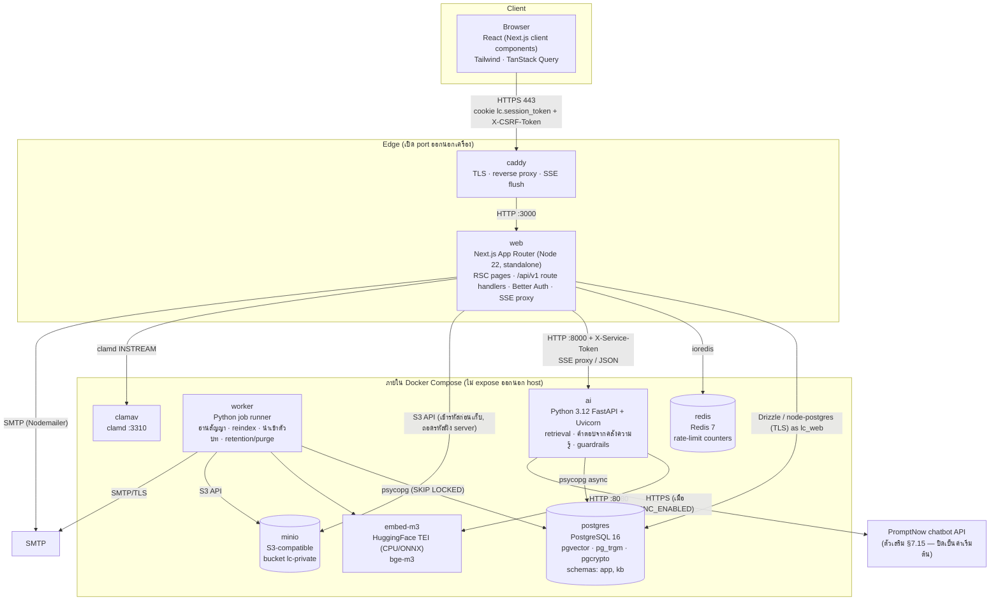
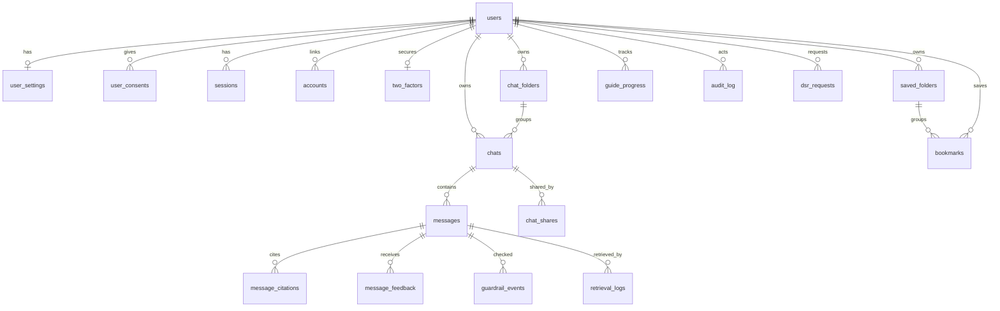
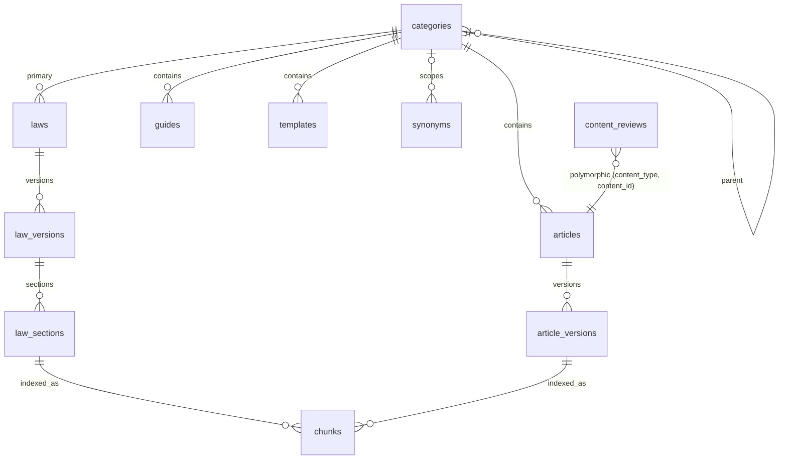

# 03 — Technical Specification (สเปกเทคนิครวมเล่ม)

| รายการ | ค่า |
|---|---|
| โปรเจกต์ | Legal Consult TH (ชื่อชั่วคราว "นิติมิตร") |
| เวอร์ชันเอกสาร | 2.18 (2026-10-01) — ตรวจเทียบเอกสารกับโค้ดทั้งฉบับและแก้ให้ตรง (สถาปัตยกรรม/deploy §1, env §1.6, retention §2.6, security §7.3, UI §5.2–5.4, dev guide §8) · 2.17 backend `pnc` ของตรวจสัญญา (§7.16) · 2.16 — ตรวจสัญญา M12 ขั้นที่ 2 (§7.16), เมนูไม่มี "คู่มือขั้นตอน", ฟีเจอร์ที่ต้องส่งอีเมลจริงแสดงเมื่อ `MAIL_LIVE`/SMTP จริง · 2.15 ปรับเอกสารให้ตรงกับระบบที่ทำงานอยู่จริง (คำตอบมาจากคลังความรู้แบบ extractive §4.13 + ตัวเสริมจากฐานความรู้บริษัท §7.15), ตัดโมดูลที่ยังไม่สร้าง · 2.14 โหมด PNC_PRIMARY §7.15 · 2.13 ฐานความรู้ของบริษัท §7.15 · 2.12 เตรียมเนื้อหา §7.14 · 2.11 ความพร้อมก่อนเปิดจริง §7.13 · 2.10 คลังความรู้ที่เหลือ §7.12 · 2.9 หลังบ้าน M10 §7.11 · 2.8 ตรวจสัญญา M12 เฟสแรก §7.10 · 2.7 แชท M2 §7.9 · 2.6 พื้นที่ทำงานองค์กร M11 §7.8 · 2.5 ระบบบัญชี M1 §7.7 · 2.3 คลังความรู้เข้า DB + คำตอบจากคลังความรู้ (§4.13) · 2.0–2.2 รวมเอกสารเทคนิคเป็นไฟล์เดียว, web tier เป็น Next.js, องค์กรก่อน + กฎหมายสัญญาก่อน (M11, M12) |
| ใช้คู่กับ | `CLAUDE.md` (กฎเหล็ก) · `01-blueprint.md` (ขอบเขต/โมดูล) · `02-srs.md` (requirement + acceptance) · `docs/prototype/index.html` (ภาพ UI) |
| ผู้อ่าน | Developer (TypeScript/Next.js, Python), DevOps, QA, AI engineer, Legal Reviewer (§6, §7) |

> **ลำดับความสำคัญเมื่อขัดกัน:** `CLAUDE.md` §2 (กฎเหล็ก) → `02-srs.md` (ระบบต้องทำอะไร) → เอกสารนี้ (สร้างอย่างไร)
> ชื่อตาราง/คอลัมน์/operationId/route/SSE field/env/class ในเอกสารนี้เป็น **contract** — เปลี่ยนได้เฉพาะใน PR ที่แก้เอกสารนี้พร้อมโค้ด
> เอกสารนี้อธิบายเฉพาะสิ่งที่ระบบทำงานอยู่จริง ณ 2026-10-01 — คำตอบแชทมาจากคลังความรู้ที่ผ่านการจัดทำ (extractive, §4.13) และตัวเสริมจากฐานความรู้ของบริษัท (§7.15)

---

## 0. วิธีใช้เอกสาร & กติกาการตั้งชื่อ

### 0.1 จะทำงานอะไร อ่านตรงไหน
| งาน | อ่าน |
|---|---|
| ตั้งเครื่อง / repo / CI | §8 → §1.5–1.6 |
| ทำหน้าเว็บ / component | §5 + `docs/prototype/index.html` + endpoint ใน §3.2 + สูตร §8.4 |
| ทำ API endpoint ใหม่ (route handler) | §3.1–3.3 → ตารางใน §2.3 → สูตร §8.4 |
| ทำแชท / streaming | §1.3–1.4, §3.4, §5.5 |
| ทำ retrieval / คำตอบจากคลังความรู้ / guardrail | §4 ทั้งหมด (+ ชุดทดสอบ §4.10) |
| ทำองค์กร / ตรวจสัญญา (M11/M12) | §2.3.10 (DDL), §3.2.13, §4.12, §7.3 (tenant isolation), §7.8, §7.10 |
| ทำ migration | §2 (+ roles §2.7) |
| เขียน/ตรวจเนื้อหา | §6 (+ §7.1 ขอบเขตวิชาชีพ) |
| เตรียม go-live | §7.6 + §9.3 |

### 0.2 Naming registry (ชื่อมาตรฐาน — ห้ามตั้งชื่อซ้ำซ้อน/ต่างจากนี้)
**โมดูล / role / หน้า**
- โมดูล: `M1` Account · `M2` Legal Chat · `M3` Library · `M5` Guides · `M6` Templates · `M10` Back-office · `M11` Organization Workspace · `M12` Contract Review
- Role ระบบ: `guest` (ไม่มีแถวใน `app.users`) < `member` < `editor` < `reviewer` < `admin` — enum `app.user_role` = `member, editor, reviewer, admin`
- Role ระดับองค์กร (Better Auth `organization` plugin): enum `app.org_role` = `org_owner, org_admin, org_member, org_counsel`; visibility `app.visibility` = `private, org`
- หน้า (Next.js App Router): `/login`, `/register`, `/forgot-password`, `/reset-password`, `/accept-invitation`, `/consent`, `/two-factor` · `/legal/[doc]` · `/print/[chatId]` · `/chat`, `/chat/[chatId]` · `/share/[token]` · `/library/**` · `/law/[code]/[section]` · `/guides/[slug]` · `/templates/[slug]` · `/saved` · `/settings` · `/admin/[section]` · `/contracts`, `/contracts/[id]` · `/org/settings|new|usage|audit|counsel` (รายการเต็ม §5.6)
- API: REST route handlers `/api/v1/...` — ทุก endpoint มี **`operationId` = ชื่อ action เดิม** (เช่น `new_chat` = `POST /api/v1/chats`); Better Auth ที่ `/api/auth/*`; SSE `POST /api/v1/chat/stream` (operationId `chat_stream`)
- หมวด 18 รหัส: `FOUND, PERSON, CONTRACT, PROPERTY, FAMILY, INHERIT, CRIMINAL, LABOR, CONSUMER, BUSINESS, TAX, ADMIN, DIGITAL, TRAFFIC, IP, DEBT, PROCEDURE, CIVREG`; หมวดย่อย `FAMILY.DIVORCE`
- Requirement prefix: `FR-AUTH, FR-CHAT, FR-AI, FR-KB, FR-GUIDE, FR-TPL, FR-ADM, FR-ORG, FR-CR` · `NFR-PERF, NFR-REL, NFR-SEC, NFR-PRIV, NFR-A11Y, NFR-I18N, NFR-USAB, NFR-OBS, NFR-MAINT, NFR-COST, NFR-LEGAL` · `BR-NNN`

**Database** (schema `app` = ข้อมูลผู้ใช้/การใช้งาน, `kb` = คลังความรู้)
- `app`: `users, sessions, accounts, verifications, two_factors` (Better Auth) `, user_settings, user_consents, chats, chat_folders, messages, message_citations, message_feedback, chat_shares, bookmarks, saved_folders, guide_progress, usage_counters, audit_log, jobs, guardrail_events, retrieval_logs, dsr_requests, system_settings, organizations, members, invitations, org_settings, contracts, contract_reviews, counsel_shares` · `org_id uuid null` บน `chats, chat_folders, bookmarks, usage_counters`
- `kb`: `categories, laws, law_versions, law_sections, articles, article_versions, guides, templates, glossary_terms, chunks, synonyms, content_reviews` (+ `eval_cases`, `review_rules` ที่ไม่ได้ใช้งาน §2.4)
- ID: `app.chats.id`, `app.organizations.id`, `app.members.id`, `app.invitations.id`, `app.contracts.id` = `uuid`; ที่เหลือ `bigint identity`
- Law code: lower snake เสมอ — P1 ใช้ `ccc` (ป.พ.พ.), `cpc` (ป.วิ.พ.), `unfair_terms_2540` (ข้อสัญญาที่ไม่เป็นธรรม) ตาม `docs/knowledge-base/`; รหัสกฎหมายอื่นกำหนดเมื่อมีการนำเข้าตัวบทจริง (ดู §6.4); ไวยากรณ์ในเนื้อหา `[[law:ccc:420]]`
- DB roles: `lc_owner` (migration เท่านั้น), `lc_web`, `lc_ai`, `lc_worker`, `lc_readonly`

**Enums หลัก** (DDL เต็มใน §2.3)
- `app.consent_purpose` = `service_terms, privacy_notice, sensitive_case_data, improve_service, marketing`
- `app.message_status` = `streaming, completed, stopped, error, blocked` · `app.explain_level` = `simple, normal, expert`
- `app.citation_kind` = `law_section, article, judgment, guide, glossary, template`
- `app.feedback_reason` = `incorrect, incomplete, hard_to_understand, off_topic, outdated, missing_citation, unsafe, other`
- `app.guardrail_stage` = `input, output, quota` · `app.guardrail_verdict` = `allowed, flagged, blocked, unavailable, quota`
- `kb.content_status` = `draft, in_review, published, archived` (ตีกลับ = review action `requested_changes` → กลับเป็น `draft`)
- `kb.content_level` = `basic, practical, advanced` (UI: พื้นฐาน / ปฏิบัติ / เชิงลึก) · `app.chats.title_source` = `auto, user`

**API / SSE** (สเปกเต็ม §3)
- Envelope `{success, data?, error?, error_code?, build}`; header `X-CSRF-Token` (double-submit กับ cookie `lc_csrf`); cookie `lc.session_token` (Better Auth `cookiePrefix: 'lc'`; เป็น `__Secure-lc.session_token` เมื่อ `APP_ENV=prod` — ทั้ง member และ guest/anonymous), `lc_csrf`, `lc_locale`, `lc_scale`
- SSE 10 events: `chat_id, status, safety_notice, chunk, citations, suggestions, guardrail, complete, title_update, error`
- `status.status` = `analyzing, retrieving, generating, verifying` (ชื่อสถานะบนหน้าจอเท่านั้น) · marker อ้างอิงในข้อความ = `[n]`
- AI service: `POST /v1/chat/stream, /v1/kb/search`, `POST /v1/documents/render` (แบบหนังสือ → DOCX/PDF), `GET /healthz, /readyz, /metrics`; headers `X-Service-Token, X-LC-User, X-Request-Id`

**Runtime**
- Compose services (production `deploy/docker-compose.yml`): `caddy, web, ai, worker, migrate` (one-shot), `embed-m3, postgres, redis, minio, clamav` + `prometheus, alertmanager` (profile `monitoring`); dev (`deploy/docker-compose.dev.yml`): `postgres, redis, ai, worker, embed-m3, minio, clamav, mailpit` (web รัน `pnpm dev`/pm2 บน host) — ไม่ได้กำหนด network แยก (ใช้ default network ของ compose; มีเพียง `caddy` ที่เปิด port ออกนอกเครื่องใน production)
- Env เพิ่ม: `CONTRACT_MAX_PAGES=50`, `CONTRACT_MAX_MB=20` · `KB_SERVE_DRAFTS` (staging เท่านั้น) · `EXTRA_TRUSTED_ORIGINS` (dev/staging เท่านั้น)
- Quota ต่อวัน: guest 10 · member 100 · staff (editor/reviewer/admin) 300 · องค์กร (ค่าเริ่มต้น pilot): 300 ข้อความ/สมาชิก/วัน, ตรวจสัญญา 50 ฉบับ/องค์กร/เดือน, ≤ 20 สมาชิก (BR-023)
- Frontend: Next.js + React + TypeScript; import alias `@/`; ที่เก็บฝั่ง browser: localStorage `lc_theme` (next-themes), `lc.guide.<slug>` (ติ๊กความก้าวหน้าของ guest), `lc.tpl.draft.<slug>` (ร่างคำตอบแบบหนังสือ); sessionStorage `lc_chat_draft`, `lc_chat_return`, `lc.tpl.ack`; cookie `lc_scale` (ขนาดตัวอักษร), `lc_locale`

---

## 1. Architecture

### 1.1 Containers



| Container | Image / Runtime | หน้าที่ | ไม่ทำ |
|---|---|---|---|
| `caddy` | `caddy:2` | TLS (staging/prod อัตโนมัติ, dev ใช้ cert ภายใน), reverse proxy → `web:3000`, `flush_interval -1` สำหรับ `/api/v1/chat/stream`, gzip/zstd (ยกเว้น `text/event-stream`), access log (JSON ทาง stdout) | logic ของแอป |
| `web` | `node:22-slim` + Next.js `output: 'standalone'` (`node server.js`) | render หน้า (Server Components, SSR ทุกหน้า — ไม่มี ISR/revalidate), auth/session (Better Auth), CSRF, RBAC, CRUD ของ `app.*` ผ่าน `/api/v1`, อ่าน `kb.*` แบบ published, i18n (next-intl), SSE proxy, rate-limit/quota, upload → ClamAV → MinIO, ส่งอีเมลธุรกรรม (verify/reset), audit log | เรียก API ภายนอกตรง (ทุก call ไปผ่าน `ai`), embedding, parsing ตัวบท, job หนัก |
| `ai` | `python:3.12-slim` + uvicorn (production `--workers 2`) | `/v1/chat/stream` (retrieval → คำตอบจากคลังความรู้แบบ extractive §4.13 + ตัวเสริมจากฐานความรู้บริษัทเมื่อเปิด), `/v1/kb/search`, `/v1/documents/render` (DOCX/PDF แบบหนังสือ), guardrails, PII masking, บันทึก `app.messages`/`app.message_citations`/`app.retrieval_logs` | จัดการ session ผู้ใช้ (เชื่อ `X-LC-User` ที่ web ส่งมาพร้อม service token) |
| `embed-m3` | `ghcr.io/huggingface/text-embeddings-inference` (CPU image บนเครื่องปัจจุบัน; GPU image เมื่อมี GPU) | dense vector 1024-d (bge-m3) (retrieval ใช้ hybrid dense + lexical รวมด้วย RRF §4.5) | — |
| `worker` | image เดียวกับ `ai` (`python -m worker`) | job queue จาก `app.jobs`: `reindex` (สร้าง chunks + embedding ใหม่), `ingest_law`, `ingest_content`, `extract_contract` (อ่านสัญญา), `review_contract` (ตรวจสัญญา §7.16), `purge_guest_data`, `purge_deleted_accounts`, `purge_deleted_orgs`, `purge_contracts`, `purge_soft_deleted`, `purge_expired_shares`, `purge_ops_tables`, `dsr_digest` — และตัวตั้งเวลา (`SCHEDULE`) ที่ใส่งานประจำเอง | รับ request จาก browser |
| `postgres` | `pgvector/pgvector:pg16` | ข้อมูลทั้งหมด (source of truth), vector index | — |
| `redis` | `redis:7-alpine` (AOF on, `maxmemory 256mb` ใน production) | ตัวนับ rate limit (rate-limiter-flexible; ถ้า Redis ล่มใช้ตัวนับในหน่วยความจำของ process แทน) — session ของ Better Auth เก็บใน Postgres อย่างเดียว | เก็บข้อมูลถาวร |
| `minio` | `bitnamilegacy/minio` (image ที่เครื่อง server ดึงได้ — production ควรเลือก image ที่ยังดูแลอยู่หรือบริการ S3 ที่จัดการให้ โดยคง bucket เป็น private) | ไฟล์สัญญาที่องค์กรอัปโหลดและไฟล์ตัวบทที่นำเข้า — bucket `lc-private` (ไม่ public); ไฟล์สัญญาเข้ารหัสระดับแอปก่อนเก็บ (§2.5) | เสิร์ฟไฟล์สาธารณะ |
| `clamav` | `clamav/clamav:stable` (clamd) | สแกนไฟล์ก่อนรับ (INSTREAM; `mem_limit` 2 GB) — ถ้า `CLAMAV_HOST` ว่าง web ข้ามการสแกน (dev เท่านั้น; ห้ามใน staging/prod) | — |
| `migrate` (production) | `pgvector/pgvector:pg16` + `deploy/migrate.sh` | รัน `db/migrations/*.sql` ที่ยังไม่รันแล้วจบ (บันทึก checksum ใน `public.schema_migrations`); `web`/`ai`/`worker` รอจน `migrate` สำเร็จ | — |
| `prometheus`, `alertmanager` (production, profile `monitoring`) | `prom/prometheus`, `prom/alertmanager` | เก็บ metrics ของ `web`/`ai` (ด้วย `METRICS_TOKEN`) และส่งแจ้งเตือนตาม `deploy/monitoring/alerts.yml` — เปิดด้วย `--profile monitoring` | — |
| `mailpit` (dev เท่านั้น) | `axllent/mailpit` | กล่องรับอีเมลทดสอบ (SMTP 51025, หน้าเว็บ 58025) | — |

---

### 1.2 Code layout (web / ai)

```
web/                                   ← Next.js (App Router) + TypeScript strict, pnpm
├── app/
│   ├── (auth)/login · register · forgot-password · reset-password · accept-invitation · consent · two-factor   ← ฟอร์ม Better Auth + ปุ่ม "ทดลองใช้โดยไม่สมัคร"
│   ├── (app)/layout.tsx               ← AppShell: sidebar · header · footer (session countdown) — layout AI-EDW
│   ├── (app)/chat/[[...chatId]]/page.tsx
│   ├── (app)/library/… law/[code]/… guides/[slug]/… templates/[slug]/… saved/… settings/… contracts/… org/…
│   ├── (app)/admin/…                  ← หลังบ้าน: review / content / laws / feedback / guardrails / users / audit / dsr / usage / announcement / orgs / system
│   ├── share/[token]/page.tsx · legal/[doc]/page.tsx · print/[chatId]/page.tsx
│   ├── api/v1/**/route.ts             ← REST route handlers (1 handler = 1 operationId, §3.2)
│   ├── api/v1/chat/stream/route.ts    ← SSE proxy → ai (§1.4)
│   ├── api/auth/[...all]/route.ts     ← Better Auth handler
│   ├── api/healthz · api/readyz · api/metrics   ← probe และ metrics (readyz/metrics ปิดจากภายนอกที่ Caddy)
│   ├── globals.css · layout.tsx · page.tsx (/ → /chat) · providers.tsx · sitemap.ts · robots.ts · manifest.ts · icon.svg · favicon.ico
├── components/
│   ├── shell/ · chat/ · kb/ · law/ · contracts/ · org/ · account/ · auth/ · share/ · admin/ · brand/   ← component เขียนเองด้วย Tailwind + token (`components/ui/` ยังว่าง — ไม่ได้ใช้ shadcn/ui)
├── lib/
│   ├── db/ (client.ts, schema.ts, generated/ ← `drizzle-kit pull` จาก DB — ห้ามแก้ด้วยมือ)
│   ├── auth.ts (Better Auth server config) · auth-client.ts · env.ts · org-access.ts (org role ของ Better Auth)
│   ├── api/ (handler.ts ← `defineOperation`, envelope.ts, origin.ts, actor.ts)
│   ├── csrf.ts · rate-limit.ts · quota.ts · ops.ts (kill switch) · sse.ts · storage.ts (MinIO) · clamav.ts · crypto.ts (AES-256-GCM) · pii.ts
│   ├── chats.ts · shares.ts · account.ts · announcement.ts · audit.ts · logger.ts (pino + redact) · metrics.ts (prom-client) · pg.ts
│   ├── org.ts (requireOrgMember — ตรวจสมาชิก/บทบาทองค์กร) · org-page.ts · contracts.ts · contract-review.ts · contract-review-shared.ts
│   ├── kb.ts · kb-library.ts · kb-categories.ts · kb-refs.ts · law-import.ts · content-edit.ts · review.ts · admin.ts · glossary-*.ts · guide-doc.ts · template-doc.ts · legal.ts
│   ├── client/ (chat-store.ts, api.ts, settings.ts, local-store.ts, …) · email/ (Nodemailer: send.ts, templates.ts, locale.ts)
├── i18n/ (config.ts, request.ts) · messages/th.json · en.json   ← next-intl
├── proxy.ts                           ← (Next.js 16 แทน middleware.ts) security headers + nonce CSP, Origin check, CSRF cookie, redirect ไป /login เมื่อไม่มี cookie session
├── next.config.ts · drizzle.config.ts · tailwind (ผ่าน globals.css @theme) · eslint config · scripts/fix-drizzle-schema.mjs
├── tests/unit/ (Vitest) · tests/*-e2e.mjs · screens.mjs · prod-rehearsal.mjs (Playwright, ถูกเรียกจาก scripts/e2e-*.sh) · tests/load/k6.js · vitest.config.mts
└── package.json · pnpm-lock.yaml · Dockerfile
```

**Request lifecycle (`/api/v1/*`):** `proxy.ts` (security headers + nonce CSP, Origin/Host check สำหรับ non-GET, ออก cookie `lc_csrf` ถ้ายังไม่มี) → route handler ที่ห่อด้วย `defineOperation({ operationId, role, csrf?, input })` → `auth.api.getSession({ headers })` (Better Auth; anonymous = guest) → ไม่มี session = `401 unauthenticated` → ตรวจ role ขั้นต่ำ (ลำดับ guest < member < editor < reviewer < admin) → rate limit รวมต่อผู้ใช้ (`RATE_API_PER_MIN`) → ตรวจ CSRF double-submit (non-GET) → zod validate → service/query (Drizzle) → `ok(data)` = `{success:true, data, build}` (error → `fail(code, message)`); rate limit/quota เฉพาะ endpoint (`chat_stream`, อัปโหลด/ตรวจสัญญา, `render_template`, ปลดล็อกลิงก์แชร์ — §3.1.4) เรียกใน handler ของ endpoint นั้น

```
ai/app/
├── main.py                     ← FastAPI app, lifespan: db pool, embed client
├── api/
│   ├── deps.py                 ← verify X-Service-Token, parse X-LC-User (user_id, role, locale)
│   ├── chat.py                 ← POST /v1/chat/stream
│   ├── kb.py                   ← POST /v1/kb/search
│   ├── documents.py            ← POST /v1/documents/render (DOCX/PDF)
│   └── health.py               ← /healthz, /readyz, /metrics
├── services/chat_stream.py     ← orchestrator ของ 1 turn: triage → retrieve → เลือกคำตอบ → (ตัวเสริมบริษัท) → บันทึก
├── answer/                     ← extractive.py (เลือก/เรียงข้อความจากคลังความรู้)
├── rag/
│   ├── retrieve.py             ← hybrid: pgvector cosine + lexical (Thai tokens + trigram) → RRF
│   ├── embed.py                ← เรียก embed-m3
│   └── tokens.py
├── guardrails/
│   ├── triage.py               ← urgent/caution categories → safety_notice, ตรวจเรื่องนอกขอบเขต
│   └── pii.py                  ← เลขบัตร ปชช. 13 หลัก (checksum), โทรศัพท์, บัญชีธนาคาร, อีเมล → placeholder
├── kb/                         ← importer, law_import/law_parse (ตัวบท PDF/TXT/HTML → มาตรา), rebuild (chunks), refs, source_files, thai
├── contracts/extract.py        ← อ่านข้อความจาก PDF/DOCX และแยกเป็นข้อ (M12)
├── contracts/review.py         ← ตรวจสัญญา (M12 ขั้นที่ 2): backend `mock` / `http` / `pnc`, ตรวจและตัดทอนผลก่อนเก็บ (§7.16)
├── docgen/render.py            ← DOCX (python-docx) / PDF (fpdf2 + PyThaiNLP) ของแบบหนังสือ
├── external/company_kb.py      ← ตัวเสริมจากฐานความรู้บริษัท (§7.15)
├── repositories/               ← chat_repo, kb_repo
├── core/                       ← config (pydantic-settings), db, logging (JSON), metrics, crypto, storage, mail
└── cli.py                      ← seed-kb, kb-stats
ai/worker/
├── __main__.py                 ← loop: claim job (FOR UPDATE SKIP LOCKED) → handler → mark done/failed (retry backoff) + ตัวตั้งเวลา
└── jobs.py                     ← handlers (รายการใน §1.1)
```

---

> DB driver ฝั่ง Python: `psycopg` 3 (ai ใช้ `psycopg_pool.AsyncConnectionPool`, worker ใช้ connection ธรรมดา); เวกเตอร์ส่งเป็นข้อความ literal ผ่าน `to_pgvector` (ไม่ใช้แพ็กเกจ `pgvector` ของ Python)

### 1.3 Chat request flow (SSE end-to-end)

```mermaid
sequenceDiagram
    autonumber
    participant B as Browser (lib/client/chat-store.ts)
    participant W as web (/api/v1/chat/stream)
    participant R as Redis
    participant A as ai (/v1/chat/stream)
    participant E as embed-m3
    participant P as Postgres
    participant X as ฐานความรู้บริษัท (ถ้าเปิด §7.15)

    B->>W: POST /api/v1/chat/stream {message, chat_id, regenerate:0, scope, context} + X-CSRF-Token
    W->>W: Better Auth getSession (member หรือ anonymous=guest), CSRF, role, ownership(chat_id)
    W->>W: นับ stream ที่กำลังตอบของผู้ใช้ (ในหน่วยความจำ ≤ 3), kill switch
    W->>R: rate limit ต่อนาที (rate-limiter-flexible)
    W->>P: quota รายวัน (app.usage_counters)
    alt เกิน stream / ปิดด้วยสวิตช์ / rate limit / quota หมด
        W-->>B: event: error{too_many_streams} หรือ guardrail {kind:"maintenance"|"rate_limit"|"quota"} → event: complete
    end
    W->>A: POST /v1/chat/stream (X-Service-Token, X-LC-User, X-Request-Id)
    A->>P: (ถ้า chat_id ว่าง) INSERT app.chats → id
    A-->>W: event: chat_id {chat_id}
    W-->>B: event: chat_id (router.replace('/chat/{id}') + refetch history)
    A->>P: INSERT app.messages(role=user) — เก็บข้อความต้นฉบับ; ส่วนที่ใช้ค้นหา/ส่งต่อใช้ฉบับ masked (ดู §4.3)
    A-->>B: event: status {status:"analyzing", text:"กำลังวิเคราะห์คำถาม…"}
    A->>A: pii_mask, safety_triage (rule-based)
    opt safety triage = urgent/caution
        A-->>B: event: safety_notice {...}
    end
    opt input blocked
        A-->>B: event: guardrail {kind:"blocked", stage:"input"} → complete
    end
    A-->>B: event: status {status:"retrieving", text:"กำลังค้นหาตัวบทและบทความ…"}
    A->>E: embed(query)
    A->>P: hybrid search kb.chunks (vector + lexical → RRF, filter scope, effective date)
    A-->>B: event: status {status:"generating", text:"กำลังเรียบเรียงคำตอบ…"}
    A->>A: extractive: เลือก/เรียงข้อความจากเอกสารที่ค้นได้ (ไม่แต่งข้อความเอง) + แปลงอ้างอิงมาตราเป็น [n]
    opt ไม่พบข้อมูล/นอกขอบเขต และเปิด PNC_ENABLED
        A->>X: ถามฐานความรู้บริษัท (ข้อความที่ mask แล้ว)
        X-->>A: คำตอบ (ไม่มีแหล่งอ้างอิง) → ต่อท้ายเป็นบล็อกที่ติดป้าย
    end
    loop ส่งคำตอบเป็นส่วนๆ
        A-->>W: event: chunk {text}
        W-->>B: event: chunk (pipe ทันที — ไม่ buffer)
    end
    A-->>B: event: citations {items:[…]}
    A-->>B: event: suggestions {followups, next_steps}
    A->>P: INSERT app.messages(assistant), app.message_citations, app.retrieval_logs; UPDATE app.chats.updated_at
    A-->>B: event: complete {status:"completed", message_id, usage}
    opt ข้อความแรกของแชท
        A->>P: UPDATE app.chats.title (ตัดจากข้อความที่ mask แล้ว)
        A-->>B: event: title_update {chat_id, title}
    end
```

หมายเหตุ:
- ทุก event ที่ `A-->>B` จริงๆ ผ่าน `W` (route handler pipe `ReadableStream` แบบ byte-pass-through) — ละไว้ในแผนภาพเพื่อความอ่านง่าย
- `citations` และ `suggestions` ส่ง **หลัง** ข้อความหลักจบ; browser render citation chips โดยแทนที่ marker `[n]` ที่อยู่ใน chunk (ดู §3.4)
- ถ้า browser abort (`AbortController`) → `request.signal` ของ route handler ถูก abort → `fetch` ไป ai ถูกยกเลิก → ai ได้ `ClientDisconnect` → หยุดส่งและบันทึกข้อความ assistant ที่ได้บางส่วนด้วย `status='stopped'`

**Regenerate:** `regenerate:1` → ai ตั้ง `is_active=false` ให้คำตอบเดิม (ไม่ลบ), รัน pipeline ใหม่โดยไม่ INSERT ข้อความ user ซ้ำ, แล้ว `superseded_by` = message ใหม่

**Login:** Better Auth `signIn.email` → ตรวจรหัสผ่านด้วย hash ค่าเริ่มต้นของ Better Auth → สร้าง session ใหม่ (`app.sessions` + cookie `lc.session_token`) → `hooks.before` ปฏิเสธถ้าบัญชีถูกล็อก, `hooks.after` เขียน audit `auth.login_success|auth.login_failed|auth.account_locked` (ข้อความ error ไม่บอกว่ามีอีเมลนี้หรือไม่) → ถ้าเดิมเป็น anonymous session: anonymous plugin `onLinkAccount` ย้ายแชท/progress ของ guest เข้าบัญชีใน transaction เดียว (= `claim_guest_data`) แล้วลบ anonymous user

### 1.4 SSE proxy (`web/app/api/v1/chat/stream/route.ts`)

#### 1.4.1 หลักการ
- Browser ใช้ `fetch()` POST + `ReadableStream` ผ่านตัวเก็บสถานะแชทฝั่ง client `lib/client/chat-store.ts` (อ่าน SSE + `AbortController` ต่อแชท; พร้อมกันได้สูงสุด 3 แชท) ไม่ใช้ `EventSource` (เพราะต้องส่ง body + CSRF header) และไม่ใช้ Vercel AI SDK (event ของเราเป็น protocol เฉพาะ §3.4)
- Route handler ทำหน้าที่ **auth gate + byte proxy**: ตรวจสิทธิ์แล้ว `fetch` ไป `ai` และคืน `upstream.body` ต่อให้ browser ทันที (ไม่ parse/ไม่ buffer)
- web แทรก event เองได้เฉพาะ `guardrail` (`maintenance` เมื่อสวิตช์ฉุกเฉินปิดแชท, `rate_limit`, `quota`), `error` (`too_many_streams`, `ai_unavailable`) และ `complete` ปิดท้าย
- runtime ต้องเป็น **Node.js** (`export const runtime = 'nodejs'`) และ `dynamic = 'force-dynamic'` — ห้ามใช้ Edge runtime/cache

#### 1.4.2 ลำดับใน `web/app/api/v1/chat/stream/route.ts`
1. `defineOperation({ operationId: 'chat_stream', role: 'guest', csrf: true, input })` — zod: `message` 1–4,000 ตัวอักษร, `chat_id?` (uuid), `regenerate` 0|1, `scope` (`"auto"` หรือรหัสหมวดไม่เกิน 18), `context?` (`source_type` ∈ article/law_section/guide/template + `source_id`)
2. ตรวจสิทธิ์ในแชทที่ระบุ (`assertChatAccess`)
3. จำนวน stream ที่กำลังตอบของผู้ใช้ ≥ 3 → ตอบ SSE `error {error:"too_many_streams"}` + `complete`
4. สวิตช์ฉุกเฉิน (`getKillSwitch`/`chatBlocked`) → `guardrail {kind:"maintenance", stage:"kill_switch"}` + `complete`
5. rate limit ต่อนาที (`RATE_CHAT_PER_MIN`, guest `RATE_GUEST_CHAT_PER_MIN`) → `guardrail {kind:"rate_limit"}` + `complete`
6. quota รายวัน (`tryConsumeMessage`) → `guardrail {kind:"quota"}` + `complete`
7. `fetch` ไป `AI_SERVICE_URL/v1/chat/stream` พร้อม `X-Service-Token`, `X-LC-User` (`user_id, role, is_anonymous, locale, org_id` — `org_id` มาจากการตรวจสมาชิกจริง), `X-Request-Id`, `signal: req.signal`; ล้มเหลว → `error {error:"ai_unavailable"}` + `complete`
8. คืน `upstream.body` ผ่าน `ReadableStream` ที่ลดตัวนับ stream เมื่อจบ/ถูกยกเลิก (`content-type: text/event-stream`, `cache-control: no-cache, no-store, no-transform`, `x-accel-buffering: no`)

#### 1.4.3 การตั้งค่า Server
| ส่วน | ค่า | เหตุผล |
|---|---|---|
| Caddy | `reverse_proxy web:3000 { flush_interval -1 }` เฉพาะ `/api/v1/chat/stream`; `response_header_timeout` และ `read_timeout` 5 นาที; กลุ่ม route อื่น `encode zstd gzip` (stream ไม่ผ่าน `encode`) | ไม่ให้ buffer/บีบอัด SSE |
| Next.js | `compress: false` ใน `next.config.ts` (ให้ Caddy บีบอัดแทน); route เป็น dynamic; ไม่มี proxy/middleware ที่อ่าน body | Next ไม่ gzip SSE |
| ai (uvicorn) | `--timeout-keep-alive 75`, heartbeat comment `: ping\n\n` ทุก 15s | กัน proxy ตัด idle |

#### 1.4.4 Multi-stream ต่อผู้ใช้
- ผู้ใช้สลับแชทระหว่างที่อีกแชทกำลังตอบได้ (เหมือน AI-EDW) — registry ระดับ module ใน `lib/client/chat-store.ts` (`Map<chatId, state>` นอก React จึงไม่หายเมื่อเปลี่ยนหน้าในแอป); browser เริ่มได้ไม่เกิน 3 แชทพร้อมกัน
- Server จำกัด **stream พร้อมกันสูงสุด 3 ต่อผู้ใช้** ด้วยตัวนับในหน่วยความจำของ process web (ใช้ได้เมื่อ web รัน 1 instance — ตามที่ pilot ใช้; ถ้าเพิ่ม instance ต้องย้ายตัวนับไป Redis) → ถ้าเกินตอบ SSE `error {error:"too_many_streams"}`
- Sidebar ได้จุดสถานะ `processing` / `reply-ready` จาก registry ฝั่ง browser (ไม่ต้อง poll server)

---

### 1.5 Deployment

```
Internet ──80/443──► caddy (TLS: Let's Encrypt อัตโนมัติ, HSTS ตั้งที่ web เมื่อ APP_ENV=prod)
                     │ reverse_proxy web:3000 (SSE: flush_interval -1)
                     ▼
                   web (Next.js standalone ×1)
                     │ Docker Compose network เดียวกัน — ไม่มี service อื่นเปิด port ออกนอกเครื่อง
   ┌──────────┬──────┴──────┬──────────┬────────┬────────┬──────────┬────────────────┐
  ai        worker       postgres    redis    minio    clamav   embed-m3
 (--workers 2)           (volume)  (volume) (volume) (volume)  (CPU TEI; GPU เมื่อมี)
ai → API ฐานความรู้บริษัท (เฉพาะเมื่อ `PNC_ENABLED`) · web/worker → SMTP relay · clamav → อัปเดต signature
```

**`deploy/docker-compose.yml` (production, `name: legal-consult`)** — ไฟล์จริงคือแหล่งความจริง; สรุป:
- มีเฉพาะ `caddy` ที่เปิด port (80, 443, 443/udp); `SITE_ADDRESS` และ `ACME_EMAIL` ต้องตั้ง (compose หยุดถ้าไม่ตั้ง); `deploy/Caddyfile` ซ่อน `/api/metrics` และ `/api/readyz` จากภายนอก (ตอบ 404), จำกัด request body 26 MB, ส่ง SSE ไม่บีบอัด
- ค่าที่บังคับทับ `.env` ใน `x-app-env`: `APP_ENV=prod`, `NODE_ENV=production`, `DB_HOST=postgres`, `REDIS_URL`, `AI_SERVICE_URL=http://ai:8000`, `EMBED_URL=http://embed-m3:80`, `S3_ENDPOINT=http://minio:9000`, `CLAMAV_HOST=clamav`, `KB_SERVE_DRAFTS=false`, `EXTRA_TRUSTED_ORIGINS=""`, `STAFF_2FA_REQUIRED=true`, `EMAIL_VERIFICATION_REQUIRED=true`, `CONTRACT_REVIEW_BACKEND` (ค่าเริ่มต้น `off`)
- DB role แยกต่อ service: `web` → `lc_web`, `ai` → `lc_ai`, `worker` → `lc_worker` (รหัสผ่านจาก `DB_*_PASSWORD`); `migrate` ใช้ `lc_owner` (`DB_ADMIN_USER`)
- `mem_limit` (production): caddy 128m · web 768m · ai 1g · worker 512m · postgres 8g · redis 384m · minio 1g · clamav 2g · embed-m3 5g · prometheus 512m · alertmanager 128m; log แบบ json-file หมุนที่ 20 MB × 5 ไฟล์; `restart: unless-stopped`
- Volume: `pgdata, redisdata, hfcache, miniodata, clamdata, caddy_data, caddy_config, promdata`
- คำสั่ง: `docker compose --env-file .env -f deploy/docker-compose.yml build` แล้ว `up -d` (เพิ่ม `--profile monitoring` เพื่อเปิด Prometheus/Alertmanager)
- **Dev** (`deploy/docker-compose.dev.yml`, `name: legal-consult-dev`): ผูก port กับ `127.0.0.1` เท่านั้น — postgres 55432, redis 56379, ai 8200, mailpit 51025/58025, minio 59000/59001, clamav 53310; web รันบน host (`pnpm dev` หรือ pm2 `deploy/pm2/ecosystem.config.cjs` ที่ port 3200); `embed-m3` ไม่เปิด port; `ai` ใช้ `--reload` และเมานต์ `docs/knowledge-base` เป็น `/kb`

> งบ RAM รวม (mem_limit) production ≈ 19 GB (รวม postgres 8 GB) ส่วน dev ≈ 9.8 GB (embed-m3 บน CPU ใช้ 5 GB — วัดจริง 2026-09-29)

#### 1.5.1 Environments & server
| Env | ที่ตั้ง | ข้อมูล | หมายเหตุ |
|---|---|---|---|
| `dev` | เครื่อง developer: `deploy/docker-compose.dev.yml` (postgres, redis, ai, worker, embed-m3, minio, clamav, mailpit — ผูก port กับ `127.0.0.1`) + `cd web && pnpm dev` | seed จาก `docs/knowledge-base/` | — |
| `staging` | **เครื่อง server ปัจจุบัน**: service เดียวกับ dev ใน compose (project `legal-consult-dev`) + web ด้วย pm2 `next start` port 3200 (`deploy/pm2/ecosystem.config.cjs`; **ห้าม `next dev` บน server** เพราะกิน RAM หลาย GB); แสดงเนื้อหา draft ได้ด้วย `KB_SERVE_DRAFTS=true` | seed จาก `docs/knowledge-base/` (ไม่มีผู้ใช้จริง) | ชุดทดสอบ retrieval (§4.10), UAT โดย Legal Reviewer |
| `prod` | **VM แยก** on-prem/cloud ในไทย: ขั้นต่ำ 8 vCPU / 32 GB RAM / SSD 200 GB, Ubuntu 24.04 + Docker; แนะนำ GPU เล็ก (NVIDIA T4/L4 16 GB) สำหรับ embedding หรือแยก DB เป็น VM 4 vCPU/16 GB | จริง | deploy ด้วย tag, migrate ก่อน switch |

**ผลตรวจเครื่อง server ปัจจุบัน (2026-09-24):** Ubuntu 24.04.5 (VMware VM) · 8 vCPU Xeon E5-2683 v4 (AVX2, **ไม่มี GPU**) · RAM 31 GB (ว่างจริง ~13 GB, swap ถูกใช้แล้ว) · disk ว่าง 129 GB · Docker 29 + compose, Node 22, pm2 · ใช้ร่วมกับ container อื่น ~9 ตัวและ next-server 2 process · sudo ต้องใช้รหัสผ่าน
- ใช้เป็น dev/staging ได้ภายใต้ `mem_limit` ข้างต้น; **ห้ามใช้ port ที่ถูกใช้แล้ว**: 3306, 3308, 5433, 20005, 20006, 31051–31056, 41051, 41057, 3014, 3041, 4100, 4101 — compose dev ผูก port กับ `127.0.0.1` เท่านั้น (เข้าจากเครื่องอื่นผ่าน SSH tunnel); `scripts/rehearse-prod.sh` ซ้อม production ผ่าน Caddy ที่ `https://localhost:8443`
- ขอ admin ของเครื่อง: เปิด port 80/443 + DNS สำหรับ staging (TLS จริง), และจัดสรร RAM ให้ ~9 GB
- **Embedding บน CPU:** embed query ต้อง ≤ 150 ms (Sprint 0 ต้อง benchmark); ถ้าคุณภาพ retrieval ไม่พอให้เขียน ADR ใหม่ก่อนเปลี่ยนวิธีค้น
- **แหล่งตัวบท:** ราชกิจจานุเบกษาและ law.go.th ตอบ 403 ต่อการดึงอัตโนมัติ, krisdika.go.th มี TLS chain ไม่สมบูรณ์ (self-signed), deka.supremecourt.or.th เข้าได้ → P1 นำเข้าด้วยการที่ editor ดาวน์โหลด PDF ทางการเองแล้วอัปโหลดผ่าน `/admin/laws` (หรือวางใน `/data/laws`); fetcher อัตโนมัติยังไม่มี (ถ้าทำ ต้องใช้ CA bundle ที่ระบุ, allow-list `INGEST_ALLOWED_HOSTS`, rate limit สุภาพ, เคารพเงื่อนไขการใช้งาน)

**Backup/DR:** `scripts/backup.sh` สำรองฐานข้อมูล (`pg_dump` แบบ custom + roles) และ MinIO bucket (tar) เข้ารหัส AES-256 ด้วย `BACKUP_PASSPHRASE` พร้อม `MANIFEST.json` (sha256 + จำนวนแถว); เก็บ 14 ชุดล่าสุด + 1 ชุดต่อสัปดาห์ 8 สัปดาห์ (`BACKUP_KEEP_DAILY`, `BACKUP_KEEP_WEEKLY`); `scripts/restore-test.sh` พิสูจน์ว่ากู้ได้ (ไม่แตะฐานข้อมูลจริง); `deploy/backup/` มี systemd service + timer รันทุกคืน 02:30 (สำรองแล้วทดสอบกู้) — ไม่มี WAL archiving/PITR จึงกู้ได้ถึงเวลาของชุดสำรองล่าสุดเท่านั้น (RPO ≤ 24 ชม.); `APP_KEY`/`BETTER_AUTH_SECRET`/`.env` ไม่อยู่ในชุดสำรอง (ตั้งใจ) ต้องเก็บใน password manager/Vault แยก; Redis ถือเป็นข้อมูลชั่วคราว (session อยู่ใน Postgres)

**Scaling:** web/ai ไม่เก็บ state ของผู้ใช้ (session อยู่ใน Postgres; ตัวนับ rate limit อยู่ใน Redis) — ข้อยกเว้น: ตัวนับ stream พร้อมกันต่อผู้ใช้ (§1.4.4) อยู่ในหน่วยความจำของ web จึงรองรับ web 1 instance; ai เพิ่ม replica ได้; SSE ใช้ connection ค้าง ~20–60s ต่อคำตอบแต่ Node จัดการแบบ async (ไม่ผูก worker process) — ปรับ `ulimit -n` และ Caddy `max_conns` ตาม; embed-m3 ใช้ CPU ใน P1 ย้าย GPU เมื่อ retrieval p95 > 800ms; worker เพิ่ม replica ได้ทันที (SKIP LOCKED)

### 1.6 ตัวแปรสภาพแวดล้อม (`.env`)

`.env.example` เป็นแม่แบบ (copy เป็น `.env` แล้วแทนที่ `CHANGE_ME`; `.env` ห้ามเข้า git). ตารางนี้คือตัวแปรที่ **โค้ด `web/` และ `ai/` อ่านจริง** (ตรวจจาก `web/lib/env.ts`, `process.env.*` ใน `web/`, `ai/app/core/config.py` และ `os.environ` ใน `ai/`); ตัวแปรใน `.env.example` ที่ไม่อยู่ในตารางนี้ไม่มีโค้ดอ่าน (compose/สคริปต์ใช้บางตัว เช่น `SITE_ADDRESS`, `ACME_EMAIL`, `BACKUP_*`, `DB_ADMIN_*`, `DB_*_PASSWORD`, `REDIS_PASSWORD`)

| กลุ่ม | ตัวแปร (ค่าเริ่มต้นในโค้ด) | ใช้โดย / ความหมาย |
|---|---|---|
| App | `APP_ENV` (`dev`; `prod` = เปิดกฎ production: cookie secure, HSTS, ปฏิเสธ `KB_SERVE_DRAFTS` และ `mock` ของตรวจสัญญา) · `APP_URL` (จำเป็น) · `APP_BUILD` (`dev`) · `APP_VERSION` (`0.0.0`) · `NODE_ENV` · `EXTRA_TRUSTED_ORIGINS` (ว่าง; dev/staging เท่านั้น) · `LOG_LEVEL` (`info`) | web, ai |
| Auth/Session | `BETTER_AUTH_SECRET` (จำเป็น) · `BETTER_AUTH_URL` · `SESSION_LIFETIME_MIN` (60 — idle timeout ที่ footer) · `SESSION_REMEMBER_DAYS` (30 — อายุ session) · `EMAIL_VERIFICATION_REQUIRED` (`false` ถ้าไม่ตั้ง) · `STAFF_2FA_REQUIRED` (prod บังคับเสมอ) · `LOCKOUT_MAX_FAILURES` (5) · `LOCKOUT_MINUTES` (15) · `ACCOUNT_DELETION_GRACE_DAYS` (30) · `AUTH_SIGNIN_RATE_MAX` (10/นาที) · `AUTH_SIGNUP_RATE_MAX` (20/ชม.) · `IP_HASH_PEPPER` (ถ้าไม่ตั้งใช้ `BETTER_AUTH_SECRET`) | web |
| Quota/Retention | `GUEST_DAILY_MESSAGES` (10) · `MEMBER_DAILY_MESSAGES` (100) · `GUEST_RETENTION_HOURS` (24; web ใช้แสดงในประกาศ, worker ใช้ลบ) · โควตา staff 300 และโควตาองค์กรเป็นค่าในโค้ด/`app.org_settings` ไม่ใช่ env | web, worker |
| Rate limit | `RATE_API_PER_MIN` (120) · `RATE_CHAT_PER_MIN` (12) · `RATE_GUEST_CHAT_PER_MIN` (6) · `RATE_UPLOAD_PER_MIN` (6) · `RATE_REVIEW_PER_MIN` (6) | web |
| ฐานข้อมูล | `DB_HOST` (web `127.0.0.1`, ai `postgres`) · `DB_PORT` (5432) · `DB_NAME` (web จำเป็น, ai `legal_consult`) · `DB_USER` (web `lc_web`, ai `lc_ai`) · `DB_PASSWORD` (หรือ `DB_WEB_PASSWORD` ฝั่ง web เมื่อไม่ตั้ง `DB_USER`) · `DB_SSLMODE` (`disable`) · `DB_POOL_MAX` (web 10) · `DB_POOL_MIN`/`DB_POOL_MAX` (ai 1/10) · `DB_ADMIN_USER`/`DB_ADMIN_PASSWORD` (`drizzle-kit pull` และ migration เท่านั้น) | web, ai, worker |
| Redis | `REDIS_URL` (ว่าง = ใช้ตัวนับในหน่วยความจำ) | web (rate limit) |
| เก็บไฟล์/สแกน | `S3_ENDPOINT` · `S3_REGION` · `S3_ACCESS_KEY` · `S3_SECRET_KEY` · `S3_BUCKET` (`lc-private`) · `CLAMAV_HOST` (ว่าง = ข้ามการสแกน — dev เท่านั้น) · `CLAMAV_PORT` (3310) · `CONTRACT_MAX_MB` (20) · `CONTRACT_MAX_PAGES` (50) | web, ai, worker |
| เข้ารหัส | `APP_KEY` (AES-256-GCM, base64 32 ไบต์ — ห้ามหาย) · `APP_KEY_PREVIOUS` (key เก่าตอน rotate) · `APP_KEY_VERSION` (1) | web, ai |
| AI service | `AI_SERVICE_URL` · `AI_SERVICE_TOKEN` (≥ 16 ตัวอักษร) · `AI_SERVICE_TOKEN_PREVIOUS` (รับระหว่างหมุน key) · `EMBED_URL` (`http://embed-m3:8080`; production compose ตั้ง `:80`) · `EMBED_DIM` (1024) · `KB_SERVE_DRAFTS` (`false`; staging เท่านั้น) · `RAG_TOPK_DENSE` (40) · `RAG_TOPK_LEXICAL` (40) · `RAG_RRF_K` (60) · `WORKER_POLL_SECONDS` (2) | web, ai, worker |
| ฐานความรู้บริษัท (§7.15) | `PNC_ENABLED` (`false`) · `PNC_CHATBOT_URL` · `PNC_CHATBOT_KEY` · `PNC_TIMEOUT_S` (20) · `PNC_ALLOW_ORG` (`false`) · `PNC_PRIMARY` (`false`) | ai (web อ่าน `PNC_*` เพื่อตัดสินว่าเปิดตรวจสัญญาแบบ `pnc` หรือไม่) |
| ตรวจสัญญา (§7.16) | `CONTRACT_REVIEW_BACKEND` (`off` \| `mock` \| `http` \| `pnc`) · `CONTRACT_REVIEW_URL` · `CONTRACT_REVIEW_KEY` (ใช้กับ `http`) · `CONTRACT_REVIEW_TIMEOUT_S` (60) | web, ai, worker (ต้องตรงกัน) |
| อีเมล | `SMTP_HOST` (`127.0.0.1`) · `SMTP_PORT` (587) · `SMTP_SECURE` · `SMTP_USER` · `SMTP_PASSWORD` · `SMTP_FROM` (`no-reply@localhost`) · `MAIL_LIVE` (`true` = ถือว่ามี SMTP จริง; ไม่ตั้งก็ได้ ระบบดูจาก `SMTP_HOST` — ลิงก์ "ลืมรหัสผ่าน" และฟอร์มเชิญสมาชิกองค์กรแสดงเมื่อ `MAIL_LIVE=true` หรือ `SMTP_HOST` ไม่ใช่ว่าง/127.0.0.1/localhost/mailpit/::1) | web (Nodemailer), worker |
| Observability | `METRICS_TOKEN` (ว่าง = `/api/metrics` ของ web และ `/metrics` ของ ai ปิด (404); ตั้งแล้วต้องส่ง `Authorization: Bearer <token>` — Caddy ซ่อน `/api/metrics` จากภายนอกอีกชั้น) | web, ai, prometheus |

### 1.7 Observability

| ประเภท | รายละเอียด |
|---|---|
| Logs | JSON lines → stdout (web: pino + redact paths; ai/worker: logging JSON); ฟิลด์ `ts, level, service, request_id, user_id(hash), op (operationId), status, latency_ms, chat_id, message_id` — **ห้ามมีข้อความแชท ชื่อ อีเมล เลขบัตร** |
| Metrics (Prometheus) | web: `lc_web_api_requests_total`, `lc_web_api_duration_seconds`, `lc_web_rate_limited_total`, `lc_web_chat_stopped_total`, `lc_web_kill_switch_active` · ai: `lc_ai_http_requests_total`, `lc_ai_http_duration_seconds` — endpoint ปิดไว้ถ้าไม่ตั้ง `METRICS_TOKEN` (รายละเอียดและเกณฑ์ใน §7.13) |
| Traces | ไม่มี distributed tracing; `X-Request-Id` ที่ web สร้างต่อเรียกส่งต่อไป ai และอยู่ใน log ของ ai (ไม่มีเนื้อหาข้อความ) |
| Alerts | `deploy/monitoring/alerts.yml`: web/ai ล่ม, error 5xx สูง, API ช้า, แชทถูกปฏิเสธเพราะ rate limit/quota มาก, kill switch เปิด, หน่วยความจำ web สูง |
| Audit | `app.audit_log`: login, role change, content publish, export/delete ข้อมูลส่วนบุคคล, การเปลี่ยนสวิตช์ฉุกเฉิน/ประกาศระบบ |

### 1.8 Architecture decisions (ADR — Accepted 2026-09-24; เปลี่ยนต้องเขียน ADR ใหม่)
| # | Decision | เหตุผลหลัก |
|---|---|---|
| ADR-001 | Web tier = **Next.js (App Router) + React + TypeScript strict** (Node 22, `output: 'standalone'`, pnpm) + Tailwind CSS v4 (component เขียนเองใน `web/components/`) — แทนการตัดสินใจเดิม PHP 8.3 + Vanilla JS (เปลี่ยน 2026-09-24) | SSR ทำให้หน้าคลังความรู้/ตัวบทติด search engine (สำคัญกับความรู้สาธารณะ); type + zod schema ใช้ร่วม client/server; ecosystem component สำหรับ UI ซับซ้อน (แชท streaming, wizard, CMS); ทีมรัน Next.js บนเครื่อง server อยู่แล้ว; ยังคง layout/token/พฤติกรรมของ AI-EDW ได้ครบ |
| ADR-002 | AI แยกเป็น Python FastAPI service ภายใน (`X-Service-Token`), web ห้ามเรียกระบบภายนอกตรง (รวมฐานความรู้บริษัท §7.15) | ecosystem retrieval/Thai NLP; scale และทดสอบแยกได้ |
| ADR-003 | PostgreSQL 16 + pgvector (HNSW) + `tsvector('simple')` + `pg_trgm` — ไม่ใช้ vector DB แยก | chunk ≤ ~1M, ต้อง filter ตาม scope/เวอร์ชันพร้อม JOIN; ระบบเดียว backup เดียว (ทบทวนเมื่อ > 5M chunks) |
| ADR-004 | Embedding `BAAI/bge-m3` self-host (HF TEI) | ภาษาไทยดี; ข้อความไม่ออกนอกองค์กร; เปลี่ยนโมเดล = reindex (เก็บ `embedding_model`) |
| ADR-005 | Streaming = SSE บน `fetch` POST + `AbortController` (ไม่ใช้ WebSocket/EventSource/Vercel AI SDK) — Next.js route handler (Node runtime) pipe ต่อจาก ai | เหมือน AI-EDW, ใช้ cookie+CSRF เดิม, ผ่าน proxy องค์กรง่าย, คุม protocol 10 event เอง |
| ADR-006 | Job queue = ตาราง `app.jobs` (`FOR UPDATE SKIP LOCKED`, worker poll ทุก `WORKER_POLL_SECONDS`, retry แบบ exponential backoff, `dedupe_key` สำหรับงานประจำ) | ไม่มี infra เพิ่ม, job อยู่ใน transaction เดียวกับข้อมูล |
| ADR-007 | Source of truth ของเนื้อหา = DB; `content/**.md` เป็นรูปแบบ seed/import (upsert ตาม slug + content hash, เข้าสถานะ `in_review` เสมอ) | ต้องมี workflow/version/diff ผ่าน CMS; เริ่มเขียนเนื้อหาจำนวนมากใน Markdown ได้เร็ว |
| ADR-008 | คำตอบแชทเลือกและเรียบเรียงจากข้อความในคลังความรู้ที่จัดทำไว้ (extractive §4.13) พร้อม citation ไปยังตัวบท/บทความต้นฉบับ; ตัวเสริมจากฐานความรู้บริษัท (§7.15) ติดป้ายและไม่มีแหล่งอ้างอิง | ห้ามแต่งเลขมาตรา/ตัวเลขเอง (CLAUDE.md §2.1 ข้อ 2) — ทุกประโยคต้องมาจากเอกสารที่ตรวจแล้ว; ไม่มีค่าใช้จ่ายต่อคำถาม; ข้อมูลผู้ใช้ไม่ออกนอกระบบ (ยกเว้นตัวเสริม §7.15 และตรวจสัญญาแบบ `pnc`/`http` §7.16 ที่ส่งข้อความซึ่งปกปิด PII แล้วเมื่อเปิดใช้) |
| ADR-009 | Citation = ผู้ใช้เห็น marker `[n]` ในคำตอบ → รายการแหล่งอ้างอิง (มาตรา/บทความ/คู่มือ/คำศัพท์) ที่กดดูต้นฉบับได้ | ตรวจสอบได้ว่าทุกข้อความมาจากเอกสารใด |
| ADR-010 | Auth = **Better Auth** (email+password, `anonymous` = guest, `twoFactor` TOTP สำหรับ staff, `admin` roles, rate limit; ยังไม่มี social login) + Drizzle adapter, session ใน Postgres (`app.sessions`), password hash ตามค่าเริ่มต้นของ Better Auth (scrypt) | ลดโค้ด auth ที่เขียนเอง (guest, 2FA, roles มีเป็น plugin); เก็บข้อมูลใน DB เรา; revoke session ได้ |
| ADR-011 | ORM = Drizzle; **SQL migrations `db/migrations/*.sql` เป็น source of truth เดียว** (ใช้ร่วมกับ Python) → `pnpm run db:pull` (`drizzle-kit pull`) สร้าง `web/lib/db/generated/` (ห้ามแก้ด้วยมือ; รันใหม่เมื่อ schema DB เปลี่ยน) | DDL เดียวทั้งสองภาษา, รองรับ pgvector/enum/partial index ตรงๆ, ไม่ผูก migration กับ ORM |
| ADR-012 | API = REST route handlers `/api/v1/...`, แต่ละ endpoint มี `operationId` = ชื่อ action เดิม; ไม่ใช้ Server Actions สำหรับ mutation | API surface เดียว; SRS traceability ใช้ operationId ต่อได้; ทดสอบ/rate-limit/audit ที่จุดเดียว |
| ADR-013 | Reverse proxy = Caddy (TLS อัตโนมัติ, `flush_interval -1` สำหรับ SSE) | config สั้น, SSE ไม่ถูก buffer, ไม่ต้องติดตั้งบน host |
| ADR-014 | ไฟล์ = MinIO (S3-compatible, bucket private; web อ่านและถอดรหัสฝั่ง server) + ClamAV สแกนก่อนรับ; ไฟล์สัญญาเข้ารหัสระดับแอปเพิ่ม | ไม่เก็บไฟล์ใน container/web root, backup ง่าย, ย้ายไป S3 จริงได้ภายหลัง |
| ADR-015 | Environments: dev/staging บนเครื่อง server ปัจจุบัน (compose + `mem_limit`), production บน VM แยก (≥ 8 vCPU/32 GB, แนะนำ GPU สำหรับ embedding) | เครื่องปัจจุบันใช้ร่วมกับระบบอื่น, CPU เก่าไม่มี GPU, swap ถูกใช้ — ไม่เหมาะกับ production |

---

## 2. Data Model (PostgreSQL 16)

### 2.1 Design principles

| # | หลักการ | รายละเอียด |
|---|---|---|
| D1 | Naming | snake_case, ตารางพหูพจน์, FK = `<entity>_id`, boolean = `is_*/has_*`, เวลา = `*_at` (`timestamptz`), วันที่ตามกฎหมาย = `date` |
| D2 | Primary key | `bigint generated always as identity` — ยกเว้น resource ที่อยู่ใน URL และห้ามเดาได้: `app.chats.id`, `app.organizations.id`, `app.contracts.id` ฯลฯ ใช้ `uuid` (`gen_random_uuid()`) |
| D3 | Audit columns | ทุกตารางมี `created_at`, `updated_at` (trigger `app.set_updated_at()`) ยกเว้นตาราง append-only (`audit_log`, `guardrail_events`, `content_reviews`) |
| D4 | Soft delete | `deleted_at timestamptz` กับข้อมูลที่ผู้ใช้ลบได้ (chats, folders, bookmarks, …) → purge จริงหลัง 30 วันด้วย job `purge_soft_deleted` |
| D5 | Content workflow | `kb.content_status`: `draft → in_review → published → archived`; ผู้ใช้ทั่วไปเห็นเฉพาะ `published` |
| D6 | Versioning | ตัวบท: `kb.law_versions` + `effective_from/effective_to` (ห้ามทับช่วงเวลา — exclusion constraint); บทความ: `kb.article_versions`; guides/templates: **row-per-version** (`slug + version_no`, published ได้ 1 แถวต่อ slug) |
| D7 | Encryption | ไฟล์สัญญาและข้อความที่สกัดจากสัญญา เก็บเป็น `bytea` เข้ารหัสระดับแอป AES-256-GCM (§2.5) คอลัมน์ลงท้าย `_enc` + `key_version` |
| D8 | ภาษาไทย | ใช้ ICU collation `"th-TH-x-icu"` กับคอลัมน์ชื่อที่ต้องเรียง; ข้อความที่ใช้ lexical search มีคู่ `*_tokens` (ตัดคำด้วย PyThaiNLP แล้วคั่นด้วย space) |
| D9 | Role DB | `lc_owner` (DDL/migration เท่านั้น), `lc_web`, `lc_ai`, `lc_worker` (DML แบบ least privilege แยกต่อ service), `lc_readonly` (analytics) — role ของ service ไม่มีสิทธิ์ `TRUNCATE/DROP/ALTER`; GRANT matrix ใน §2.7.1 |

---

### 2.2 ERD

#### 2.2.1 Schema `app`


#### 2.2.2 Schema `kb`


ความสัมพันธ์ข้าม schema: `app.message_citations.ref_id` → `kb.*` (polymorphic ตาม `kind`), `app.guide_progress.guide_id` → `kb.guides`, `app.retrieval_logs.selected_chunk_ids[]` → `kb.chunks` (ไม่มี FK — chunk อาจถูก reindex), `kb.synonyms.category_code` → `kb.categories.code` · ERD ข้างบนแสดงเฉพาะตารางที่ฟีเจอร์ปัจจุบันใช้ (ตารางองค์กร/สัญญาอยู่ใน §2.3.10)

---

### 2.3 DDL — Phase 1 (`db/migrations/0001` … `0010`)

> DDL ด้านล่างเป็นรูปตั้งต้นของ migration `0001–0010` ซึ่ง `db/migrations/*.sql` คือแหล่งความจริง (migration `0011–0026` แก้/เพิ่มภายหลัง): `0011_runtime_grants.sql` (GRANT matrix §2.7.1 + partition `audit_log` รายเดือน 2026-10 → 2027-12) · `0012_two_factor_lockout.sql` (คอลัมน์ `verified, failed_verification_count, locked_until` ใน `app.two_factors`) · `0013_kb_draft_provenance.sql`: `law_versions/law_sections.effective_from` เป็น NULL ได้ขณะเป็น draft (ห้ามเดาวันมีผล — publish ต้องมีวันที่ ตาม CHECK `ck_law_versions_published_has_date`) + `law_sections.source jsonb` (รหัสแหล่ง S1–S5, หมายเหตุการถอดข้อความ, URL ต้นฉบับ) · `0014_login_failure_window.sql` เพิ่ม `app.users.last_failed_login_at` สำหรับช่วงนับ "ผิด 5 ครั้งใน 15 นาที" · `0015_org_audit_index` + `0016_org_audit_reader` = ดัชนี/ฟังก์ชันอ่าน audit รายองค์กร · `0017_job_type_purge_orgs` = ชนิด job ลบองค์กร · `0018_chat_share_lockout` = ล็อกลิงก์แชร์ · `0019_category_content_fn` = ฟังก์ชันบอกว่าหมวดมีเนื้อหาไหม · `0020_job_types_contracts` = ชนิด job ของสัญญา · `0021_review_rule_clause_types` = ขยายชนิดข้อใน `kb.review_rules` (ตารางที่ไม่ได้ใช้งาน) · `0022` = หลังบ้าน (ฟังก์ชัน `app.admin_audit_log`, คิว feedback, guardrail, job `dsr_digest` — §7.11) · `0023` = เพิ่มค่า `review_rule` ใน CHECK ของ `kb.content_reviews.content_type` (ไม่ได้ใช้งาน) · `0024` = คอลัมน์ `edited_in_app` กันตัวนำเข้าทับร่างที่แก้ในหลังบ้าน · `0025_contract_review` = ตรวจสัญญา (ชนิด job `review_contract`, คอลัมน์ `backend`/`error_code` ของ `app.contract_reviews`, GRANT, ดัชนีโควตารายเดือน — §7.16) · `0026_contract_review_pnc` = เพิ่มค่า `pnc` ให้ CHECK ของ `app.contract_reviews.backend` (`mock, http, pnc`)
>
> **ตารางที่ไม่ได้ใช้งาน (คงไว้เพราะ migration เป็น forward-only):** ดู §2.4 · ประเภทงาน (`app.jobs.type`) ที่มี handler จริงดูที่ §1.1 `worker`

#### 2.3.1 Extensions, schemas, types, helpers — `0001_extensions_types.sql`
```sql
CREATE EXTENSION IF NOT EXISTS vector;
CREATE EXTENSION IF NOT EXISTS pg_trgm;
CREATE EXTENSION IF NOT EXISTS pgcrypto;
CREATE EXTENSION IF NOT EXISTS citext;
CREATE EXTENSION IF NOT EXISTS btree_gist;

CREATE SCHEMA IF NOT EXISTS app;
CREATE SCHEMA IF NOT EXISTS kb;

-- ---------- enum types ----------
CREATE TYPE app.user_role        AS ENUM ('member','editor','reviewer','admin');   -- guest ไม่มีแถวใน users
CREATE TYPE app.user_status      AS ENUM ('pending_verification','active','suspended','pending_deletion','deleted');  -- pending_deletion = ช่วงผ่อนผัน 30 วัน (BR-012)
CREATE TYPE app.consent_purpose  AS ENUM ('service_terms','privacy_notice','sensitive_case_data','improve_service','marketing');
CREATE TYPE app.message_role     AS ENUM ('user','assistant','system_notice');
CREATE TYPE app.message_status   AS ENUM ('streaming','completed','stopped','error','blocked');
CREATE TYPE app.explain_level    AS ENUM ('simple','normal','expert');
CREATE TYPE app.citation_kind    AS ENUM ('law_section','article','judgment','guide','glossary','template');
CREATE TYPE app.feedback_reason  AS ENUM ('incorrect','incomplete','hard_to_understand','off_topic','outdated','missing_citation','unsafe','other');
CREATE TYPE app.review_state     AS ENUM ('open','triaged','resolved','wont_fix');
CREATE TYPE app.guardrail_stage  AS ENUM ('input','output','quota');
CREATE TYPE app.guardrail_verdict AS ENUM ('allowed','flagged','blocked','unavailable','quota');
CREATE TYPE app.job_status       AS ENUM ('queued','running','done','failed','dead');
CREATE TYPE app.progress_status  AS ENUM ('not_started','in_progress','completed');
CREATE TYPE app.case_status      AS ENUM ('open','in_progress','waiting','closed');
CREATE TYPE app.case_event_type  AS ENUM ('incident','notice','police_report','filing','hearing','mediation','judgment','appeal','enforcement','deadline','note','other');
CREATE TYPE app.reminder_channel AS ENUM ('email','line');
CREATE TYPE app.saved_item_type  AS ENUM ('message','article','law_section','guide','template','judgment','glossary','document_draft','lesson');

CREATE TYPE kb.content_status    AS ENUM ('draft','in_review','published','archived');
CREATE TYPE kb.law_type          AS ENUM ('constitution','code','act','royal_decree','emergency_decree','ministerial_regulation','notification','regulation','other');
CREATE TYPE kb.content_level     AS ENUM ('basic','practical','advanced');
CREATE TYPE kb.section_change    AS ENUM ('unchanged','added','amended','repealed');
CREATE TYPE kb.chunk_source      AS ENUM ('law_section','article','judgment','guide','template','glossary','lesson','help_agency','faq');
CREATE TYPE kb.review_action     AS ENUM ('submitted','precheck','comment','requested_changes','approved','rejected','published','archived','unpublished');
CREATE TYPE kb.prompt_status     AS ENUM ('draft','active','retired');

-- ---------- helpers ----------
CREATE OR REPLACE FUNCTION app.set_updated_at() RETURNS trigger LANGUAGE plpgsql AS $$
BEGIN NEW.updated_at := now(); RETURN NEW; END $$;
-- ใช้: CREATE TRIGGER trg_<table>_upd BEFORE UPDATE ON <table> FOR EACH ROW EXECUTE FUNCTION app.set_updated_at();
-- (migration 0008 สร้าง trigger ให้ทุกตารางที่มีคอลัมน์ updated_at ด้วย DO-block วนจาก information_schema)
```
#### 2.3.2 Knowledge base: taxonomy & laws — `0002_kb_laws.sql`
```sql
CREATE TABLE kb.categories (
  id            smallint GENERATED ALWAYS AS IDENTITY PRIMARY KEY,
  code          text NOT NULL UNIQUE CHECK (code ~ '^[A-Z]+(\.[A-Z0-9_]+)*$'), -- 'FAMILY', 'FAMILY.DIVORCE'
  parent_id     smallint REFERENCES kb.categories(id),
  name_th       text NOT NULL COLLATE "th-TH-x-icu",
  name_en       text NOT NULL,
  description_th text,
  description_en text,
  icon          text,                         -- key ใน components/kb/category-icons.ts (lucide-react)
  sort_order    int  NOT NULL DEFAULT 0,
  is_active     boolean NOT NULL DEFAULT true,
  created_at    timestamptz NOT NULL DEFAULT now(),
  updated_at    timestamptz NOT NULL DEFAULT now()
);
CREATE INDEX ix_categories_parent ON kb.categories(parent_id, sort_order);

CREATE TABLE kb.laws (
  id                  bigint GENERATED ALWAYS AS IDENTITY PRIMARY KEY,
  law_code            text NOT NULL UNIQUE CHECK (law_code ~ '^[a-z0-9_]+$'),  -- 'ccc','pc','cpc','crpc','land_code','lpa_2541','pdpa_2562'
  law_type            kb.law_type NOT NULL,
  title_th            text NOT NULL,
  title_en            text,
  short_name_th       text,                 -- 'ป.พ.พ.'
  aliases             text[] NOT NULL DEFAULT '{}',   -- {'ปพพ','ประมวลแพ่ง','แพ่งและพาณิชย์'}
  year_be             int CHECK (year_be BETWEEN 2400 AND 2700),
  primary_category_id smallint REFERENCES kb.categories(id),
  category_ids        smallint[] NOT NULL DEFAULT '{}',
  official_url        text,
  is_repealed         boolean NOT NULL DEFAULT false,
  repealed_on         date,
  created_at          timestamptz NOT NULL DEFAULT now(),
  updated_at          timestamptz NOT NULL DEFAULT now()
);
CREATE INDEX ix_laws_aliases_gin   ON kb.laws USING gin (aliases);
CREATE INDEX ix_laws_title_trgm    ON kb.laws USING gin (title_th gin_trgm_ops);
CREATE INDEX ix_laws_categories    ON kb.laws USING gin (category_ids);

CREATE TABLE kb.law_versions (
  id               bigint GENERATED ALWAYS AS IDENTITY PRIMARY KEY,
  law_id           bigint NOT NULL REFERENCES kb.laws(id),
  version_label    text NOT NULL,           -- 'ฉบับรวมแก้ไขถึง (ฉบับที่ 24) พ.ศ. 2565'
  amendment_title  text,                    -- ชื่อกฎหมายแก้ไขที่ทำให้เกิดเวอร์ชันนี้
  gazette_ref      text,                    -- 'เล่ม 139 ตอนที่ 20 ก หน้า 1'
  gazette_url      text,
  promulgated_on   date,
  effective_from   date NOT NULL,
  effective_to     date,                    -- NULL = ยังมีผลอยู่
  status           kb.content_status NOT NULL DEFAULT 'draft',
  source_file_path text,
  source_sha256    text,
  parse_report     jsonb NOT NULL DEFAULT '{}',   -- จำนวนมาตรา, คำเตือน parser
  diff_summary     jsonb NOT NULL DEFAULT '{}',   -- {added:[..], amended:[..], repealed:[..]}
  created_by       bigint,                  -- FK app.users (เพิ่มใน 0005 หลังสร้าง users)
  reviewed_by      bigint,
  published_at     timestamptz,
  notes            text,
  created_at       timestamptz NOT NULL DEFAULT now(),
  updated_at       timestamptz NOT NULL DEFAULT now(),
  CHECK (effective_to IS NULL OR effective_to >= effective_from),
  -- เวอร์ชันที่ published ของกฎหมายเดียวกันห้ามมีช่วงเวลามีผลทับกัน
  CONSTRAINT ex_law_versions_no_overlap EXCLUDE USING gist (
      law_id WITH =,
      daterange(effective_from, COALESCE(effective_to, 'infinity'::date), '[]') WITH &&
  ) WHERE (status = 'published')
);
CREATE INDEX ix_law_versions_law ON kb.law_versions(law_id, effective_from DESC);

CREATE TABLE kb.law_sections (
  id              bigint GENERATED ALWAYS AS IDENTITY PRIMARY KEY,
  law_version_id  bigint NOT NULL REFERENCES kb.law_versions(id) ON DELETE CASCADE,
  law_id          bigint NOT NULL REFERENCES kb.laws(id),          -- denormalized เพื่อ query เร็ว
  section_no      text NOT NULL CHECK (section_no ~ '^[0-9]+(/[0-9]+)?( (ทวิ|ตรี|จัตวา|เบญจ|ฉ|สัตต|อัฏฐ|นว|ทศ))?$'),
  sort_key        int[] NOT NULL,           -- '1336/1' → {1336,1,0}; '4 ทวิ' → {4,0,2}
  structure_path  jsonb NOT NULL DEFAULT '[]',  -- [{"level":"บรรพ","no":"5","title":"ครอบครัว"},{"level":"ลักษณะ","no":"2",...}]
  heading         text,                     -- หัวเรื่อง (ถ้ามี)
  body            text NOT NULL,            -- ตัวบทตามต้นฉบับ (เลขไทยแปลงเป็นอารบิกเฉพาะใน body_tokens)
  body_tokens     text NOT NULL DEFAULT '', -- PyThaiNLP tokens คั่น space
  change_type     kb.section_change NOT NULL DEFAULT 'unchanged',
  is_repealed     boolean NOT NULL DEFAULT false,
  effective_from  date NOT NULL,            -- copy จาก version (อาจต่างได้ถ้ามาตรามีบทเฉพาะกาล)
  effective_to    date,
  created_at      timestamptz NOT NULL DEFAULT now(),
  updated_at      timestamptz NOT NULL DEFAULT now(),
  UNIQUE (law_version_id, section_no)
);
CREATE INDEX ix_law_sections_lookup ON kb.law_sections(law_id, section_no, effective_from DESC);
CREATE INDEX ix_law_sections_order  ON kb.law_sections(law_version_id, sort_key);
CREATE INDEX ix_law_sections_body_trgm ON kb.law_sections USING gin (body gin_trgm_ops);
```
#### 2.3.3 Knowledge base: content — `0003_kb_content.sql`
```sql
CREATE TABLE kb.articles (
  id                 bigint GENERATED ALWAYS AS IDENTITY PRIMARY KEY,
  slug               text NOT NULL UNIQUE CHECK (slug ~ '^[a-z0-9-]+$'),
  category_id        smallint NOT NULL REFERENCES kb.categories(id),
  extra_category_ids smallint[] NOT NULL DEFAULT '{}',
  level              kb.content_level NOT NULL DEFAULT 'basic',
  current_version_id bigint,                -- FK ใส่หลังสร้าง article_versions (DEFERRABLE)
  is_featured        boolean NOT NULL DEFAULT false,
  review_due_at      date,                  -- วันที่ต้องทบทวนความถูกต้อง (ค่าเริ่ม +12 เดือน)
  view_count         bigint NOT NULL DEFAULT 0,
  deleted_at         timestamptz,
  created_at         timestamptz NOT NULL DEFAULT now(),
  updated_at         timestamptz NOT NULL DEFAULT now()
);

CREATE TABLE kb.article_versions (
  id            bigint GENERATED ALWAYS AS IDENTITY PRIMARY KEY,
  article_id    bigint NOT NULL REFERENCES kb.articles(id) ON DELETE CASCADE,
  version_no    int NOT NULL,
  locale        text NOT NULL DEFAULT 'th' CHECK (locale IN ('th','en')),
  title         text NOT NULL,
  summary       text,                       -- ≤ 300 ตัวอักษร ใช้ใน card และ meta description
  body_md       text NOT NULL,
  sources       jsonb NOT NULL DEFAULT '[]',-- [{"kind":"law_section","law_code":"ccc","section_no":"420"}, {"kind":"url","url":"…","title":"…"}]
  content_hash  text NOT NULL,              -- sha256(title||body_md) — import idempotent
  status        kb.content_status NOT NULL DEFAULT 'draft',
  author_id     bigint,
  reviewer_id   bigint,
  change_note   text,
  submitted_at  timestamptz,
  published_at  timestamptz,
  created_at    timestamptz NOT NULL DEFAULT now(),
  updated_at    timestamptz NOT NULL DEFAULT now(),
  UNIQUE (article_id, locale, version_no)
);
CREATE UNIQUE INDEX ux_article_versions_one_published
  ON kb.article_versions(article_id, locale) WHERE status = 'published';
ALTER TABLE kb.articles ADD CONSTRAINT fk_articles_current_version
  FOREIGN KEY (current_version_id) REFERENCES kb.article_versions(id) DEFERRABLE INITIALLY DEFERRED;

-- ---------- row-per-version pattern: guides / templates / courses ----------
CREATE TABLE kb.guides (
  id             bigint GENERATED ALWAYS AS IDENTITY PRIMARY KEY,
  slug           text NOT NULL CHECK (slug ~ '^[a-z0-9-]+$'),
  version_no     int  NOT NULL DEFAULT 1,
  locale         text NOT NULL DEFAULT 'th',
  category_id    smallint NOT NULL REFERENCES kb.categories(id),
  title          text NOT NULL,
  summary        text,
  -- โครงสร้างมาตรฐานคู่มือ (01-blueprint §M5):
  -- {"eligibility":"md","documents":[{"key":"id_card","label":"บัตรประชาชน","required":true,"note":"…"}],
  --  "locations":[{"label":"สำนักงานเขต/อำเภอ","help_agency_slug":null,"url":null}],
  --  "fees":[{"label":"…","amount_text":"…","source_ref":{"kind":"law_section",...}}],
  --  "steps":[{"key":"s1","title":"…","body_md":"…"}], "duration_text":"…",
  --  "cautions":["md"], "faq":[{"q":"…","a_md":"…"}], "legal_basis":[{"kind":"law_section","law_code":"ccc","section_no":"1457"}],
  --  "related":{"templates":["…"],"court_tools":["…"],"articles":["…"]}}
  body           jsonb NOT NULL,
  status         kb.content_status NOT NULL DEFAULT 'draft',
  author_id      bigint,
  reviewer_id    bigint,
  review_due_at  date,
  published_at   timestamptz,
  deleted_at     timestamptz,
  created_at     timestamptz NOT NULL DEFAULT now(),
  updated_at     timestamptz NOT NULL DEFAULT now(),
  UNIQUE (slug, locale, version_no)
);
CREATE UNIQUE INDEX ux_guides_one_published ON kb.guides(slug, locale) WHERE status = 'published';
CREATE INDEX ix_guides_category ON kb.guides(category_id) WHERE status = 'published';

CREATE TABLE kb.templates (
  id                 bigint GENERATED ALWAYS AS IDENTITY PRIMARY KEY,
  slug               text NOT NULL CHECK (slug ~ '^[a-z0-9-]+$'),
  version_no         int  NOT NULL DEFAULT 1,
  locale             text NOT NULL DEFAULT 'th',
  category_id        smallint NOT NULL REFERENCES kb.categories(id),
  title              text NOT NULL,
  description_md     text,
  docx_template_path text,                  -- docxtpl template (Jinja tags) ใน volume
  static_file_path   text,                  -- P1: ไฟล์ดาวน์โหลดสำเร็จรูป
  -- wizard: [{"key":"lender_name","type":"text|number|date|select|boolean|address|id_card",
  --           "label":"…","help_md":"ช่องนี้มีผลอย่างไร","required":true,"validation":{...},"show_if":"…","pii":true}]
  fields_schema      jsonb NOT NULL DEFAULT '[]',
  -- [{"key":"interest_cap","when":"interest_rate_pa > 15","level":"warning","message_key":"tpl.warn.interest", "source_ref":{...}}]
  risk_rules         jsonb NOT NULL DEFAULT '[]',
  output_formats     text[] NOT NULL DEFAULT '{docx,pdf}',
  legal_basis        jsonb NOT NULL DEFAULT '[]',
  status             kb.content_status NOT NULL DEFAULT 'draft',
  author_id          bigint,
  reviewer_id        bigint,
  review_due_at      date,
  published_at       timestamptz,
  deleted_at         timestamptz,
  created_at         timestamptz NOT NULL DEFAULT now(),
  updated_at         timestamptz NOT NULL DEFAULT now(),
  UNIQUE (slug, locale, version_no)
);
CREATE UNIQUE INDEX ux_templates_one_published ON kb.templates(slug, locale) WHERE status = 'published';

CREATE TABLE kb.courses (
  id             bigint GENERATED ALWAYS AS IDENTITY PRIMARY KEY,
  slug           text NOT NULL CHECK (slug ~ '^[a-z0-9-]+$'),
  version_no     int  NOT NULL DEFAULT 1,
  locale         text NOT NULL DEFAULT 'th',
  title          text NOT NULL,
  description_md text,
  level          kb.content_level NOT NULL DEFAULT 'basic',
  category_ids   smallint[] NOT NULL DEFAULT '{}',
  cover_image    text,
  est_minutes    int,
  badge_code     text,
  sort_order     int NOT NULL DEFAULT 0,
  status         kb.content_status NOT NULL DEFAULT 'draft',
  author_id      bigint,
  reviewer_id    bigint,
  published_at   timestamptz,
  deleted_at     timestamptz,
  created_at     timestamptz NOT NULL DEFAULT now(),
  updated_at     timestamptz NOT NULL DEFAULT now(),
  UNIQUE (slug, locale, version_no)
);
CREATE UNIQUE INDEX ux_courses_one_published ON kb.courses(slug, locale) WHERE status = 'published';

CREATE TABLE kb.lessons (
  id            bigint GENERATED ALWAYS AS IDENTITY PRIMARY KEY,
  course_id     bigint NOT NULL REFERENCES kb.courses(id) ON DELETE CASCADE,  -- ผูกกับ "แถวเวอร์ชัน" ของ course
  slug          text NOT NULL,
  position      int  NOT NULL,
  title         text NOT NULL,
  body_md       text NOT NULL,
  est_minutes   int,
  sources       jsonb NOT NULL DEFAULT '[]',
  pass_score    int NOT NULL DEFAULT 60 CHECK (pass_score BETWEEN 0 AND 100),
  created_at    timestamptz NOT NULL DEFAULT now(),
  updated_at    timestamptz NOT NULL DEFAULT now(),
  UNIQUE (course_id, slug),
  UNIQUE (course_id, position)
);

CREATE TABLE kb.quiz_questions (
  id              bigint GENERATED ALWAYS AS IDENTITY PRIMARY KEY,
  lesson_id       bigint NOT NULL REFERENCES kb.lessons(id) ON DELETE CASCADE,
  position        int NOT NULL,
  qtype           text NOT NULL CHECK (qtype IN ('mcq','true_false','multi_select')),
  prompt_md       text NOT NULL,
  choices         jsonb NOT NULL,            -- [{"key":"a","text":"…"}]
  correct_keys    text[] NOT NULL,
  explanation_md  text NOT NULL,             -- เฉลยพร้อมเหตุผล
  source_ref      jsonb,                     -- {"kind":"law_section","law_code":"ccc","section_no":"19"}
  created_at      timestamptz NOT NULL DEFAULT now(),
  updated_at      timestamptz NOT NULL DEFAULT now(),
  UNIQUE (lesson_id, position)
);

CREATE TABLE kb.glossary_terms (
  id                  bigint GENERATED ALWAYS AS IDENTITY PRIMARY KEY,
  slug                text NOT NULL UNIQUE,
  term_th             text NOT NULL COLLATE "th-TH-x-icu",
  term_en             text,
  aliases             text[] NOT NULL DEFAULT '{}',    -- ใช้ highlight ในคำตอบ AI
  short_def           text NOT NULL,                   -- ≤ 160 ตัวอักษร (tooltip)
  long_def_md         text,
  category_ids        smallint[] NOT NULL DEFAULT '{}',
  related_section_ids bigint[] NOT NULL DEFAULT '{}',  -- kb.law_sections.id
  status              kb.content_status NOT NULL DEFAULT 'draft',
  published_at        timestamptz,
  created_at          timestamptz NOT NULL DEFAULT now(),
  updated_at          timestamptz NOT NULL DEFAULT now()
);
CREATE INDEX ix_glossary_term_trgm ON kb.glossary_terms USING gin (term_th gin_trgm_ops);
CREATE INDEX ix_glossary_aliases   ON kb.glossary_terms USING gin (aliases);

CREATE TABLE kb.help_agencies (
  id             bigint GENERATED ALWAYS AS IDENTITY PRIMARY KEY,
  slug           text NOT NULL UNIQUE,
  name_th        text NOT NULL COLLATE "th-TH-x-icu",
  name_en        text,
  agency_type    text NOT NULL CHECK (agency_type IN ('government','court','council','ngo','university_clinic','hotline','police','other')),
  topics         text[] NOT NULL DEFAULT '{}',       -- category codes
  province_codes text[],                             -- NULL = ทั่วประเทศ; รหัสจังหวัด 2 หลักตาม DOPA
  phone          text,
  hotline        text,                               -- '1300'
  email          text,
  url            text,
  line_id        text,
  address        text,
  hours_text     text,
  services_md    text,
  is_emergency   boolean NOT NULL DEFAULT false,     -- แสดงใน safety_notice
  is_free        boolean NOT NULL DEFAULT true,
  verified_at    date,
  verified_by    bigint,
  status         kb.content_status NOT NULL DEFAULT 'draft',
  created_at     timestamptz NOT NULL DEFAULT now(),
  updated_at     timestamptz NOT NULL DEFAULT now()
);
CREATE INDEX ix_help_topics    ON kb.help_agencies USING gin (topics);
CREATE INDEX ix_help_provinces ON kb.help_agencies USING gin (province_codes);
```
#### 2.3.4 Knowledge base: courts & prescription rules — `0004_kb_court.sql`
```sql
CREATE TABLE kb.courts (
  id                bigint GENERATED ALWAYS AS IDENTITY PRIMARY KEY,
  code              text NOT NULL UNIQUE,              -- 'civil_south_bkk', 'kwaeng_pathumwan'
  name_th           text NOT NULL COLLATE "th-TH-x-icu",
  name_en           text,
  court_system      text NOT NULL CHECK (court_system IN ('justice','administrative','constitutional','military')),
  court_type        text NOT NULL CHECK (court_type IN (
                      'supreme','appeal','regional_appeal','specialized_appeal',
                      'civil','criminal','provincial','kwaeng','juvenile_family',
                      'labour','tax','ip_it','bankruptcy','corruption',
                      'admin_supreme','admin_central','admin_regional','constitutional','military')),
  parent_id         bigint REFERENCES kb.courts(id),
  province_code     text,
  jurisdiction_area jsonb NOT NULL DEFAULT '{}',       -- {"province":["10"],"amphoe":["1001","1002"]} ตามประกาศเขตอำนาจ
  address           text,
  phone             text,
  url               text,
  lat               numeric(9,6),
  lng               numeric(9,6),
  efiling_supported boolean NOT NULL DEFAULT false,
  verified_at       date,
  status            kb.content_status NOT NULL DEFAULT 'draft',
  created_at        timestamptz NOT NULL DEFAULT now(),
  updated_at        timestamptz NOT NULL DEFAULT now()
);
CREATE INDEX ix_courts_type_prov ON kb.courts(court_type, province_code) WHERE status = 'published';
CREATE INDEX ix_courts_area      ON kb.courts USING gin (jurisdiction_area jsonb_path_ops);

CREATE TABLE kb.prescription_rules (
  id                      bigint GENERATED ALWAYS AS IDENTITY PRIMARY KEY,
  code                    text NOT NULL,          -- 'tort_general', 'loan_general', 'labour_wages'
  category_id             smallint NOT NULL REFERENCES kb.categories(id),
  claim_type_th           text NOT NULL,
  claim_type_en           text,
  period_value            int  NOT NULL CHECK (period_value > 0),
  period_unit             text NOT NULL CHECK (period_unit IN ('day','month','year')),
  start_event_th          text NOT NULL,          -- "นับแต่วันที่ผู้เสียหายรู้ถึงการละเมิดและรู้ตัวผู้จะพึงต้องใช้ค่าสินไหมทดแทน"
  long_stop_value         int,                    -- อายุความขั้นสูง (ถ้ามี) เช่น 10 ปีนับแต่วันทำละเมิด
  long_stop_unit          text CHECK (long_stop_unit IN ('day','month','year')),
  long_stop_event_th      text,
  legal_basis_section_ids bigint[] NOT NULL DEFAULT '{}',
  exceptions_md           text,
  interruption_notes_md   text,                   -- การสะดุดหยุด/ขยายอายุความ (อธิบาย)
  urgency_days_warning    int NOT NULL DEFAULT 60,-- เตือนระดับ urgent เมื่อเหลือ ≤ N วัน
  effective_from          date NOT NULL,
  effective_to            date,
  status                  kb.content_status NOT NULL DEFAULT 'draft',
  reviewed_by             bigint,
  created_at              timestamptz NOT NULL DEFAULT now(),
  updated_at              timestamptz NOT NULL DEFAULT now(),
  UNIQUE (code, effective_from)
);
```
#### 2.3.5 Users, auth & settings — `0005_app_users.sql`

> ตาราง auth ใช้ **Better Auth** (ADR-010): config ใน `web/lib/auth.ts` map model/field เข้ากับชื่อของเรา — `user.modelName = "users"` (field: `name→display_name`, `image→avatar_path`, `emailVerified→email_verified`, `createdAt→created_at`, `updatedAt→updated_at`), `session.modelName = "sessions"`, `account.modelName = "accounts"`, `verification.modelName = "verifications"`, twoFactor → `two_factors`; id เป็นตัวเลข (`advanced.database` ใช้ numeric/serial id — ตรวจชื่อ option กับเวอร์ชัน Better Auth ที่ติดตั้ง) และเพิ่ม field ของเราผ่าน `user.additionalFields`. DDL ด้านล่างคือ source of truth — ถ้า Better Auth CLI generate schema ต่างจากนี้ ให้แก้ config ไม่ใช่แก้ DDL ตามใจ

```sql
CREATE TABLE app.users (
  id                  bigint GENERATED ALWAYS AS IDENTITY PRIMARY KEY,
  email               citext NOT NULL,                -- anonymous user ได้อีเมลชั่วคราวที่ Better Auth สร้าง
  email_verified      boolean NOT NULL DEFAULT false, -- Better Auth
  email_verified_at   timestamptz,                    -- ตั้งโดย databaseHooks
  display_name        text NOT NULL,                  -- Better Auth "name"
  avatar_path         text,                           -- Better Auth "image" (object key ใน MinIO)
  role                app.user_role NOT NULL DEFAULT 'member',   -- admin plugin (member/editor/reviewer/admin)
  status              app.user_status NOT NULL DEFAULT 'pending_verification',
  is_anonymous        boolean NOT NULL DEFAULT false, -- anonymous plugin = guest
  guest_uuid          uuid UNIQUE,                    -- ค่า guest_id ที่ใช้ในตารางอื่นขณะเป็น guest (ออกตอน sign-in anonymous)
  two_factor_enabled  boolean NOT NULL DEFAULT false, -- twoFactor plugin (บังคับ staff)
  banned              boolean NOT NULL DEFAULT false, -- admin plugin
  ban_reason          text,
  ban_expires         timestamptz,
  last_login_at       timestamptz,
  failed_login_count  int NOT NULL DEFAULT 0,
  locked_until        timestamptz,
  deletion_requested_at timestamptz,                  -- ขอลบบัญชี → status=pending_deletion
  deletion_scheduled_at timestamptz,                  -- = requested + 30 วัน; login ก่อนเวลานี้ยกเลิกได้ (cancel_account_deletion)
  deleted_at          timestamptz,
  created_at          timestamptz NOT NULL DEFAULT now(),
  updated_at          timestamptz NOT NULL DEFAULT now()
);
CREATE UNIQUE INDEX ux_users_email_active ON app.users(email) WHERE deleted_at IS NULL;
CREATE INDEX ix_users_deletion_due ON app.users(deletion_scheduled_at) WHERE status = 'pending_deletion';
CREATE INDEX ix_users_role ON app.users(role) WHERE role <> 'member';
CREATE INDEX ix_users_anonymous_created ON app.users(created_at) WHERE is_anonymous;   -- purge guest > GUEST_RETENTION_HOURS

-- Better Auth: sessions (cookie lc.session_token = session token ที่ sign ด้วย BETTER_AUTH_SECRET; เก็บใน Postgres อย่างเดียว ไม่มี cache ใน Redis)
CREATE TABLE app.sessions (
  id              bigint GENERATED ALWAYS AS IDENTITY PRIMARY KEY,
  user_id         bigint NOT NULL REFERENCES app.users(id) ON DELETE CASCADE,
  token           text NOT NULL UNIQUE,
  expires_at      timestamptz NOT NULL,                -- absolute timeout (12 ชม. / remember-me 30 วัน)
  ip_address      text,                                -- เก็บแบบ truncate /24 (PDPA)
  user_agent      text,
  impersonated_by bigint REFERENCES app.users(id),     -- admin plugin (ปิดใช้ใน P1)
  created_at      timestamptz NOT NULL DEFAULT now(),
  updated_at      timestamptz NOT NULL DEFAULT now()
);
CREATE INDEX ix_sessions_user ON app.sessions(user_id);
CREATE INDEX ix_sessions_expires ON app.sessions(expires_at);

-- Better Auth: accounts (provider 'credential' เก็บ password hash ของ Better Auth)
CREATE TABLE app.accounts (
  id                        bigint GENERATED ALWAYS AS IDENTITY PRIMARY KEY,
  user_id                   bigint NOT NULL REFERENCES app.users(id) ON DELETE CASCADE,
  account_id                text NOT NULL,
  provider_id               text NOT NULL CHECK (provider_id IN ('credential','google','line')),
  password                  text,                     -- hash ของ Better Auth (scrypt) เฉพาะ credential
  access_token              text,
  refresh_token             text,
  id_token                  text,
  access_token_expires_at   timestamptz,
  refresh_token_expires_at  timestamptz,
  scope                     text,
  created_at                timestamptz NOT NULL DEFAULT now(),
  updated_at                timestamptz NOT NULL DEFAULT now(),
  UNIQUE (provider_id, account_id)
);
CREATE INDEX ix_accounts_user ON app.accounts(user_id);

-- Better Auth: verifications (ยืนยันอีเมล / reset password) — แทน app.auth_tokens เดิม
CREATE TABLE app.verifications (
  id          bigint GENERATED ALWAYS AS IDENTITY PRIMARY KEY,
  identifier  text NOT NULL,
  value       text NOT NULL,
  expires_at  timestamptz NOT NULL,
  created_at  timestamptz NOT NULL DEFAULT now(),
  updated_at  timestamptz NOT NULL DEFAULT now()
);
CREATE INDEX ix_verifications_identifier ON app.verifications(identifier);

-- Better Auth twoFactor plugin (TOTP + backup codes) — secret/backup codes ถูกเข้ารหัสโดย Better Auth ด้วย BETTER_AUTH_SECRET
CREATE TABLE app.two_factors (
  id            bigint GENERATED ALWAYS AS IDENTITY PRIMARY KEY,
  user_id       bigint NOT NULL UNIQUE REFERENCES app.users(id) ON DELETE CASCADE,
  secret        text NOT NULL,
  backup_codes  text NOT NULL,
  created_at    timestamptz NOT NULL DEFAULT now(),
  updated_at    timestamptz NOT NULL DEFAULT now()
);
```
- **Guest (anonymous):** `POST /api/auth/sign-in/anonymous` (operationId `guest_start`) สร้างแถว `app.users` (`is_anonymous=true`, `guest_uuid` สุ่ม) + session — ตารางที่มีคอลัมน์ `guest_id` ใช้ค่า `guest_uuid` นี้ (DDL อื่นไม่เปลี่ยน); role ระดับแอปของ anonymous = `guest`; job `purge_guest_data` ลบ anonymous user ที่อายุเกิน `GUEST_RETENTION_HOURS` พร้อมข้อมูลตาม `guest_id`
- **Remember me:** ใช้ `rememberMe` ของ Better Auth (ไม่มีตาราง token แยก); staff ห้ามใช้ (BR-017)

```sql
CREATE TABLE app.user_consents (
  id            bigint GENERATED ALWAYS AS IDENTITY PRIMARY KEY,
  user_id       bigint REFERENCES app.users(id) ON DELETE CASCADE,
  guest_id      uuid,                                -- consent ของ guest (service_terms/privacy_notice)
  purpose       app.consent_purpose NOT NULL,
  doc_version   text NOT NULL,                       -- เวอร์ชันของข้อความนโยบาย เช่น 'privacy-2026-09'
  granted       boolean NOT NULL,
  granted_at    timestamptz NOT NULL DEFAULT now(),
  withdrawn_at  timestamptz,
  ip_hash       bytea,                               -- sha256(ip || pepper)
  user_agent    text,
  CHECK (user_id IS NOT NULL OR guest_id IS NOT NULL)
);
CREATE INDEX ix_consents_user ON app.user_consents(user_id, purpose, granted_at DESC);

CREATE TABLE app.user_settings (
  user_id              bigint PRIMARY KEY REFERENCES app.users(id) ON DELETE CASCADE,
  locale               text NOT NULL DEFAULT 'th' CHECK (locale IN ('th','en','lo','my','vi','zh','ja','ko')),
  theme                text NOT NULL DEFAULT 'system' CHECK (theme IN ('light','dark','system')),
  explain_level        app.explain_level NOT NULL DEFAULT 'simple',
  default_scope        text[] NOT NULL DEFAULT '{}',  -- ว่าง = auto
  last_chat_id         uuid,
  right_panel_open     boolean NOT NULL DEFAULT false,
  email_notifications  boolean NOT NULL DEFAULT true,
  province_code        text,                          -- (ไม่บังคับ)
  text_scale           smallint NOT NULL DEFAULT 100 CHECK (text_scale IN (100, 112, 125, 150)),  -- ขนาดตัวอักษร (%) สำหรับผู้สูงอายุ
  created_at           timestamptz NOT NULL DEFAULT now(),
  updated_at           timestamptz NOT NULL DEFAULT now()
);

-- ค่าตั้งค่าระดับระบบ (แก้ผ่านหน้า `/admin/ai` (รวม announcement); ทุกการแก้ลง audit_log) — ไม่ใช่ค่าของผู้ใช้
CREATE TABLE app.system_settings (
  key          text PRIMARY KEY CHECK (key ~ '^[a-z0-9_.]+$'),  -- 'quota.guest_daily', 'announcement.banner', 'safety.prefilter_keywords'
  value        jsonb NOT NULL,
  description  text,
  updated_by   bigint REFERENCES app.users(id),
  updated_at   timestamptz NOT NULL DEFAULT now()
);
-- ค่าจาก env เป็น default; ถ้ามี key ในตารางนี้ ให้ใช้ค่าในตารางแทน (ยกเว้น secret ที่อ่านจาก env เท่านั้น)

-- FK ย้อนหลังสำหรับ kb.* ที่อ้าง users
ALTER TABLE kb.law_versions     ADD FOREIGN KEY (created_by)  REFERENCES app.users(id),
                                ADD FOREIGN KEY (reviewed_by) REFERENCES app.users(id);
ALTER TABLE kb.article_versions ADD FOREIGN KEY (author_id)   REFERENCES app.users(id),
                                ADD FOREIGN KEY (reviewer_id) REFERENCES app.users(id);
-- (ทำแบบเดียวกันกับ guides, templates, courses, help_agencies.verified_by, prescription_rules.reviewed_by)
```
#### 2.3.6 Chats & messages — `0006_app_chat.sql`
```sql
CREATE TABLE app.chat_folders (
  id            bigint GENERATED ALWAYS AS IDENTITY PRIMARY KEY,
  user_id       bigint NOT NULL REFERENCES app.users(id) ON DELETE CASCADE,
  name          text NOT NULL CHECK (char_length(name) BETWEEN 1 AND 80),
  is_collapsed  boolean NOT NULL DEFAULT false,
  sort_order    int NOT NULL DEFAULT 0,
  deleted_at    timestamptz,
  created_at    timestamptz NOT NULL DEFAULT now(),
  updated_at    timestamptz NOT NULL DEFAULT now()
);
CREATE INDEX ix_chat_folders_user ON app.chat_folders(user_id, sort_order) WHERE deleted_at IS NULL;

CREATE TABLE app.chats (
  id               uuid PRIMARY KEY DEFAULT gen_random_uuid(),
  user_id          bigint REFERENCES app.users(id) ON DELETE CASCADE,
  guest_id         uuid,                              -- = app.users.guest_uuid ของ anonymous user (guest)
  folder_id        bigint REFERENCES app.chat_folders(id) ON DELETE SET NULL,
  title            text NOT NULL DEFAULT '',
  title_source     text NOT NULL DEFAULT 'auto' CHECK (title_source IN ('auto','user')),
  is_pinned        boolean NOT NULL DEFAULT false,
  sort_order       int NOT NULL DEFAULT 0,
  scope            text[] NOT NULL DEFAULT '{}',     -- category codes; ว่าง = auto
  explain_level    app.explain_level,
  context_type     text CHECK (context_type IN ('lesson','article','law_section','guide','template','case','court_tool')),
  context_id       text,                              -- id/slug ของ context (case = uuid)
  case_id          uuid,                              -- FK → app.cases(id) ON DELETE SET NULL (เพิ่มใน migration Phase 2); ต้องมี consent sensitive_case_data
  memory_summary   text,                              -- คอลัมน์สำรอง (ปัจจุบันไม่ได้ใช้: คำตอบแต่ละข้อใช้ข้อความล่าสุดข้อความเดียว)
  summary_upto_message_id bigint,                     -- สรุปครอบคลุมถึง message id นี้ (ข้อความหลังจากนี้ส่งแบบเต็ม)
  message_count    int NOT NULL DEFAULT 0,
  last_message_at  timestamptz,
  deleted_at       timestamptz,
  created_at       timestamptz NOT NULL DEFAULT now(),
  updated_at       timestamptz NOT NULL DEFAULT now(),
  CHECK ((user_id IS NOT NULL) <> (guest_id IS NOT NULL))  -- เป็นของ user หรือ guest อย่างใดอย่างหนึ่ง
);
CREATE INDEX ix_chats_user_list  ON app.chats(user_id, is_pinned DESC, sort_order, last_message_at DESC) WHERE deleted_at IS NULL;
CREATE INDEX ix_chats_guest      ON app.chats(guest_id, created_at) WHERE guest_id IS NOT NULL;
CREATE INDEX ix_chats_title_trgm ON app.chats USING gin (title gin_trgm_ops) WHERE deleted_at IS NULL;

CREATE TABLE app.messages (
  id                 bigint GENERATED ALWAYS AS IDENTITY PRIMARY KEY,
  chat_id            uuid NOT NULL REFERENCES app.chats(id) ON DELETE CASCADE,
  role               app.message_role NOT NULL,
  status             app.message_status NOT NULL DEFAULT 'completed',
  content            text NOT NULL,                  -- user: ข้อความที่พิมพ์; assistant: markdown พร้อม marker [n]
  parent_message_id  bigint REFERENCES app.messages(id),   -- assistant → user message ที่ตอบ
  is_active          boolean NOT NULL DEFAULT true,  -- false เมื่อถูก regenerate แทน
  superseded_by      bigint REFERENCES app.messages(id),
  explain_level      app.explain_level,
  scope              text[] NOT NULL DEFAULT '{}',
  suggestions        jsonb,                          -- {followups, quick_replies, next_steps}
  safety_notice      jsonb,                          -- payload ของ event safety_notice
  guardrail          jsonb,                          -- {kind, stage, reason, generic}
  model              text,                           -- 'kb-extractive' (เอนจินคำตอบ §4.13)
  prompt_version_id  bigint,                         -- ไม่ได้ใช้งาน (§2.4); FK → kb.prompt_versions(id) เพิ่มใน 0009
  verification       jsonb,                          -- สรุปของเอนจินคำตอบ: engine, mode, draft_sources, pii_types, retrieval_degraded, issues (§4.7)
  verification_status text CHECK (verification_status IN ('passed','repaired','warned','failed')),  -- NULL สำหรับ role=user; ที่ระบบเขียนจริง: 'passed' | 'warned' (§4.7)
  input_tokens       int,
  output_tokens      int,
  ttft_ms            int,
  latency_ms         int,
  created_at         timestamptz NOT NULL DEFAULT now(),
  updated_at         timestamptz NOT NULL DEFAULT now()
);
CREATE INDEX ix_messages_chat ON app.messages(chat_id, id) WHERE is_active;
CREATE INDEX ix_messages_feedback_join ON app.messages(id) WHERE role = 'assistant';
CREATE INDEX ix_messages_verify_issue ON app.messages(created_at DESC) WHERE verification_status IN ('warned','failed');

CREATE TABLE app.message_citations (
  id              bigint GENERATED ALWAYS AS IDENTITY PRIMARY KEY,
  message_id      bigint NOT NULL REFERENCES app.messages(id) ON DELETE CASCADE,
  n               smallint NOT NULL,                 -- หมายเลขที่แสดง [n]
  kind            app.citation_kind NOT NULL,
  ref_id          bigint NOT NULL,                   -- id ใน kb.* ตาม kind (law_section → kb.law_sections.id)
  ref_version     bigint,                            -- law_version_id / article_version_id ขณะตอบ
  chunk_id        bigint,                            -- kb.chunks.id (อาจถูกลบเมื่อ reindex → ไม่ใส่ FK)
  label           text NOT NULL,                     -- 'ป.พ.พ. ม.420'
  title           text NOT NULL,
  snippet         text,                              -- ตัดจาก cited_text ≤ 400 ตัวอักษร
  cited_text      text,
  url             text NOT NULL,                     -- '/law/ccc/420?v=123'
  as_of           date NOT NULL,                     -- วันที่ข้อมูล (วันที่ตอบ)
  effective_from  date,
  UNIQUE (message_id, n)
);
CREATE INDEX ix_citations_ref ON app.message_citations(kind, ref_id);

CREATE TABLE app.message_feedback (
  id                bigint GENERATED ALWAYS AS IDENTITY PRIMARY KEY,
  message_id        bigint NOT NULL REFERENCES app.messages(id) ON DELETE CASCADE,
  user_id           bigint REFERENCES app.users(id) ON DELETE SET NULL,
  guest_id          uuid,
  rating            smallint NOT NULL CHECK (rating IN (-1, 1)),
  reasons           app.feedback_reason[] NOT NULL DEFAULT '{}',
  comment           text CHECK (char_length(comment) <= 2000),
  allow_review      boolean NOT NULL DEFAULT false,  -- ผู้ใช้ยินยอมให้ reviewer เห็นบทสนทนานี้
  review_state      app.review_state NOT NULL DEFAULT 'open',
  reviewer_id       bigint REFERENCES app.users(id),
  reviewer_note     text,
  corrected_answer  text,
  added_to_eval_id  bigint,                          -- ไม่ได้ใช้งาน (อ้าง kb.eval_cases.id)
  reviewed_at       timestamptz,
  created_at        timestamptz NOT NULL DEFAULT now(),
  updated_at        timestamptz NOT NULL DEFAULT now()
);
CREATE UNIQUE INDEX ux_feedback_one_per_user ON app.message_feedback(message_id, COALESCE(user_id, 0), COALESCE(guest_id, '00000000-0000-0000-0000-000000000000'));
CREATE INDEX ix_feedback_queue ON app.message_feedback(review_state, created_at) WHERE rating = -1;

CREATE TABLE app.chat_shares (
  id                   bigint GENERATED ALWAYS AS IDENTITY PRIMARY KEY,
  chat_id              uuid NOT NULL REFERENCES app.chats(id) ON DELETE CASCADE,
  created_by           bigint NOT NULL REFERENCES app.users(id) ON DELETE CASCADE,
  token_hash           bytea NOT NULL UNIQUE,        -- sha256(token)
  password_hash        text,                         -- hash ของรหัสผ่านลิงก์แชร์ (scrypt)
  snapshot_message_id  bigint NOT NULL REFERENCES app.messages(id),
  expires_at           timestamptz,
  revoked_at           timestamptz,
  view_count           int NOT NULL DEFAULT 0,
  last_viewed_at       timestamptz,
  created_at           timestamptz NOT NULL DEFAULT now(),
  updated_at           timestamptz NOT NULL DEFAULT now()
);
CREATE INDEX ix_chat_shares_chat ON app.chat_shares(chat_id) WHERE revoked_at IS NULL;
```
#### 2.3.7 Saved items & progress — `0007_app_user_content.sql`
```sql
CREATE TABLE app.saved_folders (
  id            bigint GENERATED ALWAYS AS IDENTITY PRIMARY KEY,
  user_id       bigint NOT NULL REFERENCES app.users(id) ON DELETE CASCADE,
  name          text NOT NULL CHECK (char_length(name) BETWEEN 1 AND 80),
  is_collapsed  boolean NOT NULL DEFAULT false,
  sort_order    int NOT NULL DEFAULT 0,
  deleted_at    timestamptz,
  created_at    timestamptz NOT NULL DEFAULT now(),
  updated_at    timestamptz NOT NULL DEFAULT now()
);

CREATE TABLE app.bookmarks (
  id           bigint GENERATED ALWAYS AS IDENTITY PRIMARY KEY,
  user_id      bigint NOT NULL REFERENCES app.users(id) ON DELETE CASCADE,
  folder_id    bigint REFERENCES app.saved_folders(id) ON DELETE SET NULL,
  item_type    app.saved_item_type NOT NULL,
  item_id      text NOT NULL,                        -- bigint/uuid/slug ตาม item_type
  title        text NOT NULL,                        -- snapshot ชื่อ ณ ตอนบันทึก
  note         text CHECK (char_length(note) <= 1000),
  is_pinned    boolean NOT NULL DEFAULT false,
  sort_order   int NOT NULL DEFAULT 0,
  deleted_at   timestamptz,
  created_at   timestamptz NOT NULL DEFAULT now(),
  updated_at   timestamptz NOT NULL DEFAULT now()
);
CREATE UNIQUE INDEX ux_bookmarks_item ON app.bookmarks(user_id, item_type, item_id) WHERE deleted_at IS NULL;
CREATE INDEX ix_bookmarks_list ON app.bookmarks(user_id, folder_id, is_pinned DESC, sort_order) WHERE deleted_at IS NULL;

CREATE TABLE app.learning_progress (
  id            bigint GENERATED ALWAYS AS IDENTITY PRIMARY KEY,
  user_id       bigint NOT NULL REFERENCES app.users(id) ON DELETE CASCADE,
  course_slug   text NOT NULL,                       -- ใช้ slug เพื่อรอดการออกเวอร์ชันใหม่ของ course
  lesson_slug   text NOT NULL,
  lesson_id     bigint REFERENCES kb.lessons(id) ON DELETE SET NULL,
  status        app.progress_status NOT NULL DEFAULT 'in_progress',
  best_score    int CHECK (best_score BETWEEN 0 AND 100),
  attempts      int NOT NULL DEFAULT 0,
  last_answers  jsonb,                               -- {"q_id":["a"]} ล่าสุด
  completed_at  timestamptz,
  created_at    timestamptz NOT NULL DEFAULT now(),
  updated_at    timestamptz NOT NULL DEFAULT now(),
  UNIQUE (user_id, course_slug, lesson_slug)
);

CREATE TABLE app.guide_progress (
  id             bigint GENERATED ALWAYS AS IDENTITY PRIMARY KEY,
  user_id        bigint NOT NULL REFERENCES app.users(id) ON DELETE CASCADE,
  guide_slug     text NOT NULL,
  guide_id       bigint REFERENCES kb.guides(id) ON DELETE SET NULL,  -- เวอร์ชันที่ใช้ล่าสุด
  checked_items  text[] NOT NULL DEFAULT '{}',       -- keys ของ documents/steps ที่ติ๊กแล้ว
  completed_at   timestamptz,
  created_at     timestamptz NOT NULL DEFAULT now(),
  updated_at     timestamptz NOT NULL DEFAULT now(),
  UNIQUE (user_id, guide_slug)
);
```
#### 2.3.8 Operations tables — `0008_app_ops.sql`
```sql
CREATE TABLE app.usage_counters (
  subject_key     text NOT NULL,                     -- 'u:<user_id>' | 'g:<guest_id>'
  day             date NOT NULL,                     -- วันตามเวลา Asia/Bangkok
  messages        int NOT NULL DEFAULT 0,
  input_tokens    bigint NOT NULL DEFAULT 0,
  output_tokens   bigint NOT NULL DEFAULT 0,
  cost_usd        numeric(12,6) NOT NULL DEFAULT 0,
  updated_at      timestamptz NOT NULL DEFAULT now(),
  PRIMARY KEY (subject_key, day)
);
-- quota แบบ real-time ตรวจใน Redis; ตารางนี้เป็น source ถาวร (upsert หลัง complete)

CREATE TABLE app.audit_log (
  id             bigint GENERATED ALWAYS AS IDENTITY,
  occurred_at    timestamptz NOT NULL DEFAULT now(),
  actor_user_id  bigint,
  actor_role     text,
  action         text NOT NULL,                      -- 'auth.login_success','content.publish','user.role_change','privacy.export', …
  target_type    text,
  target_id      text,
  request_id     text,
  ip_hash        bytea,
  user_agent     text,
  meta           jsonb NOT NULL DEFAULT '{}',        -- ห้ามมีเนื้อหาแชท/ข้อมูลคดี
  PRIMARY KEY (id, occurred_at)
) PARTITION BY RANGE (occurred_at);
-- partition รายเดือน สร้างล่วงหน้า 3 เดือนด้วย job; เก็บ 2 ปี
CREATE TABLE app.audit_log_2026_09 PARTITION OF app.audit_log FOR VALUES FROM ('2026-09-01') TO ('2026-10-01');
CREATE INDEX ix_audit_actor  ON app.audit_log(actor_user_id, occurred_at DESC);
CREATE INDEX ix_audit_action ON app.audit_log(action, occurred_at DESC);

CREATE TABLE app.jobs (
  id            bigint GENERATED ALWAYS AS IDENTITY PRIMARY KEY,
  type          text NOT NULL CHECK (type IN (
                  'ingest_law','ingest_content','reindex','ai_precheck','export_chat_pdf','render_template',
                  'send_email','send_reminder','purge_guest_data','purge_soft_deleted','purge_expired_shares','purge_deleted_accounts','purge_ops_tables','export_case',
                  'content_review_due','usage_rollup','eval_run','gen_chat_title','rotate_keys','privacy_export')),   -- migration 0017/0020/0025 เพิ่ม: purge_deleted_orgs, extract_contract, purge_contracts, dsr_digest, review_contract (ชนิดที่มี handler จริงดู §1.1)
  payload       jsonb NOT NULL DEFAULT '{}',
  status        app.job_status NOT NULL DEFAULT 'queued',
  priority      smallint NOT NULL DEFAULT 5,          -- 1 = สูงสุด
  run_after     timestamptz NOT NULL DEFAULT now(),
  attempts      int NOT NULL DEFAULT 0,
  max_attempts  int NOT NULL DEFAULT 5,
  dedupe_key    text,
  locked_by     text,
  locked_at     timestamptz,
  last_error    text,
  result        jsonb,
  created_by    bigint REFERENCES app.users(id),
  finished_at   timestamptz,
  created_at    timestamptz NOT NULL DEFAULT now(),
  updated_at    timestamptz NOT NULL DEFAULT now()
);
CREATE INDEX ix_jobs_claim ON app.jobs(priority, run_after) WHERE status = 'queued';
CREATE UNIQUE INDEX ux_jobs_dedupe ON app.jobs(dedupe_key) WHERE dedupe_key IS NOT NULL AND status IN ('queued','running');
-- claim:
-- UPDATE app.jobs SET status='running', locked_by=$1, locked_at=now(), attempts=attempts+1
--  WHERE id = (SELECT id FROM app.jobs WHERE status='queued' AND run_after<=now()
--              ORDER BY priority, run_after FOR UPDATE SKIP LOCKED LIMIT 1) RETURNING *;
-- ปลุก worker: NOTIFY lc_jobs (trigger AFTER INSERT)

CREATE TABLE app.guardrail_events (
  id           bigint GENERATED ALWAYS AS IDENTITY PRIMARY KEY,
  occurred_at  timestamptz NOT NULL DEFAULT now(),
  chat_id      uuid,
  message_id   bigint REFERENCES app.messages(id) ON DELETE SET NULL,
  user_id      bigint,
  guest_id     uuid,
  stage        app.guardrail_stage NOT NULL,
  verdict      app.guardrail_verdict NOT NULL,
  category     text,                                 -- 'prompt_injection','off_topic','illegal_request','unverified_section','safety.domestic_violence',…
  reason       text,                                 -- ข้อความสั้นสำหรับ admin (ไม่มีข้อความผู้ใช้)
  latency_ms   int,
  detail       jsonb NOT NULL DEFAULT '{}'
);
CREATE INDEX ix_guardrail_time ON app.guardrail_events(occurred_at DESC);
CREATE INDEX ix_guardrail_cat  ON app.guardrail_events(category, verdict, occurred_at DESC);

-- app.llm_calls: ตารางที่ไม่ได้ใช้งาน คงไว้เพราะ migration เป็น forward-only (ดู §2.4; โครงสร้างอยู่ใน db/migrations/0008_app_ops.sql)

-- ผลการค้นคืนต่อคำตอบ (debug คุณภาพ retrieval) — ห้ามเก็บข้อความผู้ใช้ดิบ
CREATE TABLE app.retrieval_logs (
  id                  bigint GENERATED ALWAYS AS IDENTITY PRIMARY KEY,
  message_id          bigint REFERENCES app.messages(id) ON DELETE CASCADE,   -- assistant message
  query_rewritten     text NOT NULL,                 -- query หลัง rewrite และผ่าน PII masking แล้วเท่านั้น
  filters             jsonb NOT NULL DEFAULT '{}',   -- {"scope":["LABOR"],"as_of":"2026-09-24","source_types":[…]}
  candidates          jsonb NOT NULL DEFAULT '[]',   -- [{"chunk_id":…, "dense_score":…, "lexical_score":…, "rrf":…}]
  selected_chunk_ids  bigint[] NOT NULL DEFAULT '{}',-- chunk ที่ถูกเลือกใช้ตอบ (ไม่มี FK — reindex ได้)
  latency_ms          int,
  created_at          timestamptz NOT NULL DEFAULT now()
);
CREATE INDEX ix_retrieval_logs_msg  ON app.retrieval_logs(message_id);
CREATE INDEX ix_retrieval_logs_time ON app.retrieval_logs(created_at);
-- retention 90 วัน (job purge_ops_tables)

-- คำขอใช้สิทธิเจ้าของข้อมูล (PDPA) — SLA 30 วัน
CREATE TABLE app.dsr_requests (
  id             bigint GENERATED ALWAYS AS IDENTITY PRIMARY KEY,
  user_id        bigint REFERENCES app.users(id) ON DELETE SET NULL,  -- NULL หลังลบบัญชี (คงหลักฐาน)
  request_type   text NOT NULL CHECK (request_type IN ('access','export','rectify','erase','object','withdraw_consent')),
  status         text NOT NULL DEFAULT 'received' CHECK (status IN ('received','in_progress','completed','rejected')),
  channel        text NOT NULL DEFAULT 'in_app' CHECK (channel IN ('in_app','email','other')),
  due_at         timestamptz NOT NULL DEFAULT (now() + interval '30 days'),
  handled_by     bigint REFERENCES app.users(id),
  notes          text,                               -- บันทึกการดำเนินการ (ห้ามมีข้อมูลคดี)
  result_job_id  bigint REFERENCES app.jobs(id),     -- เช่น job privacy_export
  completed_at   timestamptz,
  created_at     timestamptz NOT NULL DEFAULT now(),
  updated_at     timestamptz NOT NULL DEFAULT now()
);
CREATE INDEX ix_dsr_open ON app.dsr_requests(due_at) WHERE status IN ('received','in_progress');
CREATE INDEX ix_dsr_user ON app.dsr_requests(user_id, created_at DESC);
```
#### 2.3.9 Retrieval index, reviews, prompts, eval — `0009_kb_index_ops.sql`
```sql
CREATE TABLE kb.chunks (
  id               bigint GENERATED ALWAYS AS IDENTITY PRIMARY KEY,
  source_type      kb.chunk_source NOT NULL,
  source_id        bigint NOT NULL,                  -- law_sections.id / articles.id / guides.id / …
  source_version   bigint NOT NULL,                  -- law_version_id / article_version_id / guides.version_no
  law_id           bigint,                           -- สำหรับ filter ตามกฎหมาย
  category_ids     smallint[] NOT NULL DEFAULT '{}',
  locale           text NOT NULL DEFAULT 'th',
  chunk_index      int NOT NULL DEFAULT 0,
  title            text NOT NULL,                    -- 'ป.พ.พ. มาตรา 420' / ชื่อบทความ › หัวข้อ
  content          text NOT NULL,                    -- ข้อความของ chunk ที่ใช้ค้นและแสดงเป็นแหล่งอ้างอิง
  content_tokens   text NOT NULL,                    -- PyThaiNLP tokens คั่น space (lexical)
  tsv              tsvector GENERATED ALWAYS AS (to_tsvector('simple', title || ' ' || content_tokens)) STORED,
  embedding        vector(1024) NOT NULL,
  embedding_model  text NOT NULL DEFAULT 'BAAI/bge-m3',
  token_count      int NOT NULL,
  effective_from   date,
  effective_to     date,
  is_published     boolean NOT NULL DEFAULT true,
  metadata         jsonb NOT NULL DEFAULT '{}',      -- {"law_code":"ccc","section_no":"420","url":"…","level":"basic","structure_path":[…]}
  created_at       timestamptz NOT NULL DEFAULT now(),
  UNIQUE (source_type, source_id, source_version, chunk_index)
);
CREATE INDEX ix_chunks_embedding ON kb.chunks USING hnsw (embedding vector_cosine_ops) WITH (m = 16, ef_construction = 64);
CREATE INDEX ix_chunks_tsv       ON kb.chunks USING gin (tsv);
CREATE INDEX ix_chunks_trgm      ON kb.chunks USING gin (content gin_trgm_ops);
CREATE INDEX ix_chunks_cats      ON kb.chunks USING gin (category_ids);
CREATE INDEX ix_chunks_source    ON kb.chunks(source_type, source_id);
CREATE INDEX ix_chunks_current   ON kb.chunks(source_type, law_id) WHERE is_published AND effective_to IS NULL;
-- query ตัวอย่าง (dense): SET hnsw.ef_search = 100;
-- SELECT id, 1 - (embedding <=> $1) AS score FROM kb.chunks
--  WHERE is_published AND (effective_to IS NULL OR effective_to >= $as_of) AND effective_from <= $as_of
--    AND ($scope = '{}' OR category_ids && $scope)
--  ORDER BY embedding <=> $1 LIMIT 40;

-- พจนานุกรมคำพ้อง/คำย่อศัพท์กฎหมาย สำหรับ query rewrite (§4.5) — ดูแลโดย editor/reviewer
CREATE TABLE kb.synonyms (
  id             bigint GENERATED ALWAYS AS IDENTITY PRIMARY KEY,
  term           text NOT NULL,                      -- 'ปพพ', 'โดนไล่ออก', 'เงินชดเชย'
  canonical      text NOT NULL,                      -- 'ป.พ.พ.', 'เลิกจ้าง', 'ค่าชดเชย'
  category_code  text REFERENCES kb.categories(code),-- NULL = ใช้ได้ทุกหมวด
  kind           text NOT NULL CHECK (kind IN ('abbreviation','synonym','colloquial')),
  status         kb.content_status NOT NULL DEFAULT 'draft',
  created_by     bigint REFERENCES app.users(id),
  created_at     timestamptz NOT NULL DEFAULT now(),
  updated_at     timestamptz NOT NULL DEFAULT now(),
  UNIQUE (term, canonical)
);
CREATE INDEX ix_synonyms_term ON kb.synonyms(term) WHERE status = 'published';
CREATE INDEX ix_synonyms_trgm ON kb.synonyms USING gin (term gin_trgm_ops);

CREATE TABLE kb.content_reviews (
  id            bigint GENERATED ALWAYS AS IDENTITY PRIMARY KEY,
  content_type  text NOT NULL CHECK (content_type IN ('article','law_version','guide','template','course','glossary','judgment','help_agency','court','court_fee','prescription_rule','prompt_version')),
  content_id    bigint NOT NULL,                     -- id ของแถวเวอร์ชันนั้น (article_versions.id, guides.id, …)
  action        kb.review_action NOT NULL,
  actor_id      bigint REFERENCES app.users(id),
  comment       text,
  precheck      jsonb,                               -- ผล ai_precheck: {"unknown_refs":[…],"numbers_to_verify":[…],"readability":…}
  created_at    timestamptz NOT NULL DEFAULT now()
);
CREATE INDEX ix_reviews_content ON kb.content_reviews(content_type, content_id, created_at);
CREATE INDEX ix_reviews_queue   ON kb.content_reviews(action, created_at DESC);

-- ตารางที่ไม่ได้ใช้งาน (§2.4)
CREATE TABLE kb.prompt_versions (
  id             bigint GENERATED ALWAYS AS IDENTITY PRIMARY KEY,
  name           text NOT NULL CHECK (name IN ('answer_system','triage','rewrite','suggestions','title','precheck','template_explain','summarize_history','contract_segment','contract_review')),
  locale         text NOT NULL DEFAULT 'th',
  version_no     int NOT NULL,
  body           text NOT NULL,
  params         jsonb NOT NULL DEFAULT '{}',        
  status         kb.prompt_status NOT NULL DEFAULT 'draft',
  eval_summary   jsonb,                              -- ผล eval ล่าสุดของเวอร์ชันนี้
  created_by     bigint REFERENCES app.users(id),
  activated_by   bigint REFERENCES app.users(id),
  activated_at   timestamptz,
  created_at     timestamptz NOT NULL DEFAULT now(),
  updated_at     timestamptz NOT NULL DEFAULT now(),
  UNIQUE (name, locale, version_no)
);
CREATE UNIQUE INDEX ux_prompt_one_active ON kb.prompt_versions(name, locale) WHERE status = 'active';

-- ตารางที่ไม่ได้ใช้งาน (§2.4)
CREATE TABLE kb.eval_cases (
  id                  bigint GENERATED ALWAYS AS IDENTITY PRIMARY KEY,
  set_name            text NOT NULL CHECK (set_name IN ('core_th','safety_th','refusal_scope','citation_th','regression')),
  locale              text NOT NULL DEFAULT 'th',
  category_code       text,
  question            text NOT NULL,
  conversation        jsonb,                         -- multi-turn (ถ้ามี)
  expected_points     jsonb NOT NULL DEFAULT '[]',   -- ["ต้องบอกว่าอายุความ 1 ปีนับแต่รู้…", …]
  must_cite           text[] NOT NULL DEFAULT '{}',  -- {'ccc:420','ccc:448'}
  must_not            jsonb NOT NULL DEFAULT '[]',   -- ["ฟันธงผลคดี", "อ้างมาตราที่ไม่มีจริง"]
  expected_safety     text,                          -- NULL | 'urgent:domestic_violence' | …
  expected_guardrail  text,                          -- NULL | 'blocked'
  origin              text NOT NULL CHECK (origin IN ('manual','feedback','synthetic')),
  source_feedback_id  bigint REFERENCES app.message_feedback(id) ON DELETE SET NULL,
  status              text NOT NULL DEFAULT 'active' CHECK (status IN ('active','retired')),
  created_by          bigint REFERENCES app.users(id),
  created_at          timestamptz NOT NULL DEFAULT now(),
  updated_at          timestamptz NOT NULL DEFAULT now()
);
CREATE INDEX ix_eval_cases_set ON kb.eval_cases(set_name) WHERE status = 'active';

-- ตารางที่ไม่ได้ใช้งาน (§2.4)
CREATE TABLE kb.eval_runs (
  id                 bigint GENERATED ALWAYS AS IDENTITY PRIMARY KEY,
  set_name           text NOT NULL,
  prompt_version_id  bigint REFERENCES kb.prompt_versions(id),
  model              text NOT NULL,
  effort             text,
  git_sha            text,
  status             text NOT NULL DEFAULT 'running' CHECK (status IN ('running','done','failed')),
  metrics            jsonb,          -- {"citation_accuracy":0.97,"hallucinated_ref_rate":0.002,"answer_score":4.4,"safety_recall":1.0,"cost_usd":…}
  results            jsonb,          -- ผลรายข้อ: [{case_id, pass, scores, notes, reviewer_verdict}]
  reviewed_by        bigint REFERENCES app.users(id),  -- Legal Reviewer ที่ตรวจผล (human review ของ eval)
  reviewed_at        timestamptz,
  review_notes       text,
  started_by         bigint REFERENCES app.users(id),
  started_at         timestamptz NOT NULL DEFAULT now(),
  finished_at        timestamptz
);
ALTER TABLE app.message_feedback ADD FOREIGN KEY (added_to_eval_id) REFERENCES kb.eval_cases(id) ON DELETE SET NULL;
ALTER TABLE app.messages        ADD FOREIGN KEY (prompt_version_id) REFERENCES kb.prompt_versions(id);   -- คอลัมน์/ตารางนี้ไม่ได้ใช้งาน (§2.4)
```
> **ลำดับ migration:** FK ข้ามไฟล์ (เช่น `app.messages.prompt_version_id → kb.prompt_versions`, `kb.* → app.users`) ใส่ด้วย `ALTER TABLE` ในไฟล์ที่ตารางปลายทางถูกสร้างแล้ว เพื่อให้รัน 0001→0009 ตามลำดับได้

---

#### 2.3.10 Organizations & contracts (M11/M12) — `0010_orgs_contracts.sql`
Better Auth `organization` plugin map model → ตาราง: `organization → app.organizations`, `member → app.members`, `invitation → app.invitations`, `session.activeOrganizationId → app.sessions.active_organization_id` (ตั้ง `modelName`/`fields` ใน `lib/auth.ts`; roles custom ผ่าน `ac`/`roles` ของ plugin = `org_owner, org_admin, org_member, org_counsel`)
```sql
CREATE TYPE app.org_role        AS ENUM ('org_owner','org_admin','org_member','org_counsel');
CREATE TYPE app.visibility      AS ENUM ('private','org');
CREATE TYPE app.contract_status AS ENUM ('uploaded','extracting','unsupported_scan','ready','reviewing','reviewed','failed');
CREATE TYPE kb.review_severity  AS ENUM ('high','medium','low');

CREATE TABLE app.organizations (
  id                    uuid PRIMARY KEY DEFAULT gen_random_uuid(),
  name                  text NOT NULL CHECK (char_length(name) BETWEEN 2 AND 120),
  slug                  citext NOT NULL UNIQUE CHECK (slug ~ '^[a-z0-9-]{3,48}$'),
  logo                  text,                                   -- Better Auth field (object key ใน MinIO)
  metadata              jsonb,                                  -- Better Auth field
  business_type         text,
  province_code         text,
  status                text NOT NULL DEFAULT 'active' CHECK (status IN ('active','suspended','pending_deletion','deleted')),
  deletion_scheduled_at timestamptz,                            -- ลบองค์กร: ข้อมูลทั้งหมดลบภายใน 30 วัน (BR-024)
  created_at            timestamptz NOT NULL DEFAULT now(),
  updated_at            timestamptz NOT NULL DEFAULT now()
);

CREATE TABLE app.members (
  id               uuid PRIMARY KEY DEFAULT gen_random_uuid(),
  organization_id  uuid NOT NULL REFERENCES app.organizations(id) ON DELETE CASCADE,
  user_id          bigint NOT NULL REFERENCES app.users(id) ON DELETE CASCADE,
  role             app.org_role NOT NULL DEFAULT 'org_member',
  created_at       timestamptz NOT NULL DEFAULT now(),
  updated_at       timestamptz NOT NULL DEFAULT now(),
  UNIQUE (organization_id, user_id)
);
CREATE INDEX ix_members_user ON app.members(user_id);
-- "ต้องมี org_owner ≥ 1" ตรวจใน service layer + trigger กันลบ/ลด role owner คนสุดท้าย

CREATE TABLE app.invitations (
  id               uuid PRIMARY KEY DEFAULT gen_random_uuid(),
  organization_id  uuid NOT NULL REFERENCES app.organizations(id) ON DELETE CASCADE,
  email            citext NOT NULL,
  role             app.org_role NOT NULL DEFAULT 'org_member' CHECK (role <> 'org_owner'),
  status           text NOT NULL DEFAULT 'pending' CHECK (status IN ('pending','accepted','rejected','canceled','expired')),
  inviter_id       bigint REFERENCES app.users(id) ON DELETE SET NULL,
  expires_at       timestamptz NOT NULL,                          -- now() + 7 วัน
  created_at       timestamptz NOT NULL DEFAULT now()
);
CREATE UNIQUE INDEX ux_invitations_pending ON app.invitations(organization_id, email) WHERE status = 'pending';

CREATE TABLE app.org_settings (
  organization_id          uuid PRIMARY KEY REFERENCES app.organizations(id) ON DELETE CASCADE,
  plan                     text NOT NULL DEFAULT 'pilot',
  seat_limit               int  NOT NULL DEFAULT 20,
  chat_daily_per_member    int  NOT NULL DEFAULT 300,
  contract_reviews_monthly int  NOT NULL DEFAULT 50,
  contract_retention_days  int  DEFAULT 180 CHECK (contract_retention_days IN (30,90,180,365)),   -- NULL = เก็บจนกว่าจะลบ
  sso_config               jsonb,                                  -- P2
  updated_by               bigint REFERENCES app.users(id) ON DELETE SET NULL,
  updated_at               timestamptz NOT NULL DEFAULT now()
);

ALTER TABLE app.sessions ADD COLUMN active_organization_id uuid REFERENCES app.organizations(id) ON DELETE SET NULL;

-- ขอบเขตองค์กรบนตารางเดิม (NULL = พื้นที่ส่วนตัว)
ALTER TABLE app.chats        ADD COLUMN org_id uuid REFERENCES app.organizations(id) ON DELETE CASCADE,
                             ADD COLUMN visibility app.visibility NOT NULL DEFAULT 'private';
ALTER TABLE app.chat_folders ADD COLUMN org_id uuid REFERENCES app.organizations(id) ON DELETE CASCADE,
                             ADD COLUMN visibility app.visibility NOT NULL DEFAULT 'private';
ALTER TABLE app.bookmarks    ADD COLUMN org_id uuid REFERENCES app.organizations(id) ON DELETE CASCADE;
ALTER TABLE app.usage_counters ADD COLUMN org_id uuid;           -- subject_key รองรับ 'o:<org_id>' (quota รายองค์กร)
ALTER TABLE app.chats ADD CONSTRAINT ck_chats_org_owner CHECK (org_id IS NULL OR user_id IS NOT NULL);   -- guest ไม่มีองค์กร
ALTER TABLE app.chats DROP CONSTRAINT IF EXISTS chats_context_type_check;
ALTER TABLE app.chats ADD CONSTRAINT chats_context_type_check CHECK (context_type IN ('lesson','article','law_section','guide','template','case','court_tool','contract'));
CREATE INDEX ix_chats_org_list ON app.chats(org_id, visibility, last_message_at DESC) WHERE org_id IS NOT NULL AND deleted_at IS NULL;
CREATE INDEX ix_chat_folders_org ON app.chat_folders(org_id) WHERE org_id IS NOT NULL AND deleted_at IS NULL;
CREATE INDEX ix_usage_org_day ON app.usage_counters(org_id, day) WHERE org_id IS NOT NULL;

-- ตารางที่ไม่ได้ใช้งาน (§2.4)
CREATE TABLE kb.review_rules (
  id              bigint GENERATED ALWAYS AS IDENTITY PRIMARY KEY,
  rule_code       text NOT NULL,                                  -- เช่น 'PEN-NO-CAP', 'TERM-NO-CURE-PERIOD'
  version_no      int  NOT NULL DEFAULT 1,
  clause_type     text NOT NULL CHECK (clause_type IN ('parties','subject','price_payment','delivery_acceptance','penalty','deposit','warranty_defects','termination','liability_limit','dispute_jurisdiction','governing_law','other')),
  title           text NOT NULL,
  condition_md    text NOT NULL,                                  -- เงื่อนไขที่ตรวจ (ภาษาคน + ตัวอย่างถ้อยคำ)
  detect_hints    jsonb NOT NULL DEFAULT '{}',                    -- {"keywords":["ค่าปรับ","วันละ"],"absent_ok":false} ใช้ pre-filter
  severity        kb.review_severity NOT NULL,
  explanation_md  text NOT NULL,
  suggestion_md   text NOT NULL,                                  -- ประเด็นที่ควรเจรจา
  legal_basis     jsonb NOT NULL CHECK (jsonb_typeof(legal_basis) = 'array' AND jsonb_array_length(legal_basis) >= 1),  -- [{"law":"ccc","section":"383"}]
  status          kb.content_status NOT NULL DEFAULT 'draft',
  as_of           date,
  review_due_at   date,
  created_by      bigint REFERENCES app.users(id) ON DELETE SET NULL,
  reviewed_by     bigint REFERENCES app.users(id) ON DELETE SET NULL,
  published_at    timestamptz,
  created_at      timestamptz NOT NULL DEFAULT now(),
  updated_at      timestamptz NOT NULL DEFAULT now(),
  UNIQUE (rule_code, version_no)
);
CREATE UNIQUE INDEX ux_review_rules_published ON kb.review_rules(rule_code) WHERE status = 'published';
CREATE INDEX ix_review_rules_clause ON kb.review_rules(clause_type) WHERE status = 'published';

CREATE TABLE app.contracts (
  id                  uuid PRIMARY KEY DEFAULT gen_random_uuid(),
  org_id              uuid NOT NULL REFERENCES app.organizations(id) ON DELETE CASCADE,
  uploaded_by         bigint NOT NULL REFERENCES app.users(id),
  visibility          app.visibility NOT NULL DEFAULT 'private',
  file_name_enc       bytea NOT NULL,
  key_version         smallint NOT NULL,
  mime_type           text NOT NULL CHECK (mime_type IN ('application/pdf','application/vnd.openxmlformats-officedocument.wordprocessingml.document')),
  size_bytes          int  NOT NULL CHECK (size_bytes <= 20971520),      -- CONTRACT_MAX_MB
  page_count          int  CHECK (page_count <= 50),                     -- CONTRACT_MAX_PAGES
  storage_path        text NOT NULL,                                     -- lc-private/org/<org_id>/contracts/<id>
  dek_wrapped         bytea NOT NULL,                                    -- DEK ต่อไฟล์ (§2.5)
  sha256              text NOT NULL,
  av_status           text NOT NULL DEFAULT 'pending' CHECK (av_status IN ('pending','clean','infected','error')),
  text_enc            bytea,                                             -- ข้อความที่สกัด + ตำแหน่ง (หน้า/ข้อ) เข้ารหัส — ไม่เข้า kb.chunks
  status              app.contract_status NOT NULL DEFAULT 'uploaded',
  counterparty_hint_enc bytea,                                           -- ชื่อคู่สัญญาที่สกัดได้ (แสดงในรายการ)
  retention_until     timestamptz,                                       -- จาก org_settings.contract_retention_days
  deleted_at          timestamptz,
  created_at          timestamptz NOT NULL DEFAULT now(),
  updated_at          timestamptz NOT NULL DEFAULT now()
);
CREATE INDEX ix_contracts_org_list  ON app.contracts(org_id, created_at DESC) WHERE deleted_at IS NULL;
CREATE INDEX ix_contracts_retention ON app.contracts(retention_until) WHERE deleted_at IS NULL AND retention_until IS NOT NULL;

CREATE TABLE app.contract_reviews (
  id                        bigint GENERATED ALWAYS AS IDENTITY PRIMARY KEY,
  contract_id               uuid NOT NULL REFERENCES app.contracts(id) ON DELETE CASCADE,
  org_id                    uuid NOT NULL REFERENCES app.organizations(id) ON DELETE CASCADE,   -- denormalized เพื่อตรวจ tenant
  requested_by              bigint NOT NULL REFERENCES app.users(id),
  status                    text NOT NULL DEFAULT 'queued' CHECK (status IN ('queued','running','completed','failed','stopped')),
  summary_enc               bytea,                    -- สรุปสาระสำคัญ {parties, term, payment, termination, penalty, governing_law} (JSON) เข้ารหัส
  findings_enc              bytea,                    -- [{idx, clause_no, risk, note, suggestion}] เข้ารหัส (ไม่มีข้อความสัญญา)
  finding_counts            jsonb NOT NULL DEFAULT '{}',   -- {"high":2,"medium":3,"low":1} ใช้แสดงในรายการ
  rules_snapshot            jsonb,                    -- ไม่ได้ใช้งาน
  prompt_version_id         bigint REFERENCES kb.prompt_versions(id),   -- ไม่ได้ใช้งาน
  verification              jsonb,                    -- ไม่ได้ใช้งาน
  input_tokens              int, output_tokens int, cost_usd numeric(12,6),   -- ไม่ได้ใช้งาน
  latency_first_finding_ms  int, latency_total_ms int,
  started_at                timestamptz, finished_at timestamptz,
  created_at                timestamptz NOT NULL DEFAULT now()
  -- migration 0025 เพิ่ม: backend text CHECK (backend IN ('mock','http')), error_code text (ตั้งเมื่อ status = 'failed'), org_id + created_at index สำหรับโควตารายเดือน
);
CREATE INDEX ix_contract_reviews_contract ON app.contract_reviews(contract_id, created_at DESC);

CREATE TABLE app.counsel_shares (                                      -- share_to_counsel (FR-ORG-010)
  id               bigint GENERATED ALWAYS AS IDENTITY PRIMARY KEY,
  org_id           uuid NOT NULL REFERENCES app.organizations(id) ON DELETE CASCADE,
  resource_type    text NOT NULL CHECK (resource_type IN ('chat','contract_review')),
  resource_id      text NOT NULL,                                        -- chat uuid | contract_reviews.id
  from_user_id     bigint NOT NULL REFERENCES app.users(id),
  to_user_id       bigint NOT NULL REFERENCES app.users(id),             -- ต้องเป็น org_counsel ขององค์กรเดียวกัน
  note_enc         bytea,
  status           text NOT NULL DEFAULT 'open' CHECK (status IN ('open','answered','closed')),
  reply_enc        bytea,
  created_at       timestamptz NOT NULL DEFAULT now(),
  updated_at       timestamptz NOT NULL DEFAULT now()
);
CREATE INDEX ix_counsel_shares_inbox ON app.counsel_shares(to_user_id, status, created_at DESC);

-- GRANT (ตาม matrix §2.7.1): lc_web SIUD org tables/contracts/counsel_shares, S,I,U contract_reviews;
-- lc_ai S contracts(text_enc), SIU contract_reviews; lc_worker S,U,D contracts/contract_reviews (extract, review, purge)
```
- **Tenant isolation:** ทุก endpoint/หน้าที่แตะข้อมูลองค์กรเรียก `requireOrgMember` / `orgPageContext` (`web/lib/org.ts`, `web/lib/org-page.ts`) ซึ่งตรวจ membership จาก `app.members` แล้ว query กรอง `org_id = :active_org AND (visibility = 'org' OR owner = :uid OR <counsel share>)` เอง; ai service รับ `org_id` ใน `X-LC-User` และตรวจซ้ำก่อนอ่าน `app.contracts`
- สัญญาของลูกค้า **ไม่ถูก index เข้า `kb.chunks`**; ข้อความสัญญาอ่านได้เฉพาะภายในองค์กรเจ้าของและตามสิทธิ์ (§7.8, §7.10)

### 2.4 ตารางที่ไม่ได้ใช้งาน (คงไว้เพราะ migration เป็น forward-only)
ตารางเหล่านี้ถูกสร้างไว้ตั้งแต่ migration แรก ไม่มีหน้าจอหรือ API ใดอ่าน/เขียน — คงไว้เพราะ migration เป็น forward-only (§2.7) และ DDL ใน §2.3 ยังตรงกับ schema จริง: `kb.courses, kb.lessons, kb.quiz_questions, kb.help_agencies, kb.courts, kb.prescription_rules, kb.prompt_versions, kb.eval_cases, kb.eval_runs, kb.review_rules`, `app.learning_progress, app.llm_calls` (และ enum `app.case_status, app.case_event_type`) · คอลัมน์ `app.message_feedback.added_to_eval_id` และค่า `'generation'` ใน CHECK ของ `app.message_feedback.root_cause` (migration 0022) ก็ไม่ได้ใช้เช่นกัน — สาเหตุที่หลังบ้านเลือกได้คือ `retrieval, content_gap, outdated, guardrail, other`

### 2.5 Field encryption (AES-256-GCM)

| หัวข้อ | ข้อกำหนด |
|---|---|
| Algorithm | AES-256-GCM (Node `crypto.createCipheriv('aes-256-gcm')` ใน `web/lib/crypto.ts` / Python `cryptography.hazmat.primitives.ciphers.aead.AESGCM`) — ต้อง interoperable ทั้งสองภาษา (มี test vector ร่วมใน `db/seeds/crypto_vectors.json`) |
| รูปแบบ bytea | `0x01 (format ver) ‖ key_version (1B) ‖ nonce (12B, random) ‖ ciphertext ‖ tag (16B)` |
| AAD | `"<schema>.<table>.<column>:<row_id>"` — ป้องกันการสลับ ciphertext ข้ามแถว/คอลัมน์ |
| Key | `APP_KEY` (32 bytes base64) = key_version ปัจจุบัน; `APP_KEY_PREVIOUS` = รายการ key เก่า `ver:base64` |
| ไฟล์สัญญา | สร้าง DEK สุ่มต่อไฟล์ → เข้ารหัสทั้งไฟล์ในหน่วยความจำ (AES-256-GCM, ไฟล์ ≤ 20 MB) → เก็บ `dek_wrapped` = AES-GCM(APP_KEY, DEK) |
| Key rotation | 1) เพิ่ม key ใหม่เป็น APP_KEY, ย้ายเก่าไป APP_KEY_PREVIOUS 2) deploy — ข้อมูลที่เข้ารหัสด้วย key เก่ายังถอดได้ผ่าน `key_version` (ขั้นตอน re-encrypt เป็นงานมือ ยังไม่มี job อัตโนมัติ) |
| ห้าม | ใช้ `pgcrypto` เข้ารหัสใน SQL (key จะไหลไปอยู่ใน query log); log plaintext; เก็บ key ใน DB |

`pgcrypto` ใช้เฉพาะ `gen_random_uuid()` และ `digest()` สำหรับ hash token

---

### 2.6 Retention & purge jobs

ตัวตั้งเวลาของ worker (`SCHEDULE` ใน `ai/worker/jobs.py`) ใส่งานประจำเองตามความถี่ด้านล่าง; งานที่ไม่อยู่ในตารางไม่มี handler

| Job | ตรรกะ (สรุป) | ความถี่ |
|---|---|---|
| `purge_guest_data` | ลบผู้ใช้ guest (`is_anonymous`) ที่สร้างเกิน `GUEST_RETENTION_HOURS` (24 ชม.) และไม่มี session/แชทที่ขยับในช่วงนั้น — แชท/ข้อความไปด้วย (FK cascade); audit `privacy.guest_purged` | ทุกชั่วโมง |
| `purge_soft_deleted` | ลบจริง `chats`, `chat_folders`, `bookmarks` ที่ `deleted_at` เกิน 30 วัน | ทุกวัน |
| `purge_expired_shares` | ลบ `chat_shares` ที่ `revoked_at` หรือ `expires_at` เกิน 30 วัน | ทุกวัน |
| account deletion (ขอลบ) | `request_account_deletion` → `status='pending_deletion'`, `deletion_scheduled_at = now()+30 วัน`, ปิด session ทั้งหมด; login ภายในช่วงนี้ → เสนอ `cancel_account_deletion` | on demand |
| `purge_deleted_accounts` | เมื่อถึง `deletion_scheduled_at`: `DELETE FROM app.users` ของสมาชิก (`member`) — แชท/บุ๊กมาร์ก/progress/ความยินยอม/ตั้งค่าไปด้วย (FK cascade); คำขอ DSR ประเภท erase ที่ค้างปิดเป็น completed; audit `privacy.account_purged`; **บัญชีทีมงาน (editor/reviewer/admin) ไม่ถูกลบอัตโนมัติ** (ต้องโอนงานเนื้อหาที่ผูกอยู่ก่อน — นับเป็น skipped) | ทุกชั่วโมง |
| `purge_deleted_orgs` | องค์กรที่ถึง `deletion_scheduled_at`: ลบไฟล์สัญญาใน MinIO ก่อน แล้ว `DELETE` องค์กร (สมาชิก แชท สัญญา ผลตรวจไปด้วย) — audit `org.purged` เก็บเฉพาะจำนวน | ทุกชั่วโมง |
| `purge_contracts` | ลบไฟล์ใน MinIO + แถวสัญญา (ข้อความ `text_enc` และ `contract_reviews` ไปด้วย) เมื่อ `deleted_at` ถูกตั้งโดยผู้ใช้ หรือ `retention_until < now()`; audit `org.contract_purged` | ทุกชั่วโมง |
| `purge_ops_tables` | ลบ `app.sessions` และ `app.verifications` ที่หมดอายุเกิน 1 วัน (ไม่มี job ลบ `guardrail_events`, `retrieval_logs`, `audit_log`, `dsr_requests`, `jobs` — ตารางเหล่านี้โตต่อเนื่อง; `audit_log` แบ่ง partition รายเดือนที่สร้างไว้ล่วงหน้าถึง 2027-12 ด้วย migration `0011`) | ทุกวัน |
| `dsr_digest` | อีเมลถึง admin ที่ active สรุปคำขอ DSR ที่ครบกำหนดภายใน 7 วัน (เฉพาะจำนวนและรหัสคำขอ) | ทุกวัน |

---|---|---|
| `purge_guest_data` | `DELETE FROM app.chats WHERE guest_id IS NOT NULL AND created_at < now() - make_interval(hours => GUEST_RETENTION_HOURS)` (cascade messages/citations); ลบ `usage_counters` ของ guest > 7 วัน | ทุกชั่วโมง |
| `purge_soft_deleted` | ลบจริงแถวที่ `deleted_at < now() - interval '30 days'` ใน chats, chat_folders, bookmarks, saved_folders | ทุกวัน |
| `purge_expired_shares` | ลบ `chat_shares` ที่ `revoked_at` หรือ `expires_at` < now() - 30 วัน | ทุกวัน |
| account deletion (ขอลบ) | `delete_account` → `status='pending_deletion'`, `deletion_scheduled_at = now()+30 วัน`, ปิด session ทั้งหมด; login ภายในช่วงนี้ → เสนอ `cancel_account_deletion` | on demand |
| account deletion (ลบจริง) `purge_deleted_accounts` | เมื่อถึง `deletion_scheduled_at`: ภายใน transaction anonymize users (`status='deleted'`), ลบ chats/bookmarks/progress, คง `user_consents` (ตัดความเชื่อมโยง email), audit `privacy.account_deleted` | ทุกวัน |
| ops tables `purge_ops_tables` | `guardrail_events` > 1 ปี, `retrieval_logs` > 90 วัน, `jobs` done > 30 วัน, `audit_log` partition > 24 เดือน → DROP PARTITION | ทุกวัน/เดือน |
| `purge_contracts` | ลบไฟล์ใน MinIO + `text_enc` + `contract_reviews` เมื่อ `retention_until < now()` หรือ `deleted_at` > 24 ชม.; ลบข้อมูลองค์กรทั้งหมดเมื่อ `deletion_scheduled_at < now()` (log จำนวนที่ลบ) | ทุกชั่วโมง |
| `dsr_requests` | ลบคำขอที่ `completed_at`/rejected > 3 ปี; แจ้งเตือน admin เมื่อ `due_at` เหลือ ≤ 7 วัน | ทุกวัน |

---

> ค่าที่ใช้ตัดสิน: แชทที่ผู้ใช้ลบ = soft-delete แล้วลบถาวรภายใน 30 วัน (SRS FR-CHAT, BR); guest 24 ชม.; log ของ container เก็บแบบหมุนไฟล์ (json-file 20 MB × 5 ต่อ service); backup เก็บ 14 รายวัน + 8 รายสัปดาห์ (§7.13)

### 2.7 Migration conventions & DB roles

- ไฟล์: `db/migrations/NNNN_<snake_description>.sql` (4 หลัก เรียงต่อเนื่อง) — **forward-only** ไม่มี down migration; แก้ผิดด้วย migration ใหม่
- ตาราง tracking: `public.schema_migrations(version text PK, checksum text, applied_at timestamptz)` — runner (`scripts/db-migrate.sh`) ตรวจ checksum ห้ามแก้ไฟล์ที่ apply แล้ว
- แต่ละไฟล์รันใน transaction เดียว ยกเว้นมีบรรทัดแรก `-- migrate:no-transaction` (สำหรับ `CREATE INDEX CONCURRENTLY`)
- การเปลี่ยนแปลงที่ทำลายความเข้ากันได้ใช้ขั้นตอน expand → backfill → contract ข้ามอย่างน้อย 2 release
- index ใหญ่บน prod (`kb.chunks`) สร้างด้วย `CONCURRENTLY`
- ห้ามใส่ข้อมูลเนื้อหาใน migration (ยกเว้น lookup คงที่ เช่น 18 หมวดใน `kb.categories`) — ข้อมูลเนื้อหาใช้ seed
- สิทธิ์: migration รันด้วย `lc_owner`; ท้ายไฟล์ที่สร้างตารางต้อง GRANT ตาม matrix ใน §2.7.1 ให้ `lc_web`/`lc_ai`/`lc_worker` (รวม `USAGE` บน sequence/identity) — ห้าม GRANT แบบเหมารวมทั้ง schema

#### 2.7.1 DB Roles & GRANT matrix (least privilege)

| Role | ใช้โดย | หลักการ |
|---|---|---|
| `lc_owner` | migration runner เท่านั้น (`DB_ADMIN_USER`) | เจ้าของ schema/ตาราง, DDL ได้; ไม่ใช้ใน runtime |
| `lc_web` | container `web` (Next.js) | CRUD ข้อมูลผู้ใช้; **อ่าน** kb ที่ published; ไม่แตะ `kb.chunks` |
| `lc_ai` | container `ai` (FastAPI) | อ่าน kb ทั้งหมดที่ต้องใช้ค้น; เขียน messages/citations/retrieval_logs/guardrail_events |
| `lc_worker` | container `worker` | เขียน `kb.chunks`, `app.jobs`, ingest ตัวบท, purge/retention |
| `lc_readonly` | analytics/BI | SELECT บน view ที่ไม่มี PII เท่านั้น |

| ตาราง / กลุ่ม | `lc_web` | `lc_ai` | `lc_worker` |
|---|---|---|---|
| `app.users, sessions, accounts, verifications, two_factors, user_settings, user_consents` | SIUD | S (users/settings/consents — ตรวจ consent) | S, U (anonymize), D (purge) |
| `app.chats, chat_folders` | SIUD | S, I, U (title, memory_summary, message_count) | S, D (purge guest/soft-deleted) |
| `app.messages, message_citations` | S, U (is_active), D | SIU | S, D |
| `app.message_feedback, chat_shares, bookmarks, saved_folders` | SIUD | – | S, D |
| `app.guide_progress` | SIUD | – | S, U, D |
| `app.usage_counters` | S, I, U | S, I, U | S, D |
| `app.audit_log` | I (append-only) | I | I, D (drop partition ผ่าน `lc_owner`) |
| `app.jobs` | I, S | I, S | SIUD |
| `app.guardrail_events, retrieval_logs` | S (admin dashboard) | I, S | S, D |
| `app.dsr_requests` | SIU | – | S, U |
| `app.system_settings` | S, I, U (admin เท่านั้น — ตรวจที่แอป) | S | S |
| `kb.*` เนื้อหา (categories, laws, articles, guides, templates, glossary_terms, synonyms) | SIU (CMS: editor/reviewer ตรวจสิทธิ์ที่แอป) | S | SIU (ingest/seed) |
| `kb.chunks` | – | S | SIUD |
| `kb.content_reviews` | I, S | I | I, S |
| `kb.eval_cases`, `kb.review_rules` (ไม่ได้ใช้งาน — §2.4) | ตาม migration เดิม ไม่มีโค้ดอ่าน/เขียน | – | – |
| `app.organizations, members, invitations, org_settings, counsel_shares` | SIUD (ตรวจ org role ที่แอป) | S (membership check) | S, U, D (purge องค์กร) |
| `app.contracts` | SIU, D (soft) | S (ตรวจ org_id) | S, U (extract/status), D (retention purge) |
| `app.contract_reviews` | S, I (เริ่มตรวจ), U (ตีธง `failed` เมื่อค้าง) — migration 0025 | SIU | S, U (ผลการตรวจ), D (ลบผลที่ถูกแทนที่/purge) |

(S=SELECT, I=INSERT, U=UPDATE, D=DELETE; ไม่มี role ใดของ runtime ได้ `TRUNCATE`, `REFERENCES` แบบใหม่ หรือ DDL)

### 2.8 Seed strategy

| ลำดับ | Seed | แหล่ง | คำสั่ง |
|---|---|---|---|
| 1 | `kb.categories` + กฎหมาย/บทความ/คู่มือ/แบบหนังสือ/อภิธานศัพท์ | `docs/knowledge-base/` (taxonomy + Markdown ตาม §6.2) | `python -m app.cli seed-kb --path /kb` (idempotent ด้วย slug + content hash; เนื้อหาใหม่เข้าสถานะ draft/in_review เสมอ — คำสั่งเต็มใน CLAUDE.md §5) |
| 2 | ตัวบทฉบับเต็มจาก PDF ทางการ | ไฟล์ที่ editor ดาวน์โหลดเอง | อัปโหลดที่หลังบ้าน `/admin/laws` (§7.11) |
| 3 | ผู้ใช้ทีมงาน | บัญชีที่สมัครแล้ว | `scripts/set-role.sh <email> <editor|reviewer|admin>` (มี audit log) |
| 4 | สถิติจำนวนแถว `kb.*` | — | `python -m app.cli kb-stats` |

คำสั่ง seed ทำซ้ำได้ (upsert ตาม slug/content hash) และไม่ทับเนื้อหาที่แก้ในหลังบ้านแล้ว (§7.11)

---

## 3. API

### 3.1 Web API conventions (Next.js route handlers)

#### 3.1.1 Endpoint & Method
| รายการ | ข้อกำหนด |
|---|---|
| URL | `/api/v1/<resource>` — Route Handlers ใน `web/app/api/v1/**/route.ts` (runtime `nodejs`); auth ของ Better Auth อยู่ที่ `/api/auth/*`; probe/metrics: `/api/healthz`, `/api/readyz`, `/api/metrics` |
| operationId | ทุก endpoint มี `operationId` = ชื่อ action (snake_case) เช่น `chat_stream` — ใช้เป็น key ใน SRS traceability, ฟิลด์ log `op`, label ของ metric และ key ของ rate limit; ประกาศด้วย `defineOperation({ operationId, role, input })` (`web/lib/api/handler.ts`) |
| อ่านข้อมูล | `GET` พารามิเตอร์ใน query string (validate ด้วย zod) |
| เขียน/เปลี่ยนสถานะ | `POST` (สร้าง/สั่งทำงาน), `PATCH` (แก้บางส่วน), `PUT` (แทนทั้งก้อน เช่น progress), `DELETE` — body `application/json; charset=utf-8`; upload `multipart/form-data` ≤ 20 MB |
| Path parameter | `{chatId}`, `{messageId}` ฯลฯ — ตรวจ ownership เสมอ |
| ไม่พบ route / method ผิด | `404 not_found` / `405` |
| Server Actions | **ไม่ใช้สำหรับ mutation** (ADR-012) — Server Components อ่านข้อมูลผ่าน service layer (`web/lib/*`) ได้โดยตรง หน้าคลังความรู้ (บทความ ตัวบท คู่มือ แบบหนังสือ อภิธานศัพท์) จึงเป็นหน้า SSR ที่อ่านฐานข้อมูลเอง ไม่มี REST endpoint แยก |

#### 3.1.2 Response Envelope
```json
{ "success": true,  "data": { … },            "build": "2026.09.24.0734" }
{ "success": false, "error": "ข้อความที่มนุษย์อ่านได้", "error_code": "invalid_input", "build": "2026.09.24.0734" }
```
- `build` มีในทุก response
- endpoint ของ Better Auth (`/api/auth/*`) ใช้รูปแบบ response ของ Better Auth เอง — client เรียกผ่าน `authClient` เท่านั้น
- `error` แสดงเป็นข้อความธรรมดา (React escape) — ห้าม render เป็น HTML
- รายการที่ยาว (เช่น audit log) ใช้พารามิเตอร์ `before=<id>` เป็น cursor ตาม endpoint นั้นๆ
- วันเวลาใน JSON เป็น ISO-8601 UTC (`2026-09-24T04:36:33Z`), วันที่ตามกฎหมายเป็น `YYYY-MM-DD` (ค.ศ.) — การแปลงเป็น พ.ศ. ทำที่ UI

#### 3.1.3 Authentication, Session, CSRF
| กลไก | รายละเอียด |
|---|---|
| Session | **Better Auth** (ADR-010): cookie `lc.session_token` (`HttpOnly; SameSite=Lax; Path=/`; `Secure` และชื่อ `__Secure-lc.session_token` เมื่อ `APP_ENV=prod`), แถวใน `app.sessions` (Postgres อย่างเดียว); idle timeout 60 นาที (`SESSION_LIFETIME_MIN`) บังคับด้วย countdown ใน footer + `updateAge` 1 ชม.; อายุ session สูงสุด `SESSION_REMEMBER_DAYS` (30 วัน); สร้าง session ใหม่หลัง login และลบ session เมื่อเปลี่ยนรหัสผ่าน/role/ระงับบัญชี |
| Remember me | `rememberMe` ของ Better Auth → อายุ `SESSION_REMEMBER_DAYS` (30 วัน); ห้ามใช้กับ editor/reviewer/admin |
| Guest | Better Auth `anonymous` plugin: `guest_start` = `POST /api/auth/sign-in/anonymous` → แถว `app.users(is_anonymous=true)` + `lc.session_token`; เมื่อสมัคร/login จากโหมด guest → `onLinkAccount` ย้ายแชทและโฟลเดอร์เข้าบัญชีใหม่อัตโนมัติ |
| 2FA | Better Auth `twoFactor` (TOTP + backup codes ใน `app.two_factors`, เข้ารหัสด้วย `BETTER_AUTH_SECRET`) — หลังบ้านเปิดได้เมื่อบัญชี editor/reviewer/admin เปิด 2FA แล้วเมื่อ `APP_ENV=prod` หรือ `STAFF_2FA_REQUIRED=true`; member เปิดเองได้ |
| CSRF | `proxy.ts`/handler ตรวจ `Origin` ต้องอยู่ใน `APP_URL` + `EXTRA_TRUSTED_ORIGINS` ทุก non-GET; `/api/v1/*` เพิ่ม **double-submit**: cookie `lc_csrf` + header `X-CSRF-Token` ต้องตรงกัน (timing-safe) → ไม่ตรง `403 csrf_failed`; `/api/auth/*` ใช้ `trustedOrigins` ของ Better Auth |
| Roles | `guest` (anonymous) < `member` < `editor` < `reviewer` < `admin` (สิทธิ์สะสม) — ตารางด้านล่างระบุ role ขั้นต่ำ; ตรวจใน `defineOperation({ role })` |
| Ownership | ทุก endpoint ที่รับ id ของ resource ผู้ใช้ ต้องผ่านการตรวจเจ้าของ/สมาชิกองค์กร → ไม่ใช่เจ้าของ = `404 not_found` (ไม่ใช่ 403 เพื่อไม่เปิดเผยการมีอยู่) |

#### 3.1.4 Rate Limiting
`rate-limiter-flexible` (`RateLimiterRedis`, สำรองในหน่วยความจำเมื่อ Redis ล่ม) ใน `web/lib/rate-limit.ts`; `/api/auth/*` ใช้ rate limit ของ Better Auth + ล็อกบัญชีหลังใส่รหัสผิดซ้ำ

| กลุ่ม | ขีดจำกัด (ค่าเริ่มต้น / env) | key |
|---|---|---|
| API ทั่วไป | 120 req/นาที/ผู้ใช้ (`RATE_API_PER_MIN`) | `api:u:{userId}` |
| `chat_stream` | 12 ข้อความ/นาที (guest 6) (`RATE_CHAT_PER_MIN`, `RATE_GUEST_CHAT_PER_MIN`) + quota รายวัน (guest 10, member 100; สมาชิกองค์กรตามโควตาองค์กร) + พร้อมกันสูงสุด 3 stream/ผู้ใช้ | `chat:u:{userId}` |
| อัปโหลดสัญญา | 6 ครั้ง/นาที (`RATE_UPLOAD_PER_MIN`) | `upload:u:{userId}` |
| เริ่มตรวจสัญญา | 6 ครั้ง/นาที (`RATE_REVIEW_PER_MIN`) | `review:u:{userId}` |
| `render_template` | 12 ไฟล์/10 นาที | `render:u:{userId}` |
| ปลดล็อกลิงก์แชร์ | 20 ครั้ง/นาที/IP | `share_unlock:ip:{ip}` |

เกิน → `429` + `Retry-After` + `error_code:"rate_limited"` (หรือ `quota_exceeded` สำหรับ quota รายวัน) — รายละเอียดสวิตช์ฉุกเฉินและ rate limit ดู §7.13

#### 3.1.5 Error Codes
`error_code` ใน envelope (`web/lib/api/envelope.ts`):
| HTTP | `error_code` | ความหมาย |
|---|---|---|
| 400 | `invalid_input` | input ไม่ผ่าน zod |
| 401 | `unauthenticated` | ไม่มี session (หรือหมดอายุ) → UI redirect `/login` |
| 403 | `csrf_failed` | CSRF token ผิด/หาย หรือ Origin ไม่อยู่ในรายการที่เชื่อถือ |
| 403 | `forbidden` | role ไม่พอ / ไม่ได้ให้ความยินยอมที่จำเป็น |
| 404 | `not_found` | ไม่พบ resource หรือไม่ใช่เจ้าของ |
| 409 | `conflict` | สถานะไม่ถูก (เช่น แชทกำลังตอบอยู่, เนื้อหาถูกแก้โดยคนอื่น — ใช้ `if_updated_at`) |
| 429 | `rate_limited` / `quota_exceeded` | |
| 503 | `ai_unavailable` | AI service (ค้นคลังความรู้) ไม่พร้อม |
| 500 | `internal` | |

---

- Session: idle 60 นาที, absolute 12 ชม., footer countdown เตือนก่อนหมด 5 นาทีพร้อมปุ่ม "ใช้งานต่อ"; remember-me 30 วัน (ไม่ใช้กับ editor/reviewer/admin) — BR-017

### 3.2 Action catalogue

Route = HTTP method + path (`/api/v1/...` = route handler ของเรา, `/api/auth/...` = Better Auth); Role = ขั้นต่ำ (public < guest < member < editor < reviewer < admin) — ตารางนี้ตรงกับ `web/app/api/v1/**/route.ts` ที่มีอยู่จริง

#### 3.2.1 Auth & Session (Better Auth `/api/auth/*` + `/api/v1`)
| operationId | Route | Role | คำอธิบาย |
|---|---|---|---|
| `login` | `POST /api/auth/sign-in/email` | public | `{email, password, rememberMe}` → set cookie `lc.session_token` (+ ขั้น TOTP ถ้าเปิด 2FA); client redirect `/chat` |
| `register` | `POST /api/auth/sign-up/email` | public | `{email, password, name}` + ยอมรับข้อกำหนด/ประกาศความเป็นส่วนตัว → ส่งอีเมลยืนยัน (เมื่อมี SMTP จริง) |
| `verify_email` | `GET /api/auth/verify-email` | public | `?token=` → redirect `/login?verified=1` |
| `resend_verification` | `POST /api/auth/send-verification-email` | public | `{email}` (ตอบเหมือนกันเสมอ ไม่เปิดเผยว่ามีบัญชี) |
| `forgot_password` | `POST /api/auth/request-password-reset` | public | `{email}` |
| `reset_password` | `POST /api/auth/reset-password` | public | `{token, newPassword}` |
| `logout` | `POST /api/auth/sign-out` | member | ทำลาย session |
| `guest_start` | `POST /api/auth/sign-in/anonymous` | public | สร้าง anonymous user + session |
| `change_password` | `POST /api/auth/change-password` | member | `{currentPassword, newPassword}` |
| (2FA) | `POST /api/auth/two-factor/*` | member | เปิด/ปิด/ยืนยัน TOTP และรหัสสำรอง (Better Auth) |
| `check_session` | `GET /api/v1/session` | guest | `data:{user:{id, name, email, role}, active_org_id, idle_timeout_min, daily_limit, messages_left, version, build}` — footer countdown (ตรวจ session หมดอายุ + `build` เปลี่ยน) และตัวนับข้อความที่เหลือ; ประกาศระบบ (`announcement.banner`) อ่านใน `(app)/layout.tsx` ไม่ผ่าน endpoint นี้ |
| `get_settings` / `update_settings` | `GET / PATCH /api/v1/me/settings` | member | `{locale, theme, text_scale, email_notifications, last_chat_id}` |

ตัวอย่าง `check_session`:
```json
{ "success": true, "data": { "user": {"id": "42", "name": "สมชาย", "email": "somchai@example.com", "role": "member"},
  "active_org_id": null, "idle_timeout_min": 60, "daily_limit": 100, "messages_left": 93,
  "version": "1.0.0", "build": "2026.09.24.0734" }, "build": "2026.09.24.0734" }
```

#### 3.2.2 Chats & Folders (ชื่อตาม AI-EDW)
| operationId | Route | Role | Request | Response `data` |
|---|---|---|---|---|
| `get_chat_history` | `GET /api/v1/chats` | guest | `?q=` | `{chats:[ChatSummary], folders:[Folder]}` |
| `get_chat` | `GET /api/v1/chats/{chatId}` | guest | — | `{chat: Chat, messages:[Message]}` |
| `update_chat` | `PATCH /api/v1/chats/{chatId}` | guest (ตรวจเจ้าของ/สิทธิ์ในตัว handler) | `{title?, is_pinned?, folder_id?: number\|null, scope?: [codes], visibility?: private\|org}` | `{id, …}` |
| `delete_chat` | `DELETE /api/v1/chats/{chatId}` | guest | — | `{}` (soft delete; ลิงก์แชร์ใช้ไม่ได้ทันที) |
| `create_chat_folder` | `POST /api/v1/chat-folders` | member | `{name}` (1–80) | `{folder_id}` |
| `update_chat_folder` | `PATCH /api/v1/chat-folders/{folderId}` | member | `{name?, is_collapsed?}` | `{}` |
| `delete_chat_folder` | `DELETE /api/v1/chat-folders/{folderId}` | member | `{mode: keep\|delete_chats}` | `{}` |
| `send_feedback` | `PUT /api/v1/messages/{messageId}/feedback` | guest | `{rating: 1\|-1, reasons?:[incorrect\|incomplete\|hard_to_understand\|off_topic\|outdated\|missing_citation\|unsafe\|other], comment?, allow_review?: bool}` | `{}` |
| `remove_feedback` | `DELETE /api/v1/messages/{messageId}/feedback` | guest | — | `{}` |
| `create_chat_share` | `POST /api/v1/chats/{chatId}/shares` | member | `{days (1–max), password?: string(6–100)}` | `{url, expires_at}` (URL แสดงครั้งเดียว) |
| `list_chat_shares` | `GET /api/v1/chats/{chatId}/shares` | member | — | `{items:[{share_id, expires_at, view_count, has_password}]}` |
| `revoke_chat_share` | `DELETE /api/v1/chats/{chatId}/shares/{shareId}` | member | — | `{}` |
| (ปลดล็อกลิงก์แชร์) | `POST /api/v1/share/{token}/unlock` | public | `{password}` | `{}` (ตั้ง cookie) — หน้า `/share/{token}` เป็น SSR อ่านอย่างเดียว |

การหยุดคำตอบทำโดยปิดการเชื่อมต่อ SSE จาก browser (§3.4.5) ไม่มี endpoint แยก; การพิมพ์/บันทึก PDF ของแชทใช้หน้า `/print/{chatId}` ในเบราว์เซอร์

Schemas:
```jsonc
// ChatSummary
{ "chat_id": "3f1c…", "title": "ถูกเลิกสัญญากลางงาน", "folder_id": 12, "is_pinned": false,
  "updated_at": "2026-09-24T04:36:33Z", "message_count": 6 }
// Folder
{ "folder_id": 12, "name": "งานก่อสร้าง", "is_collapsed": false, "chat_count": 3 }
// Message
{ "message_id": 981, "role": "assistant", "status": "completed", "content": "…ตาม [1] …",
  "created_at": "…",
  "citations": [ Citation ], "suggestions": Suggestions | null,
  "safety_notice": SafetyNotice | null, "guardrail": Guardrail | null,
  "feedback": { "rating": 1 } | null, "bookmarked": false }
```

ตัวอย่าง `send_feedback`:
```json
PUT /api/v1/messages/981/feedback
X-CSRF-Token: 68d9…
{ "rating": -1, "reasons": ["incomplete","missing_citation"],
  "comment": "ไม่ได้บอกเรื่องค่าบอกกล่าวล่วงหน้า", "allow_review": true }
→ { "success": true, "data": {}, "build": "…" }
```

#### 3.2.3 Saved Items (หน้า "ที่บันทึกไว้")
| operationId | Route | Role | Request / Response |
|---|---|---|---|
| `get_saved` | `GET /api/v1/bookmarks` | member | `?q=` → `{items:[Bookmark]}` (ใหม่สุดก่อน, ปักหมุดอยู่บน) |
| `add_bookmark` | `POST /api/v1/bookmarks` | guest* | `{item_type, item_id, title}` → `{bookmark_id}` (ซ้ำ = คืน id เดิม; *guest ถูกปฏิเสธ — เฉพาะสมาชิก) |
| `remove_bookmark_by_item` | `DELETE /api/v1/bookmarks` | member | `{item_type, item_id}` |
| `update_bookmark` / `delete_bookmark` | `PATCH / DELETE /api/v1/bookmarks/{bookmarkId}` | member | `{title?, note?, is_pinned?}` |

`item_type` ∈ `message, article, law_section, guide, template, glossary`

#### 3.2.5 Library & Search (M3)
หน้าคลังความรู้ (`/library`, `/library/[category]`, `/library/articles/[slug]`, `/library/glossary`, `/law/...`) เป็น Server Components ที่อ่านฐานข้อมูลผ่าน `web/lib/kb*.ts` ไม่มี REST แยก; การค้นหา `/library/search?q=&kind=` เรียก AI service `POST /v1/kb/search` (§3.5.3) จากฝั่ง server

| operationId | Route | Role | Request / Response |
|---|---|---|---|
| `get_glossary_tips` | `GET /api/v1/glossary` | guest | → รายการศัพท์ + ความหมายสั้น สำหรับขีดเส้นประ/tooltip ในบทความ คู่มือ และคำตอบแชท (cache ฝั่ง client) |

#### 3.2.7 Guides & Letter Templates (M5/M6)
| operationId | Route | Role | Request / Response |
|---|---|---|---|
| `get_guide_progress` | `GET /api/v1/guides/{slug}/progress` | guest | → `{checked:[keys], completed}` (guest เก็บในเบราว์เซอร์) |
| `update_guide_progress` | `PUT /api/v1/guides/{slug}/progress` | guest | `{checked:[keys], completed: bool}` → `{}` |
| `render_template` | `POST /api/v1/templates/{slug}/render` | guest | `{answers:{f1:"…"}, format:"docx"\|"pdf"}` → ไฟล์ (ส่งต่อ AI service `POST /v1/documents/render`; ไม่เก็บข้อความที่กรอกไว้ที่ server) |

#### 3.2.9 Privacy (สิทธิเจ้าของข้อมูล)
| operationId | Route | Role | Request / Response |
|---|---|---|---|
| `get_consents` | `GET /api/v1/me/consents` | guest | → รายการความยินยอมและเวอร์ชันเอกสารปัจจุบัน |
| `record_consent` | `POST /api/v1/me/consents` | guest | `{purpose: service_terms\|privacy_notice\|improve_service\|marketing, granted: bool}` |
| `privacy_export` | `GET /api/v1/me/export` | member | ดาวน์โหลดข้อมูลของฉัน (JSON) |
| `request_account_deletion` | `POST /api/v1/me/deletion` | member | `{password}` → `status=pending_deletion`, `deletion_scheduled_at=+30 วัน`, logout ทุก session; ลบจริงโดย job `purge_deleted_accounts` (§2.6) |
| `cancel_account_deletion` | `DELETE /api/v1/me/deletion` | member | ใช้ได้หลัง login ในช่วงผ่อนผัน → `status=active` |

#### 3.2.10 Admin / Back-office (M10)
สิทธิ์ต่อเมนูดูตาราง Role ด้านล่าง; ทุกการเปลี่ยนแปลงบันทึก `app.audit_log` (และ `kb.content_reviews` สำหรับเนื้อหา); approve/archive สร้าง job `reindex` ให้ worker; กำหนด role ครั้งแรกด้วย `scripts/set-role.sh`
| operationId | Route | Role | คำอธิบาย |
|---|---|---|---|
| `admin_list_content` | `GET /api/v1/admin/content-items` | editor | รายการบทความ/คู่มือ/แบบหนังสือ/คำศัพท์ที่แก้ได้ |
| `admin_get_content` / `admin_save_content` | `GET / PUT /api/v1/admin/content-items/{type}/{id}` | editor | `type` ∈ `article, guide, template, glossary`; PUT = autosave ฉบับร่าง `{if_updated_at, title?, summary?, body?, term_th?, term_en?, short_def?, aliases?, long_def_md?}` (409 ถ้าถูกแก้ซ้อน) |
| `admin_revise_content` | `POST /api/v1/admin/content-items/{type}/{id}/revise` | editor | สร้างฉบับแก้ไขใหม่จากเนื้อหาที่เผยแพร่แล้ว |
| `admin_search_sections` | `GET /api/v1/admin/content-items/law-sections` | editor | ค้นมาตราเพื่อแทรกอ้างอิง `[[law:…]]` |
| `admin_submit_review` | `POST /api/v1/admin/content/{id}/submit` | editor | `{type, note?}` → status `in_review` |
| `admin_review_decision` | `POST /api/v1/admin/content/{id}/decision` | reviewer | `{type, decision:"approve\|request_changes\|reject", comment?, checklist:[…], effective_from?}` — `type` ∈ `article, guide, template, glossary, law_version`; approve ต้องติ๊ก checklist ครบ, ผู้อนุมัติต้องไม่ใช่ผู้ส่งตรวจ, `law_version` ต้องส่ง `effective_from` |
| `admin_archive_content` | `POST /api/v1/admin/content/{id}/archive` | reviewer | `{type, comment}` (comment 1–4,000 ตัวอักษร = เหตุผลที่ถอนการเผยแพร่) |
| `admin_list_laws` | `GET /api/v1/admin/laws` | editor | รายการกฎหมายสำหรับเลือกนำเข้า |
| `admin_import_law` | `POST /api/v1/admin/laws/import` | editor | multipart (PDF/TXT/HTML หรือข้อความ) + ข้อมูลฉบับ → `{job_id}` |
| `admin_get_law_import` | `GET /api/v1/admin/laws/import/{jobId}` | editor | ผลแยกมาตรา + คำเตือน + การเทียบกับฉบับเดิม |
| `admin_commit_law_import` | `POST /api/v1/admin/laws/import/{jobId}/commit` | editor | บันทึกเป็นฉบับร่าง (`law_version`) |
| `admin_list_feedback` / `admin_get_feedback` | `GET /api/v1/admin/feedback[/{feedbackId}]` | reviewer | คิว 👎 (เนื้อแชทเห็นเมื่อ `allow_review=true` และไม่ใช่แชทองค์กร) |
| `admin_update_feedback` | `PATCH /api/v1/admin/feedback/{feedbackId}` | reviewer | `{review_state?: open\|triaged\|resolved\|wont_fix, root_cause?: retrieval\|content_gap\|outdated\|guardrail\|other, reviewer_note?, corrected_answer?}` |
| `admin_list_guardrails` / `admin_mark_guardrail` | `GET /api/v1/admin/guardrails` · `PATCH …/{eventId}` | reviewer | `{false_positive: bool}` (ไม่มีข้อความผู้ใช้) |
| `admin_list_users` | `GET /api/v1/admin/users` | admin | ค้นด้วยอีเมล/บทบาท/สถานะ |
| `admin_update_user` | `PATCH /api/v1/admin/users/{userId}` | admin | `{action: set_role\|suspend\|unsuspend\|force_logout\|reset_quota\|unlock, reason (5–200), role?}` |
| `admin_audit_log` | `GET /api/v1/admin/audit` | admin | `?from=&to=&actor=&action=&org=&before=&format=json\|csv` |
| `admin_list_dsr` / `admin_create_dsr` / `admin_update_dsr` | `GET / POST /api/v1/admin/dsr` · `PATCH …/{dsrId}` | admin | คำขอใช้สิทธิ (ติดตามกำหนด 30 วัน) |
| `admin_usage` | `GET /api/v1/admin/usage` | admin | `?days=&format=json\|csv` — จำนวนข้อความ/ผู้ใช้ (ไม่มีเนื้อหา) |
| `admin_get_announcement` / `admin_set_announcement` / `admin_clear_announcement` | `GET / PUT / DELETE /api/v1/admin/announcement` | admin | `{th, en, level: info\|warning, starts_at, ends_at}` → `app.system_settings['announcement.banner']`; แสดงเป็นแถบเหนือหน้า (อ่านใน `(app)/layout.tsx`) |
| `admin_get_system` / `admin_set_kill_switch` | `GET / PUT /api/v1/admin/system` | admin | `{guests_chat, all_chat, uploads, note}` → `app.system_settings['ops.kill_switch']` (§7.13) |
| `admin_update_org_quota` | `PATCH /api/v1/admin/orgs/{orgId}` | admin | `{plan?, seat_limit?, chat_daily_per_member?, contract_reviews_monthly?}` |

#### 3.2.13 Organization (M11) & Contract Review (M12)
| operationId | Route | Role | คำอธิบาย |
|---|---|---|---|
| `create_org` | `POST /api/auth/organization/create` | member | Better Auth → `{name, slug}`; ผู้สร้าง = `org_owner`; สร้าง `app.org_settings` ค่าเริ่มต้น (guest สร้างไม่ได้) |
| `get_org` / `update_org` | `GET / PATCH /api/v1/orgs/{orgId}` | org_member / org_admin | ข้อมูลองค์กร + settings (`update`: ชื่อ, `business_type`, `province_code`, `contract_retention_days` ∈ 30/90/180/365/null) |
| `invite_member` | `POST /api/auth/organization/invite-member` | org_admin | `{email, role}` (ห้าม `org_owner`) → อีเมลเชิญ หมดอายุ 7 วัน (เมื่อมี SMTP จริง) |
| `accept_invitation` | `POST /api/auth/organization/accept-invitation` | member | `{invitationId}` |
| (สมาชิก/บทบาท) | `/api/auth/organization/*` | org_admin | รายชื่อสมาชิก, เปลี่ยนบทบาท, นำออก, `set-active` (สลับพื้นที่ส่วนตัว/องค์กร) — ตรวจกฎ owner ≥ 1 และ audit ผ่าน hook |
| `leave_org` | `POST /api/v1/orgs/{orgId}/leave` | org_member | ออกจากองค์กร (แชทที่สร้างในองค์กรตกเป็นของเจ้าขององค์กร) |
| `request_org_deletion` / `cancel_org_deletion` | `POST / DELETE /api/v1/orgs/{orgId}/deletion` | org_owner | พิมพ์ชื่อยืนยัน → ผ่อนผัน 30 วัน → job ลบถาวร |
| `get_org_usage` | `GET /api/v1/orgs/{orgId}/usage` | org_admin | จำนวนข้อความรายเดือนต่อสมาชิก (ไม่มีเนื้อหา) |
| `get_org_audit` | `GET /api/v1/orgs/{orgId}/audit` | org_admin | `?actor=&action=&from=&to=&format=csv` |
| `share_to_counsel` | `POST /api/v1/orgs/{orgId}/counsel-shares` | org_member | `{resource_type:"chat", resource_id, to_user_id, note}` → แจ้ง `org_counsel` |
| `list_counsel_shares` | `GET /api/v1/orgs/{orgId}/counsel-shares?box=inbox\|sent` | org_member | |
| `get_counsel_share` / `reply_counsel_share` | `GET / PATCH /api/v1/counsel-shares/{shareId}` | org_counsel / ผู้ส่ง | `{reply?, status: answered\|closed}` |
| `upload_contract` | `POST /api/v1/contracts` | org_member | multipart `file` (PDF/DOCX ≤ 20 MB, ≤ 50 หน้า) → ตรวจชนิดจากเนื้อไฟล์ + ClamAV → MinIO (เข้ารหัส) → job `extract_contract` → `{id, status}` |
| `list_contracts` | `GET /api/v1/contracts` | org_member | `?q=` — ตาม visibility ของ active org |
| `get_contract` | `GET /api/v1/contracts/{contractId}` | org_member | metadata + ข้อสัญญาที่แยกได้ (ถอดรหัสฝั่ง server) |
| `update_contract` | `PATCH /api/v1/contracts/{contractId}` | ผู้อัปโหลด/org_admin | `{visibility: private\|org}` |
| `delete_contract` | `DELETE /api/v1/contracts/{contractId}` | ผู้อัปโหลด/org_admin | soft-delete → worker ลบไฟล์ + ข้อความถาวร ≤ 1 ชม. |

| `get_contract_review` | `GET /api/v1/contracts/{contractId}/review` | member + ผู้ที่อ่านสัญญานั้นได้ | `{mode: off\|mock\|http\|pnc, review: {id, status: queued\|running\|completed\|failed\|stopped, backend, error_code, stale, counts:{high,medium,low,none,unrated}, summary:{parties, term, payment, termination, penalty, governing_law, not_checked?}, findings:[{idx, clause_no, risk (high\|medium\|low\|none\|unrated), note, suggestion, state? (answered\|no_answer)}]} \| null}` — ผลล่าสุดถอดรหัสฝั่ง server; 404 สำหรับผู้ที่อ่านสัญญาไม่ได้ |
| `start_contract_review` | `POST /api/v1/contracts/{contractId}/review` | member + ผู้ที่อ่านสัญญานั้นได้ | `{}` → `{review_id, stale_after_minutes}` — ใส่ job `review_contract` (priority 2); ต้องเปิดใช้ (`mode` ≠ `off`) และสัญญาอยู่สถานะ `ready`/`reviewed`; ข้อผิดพลาด: `REVIEW_DISABLED`, `NOT_READY`, `REVIEW_RUNNING` (409; ตรวจที่ค้างเกิน 15 นาทีถือว่าหายและขอใหม่ได้), `REVIEW_QUOTA` (ตาม `org_settings.contract_reviews_monthly` ค่าเริ่มต้น 50 ครั้ง/เดือน/องค์กร ปรับได้ด้วย `admin_update_org_quota`), `UPLOADS_PAUSED` (สวิตช์ฉุกเฉินการอัปโหลดหยุดการตรวจด้วย), `rate_limited` (`RATE_REVIEW_PER_MIN` ค่าเริ่มต้น 6/นาที/ผู้ใช้); บันทึก audit `org.contract_review_started` |

การตรวจสัญญาแบ่งเป็นสองขั้น: รับไฟล์ → อ่านข้อความ → แยกเป็นข้อสัญญา (§4.12) แล้วผู้ใช้กด "ตรวจสัญญา" เพื่อให้ได้สรุปสาระสำคัญและผลตรวจรายข้อ (§7.16; ปุ่มและแผงผลแสดงเมื่อ `CONTRACT_REVIEW_BACKEND` เปิดใช้เท่านั้น)

### 3.3 Shared object schemas

```jsonc
// Citation  (ใช้ทั้งใน SSE event citations, get_chat)
{ "n": 1,
  "kind": "law_section",            // law_section | article | guide
  "ref_id": 1001,
  "label": "ป.พ.พ. ม.383",
  "title": "ประมวลกฎหมายแพ่งและพาณิชย์ มาตรา 383",
  "snippet": "ถ้าได้ตกลงกันไว้ว่าจะให้ลูกหนี้ใช้เงินจำนวนหนึ่งเป็นเบี้ยปรับ…",   // ≤ 400 ตัวอักษร
  "url": "/law/ccc/383",            // หน้าในระบบ (Source Drawer / /law/[code]/[section])
  "official_url": "https://…",       // ต้นฉบับทางการ — null ถ้าไม่มี
  "as_of": "2026-09-24",            // วันที่ข้อมูล (วันที่ตอบ)
  "effective_from": "2023-01-01" }  // วันที่มีผลของเวอร์ชันที่อ้าง (null สำหรับบทความ/คู่มือ)

// Suggestions
{ "followups": ["เบี้ยปรับสูงเกินไปขอลดได้หรือไม่", "…", "…"],
  "quick_replies": [],
  "next_steps": [ { "type": "guide", "slug": "…", "title": "…" },
                  { "type": "template", "slug": "…", "title": "…" } ] }
// next_steps.type: guide | template

// SafetyNotice
{ "level": "urgent",                // urgent | caution
  "category": "domestic_violence",  // domestic_violence | self_harm | arrest_detention | threat_violence | child_abuse | deadline_imminent | scam_in_progress
  "message": "หากคุณกำลังตกอยู่ในอันตราย ให้ติดต่อเจ้าหน้าที่ตำรวจทันที…",
  "contacts": [] }                  // ว่างจนกว่าจะมีข้อมูลหน่วยงานที่ตรวจยืนยันแล้ว — ระบบไม่สร้างเบอร์โทรเอง

// Guardrail
{ "kind": "quota",                  // quota | rate_limit | maintenance | unavailable
  "stage": "quota",                 // input | quota | rate_limit | kill_switch
  "title": "…",
  "text": "…",
  "reason": null }
```

---

### 3.4 Streaming API — `POST /api/v1/chat/stream` (operationId `chat_stream`)

#### 3.4.1 Request
Headers: `Content-Type: application/json; charset=utf-8`, `Accept: text/event-stream`, `X-CSRF-Token: <token>`; cookie `lc.session_token` (member หรือ anonymous/guest) + `lc_csrf`

```jsonc
{
  "message": "ส่งงานช้า ลูกค้าจะหักค่าปรับวันละ 20,000 บาท ต้องจ่ายเต็มไหม",  // 1–4,000 ตัวอักษร
  "chat_id": "3f1c2a…" ,          // "" หรือ null = แชทใหม่
  "regenerate": 0,                // 1 = สร้างคำตอบล่าสุดใหม่ (message = ข้อความ user ล่าสุด, ไม่บันทึกซ้ำ)
  "scope": "auto",                // "auto" | ["CONTRACT","CONTRACT.BREACH"]  (ไม่เกิน 18 รหัส)
  "context": { "source_type": "article", "source_id": "…" }   // optional
  // source_type: article | law_section | guide | template
}
```
Validation errors ก่อนเริ่ม stream ตอบเป็น JSON ปกติ (`400/401/403/409/429`) — browser ต้องตรวจ `content-type` ก่อนอ่านเป็น stream (เหมือน AI-EDW)

#### 3.4.2 Response — `text/event-stream`
รูปแบบ SSE มาตรฐาน: `event: <name>\n` + `data: <JSON บรรทัดเดียว>\n\n`; heartbeat `: ping\n\n` ทุก 15 วินาที

| # | Event | Data | ส่งเมื่อ | การจัดการที่ browser |
|---|---|---|---|---|
| 1 | `chat_id` | `{chat_id}` | แชทใหม่ถูกสร้าง (ครั้งเดียว ต้นสตรีม) | ตั้ง `currentChatId`, `router.replace('/chat/{chatId}', {scroll:false})`, invalidate query `chats` |
| 2 | `status` | `{status, text}` | เปลี่ยนขั้น: `analyzing` · `retrieving` · `generating` · `verifying` | แสดง `.status-indicator.blinking` ใน message header (ไม่แตะ content) |
| 3 | `safety_notice` | SafetyNotice | triage พบสัญญาณเร่งด่วน (มาก่อน chunk) | render การ์ดแจ้งเตือนเหนือคำตอบ |
| 4 | `chunk` | `{text}` | คำตอบที่ประกอบจากคลังความรู้ถูกส่งเป็นท่อนสั้นๆ (~24 ตัวอักษร ไม่ตัดกลางสระ/วรรณยุกต์) | ต่อข้อความ → render markdown (react-markdown + rehype-sanitize, throttle 50ms); marker `[n]` แสดงเป็นตัวยกชั่วคราว |
| 5 | `citations` | `{items:[Citation]}` | หลังข้อความจบ | แปลง marker `[n]` เป็น citation chip, เติมแท็บ "แหล่งอ้างอิง" |
| 6 | `suggestions` | Suggestions | หลัง citations | follow-ups, next-step cards |
| 7 | `guardrail` | Guardrail | quota/rate limit เกิน, สวิตช์ฉุกเฉินเปิด, หรือบริการค้นคลังความรู้ไม่พร้อม | แทน content ด้วย `.guardrail-box` (รูปแบบ AI-EDW), ลบ message actions |
| 8 | `complete` | `{status:"completed", message_id, usage:{input_tokens:0, output_tokens:0}}` | จบเสมอ (ยกเว้น connection ขาด) — `usage` คงไว้เป็น 0 เพื่อความเข้ากันได้ของ payload | ใส่ `message_id` ให้ element, แสดง actions (copy/regenerate/👍👎/bookmark), เคลียร์ status |
| 9 | `title_update` | `{chat_id, title}` | หลัง complete ของข้อความแรก | อัปเดตชื่อใน sidebar |
| 10 | `error` | `{error}` | ข้อผิดพลาดระหว่าง stream | แสดงข้อความด้วย `textContent` + ปุ่มลองใหม่ |

`status` values และข้อความ (i18n key):
| status | th | en |
|---|---|---|
| `analyzing` | กำลังวิเคราะห์คำถาม… | Analyzing your question… |
| `retrieving` | กำลังค้นหาตัวบทและบทความที่เกี่ยวข้อง… | Searching laws and articles… |
| `generating` | กำลังเรียบเรียงคำตอบ… | Writing the answer… |
| `verifying` | กำลังตรวจสอบการอ้างอิง… | Verifying citations… |

ลำดับที่เป็นไปได้ (grammar):
```
[chat_id] status(analyzing) [safety_notice] ( guardrail complete
                                            | status(retrieving) status(generating) chunk+ status(verifying)
                                              citations suggestions complete [title_update]
                                            | error )
```
**ลำดับ event ท้ายสตรีมตายตัว:** `citations` → `suggestions` → `complete` → `title_update` (title_update เฉพาะข้อความแรกของแชท) — browser ห้ามพึ่งพาเวลา แต่พึ่งพาลำดับนี้ได้

#### 3.4.3 ตัวอย่าง stream
```
event: chat_id
data: {"chat_id":"3f1c2a9e-8f7b-4d7e-9a57-0c7e3b1b5a10"}

event: status
data: {"status":"analyzing","text":"กำลังวิเคราะห์คำถาม…"}

event: status
data: {"status":"retrieving","text":"กำลังค้นหาตัวบทและบทความที่เกี่ยวข้อง…"}

event: status
data: {"status":"generating","text":"กำลังเรียบเรียงคำตอบ…"}

event: chunk
data: {"text":"คำถามของคุณเกี่ยวข้องกับหัวข้อ **…** [1] ในคลังความรู้"}

: ping

event: status
data: {"status":"verifying","text":"กำลังตรวจสอบการอ้างอิง…"}

event: citations
data: {"items":[{"n":1,"kind":"article","ref_id":12,"label":"บทความ","title":"บทความ: …","snippet":"…","url":"/library/articles/…","official_url":null,"as_of":"2026-09-24","effective_from":null}]}

event: suggestions
data: {"followups":["…"],"quick_replies":[],"next_steps":[{"type":"guide","slug":"…","title":"…"}]}

event: complete
data: {"status":"completed","message_id":981,"usage":{"input_tokens":0,"output_tokens":0}}

event: title_update
data: {"chat_id":"3f1c2a9e-8f7b-4d7e-9a57-0c7e3b1b5a10","title":"ค่าปรับส่งงานล่าช้า"}
```
> ข้อความ/ชื่อเรื่องในตัวอย่างใช้แสดงรูปแบบข้อมูลเท่านั้น

#### 3.4.4 Citation marker
- ข้อความ `chunk` มี marker รูปแบบ `[n]` (n = 1..99) ที่ AI service แทรกไว้ตอนประกอบคำตอบ — 1 เลขต่อ 1 แหล่ง (มาตรา/บทความ/คู่มือ) เรียงตามลำดับที่ปรากฏครั้งแรก
- ก่อน event `citations` มาถึง browser แสดง marker เป็น `<sup class="cite-pending">[n]</sup>`; เมื่อได้ `citations` แทนด้วย `<button class="citation-chip" data-n>`

#### 3.4.5 Abort / Stop
- Browser: `controller.abort()` → `request.signal` ของ route handler ถูก abort → ยกเลิก `fetch` ไป ai
- ai บันทึก assistant message `status='stopped'` พร้อมข้อความเท่าที่ส่งไปแล้ว (ไม่มี citations); UI แสดง "หยุดการสร้างคำตอบแล้ว" + ปุ่มสร้างใหม่

---

### 3.5 AI service API (internal — FastAPI)

#### 3.5.1 Conventions
| รายการ | ข้อกำหนด |
|---|---|
| Base URL | `AI_SERVICE_URL` (เช่น `http://ai:8000`) — เข้าถึงได้เฉพาะ network ภายใน |
| Auth | header `X-Service-Token: <AI_SERVICE_TOKEN>` (รองรับ `AI_SERVICE_TOKEN_PREVIOUS` ระหว่างหมุน) — ไม่ตรง → 401 |
| User context | header `X-LC-User: {"user_id":42,"guest_id":null,"role":"member","locale":"th","org_id":null}` (JSON) — ai เชื่อค่านี้ (trust boundary อยู่ที่ web); ต้องมี `user_id` หรือ `guest_id` อย่างใดอย่างหนึ่ง |
| Tracing | `X-Request-Id` (web สร้าง, ai ส่งต่อใน log) |
| Errors | `{"error": {"code": "…", "message": "…"}}` + HTTP status |

#### 3.5.2 `POST /v1/chat/stream`
Request (pydantic):
```python
class ChatContext(BaseModel):
    source_type: Literal["article","law_section","guide","template"]
    source_id: str

class ChatStreamRequest(BaseModel):
    message: constr(min_length=1, max_length=4000)
    chat_id: UUID | None = None
    regenerate: bool = False
    scope: Literal["auto"] | list[constr(pattern=r"^[A-Z]+(\.[A-Z0-9_]+)*$")] = "auto"
    context: ChatContext | None = None
    as_of: date | None = None          # default = วันนี้ (Asia/Bangkok)
```
Response: `text/event-stream` ด้วย vocabulary เดียวกับ §3.4.2 (web proxy แบบ pass-through)
Status ที่ไม่ใช่ stream: `401` token ผิด, `404 chat_not_found` chat ไม่ใช่ของ user, `422` validation / `regenerate_requires_chat`

#### 3.5.3 `POST /v1/kb/search`
ใช้กับหน้า `/library/search` (FR-KB-009/010)
```jsonc
// request
{ "q": "ค่าปรับส่งงานช้า", "limit": 20, "kinds": ["article","law_section"], "scope": ["CONTRACT"] }
// response 200
{ "results": [ { "kind":"law_section", "title":"ป.พ.พ. มาตรา 383", "heading":null,
                 "snippet":"…", "url":"/law/ccc/383", "status":"published", "exact": true } ],
  "terms": ["ค่าปรับ","ส่งงาน"],              // คำค้นที่ตัดคำแล้ว ให้หน้าเว็บไฮไลต์ใน snippet
  "missing_sections": ["ccc 1336/1"],         // มาตราที่ผู้ใช้ค้นแต่ไม่มีในคลัง
  "degraded": false }                          // true = ค้นแบบ dense ไม่ได้ ใช้ lexical อย่างเดียว
```
`kinds` ∈ `article, guide, template, glossary, law_section`; การ parse เลขมาตรา: "ปพพ 420", "ป.พ.พ. ม.420", "มาตรา 420 ประมวลแพ่ง" → exact match ขึ้นก่อนเสมอ (`exact: true`); ผล semantic-only ที่ cosine < 0.45 ถูกตัด

#### 3.5.6 `POST /v1/documents/render`
สร้างไฟล์หนังสือจากแบบที่ผู้ใช้กรอก — stateless, ไม่ log และไม่เก็บเนื้อหา (FR-TPL-006)
```jsonc
// request (เรียกจาก web `render_template`)
{ "title": "หนังสือบอกกล่าวให้แก้ไข…", "lines": ["…", "…"], "footer": "แบบตัวอย่างเพื่อการศึกษา …", "format": "docx" }   // docx | pdf
// response 200: ไฟล์ (Content-Type ตาม format, Cache-Control: no-store)
```
ทุกไฟล์มี footer/หมายเหตุว่าเป็นแบบตัวอย่างเพื่อการศึกษา + วันที่สร้าง

#### 3.5.7 Health & Metrics
| Endpoint | Auth | Response |
|---|---|---|
| `GET /healthz` | ไม่ต้อง | `{"status":"ok"}` (process alive) |
| `GET /readyz` | ไม่ต้อง | `{"status":"ok","db":"ok"}` หรือ 503 |
| `GET /metrics` | network internal | Prometheus exposition (รายชื่อ metric ใน §1.7) |

---

### 3.6 Versioning & deprecation

| รายการ | นโยบาย |
|---|---|
| Web API | `operationId` + route เป็น contract; เปลี่ยนความหมายไม่ได้ — เพิ่ม field ใหม่ได้ (additive) โดยไม่ bump; ถ้าต้อง breaking ให้สร้าง route ใหม่ใต้ `/api/v2/...` และคงของเก่า ≥ 2 release |
| SSE events | เพิ่ม event ใหม่ได้ (browser ต้อง **ignore event ที่ไม่รู้จัก**); ห้ามเปลี่ยนชื่อ/ความหมาย 10 event ใน §3.4.2 |
| AI service | path มี `/v1`; breaking → `/v2` คู่ขนาน; web และ ai deploy พร้อมกันแต่ต้องรองรับ n-1 ระหว่าง rolling restart |
| Deprecation | ประกาศใน Changelog ท้ายเอกสารนี้ + header `Deprecation: true` และ `Sunset: <date>` ใน response ของ endpoint ที่จะเลิก |
| เอกสาร | ทุกการเปลี่ยน API ต้องแก้ไฟล์นี้ใน PR เดียวกัน (Definition of Done ใน CLAUDE.md §7) |

---

## 4. AI / RAG

> คำตอบทุกประโยคมาจากข้อความในคลังความรู้ที่ค้นได้ (บทความ/คู่มือ/อภิธานศัพท์/ตัวบทคำต่อคำ) ระบบทำแค่เลือก เรียง และจัดรูปแบบ ไม่สร้างข้อความใหม่ ส่วน "ฐานความรู้ของบริษัท" (§7.15) เป็นตัวเสริมที่ติดป้ายกำกับ ปิดอยู่เป็นค่าเริ่มต้น

### 4.1 Quality bar (release gate — วัดด้วย eval §4.10)

| Metric | นิยาม | เกณฑ์ | วัดด้วย |
|---|---|---|---|
| **Fabricated reference rate** | คำตอบที่อ้างมาตรา/ชื่อกฎหมายที่ไม่มีอยู่ใน kb | 0 — โดยโครงสร้าง: ทุก citation สร้างจากแถวใน `kb` ที่ค้นได้ ไม่มีข้อความที่ระบบแต่งเอง | ตรวจจากโค้ดและ `eval.extractive_check` |
| Section lookup | ถามเลขมาตรา แล้วมาตรานั้นต้องเป็นผลแรก | 100% | `eval.retrieval_eval` (76 เคส) |
| Glossary hit@3 | คำศัพท์ที่ถามอยู่ใน 3 เอกสารแรก | ≥ 90% | `eval.retrieval_eval` (24 เคส) |
| Scenario hit@3 | สถานการณ์ที่ถามได้เอกสาร/มาตราที่คาดหวังใน 3 อันดับแรก | ≥ 90% | `eval.retrieval_eval` (51 เคส) |
| การเลือกคำตอบ | คำถามชุดตัวอย่างได้โหมดคำตอบ (article/guide/section/definition/laws/out_of_scope/no_evidence) ถูกต้องครบ | 100% | `eval.extractive_check` |
| Safety triage recall | เคสเร่งด่วนที่ได้ `safety_notice` | 100% ของชุดตัวอย่างใน test | pytest (`ai/tests`) |
| ทุกคำตอบมี as-of + disclaimer | | 100% | โครงสร้างของ `_assemble` + pytest |
| ผู้ใช้กด 👍 | จากคำตอบที่มี feedback | ติดตามจากคิว feedback (หลังบ้าน) | `admin_list_feedback` |

---

### 4.2 Pipeline ต่อ 1 turn

```
[0] รับ request จาก web tier (route handler `/api/v1/chat/stream` → POST /v1/chat/stream)
    (web ตรวจ session/CSRF/สวิตช์ฉุกเฉิน/rate limit/quota ก่อน — §3.1.4)
[1] PII masking      ─ ปิดบังเลขบัตร/เบอร์/บัญชี/อีเมล ก่อนค้นหาและก่อนบันทึก log (§4.3)
[2] Safety triage    ─ keyword prefilter → `safety_notice` (§4.4)
[3] Retrieval        ─ exact มาตรา ∥ dense (bge-m3/pgvector) ∥ lexical (PyThaiNLP + tsvector) → RRF (§4.5)
[4] เลือกโหมดคำตอบ  ─ greeting · out_of_scope · section · definition · article/guide · laws · no_evidence (§4.13)
[5] ประกอบคำตอบ     ─ ข้อความจากคลังคำต่อคำ + marker [n] + as-of + disclaimer (+ กล่อง "ฉบับร่าง" ถ้าแหล่งยังไม่ published)
[6] ส่ง SSE         ─ chunk ท่อนสั้น → citations → suggestions (§4.7, §4.8)
[7] Persist         ─ messages, message_citations, retrieval_logs (query ที่ mask แล้ว), guardrail_events
[8] Title           ─ ข้อความแรกของแชท: ตัดบรรทัดแรกของคำถามที่ mask แล้ว ≤ 40 ตัวอักษร → `title_update`
```
(ถ้าเปิดฐานความรู้ของบริษัท §7.15: โหมด `PNC_PRIMARY` ถามฐานความรู้บริษัทก่อนขั้น [3]; โหมดเสริมต่อท้ายบล็อกที่ติดป้ายกำกับเมื่อคำตอบเป็น `no_evidence`/`out_of_scope`)

**ข้อมูลที่ใช้:**
- **as_of**: ค่าเริ่มต้น = วันนี้ (Asia/Bangkok) — กรองตัวบทเฉพาะเวอร์ชันที่มีผล ณ วันนั้น (`effective_from <= as_of` และ `effective_to` ว่างหรือหลังวันนั้น)
- **scope**: ผู้ใช้เลือกหมวดเอง = กรองผลค้นหาแบบ dense/lexical ตามหมวด (รหัสแม่ เช่น `CONTRACT` รวมรหัสลูก `CONTRACT.%`); `auto` = ไม่กรอง; มาตราที่ผู้ใช้ระบุตรงๆ ยังถูกค้นพบเสมอ แผงเลือกขอบเขตแสดงเฉพาะหมวดที่มีเนื้อหา
- **ไม่มี**: การถามกลับ, การจำบริบทหลายข้อความ — ระบบตอบจากข้อความล่าสุดข้อความเดียว
- **Normalize (deterministic):** เลขไทย→อารบิก, ชื่อกฎหมาย/ตัวย่อจาก `kb.laws.aliases` (เช่น ปพพ→`ccc`)
- **Section regex:** `(?:มาตรา|ม\.)\s*(?P<num>\d+)(?:\s*/\s*(?P<sub>\d+))?(?:\s*(?P<suffix>ทวิ|ตรี|จัตวา|เบญจ|ฉ|สัตต|อัฏฐ|นว|ทศ))?` และรูปแบบ "ชื่อย่อกฎหมาย + เลข" (เช่น "ปพพ 420") → normalize เป็น `"1336/1"`, `"4 ทวิ"`

### 4.3 Input handling & PII masking

ลำดับ:

| ขั้น | วิธี | ผลลัพธ์ |
|---|---|---|
| Quota / rate limit / สวิตช์ฉุกเฉิน | ตรวจที่ web tier (§3.1.4, §7.13) ก่อนถึง AI service | `guardrail` (`quota`, `rate_limit`, `maintenance`) |
| Length | ข้อความ ≤ 4,000 ตัวอักษร (zod ที่ web + pydantic ที่ ai) | เกิน → `400 invalid_input` / `422` |
| **PII masking** | regex + checksum (ตาราง §4.3.1) แทนที่ด้วย placeholder ก่อนค้นหา ก่อนบันทึก `retrieval_logs` และก่อนตั้งชื่อแชท | ข้อความที่ mask แล้ว + `pii_types[]` (เก็บแค่ประเภท) |

คำขอที่ขอให้ช่วยกระทำผิด/ร่างคำฟ้อง ฯลฯ ไม่มีการ "เขียนตอบ" ให้ — ระบบตอบได้เฉพาะข้อความที่มีในคลังความรู้ และหากไม่พบจะบอกว่าไม่พบข้อมูล (no-evidence)

#### 4.3.1 PII Masking Rules
| ประเภท | Pattern (สรุป) | Validation | Placeholder |
|---|---|---|---|
| เลขประจำตัวประชาชน | 13 หลัก รองรับ `1-2345-67890-12-3`, เว้นวรรค, เลขไทย | checksum mod 11 | `[เลขบัตรประชาชน]` |
| เบอร์โทรศัพท์ | `0[689]\d{8}` มือถือ, `0[2-7]\d{7}` บ้าน, `+66…` | ความยาว | `[เบอร์โทร]` |
| เลขบัญชีธนาคาร | 10–12 หลักที่อยู่ใกล้คำ "บัญชี/ธนาคาร/โอน" | context window | `[เลขบัญชี]` |
| อีเมล | RFC-lite | — | `[อีเมล]` |
| เลขหนังสือเดินทาง | `[A-Z]{1,2}\d{6,7}` ใกล้คำ "พาสปอร์ต/passport" | context | `[เลขหนังสือเดินทาง]` |
| เลขบัตรเครดิต | 13–19 หลัก | Luhn | `[เลขบัตร]` |
| ทะเบียนรถ | ไม่ mask (จำเป็นต่อบริบทคดี) — ทบทวนกับ DPO | — | — |

- ชื่อบุคคล **ไม่ mask อัตโนมัติ** (NER ภาษาไทยยังมี false positive สูง และชื่อคู่กรณีมักจำเป็นต่อความเข้าใจ) — UI เตือนให้ใช้ชื่อสมมติ
- การ mask ทำ **ก่อน** ใช้ข้อความค้นหา/บันทึก log และก่อนส่งไปฐานความรู้ของบริษัท (§7.15); ข้อความต้นฉบับเก็บใน `app.messages.content` (เข้ารหัส at-rest ตาม §7) เพื่อแสดงผลให้เจ้าของเท่านั้น

### 4.4 Safety triage

- ทำงาน **ทุก turn** ด้วย keyword prefilter (`ai/app/guardrails/triage.py`) — ถ้าจับได้ส่ง `safety_notice` ทันทีก่อนคำตอบ (CLAUDE.md §2.1 ข้อ 5)
- หมวด (`safety_category`) และระดับ:

| code | ระดับ | ตัวอย่างสัญญาณ |
|---|---|---|
| `self_harm` | urgent | อยากตาย, ทำร้ายตัวเอง |
| `domestic_violence` | urgent | ถูกสามี/ภรรยา/คนในบ้านทำร้าย, ขังไว้ |
| `threat_violence` | urgent | ถูกขู่ฆ่า/ทำร้าย, ถูกตามคุกคาม |
| `child_abuse` | urgent | เด็กถูกทำร้าย/ล่วงละเมิด |
| `arrest_detention` | caution | ถูกจับ, ถูกควบคุมตัว, หมายจับ |
| `scam_in_progress` | caution | "กำลังโอนเงินให้…", คอลเซ็นเตอร์หลอก |
| `deadline_imminent` | caution | "พรุ่งนี้ต้องไปศาล", ได้หมายเรียก/หมายศาล, ใกล้หมดอายุความ |

- `safety_notice.level`: `urgent` (อันตรายต่อชีวิต/ร่างกายทันที) แสดงบนสุดสีแดง; `caution` สีเหลือง (payload ตาม §3.3)
- `message` เป็นข้อความแนะนำทั่วไปที่เขียนไว้ล่วงหน้า (ติดต่อตำรวจ/โรงพยาบาล/ทนายความ) และ `contacts` เป็นรายการว่าง — ระบบ **ไม่สร้างเบอร์โทรเอง** และจะแสดงเบอร์เฉพาะที่มาจากข้อมูลหน่วยงานที่ตรวจยืนยันแล้วเท่านั้น
- เก็บ `app.guardrail_events(stage='input', verdict='flagged', category='safety.<code>', detail={severity, detector:'keyword'})` ไม่มีข้อความดิบ

### 4.5 Retrieval & context

| ขั้น | ค่าเริ่มต้น (env ใน §1.6) |
|---|---|
| Dense | bge-m3 1024-d cosine, pgvector HNSW บนข้อความค้นที่ mask แล้ว, top 40 (`RAG_TOPK_DENSE`) |
| Lexical | PyThaiNLP `newmm` + custom dict ศัพท์กฎหมาย → `tsvector('simple')`, top 40 (`RAG_TOPK_LEXICAL`) |
| Exact | เจอ `law_code + section_no` → SELECT ตรง = pinned (อยู่หน้าสุดเสมอ) |
| Filter (ทุก retriever) | `is_published` (หรือรวม draft เมื่อ `KB_SERVE_DRAFTS=true` เฉพาะ dev/staging), scope หมวด, ตัวบทต้องมีผล ณ `as_of` |
| Fusion | RRF `Σ w_r/(k+rank)`, `k=60` (`RAG_RRF_K`), `w_dense=1.0, w_lexical=0.8`; pinned ก่อน แล้วเรียงตามคะแนน RRF |
| Degraded | ถ้า dense ล้ม (embed service ไม่พร้อม) → ใช้ lexical อย่างเดียว + ใส่หมายเหตุ "ระบบค้นคลังความรู้ขัดข้องบางส่วน" ในคำตอบ |
| No-evidence | ไม่มีเอกสาร/ตัวบทที่ผ่านเกณฑ์ cosine (§4.13) → ตอบว่า "ยังไม่พบข้อมูลในคลังความรู้" ไม่อ้างมาตรา + บันทึก knowledge gap (`app.retrieval_logs.selected_chunk_ids = '{}'`) |

ผลค้นหาถูกบันทึกใน `app.retrieval_logs` (query ที่ mask แล้ว, scope, as_of, chunk id พร้อมคะแนน dense/lexical/RRF, latency)

**Chunking** (ingest ใน `ai/app/kb/`): `law_section` = 1 มาตรา/chunk + breadcrumb ชื่อกฎหมาย; `article`/`guide` แยกตามหัวข้อ H2; `glossary` 1 คำ/chunk; `template` 1 chunk; Re-index เมื่อ publish/archive/เวอร์ชันตัวบทใหม่ (job `reindex`, `ingest_content` — §2.6)

### 4.7 Citation mapping

ระบบจัดเลขอ้างอิงจากเอกสารที่ใช้ประกอบคำตอบจริง (`CitationBook` ใน `ai/app/answer/extractive.py`):
1. วนตามลำดับที่แหล่งปรากฏในคำตอบ → จัดเลข `n` ตามลำดับที่พบครั้งแรก (dedupe ต่อ `source_type + source_id`)
2. แทรก marker `[n]` ในข้อความที่สร้างจากแหล่งนั้น (`[[law:ccc:383]]` ในบทความ → `[n]`)
3. สร้าง Citation object ตาม §3.3 (ชื่อ field ตายตัว):

| field (SSE) | ที่มา |
|---|---|
| `n` | ลำดับจากข้อ 1 |
| `kind` | `law_section`, `article` หรือ `guide` |
| `ref_id` | `kb.law_sections.id` / `kb.articles.id` / `kb.guides.id` |
| `label` | ชื่อย่อ เช่น `ป.พ.พ. ม.383`, `บทความ`, `คู่มือ` |
| `title` | ชื่อเต็ม เช่น `ประมวลกฎหมายแพ่งและพาณิชย์ มาตรา 383` |
| `snippet` | ข้อความของแหล่งตัด ≤ 400 ตัวอักษร |
| `url` | ลิงก์ภายใน เช่น `/law/ccc/383` |
| `official_url` | ต้นฉบับทางการของกฎหมาย (null ถ้าไม่มี) |
| `as_of` | วันที่ตอบ (Asia/Bangkok) |
| `effective_from` | วันที่มีผลของเวอร์ชันตัวบทที่อ้าง (null สำหรับบทความ/คู่มือ) |

4. เก็บ `app.message_citations(message_id, n, kind, ref_id, ref_version, chunk_id, label, title, snippet, cited_text, url, as_of, effective_from)` — field สำหรับ debug (`chunk_id`, `ref_version`, `cited_text` เต็ม) อยู่ในตารางนี้เท่านั้น ไม่ส่งใน SSE
5. บันทึก `app.messages.verification` (jsonb: `engine`, `mode`, `draft_sources`, `pii_types`, `retrieval_degraded`, `issues`) และ `verification_status`: `passed` (ค่าปกติ) · `warned` (คำตอบมีบล็อกจากฐานความรู้บริษัทที่ไม่มีแหล่งอ้างอิง — เข้าคิว reviewer ผ่าน `guardrail_events` category `unverified_section`)

**ชั้นป้องกันการแต่งข้อมูล (สรุป):** L1 index เฉพาะเนื้อหาในคลังความรู้ (published; draft เฉพาะ dev/staging พร้อมป้ายกำกับ) · L2 คำตอบทุกประโยคมาจากข้อความในคลังคำต่อคำ — ระบบไม่สร้างประโยค ตัวเลข หรือเลขมาตราเอง · L3 exact lookup + hybrid retrieval + no-evidence mode (ไม่เดา) · L4 citation สร้างจากแถวที่ใช้จริง ไม่มีเลขมาตราที่ไม่มีในคลัง · L5 UI แสดง citation/as-of/disclaimer/👎 (คำตอบไม่มีป้าย "ฉบับร่าง" ตั้งแต่ 2026-10-01; หน้าคลังความรู้ยังมี) · L6 👎 และ `warned` เข้าคิว reviewer · L7 ชุดทดสอบ retrieval/การเลือกคำตอบ (§4.10)

### 4.8 Suggestions, next steps, title

- **`followups`** (≤ 3): ชื่อบทความ/คู่มือหัวข้ออื่นที่ใกล้เคียงกับคำถาม (cosine ≥ 0.48) — เมื่อไม่มีเอกสารที่ตอบได้ (ทักทาย, นอกขอบเขต, ไม่พบข้อมูล) ใช้รายชื่อบทความที่มีในคลัง
- **`next_steps`** (≤ 3): คู่มือ (`guide`) และแบบหนังสือ (`template`) ที่เนื้อหาของบทความ/คู่มือที่ตอบอ้างถึงผ่าน `[[guide:…]]` / `[[template:…]]` — เติม `title` จาก DB; UI สร้าง URL จาก type+slug (`/guides/{slug}`, `/templates/{slug}`)
- **`quick_replies`**: ว่าง (ระบบไม่ถามกลับ)
- **Title** (เฉพาะข้อความแรกของแชท): บรรทัดแรกของคำถามที่ mask PII แล้ว ตัด ≤ 40 ตัวอักษร (ไม่ตัดกลางพยางค์ไทย) → SSE `title_update`; ไม่เขียนทับชื่อที่ผู้ใช้ตั้งเอง
- ลำดับ event: `suggestions` ก่อน `complete` เพื่อให้ UI รู้ว่าจบทั้งหมด (§3.4.2)

### 4.9 Guardrails & fail policy

| stage | จุดทำงาน | verdicts | SSE |
|---|---|---|---|
| `quota` | web tier | `allowed` / `quota` | `guardrail {kind:"quota", stage:"quota", title, text, reason:null}` (เวลา reset อยู่ใน `text`) |
| (rate limit) | web tier | — | `guardrail {kind:"rate_limit", stage:"rate_limit", …}` |
| (สวิตช์ฉุกเฉิน) | web tier (§7.13) | — | `guardrail {kind:"maintenance", stage:"kill_switch", …}` (ข้อความจากผู้ดูแลระบบ) |
| `input` (บริการไม่พร้อม) | AI service | `unavailable` | `guardrail {kind:"unavailable", stage:"input", …}` + บันทึกข้อความสถานะ `error` |
| `input` (safety triage §4.4) | AI service | `flagged` + `category='safety.<code>'` (`detail.severity`) | `safety_notice {level: urgent|caution, category, message, contacts[]}` |
| `output` (ส่วนจากฐานความรู้บริษัท) | AI service | `flagged` + `category='unverified_section'` | ไม่มี event — บล็อกในคำตอบมีป้ายกำกับ |

ค่า stage/verdict ตรงกับ enum `app.guardrail_stage` (`input, output, quota`) และ `app.guardrail_verdict` (`allowed, flagged, blocked, unavailable, quota`)

รูปแบบ bubble ตาม AI-EDW (`renderGuardrailBubble`) — ข้อความสำหรับผู้ใช้มาจาก i18n key

#### Fail-closed vs fail-open
| Component ล้ม/timeout | นโยบาย | เหตุผล |
|---|---|---|
| PII masking | **fail-closed** (ไม่ค้น/ไม่บันทึก, ตอบ error) | PDPA — ห้ามใช้/ส่งต่อข้อมูลที่ยังไม่ mask |
| Safety triage | ทำงานในโปรเซสเดียวกับ AI service (keyword) — ไม่มีส่วนที่ล้มแยก | ต้องไม่พลาดเหตุฉุกเฉิน |
| Retrieval/Embed ล้ม | dense ล้ม → lexical อย่างเดียว + หมายเหตุ "ระบบค้นคลังความรู้ขัดข้อง"; ทั้งคู่ล้ม → no-evidence | ห้ามอ้างมาตราโดยไม่มีหลักฐาน |
| AI service ไม่พร้อม | `guardrail {kind:"unavailable"}` ข้อความขออภัย (`503 ai_unavailable` สำหรับ API ที่ไม่ใช่ stream) | |
| ฐานความรู้ของบริษัท (§7.15) ล้ม/timeout | ตอบจากคลังความรู้ภายในตามปกติ | เป็นตัวเสริมเท่านั้น |

#### Latency (เป้าหมายเพื่อวางแผน — ค่าที่วัดจริงดู §7.13)
- web checks → status event แรกเร็ว; retrieval (embed + ค้น) เป็นขั้นที่ใช้เวลาหลัก; ข้อความคำตอบถูกประกอบทันทีและส่งเป็นท่อน (หน่วงท่อนละ ~0.03 วินาทีเพื่อให้อ่านทัน — `ANSWER_CHUNK_DELAY_SECONDS`)

### 4.10 Evaluation & CI gate

ชุดทดสอบที่มีจริง (ไม่เรียกบริการภายนอก ไม่เสียเงิน — รันใน container `ai`, ดูคำสั่งใน CLAUDE.md §5):

| ชุด | ไฟล์ / คำสั่ง | วัดอะไร |
|---|---|---|
| Retrieval | `ai/eval/golden/retrieval_th.jsonl` (151 เคส: ค้นมาตรา 76, ศัพท์ 24, สถานการณ์ 51) สร้างด้วย `python -m eval.build_retrieval_set`, ประเมินด้วย `python -m eval.retrieval_eval [--show-misses]` | ค้นมาตรา = ผลแรกต้องเป็นมาตรานั้น 100%; ศัพท์ hit@3 ≥ 90%; สถานการณ์ hit@3 ≥ 90% (exit 1 ถ้าต่ำกว่าเกณฑ์) |
| การเลือกคำตอบ | `python -m eval.extractive_check` (คำถามจาก `docs/knowledge-base/eval/` + ตัวอย่างในหน้าแชท + คำถามนอกขอบเขต) | โหมดคำตอบที่ระบบเลือกตรงกับที่คาดหวัง (29/29 ณ 2026-09-29) |
| Unit/integration | `pytest -q` (`ai/tests`), `pnpm test` (`web`) | PII masking, triage, citation, สิทธิ์, API |

- ก่อนแก้เกณฑ์ cosine (§4.13) หรือเนื้อหาคลังที่กระทบการค้น ต้องรัน `eval.extractive_check` และ `eval.retrieval_eval` ให้ผ่านทั้งคู่; หลังแก้ KB ให้สร้างชุด retrieval ใหม่ด้วย `eval.build_retrieval_set`
- ชุดเคสทั้งหมดเป็น `synthetic` + `draft` จนกว่าผู้ตรวจเนื้อหาจะอนุมัติ

### 4.11 Runtime settings (`app.system_settings`)
ค่าที่แก้ผ่านหลังบ้านและบันทึก audit: สวิตช์ฉุกเฉิน `ops.kill_switch` (หยุดแชท guest / แชททั้งหมด / อัปโหลดสัญญา — `admin_set_kill_switch`) และประกาศระบบ `announcement.banner` (`admin_set_announcement`); โควตารายองค์กรแก้ที่ `admin_update_org_quota`; พารามิเตอร์ retrieval และเกณฑ์ cosine ตั้งผ่าน env/โค้ด (ต้องผ่าน eval §4.10) · aliases/synonyms อยู่ในตารางของตัวเอง (`kb.laws.aliases`, `kb.synonyms`)

### 4.12 Contract review (M12)
ไฟล์: `ai/app/contracts/extract.py` (รันใน worker job `extract_contract`) และ `ai/app/contracts/review.py` (job `review_contract` — ดู §7.16)

| ขั้น | ทำอะไร |
|---|---|
| 1 รับไฟล์ (web `upload_contract`) | ตรวจชนิดจากเนื้อไฟล์ (magic bytes) ไม่ใช่นามสกุล, ขนาด ≤ 20 MB, ≤ 50 หน้า, ไม่ติดรหัสผ่าน → สแกน ClamAV → เข้ารหัสและเก็บใน MinIO แยกตามองค์กร |
| 2 Extract (worker) | PDF: `pypdf` (ข้อความ + เลขหน้า; ข้อความเฉลี่ย < 120 อักษร/หน้า → `unsupported_scan`; แก้ glyph ไทยที่ฟอนต์ เช่น TH Sarabun New ย้ายไป Private Use Area), DOCX: `python-docx` (ย่อหน้า + ตาราง; ข้อความ < 80 อักษร → `unsupported_scan`) → เก็บ `text_enc` (เข้ารหัส) |
| 3 แยกข้อ | แบ่งเป็นข้อสัญญาด้วยกฎ — "ข้อ N" (ไทย) ก่อน, "Article/Section/Clause N" ถ้าไม่พบ, เลขนำหน้า "1." เมื่อมีอย่างน้อย 3 ข้อ, ไม่เข้ากฎใดเก็บเป็น "เนื้อหาทั้งฉบับ" (ข้อย่อยอยู่ในข้อหลัก; ข้อความก่อนข้อแรกคือ "ส่วนต้น") + ตรวจชื่อคู่สัญญา (บริษัท/ห้างหุ้นส่วน ในสองหน้าแรก, ยังไม่ได้ยืนยัน) |

- ขั้น 1–3 เป็นกฎและโค้ดแบบ deterministic (ไม่วิเคราะห์ความเสี่ยง — การตรวจเป็นขั้นแยกด้านล่าง); หน้าจอแจ้งว่าการแยกข้อเป็นการประมวลผลอัตโนมัติ อาจคลาดเคลื่อน
- ขั้นตรวจสัญญา (ผู้ใช้กดปุ่ม "ตรวจสัญญา" หลังอ่านเสร็จ): worker mask PII ในข้อ แล้วส่งให้ backend ที่ตั้งด้วย `CONTRACT_REVIEW_BACKEND` (`off` | `mock` | `http` | `pnc`) และเก็บผลเข้ารหัสใน `app.contract_reviews` (รายละเอียด §7.16)
- ข้อความสัญญาและไฟล์ถูกเข้ารหัส at-rest, เห็นได้เฉพาะตาม visibility ของ active org, ไม่นำไปใช้นอกวัตถุประสงค์ของบริการ (6c) และลบตาม retention ขององค์กร (§2.6)

### 4.13 Extractive answer engine
**ทุกประโยคในคำตอบมาจากข้อความในคลังความรู้** (บทความ/คู่มือ/อภิธานศัพท์/ตัวบทคำต่อคำ) ระบบทำแค่เลือก เรียง และจัดรูปแบบ — จึงไม่มีการแต่งมาตราหรือตัวเลข (`ai/app/answer/extractive.py`)
- **Ingest:** `python -m app.cli seed-kb --path /kb` (รันด้วย role `lc_worker`) อ่าน `docs/knowledge-base/` → `kb.categories` (`taxonomy.yaml` 18 หมวด + `taxonomy-contract.yaml`), `kb.laws/law_versions/law_sections` (`laws/_registry.yaml` + `laws/*.md` คำต่อคำ; ไม่ลบแถวตัวบทเก่า), `kb.articles/article_versions`, `kb.guides`, `kb.templates`, `kb.glossary_terms` → `kb.chunks` (มาตรา 1 chunk, บทความ/คู่มือแยกตาม H2, template/glossary 1 chunk) + bge-m3; idempotent, id คงที่, ใช้ embedding เดิมถ้าข้อความไม่เปลี่ยน; **ไม่ยกระดับสถานะ** (draft เข้าเป็น draft)
- **Pipeline ต่อ turn:** ดู §4.2 — mask PII (§4.3.1) → keyword safety prefilter (§4.4) → retrieval §4.5 (exact มาตรา + dense + lexical → RRF) → เลือกโหมดคำตอบ → stream `chunk` → `citations` (Citation §3.3; บทความ/คู่มือเป็น citation ลำดับแรก) → `suggestions` (§4.8) → บันทึก `messages` (`model='kb-extractive'`, `verification.engine='extractive'`), `message_citations`, `retrieval_logs` (query ที่ mask แล้ว), `guardrail_events` (safety)
- **โหมดคำตอบ** (`verification.mode`): ลำดับตรวจ `greeting` → `out_of_scope` → `section` → `definition` → `article`/`guide` → `laws` → `no_evidence`
  - `greeting` — ทักทายสั้นๆ และไม่มีเอกสารที่ตรงเกณฑ์
  - `out_of_scope` — คำสำคัญของหมวดที่ยังไม่ครอบคลุม (นายจ้าง/ลูกจ้าง/หย่า/มรดก/ใบสั่ง ฯลฯ) ยกเว้นมีคำของสัญญาการค้าชัดเจน และผู้ใช้ไม่ได้ระบุเลขมาตรา
  - `section` — ถามเลขมาตรา → อ้างตัวบทคำต่อคำ + บทความที่อ้างมาตรานั้น (ถ้าไม่มีมาตราในคลังบอกว่ายังไม่มี ไม่เดา)
  - `definition` — ถาม "…คืออะไร" + glossary ผ่านเกณฑ์ → ความหมายสั้น + มาตราที่เกี่ยวข้อง
  - `article` / `guide` — ใช้หัวข้อทั้งหมดของเอกสารที่ใกล้ที่สุด ยกเว้น "ฐานกฎหมาย"; `[[law:…]]` → `[n]`; `[[guide:…]]`/`[[template:…]]` → ลิงก์
  - `laws` — ไม่มีเอกสารผ่านเกณฑ์ แต่มีตัวบทผ่าน → ยกวรรคแรก ≤ 3 มาตรา + คำเตือนว่ายังอธิบายการใช้กับข้อเท็จจริงไม่ได้
  - `no_evidence` — ไม่พบข้อมูล บอกขอบเขตของคลังความรู้และแนะนำปรึกษาทนายความ
- **เกณฑ์ cosine (bge-m3):** เอกสาร ≥ 0.575, ตัวบทอย่างเดียว ≥ 0.52, glossary ≥ 0.60, follow-up ≥ 0.48 — ปรับได้เฉพาะเมื่อ `python -m eval.extractive_check` ผ่านครบ
- **ทุกคำตอบ** ปิดท้ายด้วย as-of + disclaimer ("ข้อมูล ณ วันที่ … · ข้อมูลนี้เป็นความรู้ทั่วไป ไม่ใช่คำปรึกษาทางกฎหมายสำหรับกรณีเฉพาะของคุณ"); ถ้ามีแหล่งใดยังไม่ `published` ขึ้นต้นด้วยกล่อง **"ฉบับร่าง — ยังไม่ผ่านผู้ตรวจเนื้อหา"** เสมอ และหน้าเนื้อหา (`/law`, `/library/articles`, `/guides`, `/templates`) แสดงป้ายเดียวกัน
- **Draft preview:** `KB_SERVE_DRAFTS=true` ใช้ได้เฉพาะ dev/staging (ai service ไม่ start ถ้า `APP_ENV=prod`; web อ่านค่าแบบเดียวกัน) — production แสดงเฉพาะเนื้อหาที่ reviewer อนุมัติ (CLAUDE.md §2.1 ข้อ 4)
- **ข้อจำกัดที่เป็นจริง:** คำตอบคือเนื้อหาทั้งหัวข้อที่ใกล้ที่สุด จึงไม่เจาะตัวเลขในเรื่องของผู้ใช้ (เช่น "2 หมื่นบาท"), ไม่ถามกลับ และไม่จำบริบทก่อนหน้าในแชท

---

## 5. UI Specification

> **ภาพอ้างอิง:** clickable `docs/prototype/index.html` คือ visual reference ของหน้าหลัก — ถ้าภาพกับเอกสารนี้ขัดกัน ให้ยึด class/token/พฤติกรรมในเอกสารนี้ และแจ้ง PO
> UI ต้นแบบคือ AI-EDW (PromptNow v1.9.0): คง layout 3 คอลัมน์, รูปทรง, สี, พฤติกรรม (streaming, history, guardrail bubble, share popup, footer countdown) แต่ **ขยายตัวอักษร/พื้นที่กด** สำหรับคนทั่วไปและผู้สูงอายุ

### 5.1 Principles
| # | หลักการ | ตรวจได้จาก |
|---|---|---|
| UX1 | ภาษาคน ไม่ใช่ภาษากฎหมาย | ปุ่มเป็นคำกริยาชัด; ศัพท์กฎหมายครั้งแรกในหน้ามี glossary tooltip |
| UX2 | เปิดเผยทีละชั้น | คำตอบเริ่มด้วยบรรทัดนำแล้วเนื้อหาหัวข้อที่ตรงคำถาม; ตัวบทเต็มอยู่ในแผงแหล่งอ้างอิง/หน้า `/law`; บทความแบ่งระดับ พื้นฐาน/ปฏิบัติ/เชิงลึก (กรองได้ในหน้าหมวด) |
| UX3 | Trust signals ทุกที่ | citation, วันที่ข้อมูล (พ.ศ.), ป้าย "ฉบับร่าง — ยังไม่ผ่านผู้ตรวจเนื้อหา" บนหน้าคลังความรู้ที่ยังไม่ published (คำตอบแชทไม่แสดงป้ายนี้ตั้งแต่ 2026-10-01; ระบบไม่แสดงป้ายว่า "ผ่านการตรวจ" — BR-027), disclaimer |
| UX4 | น้ำเสียงสงบ | สี danger เฉพาะเหตุเร่งด่วนจริง; error บอกว่าต้องทำอะไรต่อ |
| UX5 | เป็นมิตรกับผู้สูงอายุ | body ≥ 16px (ปรับได้ 4 ระดับ), touch ≥ 44px, contrast ≥ 4.5:1, ไม่มีข้อมูลที่เห็นได้ผ่าน hover อย่างเดียว |
| UX6 | ทุกหน้ามีทางไปต่อ | next-step cards (ขั้นตอนถัดไป / ถามต่อ) ใต้คำตอบ + ปุ่ม "ถามนิติมิตรเรื่องนี้" ในหน้าความรู้ |
| UX7 | ความเป็นส่วนตัวมองเห็นได้ | ข้อกำหนดและประกาศความเป็นส่วนตัว (`/legal/*`, ฉบับร่าง) ระบุว่าแชท guest ถูกลบใน 24 ชม.; ตัวเลือกยินยอมตอนเริ่มใช้; แจ้งเมื่อแชทที่จะแชร์มีเลขบัตร/เบอร์โทร; ตัวนับข้อความที่เหลือของวัน |

### 5.2 Design tokens (`web/app/globals.css` — `:root` / `:root[data-theme="dark"]` แล้ว map เข้า Tailwind ด้วย `@theme inline`; ห้ามใช้ hex ตรงใน component)

| กลุ่ม | token (light → dark ต่างค่ากัน) | หมายเหตุ |
|---|---|---|
| แบรนด์ | `--primary` `#1d4b80` (dark `#2970ba`) · `--primary-600` · `--primary-700` · `--primary-050` · `--navy` · `--gold` / `--gold-light` / `--gold-600` / `--gold-text` (ธีมนิติมิตร: พื้นครีมมีเส้นโค้งสีทอง `public/theme/page-*.svg` ผ่าน `.bg-page`, ไซด์บาร์กรมท่าลอยมุมมน `.on-navy` ที่ remap token ภายในให้อ่านบนพื้นเข้ม; หน้า login/สมัคร/2FA/consent = รูปห้องสมุด `bg-login.jpg` + การ์ดสีทอง `.on-gold` (โลโก้ `logo-login.png`, ช่องกรอกพื้นดำทรงแคปซูล, ปุ่มหลักสีขาว) — `public/theme/*` และ `icon.png` ต้องอยู่ในข้อยกเว้นของ matcher ใน `proxy.ts` เพื่อโหลดได้ตอนยังไม่ล็อกอิน) | ใน Tailwind: `bg-primary`, `text-primary-700`, `bg-primary-050`, `bg-navy`, `bg-gold`, `text-gold-text` |
| พื้น/ข้อความ/เส้น | `--bg` · `--surface` · `--surface-2` · `--text` · `--text-muted` · `--border` · `--border-strong` | `text-muted` = `--text-muted`; `bg-bg`, `bg-surface`, `border-border` |
| สถานะ | `--success` · `--warning` · `--danger` และ `*-050` (พื้นอ่อน) | ใช้กับ safety notice (`danger`/`warning`), banner, badge |
| ตัวบท | `--statute` · `--statute-050` | กล่องตัวบทที่ยกมา |
| อื่น ๆ | `--focus` (วงโฟกัสคีย์บอร์ด) · `--sidebar-width` 280px · `--header-height` 60px · `--right-panel-width` 360px | |

- Dark theme: next-themes ตั้ง `data-theme` บน `<html>` ก่อน first paint (script ใส่ nonce ของ CSP) อ่าน `localStorage.lc_theme`; ไม่มีค่า = ตาม `prefers-color-scheme`; ค่าที่เก็บใน `app.user_settings.theme` = `light|dark|system` (UI: สว่าง / มืด / ตามระบบ); Tailwind `dark:` ผูกกับ `data-theme="dark"` (`@custom-variant`)
- **Typography:** ฟอนต์ **IBM Plex Sans Thai** ทั้ง UI เนื้อหา และตัวบท + **IBM Plex Mono** สำหรับโค้ด/รหัส (OFL, Google Fonts) — ไฟล์ `web/app/fonts/*.woff2` (400/500/600/700 และ mono 400/500/600) โหลดด้วย `next/font/local` (self-host) ผ่านตัวแปร `--font-plex-thai`/`--font-plex-mono`; body `line-height: 1.65`; ไฟล์ DOCX/PDF ที่ระบบสร้าง (AI service) ยังใช้ TH Sarabun New; ขนาดตัวอักษรตั้งได้ 4 ระดับ (100 / 112 / 125 / 150 %) ใน `/settings` → cookie `lc_scale` + `app.user_settings.text_scale` → root layout ตั้ง `font-size` ที่ `<html>`
- `prefers-reduced-motion: reduce` ปิด animation/transition · `:focus-visible` มีเส้นขอบ `--focus` เสมอ · breakpoints Tailwind + `1024 / 768 / 576 / 480` · ไอคอนจาก `lucide-react` (ไอคอนหมวดอยู่ใน `components/kb/category-icons.ts`: 18 รหัสหมวด → ไอคอน; ไม่มีสีประจำหมวด)

### 5.3 App shell (ทุกหน้าใน `(app)`; `app/(app)/layout.tsx` → `components/shell/*`)
`(app)/layout.tsx` ตรวจ session (ไม่มี → `/login`) และ consent ที่จำเป็น (ยังไม่ให้ → `/consent`) แล้วห่อหน้าด้วย `AppShell` (sidebar · header · `main` · footer) + `AnnouncementBanner` (ประกาศระบบ, ปิดได้) + `AccountBanners` (สมาชิก: แจ้งยืนยันอีเมลเมื่อบังคับยืนยัน, แจ้งบัญชีอยู่ในช่วงรอลบพร้อมปุ่มยกเลิก); `/share/[token]`, `/print/[chatId]`, `/legal/[doc]` และหน้า `(auth)` อยู่นอก shell
| ส่วน | สเปก |
|---|---|
| Sidebar 280px | โลโก้+ชื่อ → **ตัวสลับพื้นที่ทำงาน** (`WorkspaceSwitcher`: ส่วนตัว ↔ องค์กรที่เป็นสมาชิก, "สร้างพื้นที่ทำงานองค์กร" → `/org/new`; guest เห็นเฉพาะ "ส่วนตัว" + ข้อความ "สมัครสมาชิกก่อนเพื่อสร้างพื้นที่ทำงานองค์กร"; สมาชิกองค์กรเข้าระบบแล้วอยู่ที่ "ส่วนตัว" ก่อน ต้องเลือกองค์กรเอง; สลับด้วย Better Auth `organization.setActive`) → ปุ่ม "แชทใหม่" → เมนูหลัก (ถามกฎหมาย `/chat`, คลังความรู้ `/library`, แบบหนังสือ `/templates`, ที่บันทึกไว้ `/saved`, หลังบ้าน `/admin` เฉพาะ editor/reviewer/admin; active = พื้น `--primary-050` + `aria-current`) → เมนู "องค์กร" เมื่อเลือกพื้นที่องค์กร (สมาชิกและตั้งค่า `/org/settings`, สัญญาขององค์กร `/contracts`, ส่งเรื่องให้ที่ปรึกษา `/org/counsel` — ทุกบทบาท; การใช้งาน `/org/usage` และบันทึกการตรวจสอบ `/org/audit` — เฉพาะเจ้าของ/ผู้ดูแลองค์กร) → `ChatList` (แชทล่าสุด: ปักหมุด, โฟลเดอร์พับได้ (สมาชิก), ช่องกรอง/ค้นชื่อแชท, เมนู ⋮ ต่อแชท: เปลี่ยนชื่อ/ปักหมุด/ย้ายโฟลเดอร์/ลบ, จุดสถานะ "กำลังตอบ" / "มีคำตอบใหม่"); guest เห็นเฉพาะแชทของ session และลิงก์ "สมัครสมาชิกเพื่อบันทึกประวัติ" ท้ายรายการ |
| Collapse | ≥ 768px: ซ่อน/แสดง sidebar ด้วยปุ่มใน header (ไม่จำสถานะข้ามหน้าโหลดใหม่); < 768px: sidebar เป็น drawer ทับเนื้อหา + พื้นหลังทึบกดปิดได้ |
| Header | ปุ่มสลับ sidebar · สวิตช์ธีม · สวิตช์ภาษา (ไทย/EN) · เมนูผู้ใช้ (ปุ่มอักษรย่อ + ชื่อ/"ผู้ทดลองใช้"; มีเพียง "ตั้งค่าบัญชี" `/settings` และ "ออกจากระบบ" ทุกบทบาท) |
| ตั้งค่าบัญชี `/settings` | การ์ด: โปรไฟล์ (ชื่อที่แสดง, อีเมล, บทบาท) · การแสดงผล (ภาษา, ธีม, ขนาดตัวอักษร) · ความปลอดภัย (เปลี่ยนรหัสผ่าน, 2FA, อุปกรณ์ที่เข้าสู่ระบบ) · ความเป็นส่วนตัวและข้อมูลของฉัน (ความยินยอม, ดาวน์โหลดข้อมูล, ขอลบบัญชี) — guest เห็นเฉพาะการ์ดการแสดงผล (เก็บในเบราว์เซอร์นี้) + ข้อความให้สมัครสมาชิก |
| แผงหน้าแชท | **แหล่งอ้างอิง** (`SourcePanel`: แผงข้างบนเดสก์ท็อป / แผ่นเลื่อนขึ้นบนมือถือ — เปิดเมื่อกด chip อ้างอิง) · **ขอบเขตกฎหมาย** (`ScopePanel` เหนือช่องพิมพ์ ชิป "ขอบเขตกฎหมาย: อัตโนมัติ": อัตโนมัติ / เลือกทั้งหมด / ติ๊กหมวด — ตอนนี้เห็น 3 หมวด: บุคคลและนิติกรรม, หนี้และสัญญา, กระบวนการยุติธรรมและวิธีพิจารณาความ; บันทึกที่แชทด้วย `update_chat` `scope`) |
| Footer | `v{เวอร์ชัน}` (เช่น v1.0.0) · ข้อความ "ข้อมูลกฎหมายทั่วไป ไม่ใช่คำปรึกษาทางกฎหมายเฉพาะกรณี" (ไม่ใช่ลิงก์; ไม่มีลิงก์ข้อกำหนด/ความเป็นส่วนตัวใน footer; ซ่อนบนจอเล็ก) · นาฬิกานับถอยหลัง idle timeout (`SESSION_LIFETIME_MIN`) — เตือนก่อนหมด 5 นาทีพร้อมปุ่ม "ใช้งานต่อ"; poll `check_session` เป็นระยะ ถ้า `build` เปลี่ยนจะแจ้ง "มีเวอร์ชันใหม่ กรุณารีเฟรช" |

### 5.4 Components หลัก (ไฟล์ใน `web/components/`)
| Component | ไฟล์ | จุดสำคัญ |
|---|---|---|
| ช่องพิมพ์แชท | `chat/ChatView.tsx` | textarea ขยายตามข้อความ, ≤ 4,000 ตัวอักษร (เกิน = ปุ่มส่งปิด), Enter ส่ง · Shift+Enter ขึ้นบรรทัด (ไม่ส่งขณะ IME composing) · Esc หยุดคำตอบ · ระหว่างตอบปุ่มส่งเป็นปุ่มหยุด · หน้าว่าง = คำทักทาย + ตัวอย่างคำถาม 4 ข้อให้กดเติม |
| ข้อความผู้ช่วย | `chat/AssistantBubble.tsx` | หัวข้อมีข้อความสถานะระหว่างสตรีม; `safety_notice` เป็นกล่อง `role="alert"` (`urgent` = โทน danger, `caution` = โทน warning) เหนือคำตอบ; `guardrail` แทนที่เนื้อหาด้วยกล่องข้อความ; chip แหล่งอ้างอิง (`n` + ชื่อ) ใต้คำตอบ; การ์ดขั้นตอนถัดไป (คู่มือ/แบบหนังสือ/บทความ ≤ 3) ; ข้อเสนอถามต่อ ≤ 3 (เฉพาะคำตอบล่าสุดของเจ้าของ); ปุ่มคัดลอก · 👍/👎 · บันทึก · สร้างคำตอบใหม่ (เฉพาะเจ้าของ); คำตอบที่ถูกแทนที่เก็บเป็นเวอร์ชันให้เลื่อนดู (อ่านอย่างเดียว); ปุ่มไอคอนใต้คำตอบ: "คัดลอกคำตอบ" · "คำตอบนี้มีประโยชน์" · "คำตอบนี้ยังไม่ดี" · "บันทึกคำตอบ" · "สร้างคำตอบใหม่"; **คำตอบที่มาจากฐานความรู้ของบริษัท (`PNC_PRIMARY`, §7.15) ไม่มี chip อ้างอิง ไม่มีขั้นตอนถัดไป/ข้อเสนอถามต่อ และไม่มีป้ายระบุแหล่ง — มีเฉพาะ "ข้อมูล ณ วันที่ …" + disclaimer ท้ายคำตอบ** |
| Markdown | `chat/Markdown.tsx` | `react-markdown` + `remark-gfm` + `rehype-sanitize` (allow-list); marker `[n]` → ปุ่มยก (superscript) เปิดแผงแหล่งอ้างอิง; ศัพท์ในอภิธานขีดเส้นประ + tooltip (`kb/GlossaryTip.tsx`); ลิงก์ภายนอก `target=_blank rel="noopener noreferrer"` |
| แผงแหล่งอ้างอิง | `chat/SourcePanel.tsx` | การ์ดของแหล่งที่เลือก: ชื่อ, ข้อความที่ยก (snippet), ข้อมูล ณ วันที่, ลิงก์เปิดในคลัง (`url`) และต้นฉบับทางการ (`official_url`) |
| Feedback | `chat/FeedbackButtons.tsx` | 👍 บันทึกทันที กดซ้ำ = ถอน; 👎 เปิดกล่อง "คำตอบนี้ยังไม่ดีอย่างไร" เหตุผล 8 ค่า (ข้อมูลผิด / ไม่ครบ / เข้าใจยาก / ไม่ตรงคำถาม / ล้าสมัย / ไม่มี-อ้างอิงไม่ถูก / ไม่ปลอดภัย / อื่น ๆ — `app.feedback_reason`) + ความเห็น + ติ๊ก "อนุญาตให้ทีมกฎหมายดูบทสนทนานี้เพื่อปรับปรุงระบบ" → `send_feedback` |
| แชร์ | `chat/ShareDialog.tsx` | สร้างลิงก์ (รหัสผ่านไม่บังคับ, หมดอายุ 7/30/90/180/365 วัน — ค่าเริ่มต้น 30), แสดงเตือนถ้าแชทมีเลขบัตร/เบอร์โทร, รายการลิงก์ + เพิกถอน — สมาชิกและแชทส่วนตัวเท่านั้น |
| ที่บันทึก | `chat/SavedList.tsx`, `kb/SaveButton.tsx` | บันทึกคำตอบ/บทความ/ตัวบท/คู่มือ/แบบหนังสือ/คำศัพท์ (สมาชิก; guest เห็นข้อความชวนสมัคร) |
| Safety/Guardrail | (ใน `AssistantBubble`) | ห้ามถูกซ่อนแม้มี guardrail (safety notice แสดงก่อนเสมอ) |
| ยืนยัน | `shell/ConfirmDialog.tsx` | dialog ยืนยันการลบ (`role="alertdialog"`; focus เริ่มที่ปุ่มยกเลิก; Esc หรือกดพื้นหลัง = ยกเลิก) — ไม่ใช้ไลบรารี dialog ภายนอก |
| อื่น ๆ | `kb/TemplateWizard.tsx`, `kb/GuideBody.tsx`, `law/StatuteText.tsx`, `contracts/*`, `org/*`, `admin/*` | wizard แบบหนังสือ (≤ 5 ช่อง/หน้า → ตรวจทาน → DOCX/PDF), คู่มือ + checklist ติ๊กได้, ตัวบทรายมาตรา, สัญญา, องค์กร, หลังบ้าน |

### 5.5 Chat UX
- **รูปแบบคำตอบ:** ประกอบจากข้อความในคลังความรู้ (บทความ/คู่มือ/ตัวบทคำต่อคำ/อภิธานศัพท์) — ระบบเลือก เรียง และจัดรูปเท่านั้น ไม่เขียนข้อความใหม่ (§4.13): บรรทัดนำ → เนื้อหาจากหัวข้อที่ตรงคำถาม → ตัวบทที่ยกมา (marker `[n]`) — ท้ายคำตอบ `.answer-meta` = "ข้อมูล ณ {as_of พ.ศ.} · แหล่งอ้างอิง N รายการ" และข้อความว่าเป็นความรู้ทั่วไป; คำตอบไม่แสดงป้าย "ฉบับร่าง" (หน้าคลังความรู้ยังแสดง); ไม่พบข้อมูล = บอกว่าไม่พบ ไม่เดา
- **สถานะเนื้อหาตอนนี้:** เนื้อหาในคลังทั้ง 43 ชิ้น (บทความ 9, คู่มือ 5, แบบหนังสือ 5, อภิธานศัพท์ 24) เป็นฉบับร่างทั้งหมด ยังไม่มีชิ้นที่เผยแพร่ — ระบบทดสอบเปิด `KB_SERVE_DRAFTS` จึงเห็นเนื้อหาเหล่านี้พร้อมป้าย "ฉบับร่าง" (การ์ดในคลัง/ตัวบท/แบบหนังสือ/คู่มือ และแบนเนอร์ "ฉบับร่าง — ยังไม่ผ่านผู้ตรวจเนื้อหา …" ในหน้าบทความ/มาตรา/คำศัพท์)
- **เมื่อเปิด `PNC_PRIMARY` (§7.15):** คำตอบอาจมาจากฐานความรู้ของบริษัทก่อน — เป็นข้อความเรียบเรียงเป็นหัวข้อ ไม่มี chip อ้างอิง/ขั้นตอนถัดไป/ข้อเสนอถามต่อ ไม่มีป้ายบอกแหล่ง (ใช้เวลาประมาณ 18 วินาทีในการวัดบนระบบทดสอบ) แต่ท้ายคำตอบยังมี "ข้อมูล ณ วันที่ … · ข้อมูลนี้เป็นความรู้ทั่วไป …" และศัพท์ในอภิธานมีเส้นประ กดดูความหมายได้
- **Streaming:** `status` → เปลี่ยนข้อความใน header; `chunk` → ต่อข้อความ; `chunk.replace:true` → ล้าง bubble แล้วเริ่มใหม่ (คง status); ท้ายสตรีม `citations → suggestions → complete → title_update`; `safety_notice` render ทันทีที่มา; หลายแชทสตรีมพร้อมกันได้ (registry ต่อ chat id, ≤ 3 ต่อผู้ใช้ — §1.4.4)
- **Stop/Regenerate:** Stop = `AbortController.abort()` (ข้อความที่ได้บันทึกเป็น `stopped`); Regenerate = `regenerate:1` แทนที่คำตอบล่าสุด (คำตอบเดิมยังอยู่ สลับดูได้)
- **Disclaimer:** footer ทุกหน้า · บรรทัดท้ายทุกคำตอบ · หน้ายอมรับข้อกำหนดและประกาศความเป็นส่วนตัวก่อนเริ่มใช้
- **Shortcuts:** Enter ส่ง (ไม่ทำงานขณะ IME composing) · Shift+Enter ขึ้นบรรทัด · Esc หยุดคำตอบ
- **Empty state:** คำทักทาย (สมาชิกมีชื่อ: "สวัสดีครับ คุณ… มีเรื่องกฎหมายอะไรให้ช่วยวันนี้?"; guest ไม่มีชื่อ) + "เล่าเรื่องด้วยภาษาของคุณเอง ไม่ต้องรู้ศัพท์กฎหมาย" + ตัวอย่างคำถาม 4 ข้อให้กดเติม + disclaimer

### 5.6 หน้าต่างๆ
| หน้า | สรุป |
|---|---|
| `/login` · `/register` · `/forgot-password` · `/reset-password` · `/two-factor` · `/consent` · `/accept-invitation/[id]` | แบบ AI-EDW (หน้า login: แผงซ้ายพื้นเข้ม + การ์ดขวา แท็บ "เข้าสู่ระบบ" | "สมัครสมาชิก"; ช่อง "จดจำฉันไว้" ติ๊กไว้ตั้งต้น); ปุ่ม "ทดลองใช้โดยไม่สมัคร (ถามได้ 10 ข้อความต่อวัน)" (`guest_start` = Better Auth anonymous); toggle รหัสผ่าน, remember me, ภาษา, ธีม; ขั้น TOTP; หน้ายอมรับข้อกำหนด/ประกาศความเป็นส่วนตัว; ลิงก์เชิญเข้าองค์กร. ลืมรหัสผ่านและอีเมลยืนยัน/คำเชิญใช้ได้เมื่อตั้ง SMTP จริง (§7.7); ผู้ยังไม่ล็อกอินเปิดหน้าในแอป (รวมคลังความรู้/ตัวบท) จะถูกพาไป `/login` |
| `/chat` · `/chat/[chatId]` | แชท (§5.3–5.5) + แผงแหล่งอ้างอิง + แผงขอบเขตกฎหมาย |
| `/saved` | ที่บันทึกไว้ (บุ๊กมาร์กของสมาชิก) |
| `/share/[token]` · `/print/[chatId]` | แชทอ่านอย่างเดียว (แถบบนมีโลโก้ ธีม ภาษา ไม่มีแถบซ้าย; ชื่อแชท + "แชร์เมื่อ …"; ท้ายคำตอบ "ข้อมูล ณ วันที่ …"; ลิงก์ "ถามต่อในนิติมิตร" เปิดแชทใหม่พร้อมคำถามแรกโดยยังไม่ส่ง; ลิงก์ที่ยกเลิก/แชทถูกลบ = "ลิงก์นี้ไม่สามารถใช้งานได้") · หน้าพิมพ์ (ชื่อแชท, "พิมพ์เมื่อ …", ปุ่ม "พิมพ์ / บันทึกเป็น PDF") |
| `/library` · `/library/[category]` · `/library/articles/[slug]` · `/library/search` · `/library/glossary` · `/library/glossary/[slug]` | หน้าแรกการ์ดหมวดที่มีเนื้อหา (ตอนนี้ 4 หมวด) + ปุ่มลัด "ตัวบทกฎหมาย" "อภิธานศัพท์" "แบบหนังสือ" + ค้นหา hybrid (เลขมาตราตรง เช่น "ปพพ 383") · หน้าหมวด (แท็บ บทความ/ตัวบท/แบบหนังสือ/คำศัพท์, กรองระดับ/หมวดย่อย — ตัวกรองอยู่ใน URL) · บทความ (ปรับปรุงล่าสุด, ป้าย/แบนเนอร์ "ฉบับร่าง", ลิงก์อ้างมาตรา, ปุ่ม "ถามนิติมิตรเรื่องนี้", ปุ่มบันทึก) · อภิธานศัพท์ ก–ฮ + tooltip ศัพท์ในเนื้อหา |
| `/law` · `/law/[code]` · `/law/[code]/[section]` | รายการตัวบท (ค้นชื่อ/ชื่อย่อ) → ตัวบทรายมาตรา: เลขวรรคที่ขอบซ้าย, ฉบับที่ใช้, วันมีผล (ยังไม่ยืนยันจะระบุ), แหล่งที่มา, "บทความที่อ้างมาตรานี้", ปุ่ม "ถามนิติมิตร" |
| `/guides/[slug]` (เปิดจากลิงก์อ้างอิง/ขั้นตอนถัดไป/ที่บันทึกไว้ — เมนูและหน้าคลังไม่มีลิงก์ไปรายการคู่มือ; `/guides` ยังเปิดได้โดยตรง) | คู่มือ: เอกสาร (checklist ติ๊กได้ เก็บในบัญชี/เบราว์เซอร์) · ขั้นตอน · ข้อควรระวัง · ฐานกฎหมาย · พิมพ์/บันทึก PDF |
| `/templates` · `/templates/[slug]` | แบบหนังสือ 5 แบบ: wizard กรอกทีละหน้า → ตรวจทาน → ดาวน์โหลด DOCX/PDF (ข้อมูลที่กรอกไม่ถูกเก็บที่เซิร์ฟเวอร์); ไม่มีแบบคำฟ้อง/คำให้การ |
| `/contracts` · `/contracts/[id]` (M12) | รายการสัญญาขององค์กร + อัปโหลด (drag & drop, แจ้งขีดจำกัด) · หน้าสัญญา: ชื่อไฟล์, สถานะ, คู่สัญญาที่ตรวจพบ (ยังไม่ยืนยัน), ข้อสัญญาที่แยกตามเลข "ข้อ" + หน้า, visibility, ลบ; ข้อความแจ้งว่าการแยกข้อเป็นการประมวลผลอัตโนมัติ · แผง "ตรวจสัญญา" (`ContractReview`, แสดงเมื่อ `CONTRACT_REVIEW_BACKEND` เปิดใช้): ปุ่มตรวจ/ตรวจอีกครั้ง, สรุปสาระสำคัญ (คู่สัญญา ระยะเวลา การชำระเงิน การเลิกสัญญา ค่าปรับ กฎหมายและศาลที่ใช้บังคับ), ผลรายข้อ (หัวข้อ "ผลตรวจรายข้อ") — backend `mock`/`http`: ระดับ (เสี่ยงสูง/ปานกลาง/ต่ำ/ไม่พบประเด็น) + ตัวกรองตามระดับ + ป้าย "ผลจำลองสำหรับทดสอบระบบ" เมื่อเป็น `mock`; backend `pnc` (ที่ใช้อยู่บนระบบทดสอบ): การ์ดต่อข้อ ("ข้อ 1 — ขอบเขตงาน") แสดงข้อความ "ความเสี่ยง: …" และ "วิธีแก้ไข: …" จาก API (พับเมื่อยาว มีลิงก์ "ดูทั้งหมด") ไม่มีป้ายระดับ ไม่มีอ้างอิงมาตรา ไม่มีปุ่มส่งออก/ส่งให้ที่ปรึกษา และบอกจำนวนข้อที่ยังไม่ได้ตรวจ; การ์ด "สรุปสาระสำคัญ" มีเฉพาะแถว "คู่สัญญา" (ยังไม่ได้ยืนยัน); หัวข้อ "ข้อสัญญา (N)" นับ "ส่วนต้น" เป็น 1 ข้อแต่ไม่ถูกส่งไปตรวจ — พร้อมข้อความ disclaimer (§7.16) |
| `/org/new` · `/org/settings` · `/org/counsel[/id]` · `/org/usage` · `/org/audit` (M11) | สร้างองค์กร (ผู้ที่ไม่มีองค์กร/ยังอยู่ "ส่วนตัว" เปิด `/contracts` `/org/*` จะถูกพาไป `/org/new`); ตั้งค่า (เจ้าขององค์กร: ข้อมูลองค์กร, สมาชิก + บทบาท, ระยะเวลาเก็บสัญญา, ออก/ลบองค์กร; ฟอร์ม "เชิญสมาชิกใหม่" แสดงเมื่อมี SMTP จริงเท่านั้น; สมาชิกทั่วไปเห็นรายชื่อสมาชิกอ่านอย่างเดียว + ปุ่ม "ออกจากองค์กร"); หน้า "เรื่องที่ส่งถึงที่ปรึกษากฎหมาย" (แท็บ "ที่ฉันส่ง"; กล่องรับเรื่องของ `org_counsel`); การใช้งาน/quota; audit log (+ CSV) |
| `/settings` | ตั้งค่าบัญชี (§5.3) |
| `/legal/[doc]` | ข้อกำหนดการใช้งาน / ประกาศความเป็นส่วนตัว (เปิดได้โดยไม่ล็อกอิน; แบนเนอร์ "ฉบับร่างสำหรับระบบทดสอบ: ข้อความนี้ยังไม่ผ่านการตรวจโดยฝ่ายกฎหมายของผู้ให้บริการ …" + เลขเวอร์ชัน) |
| `/admin` · `/admin/review[/type]` · `/admin/content[/type]` · `/admin/laws` · `/admin/feedback[/id]` · `/admin/guardrails` · `/admin/users` · `/admin/audit` · `/admin/dsr` · `/admin/usage` · `/admin/announcement` · `/admin/system` · `/admin/orgs` | หลังบ้านตามบทบาท (§7.11): คิวตรวจเนื้อหา, แก้เนื้อหา Markdown + preview/เวอร์ชัน/diff, นำเข้าตัวบท, คิว feedback, guardrail log, ผู้ใช้, audit, คำขอใช้สิทธิ (DSR), การใช้งาน, ประกาศระบบ, สวิตช์ฉุกเฉิน, องค์กร — reviewer ≠ author. เมนู "หลังบ้าน" อยู่ต่อท้าย "ที่บันทึกไว้"; แท็บบน: editor = ภาพรวม · งานตรวจเนื้อหา · แก้ไขเนื้อหา · นำเข้าตัวบท; reviewer = ภาพรวม · งานตรวจเนื้อหา · คิว feedback · Guardrail; admin = ทุกแท็บ + ผู้ใช้ · Audit log · คำขอใช้สิทธิ · การใช้งาน · ประกาศระบบ · องค์กร · ระบบ |

- **Rendering:** หน้าความรู้ (library, law, guides, templates) เป็น Server Components อ่านจาก DB ต่อ request (ไม่มี ISR/cache ข้าม request) พร้อม `generateMetadata`; ทั้งแอปอยู่หลังการเข้าสู่ระบบ (รวมโหมดทดลองใช้) — `robots.txt` อนุญาตเฉพาะ `/legal/` (ปิด `/api/` `/admin/` `/chat` `/share/` `/print/` `/settings` `/org` `/contracts` `/saved` `/library` `/law` `/guides` `/templates`); การเปิดคลังให้ search engine เป็นการตัดสินใจเชิงผลิตภัณฑ์ (§7.12)

### 5.7 i18n, a11y, responsive
- **i18n:** ข้อความทุกตัวผ่าน next-intl (`web/messages/th.json`, `en.json`; `useTranslations()` / `getTranslations()`), locale จาก `user_settings.locale`/cookie `lc_locale` (ไม่มี locale prefix ใน URL ใน P1); วันที่ไทยแสดง พ.ศ. ด้วย `Intl.DateTimeFormat('th-TH-u-ca-buddhist')` (`24 ก.ย. 2569`), JSON ส่งเป็น ISO UTC; ตัวเลขอารบิก (ยกเว้นตัวบทต้นฉบับ)

ไฟล์ข้อความแบ่งเป็น namespace ตามหน้าที่ (`th.json` และ `en.json` ต้องมี key ชุดเดียวกัน — `web/tests/unit/i18n.test.ts` ตรวจให้ในทุกครั้งที่รัน `pnpm test`): `app` · `nav` · `workspace` · `header` · `footer` · `auth` · `chat` · `kb` · `glossary` · `guide` · `templates` · `saved` · `share` · `print` · `settings` · `org` · `contracts` · `admin` · `banners` · `legal` · `email` · `common`

- **Accessibility (เป้า WCAG 2.2 AA ตาม NFR-A11Y-001 — ตรวจอัตโนมัติด้วย axe-core ชุดกฎ WCAG 2.1 A/AA ใน `scripts/e2e-a11y.sh`: 31 หน้า × 4 ชุดแสดงผล, 0 serious/critical):** landmarks (`nav` พร้อม `aria-label`, `main`, `footer`); รายการข้อความแชท `role="log"` `aria-live="polite"`; safety notice `role="alert"`, ข้อความแจ้งสถานะ `role="status"`; ทุกปุ่มไอคอนมี `aria-label`; ปุ่มและช่องกรอกสูง ≥ 44px ในแชท; โฟกัสคีย์บอร์ดมองเห็นเสมอ (`:focus-visible`); `prefers-reduced-motion`; ขนาดตัวอักษรปรับได้ 4 ระดับ; countdown หมดเวลาเตือนก่อน 5 นาที
- **Responsive:** < 768px sidebar เป็น drawer ทับเนื้อหา; แผงแหล่งอ้างอิงเป็นแผ่นเลื่อนขึ้นบนมือถือ; footer ซ่อนข้อความ disclaimer เมื่อจอแคบ; ทดสอบที่ 375px (มือถือ) และ 1360px (เดสก์ท็อป)

### 5.8 Front-end file layout (`web/`)
```
app/globals.css              ← @import "tailwindcss"; tokens :root + [data-theme="dark"] (§5.2); @theme map token → Tailwind
                                (bg-surface, text-muted, border-border, bg-primary …)
app/layout.tsx               ← <html lang> + next/font/local (IBM Plex Sans Thai + Mono, app/fonts/) + Providers
app/icon.svg · favicon.ico · apple-icon.png · manifest.ts ← ไอคอนแท็บ/หน้าจอหลัก (proxy ต้องไม่ redirect ไฟล์เหล่านี้ไป login)
app/providers.tsx            ← ThemeProvider (next-themes, attribute="data-theme", storageKey "lc_theme", light|dark|system),
                                NextIntlClientProvider, QueryClientProvider (TanStack Query)
app/(auth)/                  ← login, register, forgot-password, reset-password, two-factor, consent, accept-invitation
app/(app)/                   ← chat, library, law, guides, templates, saved, contracts, org, settings, admin
app/legal/[doc] · app/share/[token] · app/print/[chatId] · app/api/{auth,v1,healthz,readyz,metrics}
components/shell/            ← AppShell, Sidebar, ChatList, WorkspaceSwitcher, Header, PreferenceControls, Footer,
                                AccountBanners, AnnouncementBanner, ConfirmDialog, CreateOrgForm
components/chat/             ← ChatView, ChatTopBar, AssistantBubble, Markdown, SourcePanel, ScopePanel, FeedbackButtons,
                                ShareDialog, SavedList, PrintButton
components/{account,auth,admin,contracts,kb,law,org,share,brand}/   ← component ต่อโมดูล (kb = library/guides/templates/glossary)
lib/                         ← auth, csrf, rate-limit, org-access, quota, kb*, glossary, template-doc, guide-doc, contracts, storage,
                                crypto, logger, metrics, db/ (generated จาก DB — ห้ามแก้มือ), client/ (api wrapper, chat-store = fetch POST + ReadableStream อ่าน SSE + AbortController + ตัวเก็บสถานะแชทที่สตรีมพร้อมกัน, settings)
messages/th.json, en.json    ← next-intl (namespace ตามโมดูล)
public/icons/                ← ไอคอน 192/512 สำหรับ manifest
```
- **Server Components เป็นค่าเริ่มต้น**; ใส่ `'use client'` เฉพาะ component ที่มี state/effect/event (แชท, shell, ฟอร์ม)
- ห้าม `dangerouslySetInnerHTML` (ปัจจุบันไม่มีใช้ในโค้ด) · ทุก string ผ่าน `t()` · สีผ่าน token/Tailwind theme เท่านั้น · ไอคอนจาก lucide-react

---

## 6. Content & Knowledge Base

### 6.1 Taxonomy — 18 หมวดและกฎหมายหลัก
**สถานะเนื้อหาจริง (2026-10-01):** ตารางนี้คือการจัดหมวดของคลังความรู้ (18 หมวด) — ตอนนี้มีเนื้อหาเฉพาะ 4 หมวดที่เกี่ยวกับกฎหมายสัญญา คือ `CONTRACT` หนี้และสัญญา · `PERSON` บุคคลและนิติกรรม · `CONSUMER` คุ้มครองผู้บริโภค · `PROCEDURE` กระบวนการยุติธรรม; หมวดอื่นยังไม่มีเนื้อหา จึงไม่แสดงในหน้าคลังความรู้ (การ์ดแต่ละหมวดนับ: หนี้และสัญญา = บทความ 6 ตัวบท 2 แบบหนังสือ 5 คำศัพท์ 24; บุคคลและนิติกรรม = บทความ 3 ตัวบท 1; คุ้มครองผู้บริโภค = ตัวบท 1; กระบวนการยุติธรรม = ตัวบท 1) และแผงขอบเขตของแชทแสดงเฉพาะ 3 หมวด (ไม่มี "คุ้มครองผู้บริโภค") · คอลัมน์ Pri = ลำดับความสำคัญของเนื้อหา (A/B/C) ในการจัดหมวด ไม่ได้บอกว่ามีเนื้อหาแล้ว · หมวดย่อยใช้รหัส `<CAT>.<SUB>` (ไฟล์ `docs/knowledge-base/taxonomy.yaml` → `kb.categories`) — รหัสห้ามเปลี่ยนหลัง publish

| code | หมวด | Pri | หมวดย่อย (สรุป) | กฎหมายหลัก |
|---|---|---|---|---|
| `FOUND` | พื้นฐานกฎหมายและรัฐธรรมนูญ | A | SYSTEM, READLAW, RIGHTS, JUSTICE, TERMS | รัฐธรรมนูญ พ.ศ. 2560 |
| `PERSON` | บุคคลและนิติกรรม | A | CAPACITY, DOMICILE, JURISTIC, JURACT, VOID, PRESCRIPT, POA | ป.พ.พ. บรรพ 1 |
| `CONTRACT` | หนี้และสัญญา | A | OBLIG, BREACH, TORT, UNJUST, SALE, LEASE, LOAN, SECURITY, HIRE, AGENCY, COMPROM, DEPOSIT | ป.พ.พ. บรรพ 2–3 |
| `PROPERTY` | ทรัพย์สินและที่ดิน | A | OWNERSHIP, POSSESS, SERVITUDE, LANDDOC, LANDREG, CONDO, ESTATE, NEIGHBOR | ป.พ.พ. บรรพ 4, ประมวลกฎหมายที่ดิน, พ.ร.บ.อาคารชุด 2522, พ.ร.บ.การจัดสรรที่ดิน 2543 |
| `FAMILY` | ครอบครัว | A | ENGAGE, MARRIAGE, ASSETS, DIVORCE, CHILD, SUPPORT, ADOPT, VIOLENCE | ป.พ.พ. บรรพ 5, พ.ร.บ.จดทะเบียนครอบครัว 2478, กฎหมายคุ้มครองผู้ถูกกระทำด้วยความรุนแรงในครอบครัว [ตรวจสอบฉบับที่ใช้บังคับ] |
| `INHERIT` | มรดกและพินัยกรรม | A | HEIRS, WILL, ADMIN, DIVIDE, DISINHERIT, TAX | ป.พ.พ. บรรพ 6, พ.ร.บ.ภาษีการรับมรดก 2558 |
| `CRIMINAL` | อาญา | A | PRINCIPLE, VICTIM, ACCUSED, COMPOUND, FRAUD, DEFAME, BODY, SEXUAL, CHEQUE, COMPENSATE | ป.อ., ป.วิ.อ., พ.ร.บ.ความผิดอันเกิดจากการใช้เช็ค 2534 |
| `LABOR` | แรงงานและประกันสังคม | A | CONTRACT, WAGE, LEAVE, TERMINATION, DISCIPLINE, WOMEN_CHILD, SOCIALSEC, COMPENSATION, DISPUTE, FOREIGN | พ.ร.บ.คุ้มครองแรงงาน 2541, ประกันสังคม 2533, เงินทดแทน 2537, ศาลแรงงาน 2522 |
| `CONSUMER` | คุ้มครองผู้บริโภค | A | RIGHTS, ONLINE, DEFECT, SERVICE, HOUSING, FINANCE, COMPLAINT, CASE | พ.ร.บ.คุ้มครองผู้บริโภค 2522, วิธีพิจารณาคดีผู้บริโภค 2551, ข้อสัญญาที่ไม่เป็นธรรม 2540 |
| `BUSINESS` | ธุรกิจและบริษัท | B | FORMS, REGISTER, COMPANY, LICENSE, COMMLEASE, NEGOTIABLE, ECOMMERCE | ป.พ.พ. หุ้นส่วนบริษัท/ตั๋วเงิน, พ.ร.บ.ทะเบียนพาณิชย์ 2499 |
| `TAX` | ภาษีอากร | B | PIT, CIT, VAT, PROPERTY, TRANSFER, INHERIT, STAMP, DISPUTE | ประมวลรัษฎากร, พ.ร.บ.ภาษีที่ดินและสิ่งปลูกสร้าง 2562 |
| `ADMIN` | ปกครองและหน่วยงานรัฐ | B | ORDER, APPEAL, CASE, TORT, INFO, COMPLAIN, PERMIT | ศาลปกครอง 2542, วิธีปฏิบัติราชการทางปกครอง 2539, ความรับผิดทางละเมิดของเจ้าหน้าที่ 2539, ข้อมูลข่าวสารของราชการ 2540 |
| `DIGITAL` | ดิจิทัล ข้อมูลส่วนบุคคล คอมพิวเตอร์ | A | PDPA, CYBERCRIME, SCAM, ETRANS, SOCIAL | PDPA 2562, พ.ร.บ.คอมพิวเตอร์ 2550, ธุรกรรมอิเล็กทรอนิกส์ 2544, พ.ร.ก.อาชญากรรมทางเทคโนโลยี 2566 [ตรวจสอบ] |
| `TRAFFIC` | จราจรและยานพาหนะ | B | RULES, TICKET, ACCIDENT, INSURANCE, DUI, VEHICLE | พ.ร.บ.จราจรทางบก 2522, คุ้มครองผู้ประสบภัยจากรถ 2535 |
| `IP` | ทรัพย์สินทางปัญญา | C | COPYRIGHT, TRADEMARK, PATENT, ONLINE | ลิขสิทธิ์ 2537, เครื่องหมายการค้า 2534, สิทธิบัตร 2522 |
| `DEBT` | หนี้สิน บังคับคดี ล้มละลาย | A | COLLECTION, NEGOTIATE, SUED, ENFORCE, BANKRUPT, INTEREST | พ.ร.บ.การทวงถามหนี้ 2558, ป.วิ.พ. (บังคับคดี), ล้มละลาย 2483 |
| `PROCEDURE` | กระบวนการยุติธรรมและวิธีพิจารณาความ | A | COURTS, CIVIL, SMALLCLAIM, CRIMINAL, BAIL, MEDIATION, APPEAL, ENFORCE, EFILING, FEES, LEGALAID, SUMMONS | ป.วิ.พ., ป.วิ.อ., การไกล่เกลี่ยข้อพิพาท 2562, กองทุนยุติธรรม 2558, พ.ร.บ.ทนายความ 2528 |
| `CIVREG` | ทะเบียนราษฎร สัญชาติ คนต่างด้าว | B | IDCARD, HOUSEREG, NAME, NATIONALITY, FOREIGNER, STATELESS | ทะเบียนราษฎร 2534 [ตรวจสอบ], สัญชาติ 2508, ชื่อบุคคล 2505, คนเข้าเมือง 2522 |
> ทุกชื่อกฎหมาย/ปีในตารางต้องให้ Legal Reviewer ยืนยันก่อน seed (โดยเฉพาะรายการที่มี [ตรวจสอบ])

### 6.2 Content model & front-matter (`docs/knowledge-base/**` → import เข้า DB ด้วย `seed-kb`)
ทุกเนื้อหาบรรณาธิการมี: `slug` (a-z0-9-, ห้ามเปลี่ยนหลัง publish), `title`, `title_en`, `summary` (≤ 200), `primary_category`, `categories` (≤ 3), `sub_categories` (≥ 1), `tags`, `level` (`basic|practical|advanced`, article), `legal_basis` (`{law: ccc, sections: ["420"]}` — บังคับถ้ามีข้อเท็จจริงทางกฎหมาย), `as_of`, `review_cycle_months` (6|12), `status` (seed ได้แค่ `draft|in_review`), `authors`, `locale`, `related`

```markdown
---
type: article
slug: late-delivery-penalty
title: ส่งงานช้าแล้วโดนปรับ ต้องจ่ายเท่าไร
primary_category: CONTRACT
categories: [CONTRACT]
sub_categories: [CONTRACT.PENALTY, CONTRACT.HIRE, CONTRACT.UNFAIR]
level: practical
legal_basis:
  - {law: ccc, sections: ["383", "381"]}
as_of: null                 # null = ยังไม่มีผู้ตรวจยืนยัน
review_cycle_months: 6
status: draft
authors: [kb-seed]
locale: th
related: {guides: [respond-to-penalty-deduction], templates: [penalty-objection]}
---
```
(ตัดฟิลด์ `title_en`, `summary`, `tags`, `verification` ออกเพื่อย่อ — ไฟล์จริงอยู่ที่ `docs/knowledge-base/articles/CONTRACT/late-delivery-penalty.md`)
**Reference syntax ในเนื้อหา:** `[[law:ccc:420]]`, `[[law:ccc:383|เบี้ยปรับ]]`, `[[law:ccc:420#p2]]` (วรรคสอง), `[[term:ครอบครองปรปักษ์]]`, `[[guide:<slug>]]`, `[[template:<slug>]]` — precheck (ตรวจเบื้องต้นแบบกฎ ไม่ใช่ AI) ตรวจว่าอ้างของที่มีจริงในคลัง; ตัวเลขทางกฎหมายต้องมีที่มาจากตัวบท/แหล่งที่ระบุ

| ประเภท | ไฟล์ต้นทาง | หมายเหตุ |
|---|---|---|
| Article | `docs/knowledge-base/articles/<CAT>/<slug>.md` | โครง H2 ตามระดับ: basic = สรุปสั้น · เรื่องนี้คืออะไร · สิทธิของคุณ · ต้องทำอย่างไร · เมื่อไรควรปรึกษาทนาย; practical = + เอกสาร · ค่าใช้จ่ายและระยะเวลา · ข้อผิดพลาดที่พบบ่อย; advanced = หลักกฎหมาย · องค์ประกอบ · แนวคำพิพากษา · ข้อยกเว้น |
| Law / version / section | ไฟล์ทางการ (PDF/HTML) → ingest | `kb.laws` (law_code, aliases, official_url) → `kb.law_versions` (effective_from/to, gazette) → `kb.law_sections` (section_no normalized, structure_path, change_type) |
| Guide | `docs/knowledge-base/guides/<slug>.md` | ภาพรวม · ใครทำได้ · เอกสาร (checklist keys) · สถานที่ · ค่าธรรมเนียม · ขั้นตอน · ระยะเวลา · ข้อควรระวัง · FAQ · ฐานกฎหมาย |
| Template | `docs/knowledge-base/templates/<slug>.md` | แบบหนังสือ + ช่องกรอก (wizard → DOCX/PDF); ห้ามมีแบบคำคู่ความ |
| Glossary | `docs/knowledge-base/glossary/*.md` | term_th, term_en, aliases (ใช้ highlight), short_def, long_def, related sections |

### 6.3 แหล่งข้อมูลและลิขสิทธิ์
- ตัวบทกฎหมาย ระเบียบ คำพิพากษา และรายงานของทางราชการ ไม่ถือเป็นงานอันมีลิขสิทธิ์ (พ.ร.บ.ลิขสิทธิ์ 2537 ม.7 — **ให้ที่ปรึกษากฎหมายยืนยัน**) แต่ต้องเคารพ Terms of Use/robots ของแต่ละเว็บ, ดึงอัตราต่ำ, แสดง attribution "แหล่งที่มา: {หน่วยงาน} · {วันที่ดึง}" + `official_url`; **ห้ามคัดลอก** ตำรา/คำอธิบาย/สรุปฎีกาของเอกชน
- แหล่งหลัก: ราชกิจจานุเบกษา (ต้นฉบับประกาศ) · สำนักงานคณะกรรมการกฤษฎีกา/ระบบกลางทางกฎหมาย (ฉบับรวมแก้ไข = ตัวบทหลักใน kb) · หน่วยงานรายเรื่องตามหมวดที่เพิ่มในอนาคต — เฟสนี้ใช้เฉพาะแหล่งที่ระบุใน `docs/knowledge-base/sources.md`
- Law ingestion: extract (pypdf; ไฟล์สแกนเป็นภาพยังไม่รองรับ) → normalize (NFC, header/footer, สระลอย, เลขไทย) → structure parser (ภาค|บรรพ|ลักษณะ|หมวด|ส่วน|มาตรา) → validation report (ขาด/ซ้ำ/ว่าง/diff กับเวอร์ชันก่อน) → editor แก้รายมาตรา → reviewer approve → publish version → reindex; เก็บไฟล์ต้นฉบับ + checksum + `source_url, retrieved_at, ingested_by, approved_by`
- เมื่อมีการอนุมัติตัวบทฉบับใหม่ ระบบตั้งธง `needs_review` ให้บทความ/คู่มือที่อ้างมาตรานั้นอัตโนมัติ (§7.11)

### 6.4 Editorial workflow
```
draft ──► submit ──► precheck + ref check ──► in_review ──► approve ──► published ──► reindex
  ▲                         │ fail                    │ requested_changes
  └─────────────────────────┴─────────────────────────┘
published ──► edit ──► draft เวอร์ชันใหม่ (ฉบับเดิมยังแสดงจนฉบับใหม่ approve) · published ──► archive ──► deindex
```
- **Reviewer ≠ author** (บังคับในระบบ); reviewer เห็น diff กับฉบับ published; precheck เป็นคำเตือนไม่ใช่การรับรอง; emergency fix โดย reviewer ได้พร้อมเหตุผล (audit)
- **Style:** ภาษาไทยสนทนาสุภาพ ประโยค ≤ 25 คำ เรียกผู้อ่านว่า "คุณ"; ศัพท์กฎหมายครั้งแรกอธิบาย/`[[term:…]]`; ตัวอย่างใช้ตัวละครสมมติ; ไม่ฟันธง ("โดยทั่วไป…"); วันที่ พ.ศ.; เป็นกลางทั้งสองฝ่าย; เรื่องความรุนแรง/เพศ ไม่ตำหนิผู้เสียหายและมีช่องทางช่วยเหลือ
- **As-of** = วันที่ยืนยันความถูกต้องทางกฎหมาย (ไม่ใช่วันแก้คำผิด); `review_due_at = as_of + review_cycle_months` — 6 เดือน: คู่มือ, บทความ practical, template · 12 เดือน: บทความ basic/advanced, glossary
- **Reviewer checklist** (ต้องติ๊กครบจึง approve): ข้อเท็จจริงตรงตัวบทเวอร์ชันที่ใช้บังคับ ณ as_of · ทุกข้อเท็จจริงมี `[[law:…]]` หรืออ้างแหล่งใน `docs/knowledge-base/` · ตัวเลขมาจากตัวบทหรือแหล่งทางการ · ไม่รับประกันผล/ไม่ชี้นำให้เลี่ยงกฎหมาย · มี "เมื่อไรควรปรึกษาทนาย" · ระดับภาษาเหมาะกับ level · ไม่คัดลอกงานมีลิขสิทธิ์ · ไม่มีข้อมูลส่วนบุคคลจริง · ลิงก์ภายนอกเป็นทางการและใช้ได้ · (template) มีคำเตือน · (guide) ตรงประกาศหน่วยงานล่าสุด
- **SLA:** review ใหม่ ≤ 5 วันทำการ; แก้เนื้อหาผิดที่ยืนยันแล้ว ≤ 2 วัน (ร้ายแรง ≤ 1 วัน, archive ก่อนได้); นำเข้ากฎหมายแก้ไขใหม่ ≤ 10 วันทำการ

### 6.5 เนื้อหาเฟสแรก (pilot องค์กร — กฎหมายสัญญา)
แหล่งตัวบท/บทความ/คู่มือต้นฉบับของ P1 อยู่ใน `docs/knowledge-base/` (seed format ตาม §6.2) — ทุกข้อความทางกฎหมายต้องอ้างแหล่งในนั้น
| รายการ | จำนวน | หมายเหตุ |
|---|---|---|
| ตัวบท (7 ไฟล์ใน `laws/`) | `ccc` (มาตราที่คัดเลือก: หลักทั่วไป/อายุความ, หนี้และการผิดนัด + ดอกเบี้ยผิดนัดฉบับ 2564, สัญญา มัดจำ เบี้ยปรับ เลิกสัญญา, ซื้อขายและความชำรุดบกพร่อง, จ้างทำของ), `unfair_terms_2540`, `cpc` (ม.4) | ตรวจเทียบฉบับปัจจุบันก่อน publish (ดู `docs/knowledge-base/sources.md`) |
| บทความ | 6 | ค่าปรับส่งงานล่าช้า, ซัพพลายเออร์ส่งของไม่ได้มาตรฐาน, ถูกเลิกสัญญากลางงาน, ข้อสัญญาที่เสียเปรียบ/ไม่เป็นธรรม, ค่าเสียหายและดอกเบี้ยผิดนัด, อายุความของสิทธิตามสัญญา |
| คู่มือขั้นตอน | 5 | `notice-to-cure-then-terminate`, `reserve-rights-when-accepting-late-work`, `respond-to-penalty-deduction`, `notify-seller-of-defects`, `claim-after-termination-mid-work` |
| แบบหนังสือ | 5 | `notice-to-cure`, `termination-notice`, `reservation-of-rights`, `penalty-objection`, `defect-notice` (ไม่มีแบบคำฟ้อง/คำให้การ) |
| อภิธานศัพท์ | 24 คำ | เบี้ยปรับ, มัดจำ, ผิดนัด, บอกกล่าว, สงวนสิทธิ, เลิกสัญญา, ความชำรุดบกพร่อง, จ้างทำของ, สินจ้าง, อายุความ, ค่าสินไหมทดแทน, สัญญาสำเร็จรูป, ข้อสัญญาที่ไม่เป็นธรรม ฯลฯ |

---

## 7. Security, Privacy & Legal Compliance

### 7.1 ขอบเขตการให้บริการทางกฎหมาย
| ระบบทำได้ ("ข้อมูลกฎหมายทั่วไป") | ระบบไม่ทำ |
|---|---|
| อธิบายว่ากฎหมายบัญญัติอะไร พร้อมอ้างอิงตัวบท | ยืนยันผลคดี ("ชนะแน่นอน") |
| อธิบายสิทธิ หน้าที่ ทางเลือก ข้อดี/ข้อเสียโดยทั่วไป | ตัดสินใจแทนผู้ใช้ในเรื่องเสี่ยงสูง |
| อธิบายขั้นตอนราชการ/ศาล และแบบพิมพ์ทางการของศาลคืออะไร กรอกอย่างไรโดยทั่วไป | **ร่างคำฟ้อง คำให้การ คำร้อง คำแถลง หรือคำคู่ความใดๆ แทนผู้ใช้** |
| แบบสัญญา/หนังสือทั่วไปเพื่อการศึกษา (M6) | เป็นตัวแทนติดต่อศาล/คู่กรณี/หน่วยงาน หรือยื่นเอกสารแทน |
| แนะนำให้ปรึกษาทนายความเมื่อเรื่องซับซ้อน เร่งด่วน มูลค่าสูง หรือมีกำหนดเวลา | รับค่าตอบแทนรายคดี หรือแนะนำทนายเพื่อรับค่าหัวคิว |
- เหตุผล: พ.ร.บ.ทนายความ พ.ศ. 2528 สงวนการว่าความและการแต่งคำคู่ความให้ผู้อื่นไว้กับทนายความ (ม.33 และบทลงโทษ — **[ให้ที่ปรึกษากฎหมายยืนยัน]**) → ระบบ **ไม่สร้างคำคู่ความเฉพาะคดีเลย**
- Controls: LC-1 disclaimer (footer · ท้ายคำตอบ · หน้ายอมรับข้อกำหนด) · LC-2 ไม่ร่างคำคู่ความ (คำตอบมาจากข้อความในคลังที่ผ่านการนำเข้าเท่านั้น ไม่สร้างข้อความใหม่ + M6 ไม่มีแม่แบบคำคู่ความ) · LC-3 ข้อความ "เมื่อไรควรปรึกษาทนายความ" ในบทความ/คู่มือและคำตอบ · LC-4 เนื้อหาในคลังห้ามถ้อยคำรับประกันผล (precheck เตือน + ผู้ตรวจเช็ก) · LC-5 reviewer approval (≠ author) · LC-6 as-of date · LC-7 ไม่มีการจ่ายเงิน/ค่าหัวคิว · LC-8 safety notice ก่อนเนื้อหา

**ร่างข้อความ (ให้ที่ปรึกษากฎหมายยืนยันทั้งหมด; ข้อความที่ระบบแสดงจริงอยู่ใน `web/messages/*.json` namespace `legal` และ `chat`/`footer`)**
- Footer (`footer_disclaimer`): "ข้อมูลในระบบเป็นข้อมูลกฎหมายทั่วไปเพื่อการศึกษา ไม่ใช่คำปรึกษาทางกฎหมายเฉพาะกรณี"
- ท้ายคำตอบ: "ข้อมูล ณ วันที่ {as_of_th} · ข้อมูลนี้เป็นความรู้ทั่วไป ไม่ใช่คำปรึกษาทางกฎหมายสำหรับกรณีเฉพาะของคุณ"
- หน้ายอมรับข้อกำหนด (ต้องกดยอมรับ): นิติมิตรช่วยให้เข้าใจกฎหมายด้วยภาษาง่ายพร้อมอ้างอิงตัวบท · **ไม่ใช่ทนายความ** ไม่ว่าความ ไม่ร่างคำฟ้อง ไม่เป็นตัวแทนต่อศาลหรือหน่วยงาน · ระบบอาจเลือกข้อมูลคลาดเคลื่อนได้ โปรดตรวจแหล่งอ้างอิงและปรึกษาผู้เชี่ยวชาญก่อนตัดสินใจเรื่องสำคัญ · หากเป็นเรื่องเร่งด่วนหรือเสี่ยงสูง ควรปรึกษาทนายความหรือหน่วยงานช่วยเหลือโดยตรง (ระบบจะแสดงเบอร์ติดต่อเฉพาะเมื่อมีข้อมูลหน่วยงานที่ตรวจยืนยันแล้ว — ปัจจุบันยังไม่มี) · [ ] ยอมรับข้อกำหนดการใช้งานและประกาศความเป็นส่วนตัว
- ToS โครงร่าง: นิยาม · ลักษณะบริการ (ไม่เกิดความสัมพันธ์ทนาย–ลูกความ) · ข้อจำกัดของระบบ · สิ่งที่ห้ามทำ · แบบเอกสารเพื่อการศึกษา · ความรับผิดชอบลิงก์แชร์ · ทรัพย์สินทางปัญญา · ข้อจำกัดความรับผิด (ภายใต้กฎหมายคุ้มครองผู้บริโภค) · การระงับบัญชี/เปลี่ยนข้อกำหนด (แจ้งล่วงหน้า 30 วัน)/กฎหมายไทย

### 7.2 PDPA
**ROPA (สรุป — เก็บในไทยทั้งหมด; ข้อความที่ปกปิด PII แล้วจะถูกส่งไปยัง API ฐานความรู้ของบริษัทเฉพาะเมื่อเปิดใช้ — §7.15)**
| ข้อมูล | ตาราง | ฐานทางกฎหมาย | เก็บนาน |
|---|---|---|---|
| บัญชี / การตั้งค่า | `app.users`, `app.user_settings` | สัญญา | อายุบัญชี (+30 วันหลังขอลบ) |
| Consent records | `app.user_consents` | หน้าที่ตามกฎหมาย | อายุบัญชี + 5 ปี [ยืนยัน] |
| แชท member / guest | `app.chats`, `app.messages` | สัญญา; ถ้ามีข้อมูลอ่อนไหว → ความยินยอมโดยชัดแจ้ง (ม.26) | จนลบ หรือไม่ active 2 ปี / guest 24 ชม. |
| คำถามที่ส่งไป API ฐานความรู้ของบริษัท (เมื่อเปิดใช้) | (ไม่เก็บฝั่งเรา — mask PII ก่อนส่ง) | เหมือนแชท | ตามผู้ให้บริการ API (§7.15) |
| Retrieval logs | `app.retrieval_logs` | ประโยชน์โดยชอบ | 90 วัน |
| Feedback | `app.message_feedback` | ประโยชน์โดยชอบ; reviewer เปิดอ่านบทสนทนาได้เมื่อสมาชิกอนุญาต (`allow_review`) | 2 ปี |
| Audit / access log | `app.audit_log`, Caddy access log | ประโยชน์โดยชอบ/หน้าที่ตามกฎหมาย | 1 ปี / 90 วัน [ยืนยัน] |
| สัญญาและผลตรวจขององค์กร (M12) | `app.contracts`, `app.contract_reviews` | องค์กรลูกค้าเป็น **ผู้ควบคุมข้อมูล**; ผู้ให้บริการเป็น **ผู้ประมวลผล** ตาม DPA | ตาม retention ขององค์กร (ค่าเริ่มต้น 180 วัน) |
| Backup | ทั้งหมด | ประโยชน์โดยชอบ | รายวัน 14 ชุดล่าสุด + รายสัปดาห์ 8 ชุด (§7.13 C) |

> **ระยะเก็บที่มี job ลบจริงตอนนี้ (§2.6):** guest 24 ชม. · แชท/โฟลเดอร์/ที่บันทึกที่ผู้ใช้ลบ 30 วัน · ลิงก์แชร์ที่ยกเลิก/หมดอายุ 30 วัน · บัญชีและองค์กรที่ขอลบ 30 วัน · สัญญาตาม retention ขององค์กร (ค่าเริ่มต้น 180 วัน) · session/token ที่หมดอายุ; ระยะเก็บอื่นในตารางข้างบน (retrieval logs, feedback, audit, แชทที่ไม่ active) เป็นนโยบายที่เสนอและยังไม่มี job ลบ

**Consents** (`app.consent_purpose`): `service_terms` (บังคับ) · `privacy_notice` (รับทราบ) · `sensitive_case_data` (ค่า enum ที่สงวนไว้ — ยังไม่มีฟีเจอร์ที่ขอ consent นี้) · `improve_service` (optional; รวม analytics; ถอน = เอาออกจากชุดทดสอบภายใน 30 วัน + หยุด analytics) · `marketing` (optional) — เก็บ `purpose, doc_version, granted, granted_at, withdrawn_at, ip_hash, user_agent`

**Data subject rights** (self-service + `app.dsr_requests`, SLA 30 วัน, แจ้งเตือน admin เมื่อเหลือ ≤ 7 วัน): ดาวน์โหลดข้อมูล (JSON ทันที — `privacy_export`) · แก้ไขโปรไฟล์ทันที · ลบบัญชี (`request_account_deletion` → `pending_deletion` 30 วัน → ลบจริงโดย `purge_deleted_accounts`) · ลบแชทรายรายการ · ถอน consent · คัดค้าน/ระงับ (ticket) · ลิงก์ร้องเรียน สคส.

**Cross-border:** ระบบไม่ส่งข้อความผู้ใช้ออกนอกประเทศ; เมื่อเปิดฐานความรู้ของบริษัท (§7.15, ปิดโดยปริยาย) คำถามที่ mask PII แล้ว (fail-closed) จะถูกส่งไปยัง API ของบริษัท — ประกาศความเป็นส่วนตัวในระบบ (`legal.privacy`, ฉบับร่าง) มีหัวข้อ "การส่งข้อมูลไปยังบริการภายนอก" อธิบายเรื่องนี้ (คำถามที่ปกปิดเลขบัตรประชาชน เบอร์โทร เลขบัญชี อีเมลแล้วอาจถูกส่งไปยังบริการฐานความรู้ของบริษัทเมื่อคลังความรู้ไม่พบคำตอบ); ที่ปรึกษากฎหมายต้องยืนยันข้อความก่อนเปิดจริง
**องค์กร (B2B):** DPA มาตรฐาน (ขอบเขตการประมวลผล, ผู้ประมวลผลช่วง = ผู้ให้บริการ hosting, มาตรการความปลอดภัย, แจ้งเหตุละเมิดต่อองค์กรโดยไม่ชักช้า, การลบ/คืนข้อมูลเมื่อสิ้นสุด) · **ไม่นำข้อมูลลูกค้ามาใช้นอกวัตถุประสงค์ของบริการ หรือใส่ชุดทดสอบ** เว้นแต่ได้รับอนุญาตเป็นลายลักษณ์อักษรและทำให้ไม่ระบุตัวตน (FR-CR-010) · export/delete รายองค์กร
**Breach:** แจ้ง สคส. ภายใน 72 ชม. นับแต่ทราบเหตุ (เว้นไม่มีความเสี่ยง) + แจ้งเจ้าของข้อมูลเมื่อความเสี่ยงสูง; มี template + ซ้อม tabletop ก่อน go-live

### 7.3 Security controls
| ด้าน | Control |
|---|---|
| Password | Better Auth `emailAndPassword` (ค่าเริ่มต้นของ Better Auth: scrypt; ไม่ได้ตั้ง hash เอง), ≥ 10 ตัวอักษร, อีเมลแจ้งเมื่อเปลี่ยน/รีเซ็ตรหัสผ่าน และ revoke session อื่น |
| Login | rate limit ของ Better Auth ต่อ IP: `/sign-in/email` 10 ครั้ง/นาที (`AUTH_SIGNIN_RATE_MAX`), `/sign-up/email` 20 ครั้ง/ชม., ขอรีเซ็ต/ส่งอีเมลยืนยัน 5 ครั้ง/ชม., ยืนยัน 2FA 10 ครั้ง/15 นาที; รหัสผิด `LOCKOUT_MAX_FAILURES` (5) ครั้งภายใน `LOCKOUT_MINUTES` (15) นาที → ล็อกบัญชีเท่านั้น (ปลดด้วย `admin_update_user` action `unlock`); error ไม่เปิดเผยว่ามีบัญชี; ลิงก์ยืนยันอีเมลอายุ 24 ชม., ลิงก์รีเซ็ตรหัสผ่านอายุ 1 ชม. |
| Session | Better Auth: `lc.session_token` (`__Secure-` เมื่อ prod) HttpOnly/SameSite=Lax (signed), แถว `app.sessions` ใน Postgres, สร้าง session ใหม่หลัง login, ลบ session เมื่อเปลี่ยน role/ระงับบัญชี/เปลี่ยนรหัสผ่าน, idle 60 นาที (footer countdown, `SESSION_LIFETIME_MIN`), อายุ session สูงสุด `SESSION_REMEMBER_DAYS` (30 วัน; staff ไม่ใช้ remember-me) |
| 2FA | Better Auth `twoFactor` (TOTP + backup codes ใน `app.two_factors`, เข้ารหัสด้วย `BETTER_AUTH_SECRET`) บังคับ editor/reviewer/admin; member เปิดเองได้ |
| Tenant isolation (M11/M12) | ทุกตารางขององค์กรมี `org_id`; ทุก endpoint/หน้าองค์กรผ่าน `requireOrgMember` (`web/lib/org.ts`) หรือ `orgPageContext` ที่ตรวจ membership + org role และ query กรอง `org_id` เอง (ไม่มี lint rule บังคับ); ไม่ใช่สมาชิก = 404 + audit `org.cross_tenant_denied`; ชุดทดสอบ cross-tenant ใน `scripts/e2e-org.sh` และ `e2e-contract.sh` (NFR-SEC-012); ไฟล์สัญญาเข้ารหัสด้วย DEK ต่อไฟล์, object path แยกตามองค์กร |
| AuthZ | RBAC ใน route table (deny by default) + ownership ทุก query (`WHERE user_id = :uid` — ไม่ใช่เจ้าของ = 404); **ไม่มี role ใดอ่านแชทของผู้อื่น** (reviewer เห็นเฉพาะที่ผู้ใช้อนุญาตใน feedback); admin แก้ role ตัวเองไม่ได้ |
| CSRF | `proxy.ts` ตรวจ Origin/Host ทุก non-GET ของ `/api/*`; `/api/v1/*` (รวม `/api/v1/chat/stream`) ใช้ double-submit cookie `lc_csrf` + header `X-CSRF-Token` (timing-safe); `/api/auth/*` ใช้ `trustedOrigins` ของ Better Auth |
| XSS | React escape โดยปริยาย; Markdown ผ่าน react-markdown + rehype-sanitize allow-list; ห้าม `dangerouslySetInnerHTML`; citation chip สร้างจาก JSON; ลิงก์ในคำตอบ `target=_blank rel="noopener noreferrer"`; CSP แบบ nonce |
| SQL | Drizzle query builder / `sql` template (parameterized) เท่านั้น — ห้ามต่อ string, sort column allow-list; Python parameterized เท่านั้น |
| Upload | ไฟล์สัญญา (PDF/DOCX ≤ 20 MB / 50 หน้า): ตรวจชนิดจาก magic bytes ไม่ใช่นามสกุล, ClamAV (clamd INSTREAM) ก่อนรับ, เก็บใน MinIO bucket `lc-private` (ไม่ public), เข้ารหัสระดับแอป (DEK ต่อไฟล์) |
| SSRF | ไม่มีการดึง URL ภายนอกจากข้อมูลผู้ใช้ — ตัวบทนำเข้าด้วยไฟล์ที่ editor อัปโหลด; การเรียกออกภายนอกมีเฉพาะ SMTP และ API ฐานความรู้ของบริษัท (URL มาจาก env เท่านั้น) |
| Encryption | TLS 1.2+; field encryption AES-256-GCM (§2.5); secrets ใน `.env`/secret store ไม่เข้า git (gitleaks) |
| Service-to-service | `X-Service-Token` + ai ไม่เปิด port ออกนอกเครื่องใน production (อยู่หลัง Docker Compose network; dev ผูก `127.0.0.1:8200`); ai เชื่อ `X-LC-User` เพราะ trust boundary อยู่ที่ web |
| Input ผู้ใช้ในแชท | mask PII (บัตรประชาชน/โทรศัพท์/บัญชี/อีเมล) ก่อนค้นหาและก่อนบันทึก log; safety triage; ข้อความผู้ใช้ไม่ถูกตีความเป็นคำสั่ง (ระบบเลือกข้อความจากคลังเท่านั้น); output sanitize; ติดตามผ่าน guardrail events |
| Dependencies | `pnpm audit`, `pip-audit`, gitleaks, ZAP baseline (`scripts/security-scan.sh`) — ไม่มี High/Critical ค้าง |
| Logging | ไม่มีข้อความแชท/PII ใน log (log เฉพาะ id, ความยาว, เวลา, verdict); audit ครอบคลุม login, role, publish, export/delete, สวิตช์ฉุกเฉิน |

**Security headers** (ตั้งใน `web/proxy.ts` ต่อ request; Next.js ใช้ inline bootstrap script จึงต้องใช้ nonce ต่อ request — ส่งผ่าน header `x-nonce` ให้ root layout; หน้า HTML เท่านั้นที่ได้ CSP, `/api/*` ได้เฉพาะ header อื่น):
```
Content-Security-Policy: default-src 'self'; script-src 'self' 'nonce-{nonce}' 'strict-dynamic'; style-src 'self' 'unsafe-inline'; img-src 'self' blob: data:;
  font-src 'self'; connect-src 'self'; object-src 'none'; base-uri 'self'; form-action 'self'; frame-ancestors 'self'
  (+ upgrade-insecure-requests เมื่อ APP_ENV=prod; + 'unsafe-eval' เฉพาะ NODE_ENV=development)
X-Content-Type-Options: nosniff
X-Frame-Options: SAMEORIGIN
Referrer-Policy: strict-origin-when-cross-origin
Cross-Origin-Opener-Policy: same-origin
Permissions-Policy: geolocation=(), microphone=(), camera=(), payment=(), usb=()
Strict-Transport-Security: max-age=31536000; includeSubDomains     (เฉพาะ APP_ENV=prod)
```
Caddy ตัด header `Server` และตั้ง `X-Content-Type-Options: nosniff` ซ้ำอีกชั้น (`deploy/Caddyfile`)

### 7.4 Threats ที่ต้องมี test ครอบ
IDOR ข้ามผู้ใช้และข้ามองค์กร (chat/share/contract/counsel share) · CSRF บน POST/stream · XSS ผ่านข้อความในคำตอบ/ชื่อแชท · PII รั่วไป log · quota bypass ด้วยการล้าง cookie · brute force login · share link เดาได้ (token สุ่ม + รหัสผ่าน + หมดอายุ) · อัปโหลดไฟล์อันตราย (ClamAV EICAR) · ตัว admin/editor ถูกยึดบัญชี (2FA)

### 7.5 Incident response (ย่อ)
Severity S1 (ข้อมูลรั่ว/ระบบล่มทั้งหมด/คำตอบอันตรายแพร่) → S4; ขั้นตอน: ตรวจจับ → จำกัดวง (kill switch ปิดแชท guest/ทั้งหมด/การอัปโหลดใน `app.system_settings`, revoke key) → ประเมินผลกระทบ (PDPA 72 ชม.) → แก้ไข → สื่อสาร → post-mortem ภายใน 5 วันทำการ; รายชื่อผู้ติดต่อ (on-call, DPO, ที่ปรึกษากฎหมาย, ผู้ให้บริการ) กรอกก่อน go-live

### 7.7 ระบบบัญชี (M1) — สิ่งที่ implement แล้ว (2026-09-30)
ทดสอบด้วย `scripts/e2e-account.sh` (32 จุด บน DB สำเนา + mailpit) และ `web/tests/unit/email.test.ts`

| เรื่อง | พฤติกรรม | โค้ด |
|---|---|---|
| อีเมลระบบ | Nodemailer (`SMTP_*`), เทมเพลต TH/EN ผ่าน next-intl (`email.*` ใน messages), ภาษาตาม cookie `lc_locale` ของคำขอ; ส่งไม่สำเร็จไม่ทำให้คำขอล้ม (log เฉพาะ kind ไม่ log ที่อยู่อีเมล) | `web/lib/email/*` |
| สมัคร/ยืนยันอีเมล | ต้องติ๊กยอมรับข้อกำหนด+ประกาศฯ; ลิงก์ยืนยัน 24 ชม.; `EMAIL_VERIFICATION_REQUIRED=true` → หน้า "ตรวจอีเมล" แบบกลางๆ (อีเมลซ้ำได้หน้าเดียวกัน — ไม่เปิดเผยว่ามีบัญชี), login ก่อนยืนยันถูกปฏิเสธและส่งลิงก์ใหม่ (`sendOnSignIn`). **แถบเตือนให้ยืนยันอีเมล** (`web/app/(app)/layout.tsx`) แสดงเมื่อ `env.emailVerificationRequired` (`EMAIL_VERIFICATION_REQUIRED=true`) และผู้ใช้ยังไม่ยืนยัน — ไม่ขึ้นกับ `MAIL_LIVE` · **ลิงก์ "ลืมรหัสผ่าน" ในหน้า login และหน้า `/forgot-password` แสดง/ใช้ได้เฉพาะเมื่อ `env.mailLive`** (`MAIL_LIVE=true` หรือ `SMTP_HOST` ไม่ใช่ค่าว่าง/`127.0.0.1`/`localhost`/`mailpit`/`::1`) — เมื่อไม่ใช่ `/forgot-password` ตอบ 404; สคริปต์ `scripts/e2e-*.sh` ตั้ง `MAIL_LIVE=true` | `web/lib/auth.ts`, `AuthForm` |
| ลืม/ตั้งรหัสผ่านใหม่ | เปิดใช้เฉพาะเมื่อ `env.mailLive` (ไม่งั้นส่งลิงก์ไม่ถึงผู้ใช้); ตอบเหมือนกันเสมอ; ลิงก์ใช้ครั้งเดียว 1 ชม.; ตั้งสำเร็จ → ยกเลิก session อื่นทั้งหมด + audit + อีเมลแจ้ง | `/forgot-password`, `/reset-password` |
| ล็อกบัญชี (FR-AUTH-019) | ผิด `LOCKOUT_MAX_FAILURES` (5) ครั้งภายใน `LOCKOUT_MINUTES` (15) → ล็อกช่วงเดียวกัน, ตอบ `ACCOUNT_LOCKED` แม้รหัสถูก, อีเมลแจ้งเจ้าของ, หน่วง 1–3 วินาทีตั้งแต่ครั้งที่ 3, นับรวม "เปลี่ยนรหัสผ่านโดยใส่รหัสเดิมผิด"; ทุกเหตุการณ์ลง `app.audit_log` (`auth.login_success/login_failed/account_locked/password_reset/password_changed`); rate limit ต่อ IP ของ Better Auth (sign-in 10/นาที, สมัคร 20/ชม., ขอรีเซ็ต 5/ชม., TOTP 10/15 นาที). | `recordFailure()` ใน `web/lib/auth.ts` |
| Remember me | 30 วันสำหรับ member; **ไม่ใช้กับ staff** (BR-017) — hook `before` บังคับ `rememberMe=false` | `web/lib/auth.ts` |
| 2FA (TOTP) | เปิด/ปิดในหน้าตั้งค่า (ยืนยันด้วยรหัสผ่าน, QR สร้างฝั่ง browser, recovery codes แสดงครั้งเดียว); login ผ่านหน้า `/two-factor` (รหัสสำรองได้, "เชื่อถืออุปกรณ์ 30 วัน"); ล็อกเมื่อผิดซ้ำเป็นของปลั๊กอิน (`two_factors.failed_verification_count/locked_until`); **staff เข้า `/admin` ไม่ได้ถ้ายังไม่เปิด 2FA** เมื่อ `APP_ENV=prod` หรือ `STAFF_2FA_REQUIRED=true` | `(app)/admin/layout.tsx` |
| PDPA consent | `service_terms` + `privacy_notice` เวอร์ชัน `LEGAL_VERSIONS` (`web/lib/legal.ts`) — ทั้ง **member และ guest** ต้องยอมรับก่อนใช้งาน (`/consent`, gate ใน `(app)/layout.tsx`); เปลี่ยนเวอร์ชัน = ขอใหม่; บันทึก `app.user_consents` (เวอร์ชัน, เวลา, `ip_hash`); ถอน consent บังคับ = ต้องลบบัญชี. `improve_service`/`marketing`/`sensitive_case_data` รองรับใน API แต่ไม่มีหน้าจอ เพราะระบบไม่ใช้ข้อมูลเพื่อวัตถุประสงค์เหล่านั้น | `web/lib/account.ts`, `api/v1/me/consents` |
| ข้อกำหนด/ประกาศฯ | `/legal/terms`, `/legal/privacy` (สาธารณะ) — เป็น**ฉบับร่างสำหรับระบบทดสอบ** ป้ายกำกับชัดเจน เขียนตามสิ่งที่ระบบทำจริงเท่านั้น; ฉบับจริงรอที่ปรึกษากฎหมายโครงการ (ห้ามอ้างว่าผ่านการตรวจ — กฎเหล็ก 6a) | `messages/*.json` → `legal` |
| การตั้งค่า | `/settings`: โปรไฟล์, ภาษา/ธีม/ขนาดตัวอักษร 100–112–125–150% (cookie `lc_scale` + `app.user_settings`, สวิตช์ในแถบบนบันทึกเข้าบัญชีด้วย; guest เก็บในเบราว์เซอร์), เปลี่ยนรหัสผ่าน, 2FA, อุปกรณ์ที่ล็อกอิน + ออกจากระบบอุปกรณ์อื่น. | `web/components/account/*` |
| Session | ตัวนับท้ายจอ: เตือน 5 นาทีก่อนหมด (ปุ่ม "ต่อเวลา") → ออกจากระบบอัตโนมัติ (`/login?reason=idle`); ทุก 5 นาทีเรียก `check_session` เพื่อจับ session หมดอายุ (→ login พร้อม `next`) และ build ใหม่ (แถบ "โหลดใหม่"); ข้อความที่ยังไม่ส่งเก็บใน `sessionStorage` (ต่อแท็บ ไม่ค้างในเครื่องที่ใช้ร่วมกัน) และล้างตอนกดออกจากระบบ. การนับเป็นฝั่ง browser — session ฝั่ง server ยังเป็น 30 วันเมื่อ remember-me | `Footer.tsx` |
| ส่งออกข้อมูล (FR-AUTH-017) | ดาวน์โหลด JSON ทันที (โปรไฟล์, ตั้งค่า, consent, แชท+ข้อความ, feedback) — บันทึก `dsr_requests` (export/completed) + audit | `api/v1/me/export` |
| ลบบัญชี (FR-AUTH-018) | ยืนยันด้วยรหัสผ่าน → `pending_deletion` + ออกจากระบบทุกอุปกรณ์ทันที + เพิกถอนลิงก์แชร์ + อีเมลยืนยัน + `dsr_requests` (erase); login ภายใน `ACCOUNT_DELETION_GRACE_DAYS` (30) เห็นแถบ "ยกเลิกการลบ"; หน้าตั้งค่าแสดงสถานะคำขอ (FR-AUTH-024) | `api/v1/me/deletion` |
| งานเบื้องหลัง | worker มีตัวตั้งเวลา (`SCHEDULE` ใน `ai/worker/jobs.py`, dedupe ด้วย `dedupe_key`): `purge_guest_data` ทุกชม. (guest ไม่ใช้งานเกิน `GUEST_RETENTION_HOURS`), `purge_deleted_accounts` ทุกชม. (member ที่พ้นช่วงผ่อนผัน; **บัญชี staff ข้าม** เพราะเป็นเจ้าของแถว kb.* ต้องโอนก่อน; ปิด DSR + audit `privacy.account_purged`), `purge_ops_tables` ทุกวัน (session/token หมดอายุ) | `ai/worker/` |

### 7.8 พื้นที่ทำงานองค์กร (M11) — สิ่งที่ implement แล้ว (2026-09-30)
ทดสอบด้วย `scripts/e2e-org.sh` (16 + 88 จุด บน DB สำเนา, 6 ผู้ใช้/2 องค์กร, ตรวจ tenant isolation ทุก endpoint ที่รับ org/chat/share id) และ `web/tests/unit/crypto.test.ts`

| เรื่อง | พฤติกรรม | โค้ด |
|---|---|---|
| ขอบเขตข้อมูล | ทุก endpoint ที่แตะข้อมูลองค์กรเรียก `requireOrgMember(userId, orgId, roles?)` (`web/lib/org.ts`): ไม่ใช่สมาชิก → **404** + audit `org.cross_tenant_denied` (เก็บ `attempted_org_id` ไม่ใส่ `org_id` เพื่อไม่โผล่ใน log ของเหยื่อ); สมาชิกแต่บทบาทไม่พอ → 403. แชท: `chatAccess()` คืน `owner/org/counsel` หรือ null (→404) — แม้เจ้าของแชทก็ต้องยังเป็นสมาชิกที่ active. ก่อนเรียก AI service เว็บตรวจสมาชิกภาพซ้ำแล้วส่ง `org_id` ที่ตรวจแล้วเท่านั้น (AI เชื่อ header นี้) | `web/lib/org.ts`, `web/lib/chats.ts`, `api/v1/chat/stream` |
| บทบาท/เชิญ | Better Auth organization plugin: `org_owner/org_admin/org_member/org_counsel`; เชิญทางอีเมล (แสดงฟอร์ม "เชิญสมาชิกใหม่" เฉพาะเมื่อ `env.mailLive`; 7 วัน, `requireEmailVerificationOnInvitation` เมื่อบังคับยืนยันอีเมล, เชิญซ้ำ = ยกเลิกคำเชิญเก่า); ผู้ดูแลแก้บทบาท/นำเจ้าขององค์กรออกไม่ได้ (plugin คืน 403); ที่นั่ง = สมาชิก + คำเชิญที่ค้าง ≤ `org_settings.seat_limit`; หน้า `/accept-invitation/[id]` บังคับ login → ยอมรับข้อกำหนด → ตอบรับ (ส่ง `next` ผ่านทั้ง login/สมัคร/ลิงก์ยืนยันอีเมล/หน้า consent) | `web/lib/auth.ts` |
| สมาชิกออก | นำออก/ออกเอง → แชท+โฟลเดอร์ที่สร้างในองค์กรโอนให้เจ้าขององค์กร (BR-026), `sessions.active_organization_id` ถูกล้าง, audit; เจ้าขององค์กรคนสุดท้ายออกไม่ได้ (409 `LAST_OWNER`) | `handleMemberRemoved()` |
| Visibility | `chats.visibility` `private`/`org` (ค่าเริ่มต้น private); รายการแชทในพื้นที่องค์กร = ของตนเอง + แชท `org` ของคนอื่น (ตีความ FR-ORG-004 AC1); แชทของคนอื่นเปิดได้อ่านอย่างเดียว (`access: 'org'`) — แก้ชื่อ/ลบ/ส่งข้อความ/เปลี่ยน visibility ได้เฉพาะเจ้าของ (คนอื่น → 404) | `api/v1/chats/[chatId]` |
| ส่งให้ที่ปรึกษา | `POST /orgs/:id/counsel-shares` (ผู้รับต้องเป็น `org_counsel` ขององค์กรเดียวกัน, ผู้ส่งต้องเห็นแชทนั้นและแชทต้องอยู่ในองค์กรนี้); note/reply **เข้ารหัส AES-256-GCM** (`web/lib/crypto.ts`, AAD `app.counsel_shares.note_enc:<id>`); อีเมลแจ้งไม่มีเนื้อหา; เฉพาะผู้ส่ง/ผู้รับเปิดรายการได้ (ผู้ดูแลองค์กรคนอื่น → 404); ผู้รับอ่านแชทได้แบบอ่านอย่างเดียวผ่าน `chatAccess = counsel` (ไม่ได้สิทธิ์แชท private อื่นของผู้ส่ง) | `api/v1/orgs/[orgId]/counsel-shares`, `api/v1/counsel-shares` |
| Quota | สมาชิกในพื้นที่องค์กรใช้ `org_settings.chat_daily_per_member` (300) นับแยกที่ `subject_key = user:<id>:org:<orgId>`; พื้นที่ส่วนตัวยังเป็น 10/100/300 ตาม role; ผู้ดูแลระบบปรับรายองค์กรที่ `/admin/orgs` (`PATCH /admin/orgs/:id`, audit ใน log ขององค์กรนั้น) | `web/lib/quota.ts` |
| Audit | `app.audit_log` เพิ่ม `meta.org_id`; อ่านผ่านฟังก์ชัน `app.org_audit_log()` (SECURITY DEFINER, คืนได้ทีละองค์กร — `lc_web` ยังมีแค่ INSERT บนตาราง); หน้า `/org/audit` กรองวันที่/ประเภท ส่งออก CSV (กัน formula injection, มี audit `org.audit_exported`) — ไม่มีข้อความแชท/note | migration 0015–0016 |
| ลบองค์กร | เจ้าขององค์กรพิมพ์ชื่อยืนยัน → `status=pending_deletion` + `deletion_scheduled_at = +30 วัน`, สมาชิกอื่นเข้าไม่ได้ทันที + อีเมลแจ้ง, ยกเลิกได้; worker `purge_deleted_orgs` (ทุกชม.) ลบถาวรด้วย cascade และบันทึก `org.purged` พร้อมจำนวน members/chats/contracts. Better Auth `deleteOrganization` ปิดไว้ | `ai/worker/jobs.py`, migration 0017 |
| Field encryption | `web/lib/crypto.ts` ตาม §2.5 (format `0x01‖key_ver‖nonce‖ct‖tag`, keyring `APP_KEY`/`APP_KEY_PREVIOUS`/`APP_KEY_VERSION`) + test vectors ร่วมใน `db/seeds/crypto_vectors.json` — ฝั่ง Python (`ai/app/core/crypto.py`) ผ่าน vector เดียวกัน (ใช้กับไฟล์สัญญา §7.10) | `web/lib/crypto.ts` |

### 7.9 แชท (M2) — สิ่งที่ implement แล้ว (2026-09-30)
ทดสอบด้วย `scripts/e2e-chat.sh` (43 จุด กับ AI service จริงแบบ extractive บน DB สำเนา + worker purge), `web/tests/unit/pg.test.ts`, `ai/tests` (regenerate parent)

| เรื่อง | พฤติกรรม | โค้ด |
|---|---|---|
| Client store | สถานะแชทอยู่ใน `lib/client/chat-store.ts` (นอก React) → stream ทำงานต่อเมื่อเปิดแชทอื่น; จุดสถานะ `processing`/`ready` ใน sidebar; แชทใหม่ที่ยังตอบไม่เสร็จถูก "จอด" ไว้ (`detachNewChat`) แล้วย้ายเข้า id จริงเมื่อ event `chat_id` มา; ฝั่ง server จำกัด stream พร้อมกัน 3/ผู้ใช้ (ใน memory ของ process — pilot ใช้ web instance เดียว; ถ้าขยายเป็นหลาย instance ต้องย้ายไป Redis) | `chat-store.ts`, `api/v1/chat/stream` |
| ประวัติแชท | `GET /chats?q&offset&limit` (50/หน้า, ปักหมุดก่อน, ค้นชื่อ ≥2 ตัวอักษรฝั่ง server); เมนู ⋮ เปลี่ยนชื่อ inline (Esc ยกเลิก; title_source='user' กันระบบตั้งชื่อทับ, BR-013) / ปักหมุด / ย้ายโฟลเดอร์ / ลบ (dialog ยืนยัน); ลบ = soft delete + เพิกถอนลิงก์แชร์ทั้งหมด + กลับไป "แชทใหม่"; `PATCH /chats/:id` = `update_chat` (title, is_pinned, folder_id, scope, visibility) | `lib/chats.ts`, `ChatList.tsx` |
| โฟลเดอร์ | `chat_folders` แยกต่อ workspace (org_id) และต่อผู้ใช้; สร้าง/เปลี่ยนชื่อ/ลบ (เลือก "ลบเฉพาะโฟลเดอร์" หรือ "พร้อมแชท"); สถานะพับ/ขยายจำใน DB; ย้ายแชทเข้าโฟลเดอร์ต่าง workspace ไม่ได้; guest ไม่มีโฟลเดอร์ ย้ายแชทเข้าโฟลเดอร์ผ่านเมนู "ย้ายไปโฟลเดอร์" | `api/v1/chat-folders` |
| สร้างคำตอบใหม่ | ปุ่มที่คำตอบล่าสุดของเจ้าของแชท; AI service ผูกคำตอบใหม่กับ user message เดิม (`message_parent`) → หน้าจอสลับเวอร์ชัน ‹ n/N › ได้ (`versions` ใน `get_chat`); นับโควตา 1 ข้อความ | `chat_repo.message_parent`, `AssistantBubble` |
| Feedback | `PUT/DELETE /messages/:id/feedback`: 👍 บันทึกทันที กดซ้ำ = ยกเลิก; 👎 เลือกเหตุผลหลายข้อ (enum BR-014) + ความเห็น ≤1,000 + ยินยอมให้ทีมกฎหมายดูแชท (`allow_review`); ทำได้เฉพาะคำตอบในแชทที่ผู้ใช้เข้าถึงได้; คิวของ reviewer อยู่ที่ `/admin/feedback` (§7.11) | `api/v1/messages` |
| ที่บันทึกไว้ | `app.bookmarks` (item_type message/article/law_section/guide/template/glossary); ปุ่มบุ๊กมาร์กใต้คำตอบ (เฉพาะแชทของตนเอง), หน้า `/saved` ค้นหา/ปักหมุด/เปลี่ยนชื่อ/ลบ, คลิกคำตอบ → เปิดแชทที่ `#msg-<id>` เลื่อนไปหาและ highlight 2 วินาที; guest กดบันทึก → ชวนสมัคร; ปุ่มบันทึกมีในหน้าบทความ/มาตรา/คู่มือ/แบบ/คำศัพท์ (§7.12) | `api/v1/bookmarks`, `SavedList.tsx` |
| ขอบเขตกฎหมาย | ตัวเลือก "อัตโนมัติ" หรือติ๊กหมวดระดับบน; เก็บที่ `chats.scope`; AI service กรอง dense + lexical ด้วย `category_ids` (รหัสแม่รวมลูก เช่น CONTRACT รวม CONTRACT.BREACH; มาตราที่ผู้ใช้ระบุตรงๆ ยังหาเจอ); แผงขอบเขตแสดงเฉพาะหมวดที่ `kb.category_content()` คืนว่ามีเนื้อหา (migration 0019; SECURITY DEFINER คืนแค่ flag) — บนจอตอนนี้เห็น 3 หมวด (บุคคลและนิติกรรม, หนี้และสัญญา, กระบวนการยุติธรรมและวิธีพิจารณาความ) ขณะที่หน้าคลังความรู้แสดง 4 หมวด | `ai/app/rag/retrieve.py`, `ScopePanel.tsx` |
| แชร์ลิงก์ | `POST /chats/:id/shares`: token 256 บิต (เก็บเฉพาะ sha256), หมดอายุ 7–365 วัน (ค่าเริ่มต้น 30), รหัสผ่านไม่บังคับ (≥6, scrypt), ≤50 ลิงก์/ผู้ใช้; แสดง URL ครั้งเดียว; เตือนก่อนสร้าง + สแกน PII (เลขบัตร 13 หลัก/เบอร์โทร — นับจำนวนเท่านั้น); ทำได้เฉพาะแชทส่วนตัวของสมาชิก (แชทองค์กรใช้ visibility/ส่งให้ที่ปรึกษา). หน้า `/share/[token]` สาธารณะ อ่านอย่างเดียว noindex ไม่แสดงเจ้าของ แสดงถึงคำตอบล่าสุด ณ ตอนสร้าง พร้อมวันที่+disclaimer (และแหล่งอ้างอิงเมื่อคำตอบมี); รหัสผ่านผิด 5 ครั้งล็อก 15 นาที (migration 0018); cookie ปลดล็อก HMAC 12 ชม.; ลิงก์ที่ถูกยกเลิก/แชทถูกลบ/หมดอายุ แสดงหน้าแจ้งตามจริง; "ถามต่อในนิติมิตร" เปิดแชทใหม่พร้อมคำถามแรก (ยังไม่ส่ง) — **ไม่คัดลอกบทสนทนาเป็น context** | `lib/shares.ts`, `app/share` |
| Export | **พิมพ์/บันทึกเป็น PDF ผ่านเบราว์เซอร์** (`/print/[chatId]`: ชื่อ วันที่ พ.ศ. บทสนทนา แหล่งอ้างอิง disclaimer) — ฟอนต์ไทยถูกต้องเพราะเบราว์เซอร์เป็นคนเรนเดอร์ | `app/print` |
| อื่นๆ | ปุ่มเลื่อนลงล่างสุด (>200px), เลื่อนตามอัตโนมัติเว้นแต่ผู้ใช้เลื่อนขึ้น, quick replies/followups (สูงสุด 3, เฉพาะคำตอบล่าสุด), ปุ่ม "ลองใหม่" เมื่อ error, `tel:` บน safety notice, `/chat` เปิดแชทล่าสุด (`user_settings.last_chat_id`, เฉพาะแชทของตนใน workspace ปัจจุบัน) / `/chat?new=1` = แชทใหม่ / id ที่ไม่ใช่ของตน = "ไม่พบแชท" + แชทใหม่ / `?q=` เติมแต่ไม่ส่ง | |
| งานเบื้องหลัง | worker: `purge_soft_deleted` (แชท/โฟลเดอร์/ที่บันทึก ที่ลบเกิน 30 วัน) และ `purge_expired_shares` (ลิงก์ที่ยกเลิก/หมดอายุเกิน 30 วัน) ทุกวัน | `ai/worker/jobs.py` |

### 7.10 ตรวจสัญญา (M12) ขั้นที่ 1 — รับไฟล์ อ่านข้อความ แยกข้อ (2026-09-30)
ขอบเขตที่มี: **รับไฟล์ → ตรวจ → สแกนไวรัส → เข้ารหัส → เก็บ → อ่านข้อความ → แยกเป็นข้อ → ลบ/หมดอายุ** — ขั้นอ่านและแยกข้อนี้ไม่วิเคราะห์ความเสี่ยงหรือสรุปสัญญา (การตรวจสัญญาเป็นขั้นต่อมา §7.16) และหน้าจอบอกตรงๆ ว่าการแยกข้อเป็นการประมวลผลอัตโนมัติ (กฎเหล็ก 6a). ทดสอบด้วย `scripts/e2e-contract.sh` (12 + 29 + 3 จุด + ตรวจ storage/DB/ClamAV/worker), `ai/tests/test_contract_extract.py`, `test_crypto.py`

| เรื่อง | พฤติกรรม | โค้ด |
|---|---|---|
| Infra dev | compose เพิ่ม **MinIO** (`127.0.0.1:59000`, console `:59001`, bucket `lc-private`) และ **ClamAV** (`127.0.0.1:53310`, ใช้เวลา ~1 นาทีโหลดลายเซ็นตอนเริ่ม). ⚠ image ทางการ `minio/minio` ดึงบนเครื่องนี้ไม่ได้ (pull denied) จึงใช้ `bitnamilegacy/minio` — เลือก image ของ prod แยกต่างหาก. `.env`: `S3_ENDPOINT` = มุมมองของ host, compose override ให้ container ใช้ `http://minio:9000`; `CLAMAV_HOST` ว่าง = ข้ามสแกนได้เฉพาะนอก prod (prod ที่ไม่มี scanner = **ปฏิเสธทุกไฟล์**) | `deploy/docker-compose.dev.yml` |
| อัปโหลด | `POST /api/v1/contracts` (multipart, `upload_contract`) ใน workspace องค์กรที่ active เท่านั้น (guest/พื้นที่ส่วนตัว → `NO_ORG`); ตรวจ **จากเนื้อไฟล์** ไม่ใช่นามสกุล (PDF `%PDF-`, DOCX zip ที่มี `word/document.xml`); ≤ `CONTRACT_MAX_MB` (20) และ ≤ `CONTRACT_MAX_PAGES` (50, นับด้วย pdf-lib); PDF ติดรหัสผ่าน/เสียหาย/ไฟล์ว่าง ถูกปฏิเสธพร้อมรหัสเหตุผล (`TOO_LARGE, TOO_MANY_PAGES, UNSUPPORTED_TYPE, INFECTED, ENCRYPTED, UNREADABLE, EMPTY, SCAN_UNAVAILABLE, STORAGE_UNAVAILABLE`) และหน้าจอแปลเป็นภาษาคน; สแกน ClamAV (INSTREAM) — พบไวรัส = ไม่เก็บ + audit `org.contract_rejected_virus`; scanner ล่ม = ปฏิเสธ (fail closed). `experimental.proxyClientMaxBodySize = 25mb` เพราะ `proxy.ts` buffer body (ค่าเริ่มต้น 10 MB) | `web/lib/contracts.ts`, `lib/clamav.ts` |
| เข้ารหัส | ไฟล์เข้ารหัส **AES-256-GCM ด้วย key สุ่มต่อไฟล์ (DEK)** ทั้งไฟล์ในหน่วยความจำ (≤20 MB; ไม่ใช้ stream — ต้องเปลี่ยนถ้าจะรับไฟล์ใหญ่กว่านี้) แล้วเก็บใน MinIO ที่ `lc-private/org/<org_id>/contracts/<id>`; `dek_wrapped` = AES-GCM(APP_KEY, DEK); ชื่อไฟล์, ข้อความที่อ่านได้, ชื่อคู่สัญญา = `*_enc` (AAD ผูกแถว/คอลัมน์); ตรวจใน E2E ว่า object และคอลัมน์ไม่มี plaintext. **Python (`ai/app/core/crypto.py`) ผ่าน test vector ร่วมกับ Node** (`db/seeds/crypto_vectors.json` — เป็นการถอดรหัสค่าที่ Node เข้ารหัสจริง) | `web/lib/crypto.ts`, `ai/app/core/crypto.py` |
| อ่านข้อความ | job `extract_contract` (worker; priority 2): ถอดรหัส → pypdf / python-docx (รวมตาราง) → `clean()` → ตรวจว่าเป็นไฟล์สแกน (<120 ตัวอักษร/หน้า → `unsupported_scan`, ไม่เดา OCR) → แยกเป็นข้อ → เก็บ JSON เข้ารหัสใน `text_enc` (**ไม่เข้า `kb.chunks`**). **พบจริงระหว่างทดสอบ:** PDF ที่ใช้ฟอนต์ TH Sarabun New ให้สระ/วรรณยุกต์เป็นอักขระ Private Use (`จ\uf70bาง`) จึงมีตาราง PUA→ไทยมาตรฐานจากชื่อ glyph ของฟอนต์เอง (`_PUA_THAI`); glyph ของฟอนต์อื่นที่ไม่รู้จักถูกตัดทิ้ง — **ฟอนต์อื่นที่มี PUA ต่างกัน (เช่น Angsana/Cordia ของ Windows) อาจอ่านผิด ต้องเก็บตัวอย่างจากลูกค้าจริงมาเพิ่มตาราง** | `ai/app/contracts/extract.py`, `ai/worker/jobs.py` |
| แยกข้อ | `ข้อ N` (เลขไทย/อารบิก) → `Article/Section/Clause N` → `N.` (ต้องพบ ≥3) ตามลำดับ; ข้อย่อย (2.1, (ก)) อยู่ในข้อหลัก; ข้อความก่อนข้อแรก = "ส่วนต้น"; ไม่พบเลขข้อ = "เนื้อหาทั้งฉบับ" (ไม่เดา); เก็บหน้าที่ข้อเริ่ม (PDF); DOCX ไม่มีหน้า. ชื่อคู่สัญญา = ชื่อ "บริษัท…จำกัด" 2 ชื่อแรกในหน้าต้น — **แสดงพร้อมป้าย "ยังไม่ได้ยืนยัน"** | |
| Visibility/สิทธิ์ | `private` (ค่าเริ่มต้น) = เฉพาะผู้อัปโหลด — **แม้ org_admin/owner ก็อ่านไม่ได้ (404)**; `org` = สมาชิกทุกคนอ่านได้; เปลี่ยนได้เฉพาะผู้อัปโหลด; **ลบได้โดยผู้อัปโหลด/org_admin/org_owner** (admin ลบของที่อ่านไม่ได้ได้ตาม FR-CR-009). องค์กรอื่น/ไม่มีองค์กร → 404 + audit `org.cross_tenant_denied` | `lib/contracts.ts` |
| ลบ/หมดอายุ | ลบ = `deleted_at` ทันที (404) + job `purge_contracts` (สั่งทันที และตามตารางทุกชม.): ลบ object ใน MinIO แล้วลบแถว (ผลตรวจ cascade) + audit `org.contract_purged` (id/เหตุผลเท่านั้น); **retention** จาก `org_settings.contract_retention_days` (ค่าเริ่มต้น 180) → `retention_until` → purge เมื่อเลยกำหนด; **ลบองค์กร** (`purge_deleted_orgs`) ลบ object ทั้งหมดของ org ก่อนลบแถว | `ai/worker/jobs.py` |

### 7.11 หลังบ้าน (M10) — สิ่งที่ implement แล้ว (2026-09-30)
ทดสอบด้วย `scripts/e2e-admin.sh` (68 จุด + DB role + digest mail), `e2e-content.sh` (chunks/importer), `e2e-law.sh` (parser 60/60 มาตรา), `e2e-review.sh` (เดิม) และ pytest `test_law_parse`, `test_rebuild`, vitest `pii`

| เรื่อง | พฤติกรรม | โค้ด |
|---|---|---|
| สิทธิ์ (FR-ADM-001) | `web/lib/admin.ts` กำหนด **ชุด role ต่อเมนู** (ไม่ใช่ลำดับชั้น): review = editor/reviewer/admin · content, laws = editor/admin · feedback, guardrails = reviewer/admin · users, audit, dsr, usage, announcement, orgs = admin. หน้าที่ไม่มีสิทธิ์ = 404 + audit `auth.forbidden`; API ที่ role ต่ำกว่า = 403 + audit; ใน operation ใช้ `requireRoles()` เมื่อต้องเป็น role ตรงตัว (เช่น reviewer แก้เนื้อหาไม่ได้). หน้า `/admin` แสดงเฉพาะส่วนที่เปิดได้; แท็บบนสุดของหลังบ้านตาม role; 2FA บังคับตามเดิม. **ต่างจาก SRS:** หน้าที่ไม่มีสิทธิ์ตอบ 404 (ซ่อนว่ามีอยู่) ไม่ใช่ 403 | `lib/admin.ts`, `lib/api/handler.ts` |
| ผู้ใช้ (017) | ค้นหา/กรอง; เปลี่ยน role, ระงับ/ยกเลิกระงับ, ออกจากระบบทุกอุปกรณ์, รีเซ็ตโควตาวันนี้, ปลดล็อก — **ทุกการกระทำต้องมีเหตุผล ≥5 ตัวอักษรและลง audit พร้อมเหตุผล**; ระงับ/เปลี่ยน role = ลบ session ทั้งหมดทันที; ห้ามลดสิทธิ์/ระงับตัวเอง และต้องเหลือ admin ที่ active ≥1 (409); ไม่มี API ที่อ่านแชท/สัญญาของผู้ใช้ | `api/v1/admin/users` |
| Audit viewer (018) | `GET /admin/audit` กรองวันที่/ผู้ดำเนินการ/ประเภท + CSV (กัน formula injection, มี audit `audit.exported`); อ่านผ่านฟังก์ชัน `app.admin_audit_log()` (migration 0022); **ทดสอบจริงว่า role `lc_web` สั่ง DELETE/UPDATE/TRUNCATE ตาราง audit ไม่ได้ (permission denied)** และ endpoint ตอบ 405 ต่อ PUT/PATCH/DELETE/POST | `api/v1/admin/audit` |
| DSR (023) | คิวเรียงตาม due, แถวแดงเมื่อ ≤7 วัน/เกินกำหนด, เริ่ม/เสร็จ/ปฏิเสธ (ปฏิเสธต้องมีเหตุผล) + `handled_by`, บันทึกคำขอที่ได้รับนอกแอป (อีเมล) ด้วย `admin_create_dsr`; worker job `dsr_digest` ส่งอีเมลสรุปให้ admin ทุกวัน (**ระบุเฉพาะจำนวน/รหัส/ประเภท/กำหนด — ไม่ระบุตัวผู้ขอ**; ทดสอบกับ mailpit) | `ai/worker/jobs.py` |
| Feedback (011) | คิว 👎 กรองสถานะ/เหตุผล; รายการแสดงเหตุผล+ความเห็น**ที่ปกปิดข้อมูลส่วนบุคคลแล้ว** (`lib/pii.ts`); เปิดดูบทสนทนาได้เฉพาะเมื่อสมาชิกอนุญาต (`allow_review`) และ**ไม่ใช่แชทองค์กร** (แม้ติ๊กอนุญาตก็ไม่แสดง) — การอ่านลง audit; คัดแยก (สถานะ, สาเหตุ ∈ `retrieval, content_gap, outdated, guardrail, other`, note, คำตอบที่ถูกต้อง) | `api/v1/admin/feedback` |
| Guardrail (015) | รายการเหตุการณ์ + อัตราบล็อกรายวัน (ไม่มีข้อความผู้ใช้); reviewer/admin ทำเครื่องหมาย "บล็อกผิด" (`false_positive`) | `api/v1/admin/guardrails` |
| Usage (016) | ข้อความ/ผู้ใช้ต่อวัน (ย้อนหลังได้ถึง 90 วัน) จาก `usage_counters` + ยอดรวม (สมาชิก/guest/องค์กร/แชท/สัญญา) + CSV | `api/v1/admin/usage` |
| ประกาศ (022) | แถบเดียวไทย/อังกฤษ ระดับ info/warning ช่วงเวลาแสดง; ผู้ใช้ปิดได้ (localStorage ต่อ id ของประกาศ) ประกาศใหม่แสดงอีก; เก็บใน `system_settings.announcement.banner` | `lib/announcement.ts` |
| Editor (002/003) | `/admin/content`: บทความ/คู่มือ/แบบหนังสือ/คำศัพท์ — **แก้ได้เฉพาะ draft**; Markdown + preview, ตัวช่วยแทรก `[[law:code:sec]]` จากการพิมพ์ "ปพพ 383", **autosave ทุก 10 วินาที** + ล็อกแบบ optimistic (`if_updated_at` ไม่ตรง → 409 ไม่ทับกัน), ประวัติเวอร์ชัน + diff บรรทัด, กู้คืน/สร้างฉบับแก้ไข = draft ใหม่ (draft เปิดค้างได้ 1 รายการต่อเรื่อง); เฉพาะ editor/admin (reviewer ห้ามแก้). **ตรวจเบื้องต้นแบบกฎ (precheck)**: อ้างมาตราที่ไม่มีในคลัง, อ้างเนื้อหาที่ไม่มี, ตัวเลข (บาท/วัน/ปี/%) ที่ย่อหน้าไม่มีการอ้างอิง, ถ้อยคำรับประกันผล, ไม่มีหัวข้อ "ปรึกษาทนายความ" — เป็นคำเตือน ไม่ใช่การรับรอง. | `lib/content-edit.ts` |
| แก้แล้วค้นเจอ | migration 0024 `edited_in_app`; importer **ไม่เขียนทับ draft ที่แก้ในระบบ** และไม่ยุ่งกับ chunks ของฉบับที่ published (แก้บั๊กแฝง: เดิม `seed-kb` ลบ chunks ทุกเวอร์ชันของบทความ/ตั้ง `is_published=false` ให้ฉบับที่อนุมัติแล้ว); worker job `ingest_content` สร้าง chunks+embedding ของเนื้อหาที่แก้ในระบบ (ตอนส่งตรวจและตอนอนุมัติ); `reindex` มี sweep: ฉบับ archived ถูก**ลบออกจากการค้นหา**, เหลือเวอร์ชันเดียวที่ค้นเจอ | `ai/app/kb/rebuild.py`, `worker/jobs.py` |
| นำเข้าตัวบท (008/009) | `/admin/laws`: อัปโหลด PDF(มีข้อความ)/TXT/HTML หรือวางข้อความ → ไฟล์เข้า MinIO (`lc-private/kb/imports/…`, ไม่เข้ารหัสเพราะเป็นตัวบทสาธารณะ) → worker `ingest_law` step **parse** (แยกมาตรา บรรพ/หมวด, ซ่อมอักขระ PUA ของฟอนต์, ตัด header/เลขหน้า, ไม่ตัดมาตราจากบรรทัดที่ขึ้นต้นด้วยการอ้างถึง "มาตรา N" ที่เลขไม่เรียงต่อ, เตือนมาตราซ้ำ/ข้าม/ว่าง) + เทียบกับฉบับเดิม (เพิ่ม/แก้/ยกเลิก) → ตารางตรวจ/แก้/ไม่นำเข้าทีละมาตรา → step **commit** สร้าง `kb.law_versions` **draft** (วันมีผล = NULL ไม่เดา) + sections + chunks พร้อม embedding → เข้าคิวตรวจ `law_version`. **ความแม่นยำ:** ตัวบท ป.พ.พ. 60 มาตราในคลังความรู้ → จัดหน้าแบบราชกิจจาฯ (Chromium + TH Sarabun New) → parse ได้ 60/60 ข้อความตรงทุกตัวอักษร (เกณฑ์ ≥99%). ยังไม่ได้ทดสอบกับ PDF ทางการจริงของทั้ง ป.พ.พ. (1,700+ มาตรา); ไม่รองรับไฟล์สแกน | `ai/app/kb/law_parse.py`, `law_import.py` |
| ออกเวอร์ชันตัวบท (009) | อนุมัติ law_version: วันมีผลต้องหลังเวอร์ชัน published เดิม (ไม่งั้น 400), **เวอร์ชันเดิมถูกปิดวัน `effective_to` = วันก่อนหน้า (ไม่ลบ, กฎเหล็ก 6)** ทั้ง sections และ chunks; บทความ/คู่มือ/แบบหนังสือที่อ้างมาตราที่แก้/ยกเลิก (จาก `diff_summary` ของที่จะบันทึกจริง) ถูกตั้ง `review_due_at = วันนี้` | `closeEarlierVersions()` |

### 7.12 คลังความรู้ (M3/M5/M6 ส่วนที่เหลือ) — สิ่งที่ implement แล้ว (2026-09-30)
ทดสอบด้วย `scripts/e2e-library.sh` (88 จุด + ตรวจไฟล์ที่ดาวน์โหลดด้วย python-docx/pypdf + ตรวจว่าข้อความในหนังสือไม่อยู่ในตารางใดหรือ log ใด), `scripts/e2e-chat.sh` (tooltip ในคำตอบแชท), vitest `kb-docs` / `glossary-rehype`, pytest `test_docgen` / `test_section_refs`

| เรื่อง | พฤติกรรม | โค้ด |
|---|---|---|
| หน้าแรก + หมวด (FR-KB-001/002) | `/library` = การ์ดหมวดระดับบนที่มีเนื้อหา (นับบทความ/ตัวบท/คู่มือ/แบบหนังสือ/คำศัพท์ รวมหมวดย่อย; หมวดว่างไม่แสดงตามที่ SRS กำหนดสำหรับ pilot) + ช่องค้นหา; `/library/<CODE>` = แท็บตามชนิด, ตัวกรองระดับ (พื้นฐาน/ปฏิบัติ/เชิงลึก) และหมวดย่อย **ผ่าน query string (แชร์ลิงก์ได้)**, breadcrumb; บทความนับตามหมวดหลัก + หมวดเพิ่ม (`extra_category_ids`) | `lib/kb-library.ts`, `app/(app)/library/` |
| ค้นหา (FR-KB-009/010/GUIDE-007) | `/library/search?q=&kind=` เรียก **AI service `POST /v1/kb/search`** (web ไม่ต้องอ่าน `kb.chunks`): เลขมาตรา (exact, pinned) → ความหมาย (bge-m3) → คำ (PyThaiNLP) รวมด้วย RRF เดียวกับแชท; ตัดผลที่ได้แต่คะแนนความหมายต่ำกว่า 0.45 และไม่มีคำตรง; รวมผลต่อเอกสาร (หนึ่งเอกสารไม่ซ้ำ); จัดกลุ่มตามชนิดโดยกลุ่มที่มีผลอันดับแรกขึ้นก่อน (เลขมาตราที่ตรงเป๊ะขึ้นบนสุด); ไฮไลต์คำ; ถ้าค้นมาตราที่ไม่มีในคลัง → แจ้ง "ไม่พบมาตรา N" ไม่แต่ง; ผลน้อย/ไม่พบ → ปุ่ม "ถามนิติมิตรแทน"; AI service ล่ม → ข้อความแจ้ง (ไม่ error). **แก้ `parse_section_refs`:** รับ "ปพพ 420", "ป.พ.พ. 420", "CCC 420", "ปพพ ๑๓๓๖/๑" (ชื่อกฎหมายตามด้วยเลข ไม่ต้องมีคำว่า "มาตรา") ซึ่งเดิมใช้ไม่ได้ — มีผลกับแชทด้วย (extractive_check ผ่าน) | `ai/app/api/kb.py`, `ai/app/rag/retrieve.py` |
| ตัวบท (FR-KB-005/006) | `/law` แยกตามประเภทกฎหมาย ค้นชื่อ/ชื่อย่อ (มีหรือไม่มีจุด, เลขไทย) แสดงปี พ.ศ./จำนวนมาตรา/ข้อมูล ณ วันที่; `/law/<code>` รายการมาตราพร้อมตัวอย่างข้อความ; หน้ามาตรามี breadcrumb, ปุ่มบันทึก, ชื่อแท็บเฉพาะ | `app/(app)/law/` |
| อภิธานศัพท์ (FR-KB-011) | `/library/glossary` เรียงตาม collation ภาษาไทยของ Postgres, จัดกลุ่มตัวอักษร (ข้ามสระนำ เ แ โ ไ ใ), ค้นหา; `/library/glossary/<slug>` คำอธิบายสั้น/ยาว, คำที่ใช้เรียกอีกอย่าง, **มาตราที่เกี่ยวข้อง (ลิงก์)** | `lib/glossary-letters.ts` |
| Tooltip ศัพท์ (FR-CHAT-015, KB-003 AC3) | rehype plugin (`lib/glossary-rehype.ts`, รันหลัง rehype-sanitize) ห่อ**การกล่าวถึงครั้งแรก**ของแต่ละศัพท์ (จาก `term_th` + `aliases`, เลือกคำยาวกว่าก่อน, ข้ามลิงก์/โค้ด/หัวข้อ, ไม่ตัดคำภาษาอังกฤษ) เป็นปุ่มขีดเส้นประ → hover / focus / แตะ แสดงความหมายสั้น + ลิงก์ "ดูคำอธิบายเต็ม"; Esc/แตะนอกกรอบปิด; **บนมือถือเป็นแผ่นล่างเต็มความกว้าง** (ไม่ล้นจอ). ใช้ในหน้าบทความ/คู่มือ (ส่งรายการจาก server) และในคำตอบแชท (`GET /api/v1/glossary` แคช 1 ชม.). **บั๊กที่พบตอนทดสอบ:** ตัวแสดงผล markdown สร้างใหม่ทุก render ทำให้ React ถอด-ใส่ tree ใหม่และ popover ปิดเองเมื่อแชท render ซ้ำ → ย้าย `components` ไปเป็นค่าคงที่ระดับ module ส่งค่าที่เปลี่ยนตาม render ผ่าน context | `components/kb/GlossaryTip.tsx`, `components/chat/Markdown.tsx` |
| คู่มือ (FR-GUIDE-002/003/006/008) | `lib/guide-doc.ts` แยก Markdown เป็น ข้อความ / **รายการเอกสาร** (`- [ ] … (`key`)`) / **ขั้นตอน** (ข้อ 1. 2. … รวมบรรทัดย่อย) → ติ๊กได้, แถบความก้าวหน้า "ทำแล้ว x จาก y", ปุ่ม **ทำเสร็จแล้ว / เริ่มใหม่ / พิมพ์**, ลิงก์ "ถามนิติมิตรเรื่องขั้นตอนนี้" ต่อขั้น. **สมาชิก:** บันทึกลง `app.guide_progress` ผ่าน `PUT /api/v1/guides/<slug>/progress` (เก็บเฉพาะ key ที่คู่มือมีจริง; `completed_at` คงเวลาแรก); **guest:** เก็บใน localStorage ของเบราว์เซอร์นี้ (บอกผู้ใช้ตรงๆ, API ตอบ 403). พิมพ์: ซ่อน sidebar/header/footer, checklist ยังอยู่, ท้ายหน้าเป็น "พิมพ์เมื่อ <วันที่ พ.ศ.> · <URL>" | `components/kb/GuideBody.tsx`, `app/api/v1/guides/` |
| หนังสือ wizard (FR-TPL-002…008) | **ช่องกรอกมาจากตัวหนังสือเอง:** ทุก `[ชื่อช่อง]` ในบล็อก "ตัวหนังสือ" ของแบบ = 1 ช่อง (ชื่อซ้ำ = ช่องเดียวกัน; `[ … เช่น ตัวอย่าง]` แยกเป็นคำใบ้; `[ถ้ามี: … [ช่อง]]` = ประโยคที่ตัดทิ้งเมื่อช่องว่าง) → แบบที่แก้ในหลังบ้านไม่ต้องมี schema แยก; ชนิดช่อง (วันที่/หลายบรรทัด/ข้อความ) เดาจากชื่อ; **คำอธิบายช่อง (i) ดึงจากวงเล็บท้ายบรรทัดใน "ช่องที่ต้องกรอก"** (มีลิงก์มาตรา) ไม่แต่งเอง. wizard ≤5 ช่อง/หน้า, แถบขั้น, ย้อนกลับ, หน้าตรวจทาน: preview ไฮไลต์ส่วนที่มาจากคำตอบ (**กดแล้วกลับไปช่องนั้น**), เตือน (ไม่บล็อก) เมื่อมีช่องว่างซึ่งจะเป็น `[ชื่อช่อง]` ในไฟล์, วันที่แสดง พ.ศ., **ต้องติ๊กรับทราบ disclaimer (จำต่อ session) จึงกดดาวน์โหลดได้**, DOCX / PDF / แบบเปล่า. **เก็บร่างในเบราว์เซอร์เท่านั้น** (ล้างได้) | `lib/template-doc.ts`, `components/kb/TemplateWizard.tsx` |
| สร้างไฟล์ (FR-TPL-006/008) | `POST /api/v1/templates/<slug>/render` (CSRF, zod, ≤2,000 ตัวอักษร/ช่อง, กุญแจช่องต้องเป็น `f<N>`, จำกัด 12 ไฟล์/10 นาที/ผู้ใช้) สร้างข้อความจากแบบที่**เผยแพร่**ใน server + คำตอบ แล้วส่ง AI service `POST /v1/documents/render` → **DOCX** (python-docx, TH Sarabun New 16 pt, footer disclaimer) หรือ **PDF** (fpdf2 + HarfBuzz จัดวรรณยุกต์/สระไทยถูก, ตัดบรรทัดด้วย PyThaiNLP เพราะภาษาไทยไม่มีช่องว่าง, ฝังฟอนต์, footer disclaimer ทุกหน้า; วัดในเครื่องทดสอบ: DOCX < 0.1 วินาที, PDF ≤ 1.5 วินาทีแม้เอกสารหนัก ~9,000 ตัวอักษร โดยวัดความกว้างคำครั้งเดียวแล้วบวก ไม่วัดทั้งบรรทัดซ้ำ). **ไม่เก็บอะไร:** ไม่มีตาราง/ไฟล์/job, log มีเฉพาะ template/format/จำนวนช่อง/ขนาดไฟล์ (ทดสอบว่าข้อความที่พิมพ์ไม่อยู่ในตารางใดของ `app`/`kb` และไม่อยู่ใน log ของ web/ai). ฟอนต์ TTF แปลงจาก woff2 เดิม (GPL + font exception, README ติดไว้) ใน `ai/app/docgen/fonts/` | `ai/app/docgen/render.py`, `ai/app/api/documents.py` |
| บันทึก (FR-KB-014) | ปุ่ม "บันทึก" (สมาชิก) ในบทความ/มาตรา/คู่มือ/แบบ/คำศัพท์ → หน้า "ที่บันทึกไว้" เดิม | `components/kb/SaveButton.tsx` |
| Meta / ไฟล์สาธารณะ | ทุกหน้าใหม่มี `generateMetadata` (ชื่อแท็บเฉพาะเรื่อง; บทความ/คู่มือมี description จาก summary) และไอคอนแท็บ; `robots.txt` ปิดทุกอย่างในแอป (เปิดเฉพาะ `/legal/`), `sitemap.xml` ระบุหน้าสาธารณะ (login/register/legal) — **หน้าคลังความรู้ยังอยู่หลัง login จึงไม่ทำ JSON-LD/sitemap ของบทความ** (การเปิดให้ค้นจาก Google เป็นการตัดสินใจเชิงผลิตภัณฑ์) | `app/robots.ts`, `app/sitemap.ts`, `proxy.ts` |

### 7.13 ความพร้อมก่อนเปิดจริง (Hardening) — สิ่งที่ implement และวัดแล้ว (2026-09-30)
ทดสอบด้วย `scripts/e2e-ops.sh` (12 จุด), `scripts/e2e-a11y.sh` (axe 124 ชุด), `scripts/rehearse-prod.sh` (14 จุด), `scripts/backup.sh` + `scripts/restore-test.sh`, `scripts/loadtest.sh` (k6), `scripts/security-scan.sh`, vitest `api-guard`, pytest `test_docgen` (metrics)

**A. Rate limit และ kill switch**
| เรื่อง | พฤติกรรม | โค้ด |
|---|---|---|
| Rate limit รายนาที | `rate-limiter-flexible` เก็บตัวนับใน **Redis** (ใช้ร่วมกันได้หลาย instance); ถ้า Redis ใช้ไม่ได้ตกไปใช้หน่วยความจำของ process (ไม่ปิดเว็บทั้งหมดเพราะตัวจำกัดพัง). ขีดจำกัด: **API รวมทุก operation 120/นาที/ผู้ใช้** (ใน `defineOperation` จึงครอบทุก route), **แชท 12/นาที/สมาชิก และ 6/นาที/guest**, อัปโหลดสัญญา 6/นาที, สร้างไฟล์หนังสือ 12/10 นาที, ปลดล็อกลิงก์แชร์ 20/นาที/IP (นอกเหนือจากล็อกต่อลิงก์เดิม), สมัคร 20/ชม./IP (`AUTH_SIGNUP_RATE_MAX`). เกินขีด = HTTP 429 + `Retry-After` (แชท = SSE `guardrail` ชนิด `rate_limit` ข้อความ "ถามถี่เกินไป…"). ปรับได้ด้วย env `RATE_*` | `lib/rate-limit.ts`, `lib/api/handler.ts` |
| Kill switch | `/admin/system` (admin เท่านั้น): **หยุดแชท guest / หยุดแชททั้งหมด / หยุดอัปโหลดสัญญา** พร้อมข้อความถึงผู้ใช้ — เก็บใน `app.system_settings` (`ops.kill_switch`), อ่านแคช 5 วินาที จึงมีผลภายในไม่กี่วินาทีโดยไม่ต้อง deploy; แชทที่ถูกหยุดแสดง SSE `guardrail` ชนิด `maintenance` (ก่อนนับโควตา/ก่อนเรียก AI); ทุกครั้งที่เปลี่ยนลง audit `system.kill_switch_changed`; ประวัติแชทยังอ่านได้ | `lib/ops.ts`, `app/api/v1/admin/system` |
| ตัวป้องกันการลืมกุญแจ | vitest `api-guard`: ทุก `route.ts` ต้องใช้ `defineOperation` (มี operationId + role + CSRF) ยกเว้นรายการที่ตรวจแล้ว 5 ไฟล์ (healthz, readyz, metrics, Better Auth, ปลดล็อกลิงก์แชร์); ห้ามมี `csrf: false` | `tests/unit/api-guard.test.ts` |

**B. Production stack (`deploy/`)**
| เรื่อง | รายละเอียด |
|---|---|
| Compose production | `deploy/docker-compose.yml`: caddy (เปิดเฉพาะ 80/443) → web → ai (2 workers) / worker / postgres (pgvector) / redis (มีรหัสผ่าน) / minio / clamav / embed-m3; `migrate` เป็นงานครั้งเดียวที่ต้องสำเร็จก่อน web/ai/worker เริ่ม (`deploy/migrate.sh` กฎเดียวกับ `scripts/db-migrate.sh`: forward-only + checksum); mem_limit ทุก service, log หมุน 20 MB × 5, healthcheck, `APP_ENV=prod` + `KB_SERVE_DRAFTS=false` + `STAFF_2FA_REQUIRED=true` + `EMAIL_VERIFICATION_REQUIRED=true` บังคับที่ระดับ compose; profile `monitoring` เพิ่ม Prometheus + Alertmanager |
| Web image | `web/Dockerfile` (multi-stage, standalone, ผู้ใช้ `node`, HEALTHCHECK `/api/healthz`; ขนาด 415 MB). **ปรับเพื่อให้ build ใน image ได้:** pool ฐานข้อมูลสร้างเมื่อใช้ครั้งแรก (ไม่ใช่ตอน import), ค่า placeholder เฉพาะ stage build (ไม่ส่งต่อไป image จริง), `pnpm-workspace.yaml` ระบุ `allowBuilds` |
| Caddy | `deploy/Caddyfile`: HTTPS อัตโนมัติจาก `SITE_ADDRESS`, `/api/metrics` และ `/api/readyz` **ตอบ 404 จากภายนอก**, ขนาดคำขอ ≤ 26 MB, บีบอัด zstd/gzip **ยกเว้น SSE**, SSE ปิด buffering + timeout 5 นาที, health check ของ upstream, ซ่อนหัว `Server`, log JSON |
| ซ้อมทั้งชุด | `scripts/rehearse-prod.sh` รัน image จริงหลัง Caddy บน `https://localhost:8443` (CA ภายใน) ต่อกับ service dev แล้วตรวจ 14 ข้อ: HTTPS, HSTS, CSP มี nonce ไม่มี unsafe-eval + upgrade-insecure-requests, cookie session `__Secure-` + Secure + HttpOnly + SameSite=Lax, ไม่โชว์ `Server`/`X-Powered-By`, บีบอัด HTML, metrics/readyz ปิดจากภายนอก, healthz ผ่าน proxy, **SSE ผ่าน Caddy ไหลเป็นชิ้น (179 ชิ้น ชิ้นแรก ~150 ms) ไม่ถูกบัฟเฟอร์**, ไม่มี error ฝั่ง client. **ยังไม่ได้ทำ:** ขึ้นบน VM production จริง/โดเมนจริง/ใบรับรอง Let's Encrypt (ต้องมีโดเมน) |
| ตัวแปรใหม่ | `SITE_ADDRESS`, `ACME_EMAIL`, `METRICS_TOKEN`, `RATE_API_PER_MIN`, `RATE_CHAT_PER_MIN`, `RATE_GUEST_CHAT_PER_MIN`, `RATE_UPLOAD_PER_MIN`, `AUTH_SIGNUP_RATE_MAX`, `DB_POOL_MAX`, `BACKUP_*` (ดู `.env.example`) |

**ขั้นตอนใช้งานจริง (runbook ย่อ)**
1. เตรียมเครื่อง: Docker, `.env` จาก `.env.example` (ทุก `CHANGE_ME`, `APP_ENV=prod`, `SITE_ADDRESS`, `ACME_EMAIL`, `METRICS_TOKEN`, `BACKUP_PASSPHRASE`); DNS ชี้มาที่เครื่อง; เปิด 80/443
2. `docker compose --env-file .env -f deploy/docker-compose.yml build && … up -d` (เพิ่ม `--profile monitoring` เมื่อพร้อม)
3. นำเข้าเนื้อหาครั้งแรกด้วย `seed-kb` (ดู CLAUDE.md §5; ยังเป็น draft จนกว่าผู้ตรวจอนุมัติ — production ไม่แสดง draft)
4. ให้สิทธิ์ admin คนแรกด้วย `scripts/set-role.sh` แล้วเปิด 2FA ก่อนเข้า `/admin`
5. อัปเดต: `git pull` → `build` → `up -d` (migrate รันก่อนเสมอ; migration เป็น forward-only จึงต้อง backup ก่อนทุกครั้งที่มี migration ใหม่ — รัน `scripts/backup.sh`)
6. Rollback โค้ด: `up -d` ด้วย image/commit ก่อนหน้า (ถ้ามี migration ใหม่ที่เข้ากันย้อนหลังไม่ได้ ให้กู้จาก backup)

**C. Backup และกู้คืน (NFR-REL-002/003)**
| เรื่อง | รายละเอียด |
|---|---|
| ที่สำรอง | `scripts/backup.sh`: `pg_dump -Fc` ของฐานข้อมูล + `pg_dumpall --globals-only` (role ของแอป) + ไฟล์ทั้งหมดใน MinIO bucket → เข้ารหัส **AES-256 (openssl, PBKDF2 200,000 รอบ)** ด้วย `BACKUP_PASSPHRASE` → `backups/<เวลา UTC>/` พร้อม `MANIFEST.json` (sha256, ขนาด, จำนวนแถวตารางหลัก, จำนวนวัตถุ, จำนวน migration); เก็บรายวันล่าสุด 14 + รายสัปดาห์ 8 (`BACKUP_KEEP_*`) |
| **ไม่ได้สำรอง (ตั้งใจ)** | `.env` และกุญแจ `APP_KEY_*` — **ต้องเก็บใน vault นอกเครื่อง** เพราะไฟล์สัญญาและช่องข้อมูลเข้ารหัสด้วยกุญแจนี้ ถ้าไม่มีกุญแจ backup กู้มาก็อ่านไม่ได้; และไม่มี WAL archiving (RPO จึง = ช่วงห่างของ backup: รายวัน ≈ 24 ชม. ตรงเกณฑ์ NFR-REL-002 ฉบับ P1) |
| ทดสอบกู้คืน | `scripts/restore-test.sh`: ตรวจ sha256 → ถอดรหัส → `pg_restore` ลงฐานข้อมูลชั่วคราว → เทียบจำนวนแถวกับ manifest, ต้องมี extension `vector` + `pg_trgm`, ต้องมี embedding, ตารางครบ → แตกไฟล์ MinIO เทียบจำนวนวัตถุ → ลบทิ้ง (ไม่แตะฐานข้อมูลจริง). วัดจริง: backup 2.1 MB, ทดสอบกู้ **10 วินาที**; ทดสอบกรณีไฟล์ถูกแก้ (ล้มเหลวตามคาด) และรหัสผิด (ถอดรหัสไม่ได้) แล้ว |
| ตั้งเวลา | `deploy/backup/legal-consult-backup.{service,timer}` (ทุกวัน 02:30 + ทดสอบกู้ต่อท้าย) — **ติดตั้งต้องใช้ sudo** (`systemctl enable --now legal-consult-backup.timer`) จึงยังไม่ได้ติดตั้ง |
| ยังไม่มี | สำเนา backup นอกเครื่อง (off-site) และนอกประเทศไม่ได้ — ข้อมูลต้องอยู่ในไทย จึงต้องเลือกที่เก็บในไทย; ซ้อมกู้บนเครื่องอื่นจริง; ทดสอบทุกไตรมาสตาม NFR-REL-003 |

**D. Monitoring**
| เรื่อง | รายละเอียด |
|---|---|
| Health | web `/api/healthz` (มีชีวิต), `/api/readyz` (ฐานข้อมูล + AI service); ai `/healthz`, `/readyz` |
| Metrics | web `/api/metrics` (prom-client: จำนวน/เวลาของทุก operation ตาม operationId + status, rate limit, แชทที่ถูกหยุด, kill switch, process); ai `/metrics` (จำนวน/เวลาตาม route) — **ปิดจนกว่าจะตั้ง `METRICS_TOKEN`** และต้องมี `Authorization: Bearer`; label เป็น operation/route เท่านั้น ไม่มี id ผู้ใช้หรือข้อความ |
| Alert | `deploy/monitoring/alerts.yml`: web/ai ล่ม 2 นาที, 5xx > 5%, p95 API > 2 วินาที 10 นาที, แชทโดนจำกัดผิดปกติ, kill switch เปิด, หน่วยความจำ web > 600 MB, ai 5xx. **Alertmanager ยังไม่มีผู้รับ** (ต้องมีช่องทาง on-call ของ pilot — `alertmanager.yml` เป็น placeholder) จึงเห็น alert ได้ใน Prometheus เท่านั้น |

**E. ผลวัดโหลด (k6, `scripts/loadtest.sh`) — เครื่อง dev ใช้ร่วมกับโปรเจกต์อื่น 8 vCPU, embedding บน CPU, ตอบแบบ extractive**
| สถานการณ์ | ผล | เกณฑ์ |
|---|---|---|
| ระดับใช้งานหนักของ pilot (~21 VUs: เรียกหน้า/ค้นหา/API/แชทพร้อมกัน) | API p95 **88 ms**, หน้า p95 **128 ms**, ค้นหา p95 **149 ms**, TTFT แชท p95 **144 ms**, แชทจบ p95 **5.8 s**, ล้มเหลว 0 | ผ่านทุกเกณฑ์ NFR-PERF-001/003/004/006 |
| 58 VUs พร้อมกัน (~38 คำขอ/วินาที) | หน้า p95 591 ms, ค้นหา p95 695 ms, TTFT p95 576 ms, แชทจบ p95 6.6 s, ล้มเหลว 0; **API p95 406 ms (เกิน 300 ms)** | ผ่านทุกข้อยกเว้น NFR-PERF-004 |
| แชท 200 streams พร้อมกัน (NFR-PERF-005) | สำเร็จ **1,939/1,939**, ไม่มีข้อผิดพลาด; TTFT p95 **3.48 s** (เกินเป้า 3 s เล็กน้อย), แชทจบ p95 21.4 s | ระบบรับ 200 streams ได้ แต่ TTFT เริ่มเกินเป้าที่ระดับนี้ |
ข้อควรระวัง: เครื่องทดสอบใช้ร่วมกับงานอื่น, k6 และ web อยู่เครื่องเดียวกัน, web เป็น process เดียว (production ควรรันหลาย instance หลัง Caddy หรือแยกเครื่อง), ต้องวัดซ้ำบนเครื่อง production ก่อนเปิดจริง

**F. ความปลอดภัย (ตรวจภายใน — ไม่ใช่ pentest โดยผู้ทดสอบอิสระ)**
| รายการ | ผล |
|---|---|
| `pnpm audit` | 1 ช่องโหว่ระดับ moderate: esbuild (dev server) ผ่าน `better-auth › drizzle-kit` — อยู่ในเครื่องมือ dev ไม่ใช่โค้ดที่รันใน production; ยอมรับและติดตามอัปเดต better-auth |
| `pip-audit` | ไม่พบช่องโหว่ที่ทราบ |
| gitleaks | ไม่พบ secret ในประวัติ git ทั้งหมด |
| OWASP ZAP baseline (`scripts/security-scan.sh`) | ผ่าน cookie/header/cache rules; พบเพียง Informational "Non-Storable Content" (ตั้งใจ: `no-store`). **ข้อจำกัด: spider เข้าถึงเพียง 6 URL** เพราะแอปนำทางฝั่ง client — ผลนี้ไม่ใช่หลักฐานว่าทั้งระบบปลอดภัย |
| การควบคุมสิทธิ์ | e2e ครอบคลุม tenant isolation, ความเป็นเจ้าของแชท/สัญญา, role ต่อเมนู, CSRF, Origin (org/chat/contract/admin) + vitest `api-guard` กัน route ที่ลืมตรวจสิทธิ์ |
| **ยังไม่ทำ** | **pentest โดยบุคคลที่สาม (NFR-SEC-001 กำหนดก่อนเปิด P1)**, active scan ของ API, container scanning ใน CI (ยังไม่มี CI), รหัสผ่านใช้ scrypt ตามค่าเริ่มต้นของ Better Auth ไม่ใช่ Argon2id (NFR-SEC-002) |

**G. Accessibility (NFR-A11Y-008)**: `scripts/e2e-a11y.sh` สแกนด้วย axe-core (WCAG 2.1 A/AA) 31 หน้า × (desktop สว่าง/มืด ไทย, มือถือ 375px, desktop อังกฤษ) = 124 ชุด → **0 finding** หลังแก้ (เดิมพบ 39: contrast ของป้ายสถานะสีเขียว/ปุ่มหลัก/ลิงก์/ปุ่มอันตรายใน dark theme, และตารางที่เลื่อนได้แต่โฟกัสด้วยคีย์บอร์ดไม่ได้ — แก้ที่ token และเพิ่ม `tabIndex`). **ข้อจำกัด:** axe ตรวจอัตโนมัติได้เพียงส่วนหนึ่งของ WCAG; ไม่ได้สแกนสถานะที่ต้องโต้ตอบ (dialog, หน้าตรวจทาน wizard), ไม่ได้ทดสอบกับ screen reader (NVDA/VoiceOver) และเกณฑ์ที่ระบุคือ WCAG 2.2

**H. งานตั้งเวลา:** ตัวตั้งเวลาใน worker (`SCHEDULE`) ยังครบตามเดิม (purge guest/บัญชี/องค์กร/แชทที่ลบ/ลิงก์แชร์/สัญญา/ตารางปฏิบัติการ, `dsr_digest`, reindex sweep); backup รันโดย systemd timer บน host (ต้องเข้า docker) ไม่ใช่ worker
**I. สิ่งที่พบระหว่างทำ:** เครื่องทดสอบรีบูตแล้ว **`legal-consult-web` (pm2) ไม่กลับมาเอง** ขณะที่ service ใน docker กลับมา — ยืนยันว่าต้องรัน `pm2 startup` (ใช้ sudo) ตามที่ค้างไว้; k6 ล้างคุกกี้ทุก iteration โดยปริยาย ต้องตั้ง `noCookiesReset`

### 7.14 เตรียมเนื้อหา — สิ่งที่ทำแล้วและสิ่งที่ทำไม่ได้ (2026-09-30)
**หลักการ:** ไม่เขียนข้อความกฎหมายหรือวันมีผลใดที่ไม่มีแหล่งตรวจยืนยัน (กฎเหล็ก 6a/6b) เว็บทางการยังบล็อกการดึงอัตโนมัติ จึงยืนยันจากต้นฉบับไม่ได้ในเครื่องนี้ — สิ่งที่ทำจึงเป็น (1) รายการงานสำหรับผู้ตรวจ (2) ชุดทดสอบ retrieval และ **เนื้อหาทั้งหมดยังเป็น draft** (ตรวจบนหน้าจอ 2026-10-01: คลัง 43 ชิ้น = บทความ 9 + คู่มือ 5 + แบบหนังสือ 5 + คำศัพท์ 24 เป็น "ร่าง" ทั้งหมด เผยแพร่แล้ว 0; ระบบทดสอบเปิด `KB_SERVE_DRAFTS` จึงเห็นป้าย "ฉบับร่าง")

| งาน | ผล |
|---|---|
| การแก้ไข ป.พ.พ. ฉบับ 20–30 | **แผนเดิมผิดช่วง:** รายการที่พบสิ้นสุดที่ **ฉบับที่ 25 พ.ศ. 2568** (Wikisource) จึงแก้ทุกเอกสารเป็น 20–25; รวบรวมอ้างอิงราชกิจจาฯ + ข้อความวันใช้บังคับ + มาตราที่แก้ของฉบับ 20–25 ในตารางงานตรวจ `docs/knowledge-base/research/verification-worklist.md` (แหล่งรอง ผ่านเครื่องมือสรุปหน้าเว็บ — **ไม่ใช่การยืนยัน**); ผลเบื้องต้น: ไม่มีฉบับใดแก้มาตราที่ฐานความรู้มี (60 มาตรา) แต่ผลสรุปของฉบับ 21/22/24 ไม่ครบ ต้องตรวจต้นฉบับ |
| พระราชกฤษฎีกาตาม ม.7 ว.2 | ผลค้นเบื้องต้นไม่พบ แต่ไม่ใช่หลักฐานว่าไม่มี — ให้ผู้ตรวจค้นในระบบกฤษฎีกา; ชุดทดสอบยังห้ามคำนวณดอกเบี้ยเป็นตัวเลข |
| วันมีผลของตัวบท | ไม่เดา: `effective_from` ของฉบับรวมยังว่างจนกว่าผู้ตรวจกรอกตอนอนุมัติ (ระบบไม่ให้ publish ถ้าว่าง) |
| มาตราที่ขาด | ตรวจอัตโนมัติ: 61 มาตราที่เอกสารทั้งหมดอ้างถึงมีในฐานความรู้ครบ; **ช่องว่างเนื้อหา:** มัดจำ (ม.377–378) มีตัวบทแต่ไม่มีบทความ — คำถามเรื่องมัดจำพบตัวบทเพียงอันดับ 8; สัญญาต่างตอบแทน (ม.369) และผู้รับจ้างช่วง (ม.607) มีเฉพาะตัวบท |
| ชุดทดสอบ ≥100 | **151 เคส** `ai/eval/golden/retrieval_th.jsonl` (ค้นมาตรา 76, ศัพท์ 24, สถานการณ์ 51) สร้างโดย `python -m eval.build_retrieval_set` ประเมินโดย `python -m eval.retrieval_eval` (ไม่ต้องเรียกบริการภายนอก; exit 1 ถ้าต่ำกว่าเกณฑ์: ค้นมาตรา 100%, ศัพท์ hit@3 ≥ 90%, สถานการณ์ hit@3 ≥ 90%). **Baseline:** ค้นมาตรา 76/76 (hit@1 100%), ศัพท์ hit@3 96% (พลาด "ข้อสัญญา"), สถานการณ์ hit@3 98% (พลาด "มัดจำ"). ระหว่างสร้างพบว่าใช้ตัวย่อ "ปวพ" ไม่ตรง alias (ที่ถูกคือ "ปวิพ") — ปรับชุดทดสอบแล้ว. ทุกเคส `synthetic` + `draft` |

### 7.15 ฐานความรู้กฎหมายของบริษัท (PromptNow chatbot API) — ตัวเสริม (2026-09-30)
| เรื่อง | รายละเอียด |
|---|---|
| คืออะไร | API ของบริษัท (`PNC_CHATBOT_URL`, Bearer `PNC_CHATBOT_KEY`) รับข้อความเดียว คืนคำตอบข้อความเดียว **ไม่มี citation/แหล่งอ้างอิง** (ชื่อบอทที่ API คืนมาเปลี่ยนไปมา); ทดสอบ 2026-09-30: **ยังไม่มีเนื้อหา PDPA** (ตอบว่าไม่พบ) แต่มีเนื้อหาความลับทางการค้า และการไกล่เกลี่ยข้อพิพาท; ไม่มีเรื่องมัดจำ |
| ใช้อย่างไร | `ai/app/external/company_kb.py` เรียกจาก AI service เท่านั้น (web ไม่เรียก): **เมื่อคลังของนิติมิตรตอบไม่ได้** (`no_evidence` / `out_of_scope`) จึงถามฐานความรู้ของบริษัทด้วยคำถามที่ **ปกปิด PII แล้ว** และต่อท้ายคำตอบเป็นบล็อกที่มีป้าย "ข้อมูลเพิ่มเติมจากฐานความรู้ของบริษัท — ไม่มีแหล่งอ้างอิงแนบมา และยังไม่ผ่านผู้ตรวจ"; ถ้า API ตอบ "ไม่พบข้อมูล" หรือล้มเหลว/หมดเวลา (20 วินาที) จะไม่แสดงอะไร (คำตอบเดิม); **ไม่สร้าง citation** และไม่ถือเป็นหลักฐานของคำตอบ; turn ถูกบันทึกเป็น guardrail "unverified_section" (`external_kb_uncited`) เพื่อให้ผู้ตรวจเห็น |
| โหมดใช้ API เป็นหลัก (`PNC_PRIMARY=true`, ปิดโดยปริยาย; เพิ่ม 2026-10-01) | AI service ถามฐานความรู้ของบริษัท **ก่อน** คลังของนิติมิตร: ถ้าได้คำตอบ จะใช้คำตอบนั้นทั้งหมด (**ไม่แสดงป้าย** "ไม่มีแหล่งอ้างอิง/ยังไม่ผ่านผู้ตรวจ" ตามคำสั่งเจ้าของงาน 2026-10-01 — แสดงเฉพาะ as-of + disclaimer ท้ายคำตอบ; `citations` ว่าง, mode `company_kb`, guardrail `unverified_section`/`external_kb_uncited`); ถ้า API ล้มเหลว/หมดเวลา/ตอบ "ไม่พบ" จะถอยกลับไปตอบจากคลังภายในตามเดิม (ไม่ถามซ้ำในเทิร์นเดียวกัน); safety triage + kill switch ทำงานก่อนเสมอ; ไม่ใช้กับองค์กร (`PNC_ALLOW_ORG=false`). **ขัดกับ CLAUDE.md §2.1 ข้อ 2, 3, 6b** (ทุกคำตอบต้องมี citation/ทุกข้อความกฎหมายต้องอ้างแหล่ง) — คำตอบโหมดนี้ไม่มี citation; ต้องให้ผู้ตัดสินใจ/ผู้ตรวจรับทราบก่อนเปิดจริง ถ้าไม่ยอม ตั้ง `PNC_PRIMARY=false` |
| ขอบเขตและความเป็นส่วนตัว | **ปิดโดยปริยาย** (`PNC_ENABLED=false`); ไม่เรียกเมื่อผู้ใช้อยู่ในพื้นที่องค์กร (`PNC_ALLOW_ORG=false` — ข้อมูลองค์กรแยกกัน กฎ 6c); ไม่ log ข้อความคำถาม/คำตอบ (log เฉพาะ request id, เวลา, จำนวนตัวอักษร) |
| สิ่งที่เห็นบนจอ (โหมด `PNC_PRIMARY`, ตรวจ 2026-10-01) | คำตอบข้อความเรียบเรียงเป็นหัวข้อ (ใช้เวลา ~18 วินาที) ไม่มีป้ายบอกว่ามาจากฐานความรู้ของบริษัท ไม่มี chip/รายการอ้างอิง ไม่มีกล่อง safety notice ไม่มีคำถามต่อเนื่อง/ขั้นตอนถัดไป; ท้ายคำตอบมี "ข้อมูล ณ วันที่ … · ข้อมูลนี้เป็นความรู้ทั่วไป ไม่ใช่คำปรึกษาทางกฎหมายสำหรับกรณีเฉพาะของคุณ" + ปุ่มคัดลอก/มีประโยชน์/ยังไม่ดี/บันทึก/สร้างใหม่; ศัพท์ในอภิธานมีเส้นประ |
| ทดสอบ | pytest `test_company_kb` (ปิดโดยปริยาย, ไม่ใช้กับองค์กร, ส่งเฉพาะ message + Bearer, "ไม่พบ"/error/timeout = ไม่เพิ่ม, เพิ่มบล็อกเฉพาะเมื่อคลังไม่มี และไม่มี citation) + ทดสอบจริงผ่านหน้าแชทบน staging: คำถามความลับทางการค้าแสดงบล็อกพร้อมป้าย ส่วนคำถาม PDPA ไม่แสดงอะไร |
| **ต้องตัดสินใจ/ทำต่อ** | (1) **ข้อกำหนด/ประกาศความเป็นส่วนตัวต้องระบุว่าคำถามที่ปกปิดแล้วอาจถูกส่งไปยังระบบของบริษัท** ก่อนเปิดจริง (ข้อความจริงเป็นงานของที่ปรึกษากฎหมาย) (2) ผู้ตรวจต้องตัดสินว่าจะยอมให้แสดงคำตอบไม่มีแหล่งอ้างอิงต่อผู้ใช้จริงหรือไม่ — ถ้าไม่ ตั้ง `PNC_ENABLED=false` (3) ขอให้ API คืนแหล่งอ้างอิง (ชื่อกฎหมาย/มาตรา) แล้วจึงแปลงเป็น citation ได้ (4) key ปรากฏในบทสนทนา ควรหมุนใหม่ก่อนเปิดจริง |

### 7.16 ตรวจสัญญา (M12 ขั้นที่ 2) — backend แบบเสียบได้ และสเปก API ตรวจสัญญาของบริษัท (2026-10-01)
| เรื่อง | รายละเอียด |
|---|---|
| คืออะไร | ผู้ใช้กด "ตรวจสัญญา" ในหน้าสัญญา → `POST /api/v1/contracts/{id}/review` (`start_contract_review`) สร้างแถว `app.contract_reviews` (queued) + job `review_contract` และตั้งสัญญาเป็น `reviewing` → worker ปกปิด PII ในแต่ละข้อ (`mask_pii`) → เรียก backend → เก็บผลเข้ารหัส (`summary_enc`, `findings_enc` — เก็บเลขข้อ ระดับ หมายเหตุสั้น ข้อเสนอแนะ **ไม่เก็บข้อความสัญญาซ้ำ**) → สัญญาเป็น `reviewed`; ล้มเหลว → แถวเป็น `failed` + `error_code` และสัญญากลับเป็น `ready` (ลองใหม่ได้). อ่านผลด้วย `GET /api/v1/contracts/{id}/review` (`get_contract_review`); ผู้อ่านสัญญาได้ = ผู้ตรวจ/อ่านผลได้ (ส่วนตัว = ผู้อัปโหลดเท่านั้น), เก็บเฉพาะผลล่าสุด, ผลถูกลบพร้อมสัญญา (FK cascade ตอน `purge_contracts`/ลบองค์กร) |
| สวิตช์ | `CONTRACT_REVIEW_BACKEND` = `off` (ปริยาย; ไม่มีปุ่มในหน้าเว็บ) · `mock` (ผลจำลองจากการจับคำสำคัญในข้อความ ผลเดิมทุกครั้งสำหรับข้อความเดิม ไม่ส่งข้อมูลไปไหน; **ปฏิเสธเมื่อ `APP_ENV=prod`** = ฟีเจอร์ปิด) · `http` (ต้องตั้ง `CONTRACT_REVIEW_URL` + `CONTRACT_REVIEW_KEY` ไม่ครบ = ปิด) · `pnc` (ถาม API แชทของบริษัท §7.15 ทีละข้อ — ต้อง `PNC_ENABLED=true` + `PNC_CHATBOT_URL` + `PNC_CHATBOT_KEY` ไม่ครบ = ปิด; **ใช้ได้ใน prod**; ดูแถว "backend `pnc`" ด้านล่าง); `CONTRACT_REVIEW_TIMEOUT_S` (ปริยาย 60; กับ `pnc` คือเวลารอต่อข้อ). web อ่านค่าเดียวกันด้วยกฎเดียวกัน (web ต้องเห็น `PNC_*` เพื่อคำนวณเปิด/ปิดเท่านั้น ไม่ส่งต่อ key) (`web/lib/contract-review-shared.ts` ↔ `ai/app/contracts/review.py:effective_backend`). ใช้ rate limit `RATE_REVIEW_PER_MIN` (6), kill switch "uploads" (หยุดรับ/ตรวจสัญญา), โควตารายเดือน `org_settings.contract_reviews_monthly` (ไม่นับครั้งที่ล้มเหลว) |
| ความเป็นส่วนตัว | เมื่อ `http`/`pnc`: ข้อความสัญญา **ที่ปกปิด PII แล้ว** ถูกส่งไปยังบริการตรวจสัญญาของบริษัท — หน้าเว็บแสดงบรรทัดแจ้งข้างปุ่ม; เมื่อ `mock` ไม่ส่งอะไรออกนอกโปรเซส; ไม่ log ข้อความสัญญา/ผลตรวจ (log เฉพาะ id, จำนวนข้อ, ผล, error code); **ต้องอัปเดตประกาศความเป็นส่วนตัว/DPA ก่อนเปิด `http`/`pnc` จริง** (`pnc` ส่งข้อความของสัญญาองค์กรไปยังบริการของบริษัทแม้ `PNC_ALLOW_ORG=false` เพราะเป็นการที่ผู้ใช้กดตรวจเอง และหน้าเว็บแสดงบรรทัดแจ้งข้างปุ่ม — ต้องให้เจ้าของงาน/ที่ปรึกษากฎหมายยืนยันกับกฎข้อ 6c) (เช่นเดียวกับ §7.15) |
| ป้ายและข้อความ | ผลทุกชุดมีข้อความ "ข้อมูลกฎหมายทั่วไป ไม่ใช่คำปรึกษา ควรให้ทนายความตรวจ"; เมื่อผลมาจาก `mock` แสดงป้าย "ผลจำลองสำหรับทดสอบระบบ" / "Simulated result for testing" (ดูจาก `backend` ของผลนั้นเอง); mock **ไม่อ้างมาตรา/ชื่อกฎหมาย/ตัวเลขของตัวเอง** — หมายเหตุเป็นถ้อยคำทั่วไป ส่วนสรุปสาระสำคัญเป็นการ "ยกข้อความ" จากสัญญา |
| backend `pnc` (2026-10-01) | `PncBackend` ใน `ai/app/contracts/review.py`: **หนึ่งคำถามต่อหนึ่งข้อ** — ข้อความภาษาไทยสั้น ๆ ให้ประเมินความเสี่ยงของข้อสัญญาและแนะนำวิธีแก้ไข (ไม่เกิน ~8 บรรทัด ไม่มีคำนำ) ตามด้วยเลขข้อ/หัวข้อ/ข้อความของข้อ (ที่ปกปิด PII แล้วโดย worker; ส่งไม่เกิน 1,800 ตัวอักษรของข้อ ถ้ายาวกว่านั้นจะมีหมายเหตุต่อท้ายผล) เรียกด้วยโค้ด HTTP/ค่าตั้งเดียวกับแชท (`external/company_kb.py`: `request_args`, `useful_answer`; ไม่แก้พฤติกรรมแชท) · **เรียกพร้อมกันไม่เกิน 3 ข้อ**, เวลารอต่อข้อ = `CONTRACT_REVIEW_TIMEOUT_S`, ไม่เริ่มคำถามใหม่หลัง 600 วินาที, ตรวจ **30 ข้อแรกเท่านั้น** (ไม่นับ "ส่วนต้น" เมื่อสัญญามีข้ออื่น) — ที่เหลือไม่ถูกส่ง และผลบอกจำนวนที่ไม่ได้ตรวจ (`summary.not_checked`; หน้าเว็บแสดง "ตรวจเฉพาะ N ข้อแรก อีก M ข้อยังไม่ได้ตรวจ") · ผลรายข้อ: `risk = unrated` (ระดับกลาง ๆ ใหม่; อยู่ใน `findings_enc`, `finding_counts`, เรียงหลังทุกระดับ, ไม่มีป้าย/ตัวกรองระดับ, ไม่นับเป็น "ไม่พบประเด็น"), `note` = ข้อความคำตอบ markdown (≤ 2,000 ตัวอักษร), `suggestion` ว่าง, `state = answered`; ข้อที่ error/หมดเวลา/ตอบ "ไม่พบข้อมูล" เป็นผลรายข้อ `state = no_answer` (หน้าเว็บ: "ไม่ได้รับคำตอบสำหรับข้อนี้") ไม่ใช่ exception; ถ้า **ไม่ได้คำตอบเลยสักข้อ** การตรวจล้มเหลวด้วยรหัสของความผิดพลาดที่พบบ่อยสุด (`REVIEW_TIMEOUT`/`REVIEW_UNAVAILABLE`/`REVIEW_BUSY`/`REVIEW_BAD_RESPONSE`), `REVIEW_AUTH` (401/403 หยุดถามต่อทันที) หรือ `REVIEW_NO_ANSWER` · หน้าจอ (ตรวจ 2026-10-01, 3 ข้อ ใช้ 34 วินาที): การ์ดผลตรวจรายข้อ ("ข้อ 2 — ค่าปรับ") แสดง "ความเสี่ยง: …" และ "วิธีแก้ไข: …" จาก API ตามด้วยลิงก์ "ดูทั้งหมด"; ไม่มีป้ายระดับ/อ้างอิงมาตรา · **สรุปสาระสำคัญ**: API ไม่ให้ตัวเลข/สาระ จึงเก็บเฉพาะรายชื่อคู่สัญญาที่ตัวอ่านสัญญาของเราพบ (ยังไม่ยืนยัน) — หน้าเว็บซ่อนการ์ดถ้าไม่มี และไม่แสดงช่องอื่น, คำตอบ render ผ่าน `Markdown` (react-markdown + rehype-sanitize) และพับเมื่อยาว ("ดูทั้งหมด"), ป้าย "ผลจำลอง" เฉพาะ `mock` · log: จำนวนข้อ/คำตอบ/error/เวลาต่อข้อ ไม่มีข้อความหรือ key · **ข้อควรรู้ด้านเวลา:** วัดจริง 2026-10-01 — 3 ข้อพร้อมกันใช้ 19–55 วินาที ดังนั้น 30 ข้อ ≈ 3–9 นาที; job ทำงานทีละงานต่อ worker จึงบล็อกงานอื่น (อ่านสัญญา ฯลฯ) ระหว่างนั้น; ตรวจที่ไม่มีผลเกิน 15 นาที (`STALE_MINUTES`) ถือว่าหาย; หน้าเว็บไม่เห็นความคืบหน้าจนกว่า job จะจบ (job ทำใน transaction เดียว) |
| Request (`http`) | `POST {CONTRACT_REVIEW_URL}` · `Authorization: Bearer {CONTRACT_REVIEW_KEY}` · `Content-Type: application/json` |
| Request body | `{ "schema_version": 1, "language": "th", "request_id": "123", "clauses": [ { "clause_no": "ข้อ 3", "heading": "ค่าปรับ", "text": "…ข้อความที่ปกปิด PII แล้ว…" } ] }` — `clause_no` คือเลขข้อตามสัญญา (`ส่วนต้น` = ข้อความก่อนข้อแรก; เลขซ้ำได้ ให้ตอบตามลำดับ); รวมไม่เกิน 400,000 ตัวอักษร (เกินแล้วฝั่งเราไม่ส่ง = `REVIEW_TOO_LARGE`) |
| Response 200 | `{ "summary": { "parties": ["บริษัท เอ จำกัด"], "term": "…", "payment": "…", "termination": "…", "penalty": "…", "governing_law": "…" }, "findings": [ { "clause_no": "ข้อ 3", "risk": "high", "note": "…", "suggestion": "…" } ] }` — `risk` ∈ `high` · `medium` · `low` · `none`; `summary.*` เป็นข้อความสั้น (≤ 300 ตัวอักษร) หรือ `null`/ไม่ใส่ถ้าไม่พบ; `parties` เป็น array ของชื่อ; `note`/`suggestion` เป็นภาษาไทย ≤ 600 ตัวอักษร; `findings` ข้อใดไม่ตอบ = ไม่แสดงระดับของข้อนั้น; `clause_no` ที่เราไม่ได้ส่งจะถูกทิ้ง; ค่า `risk` นอกชุด หรือรูปแบบผิด = `REVIEW_BAD_RESPONSE` |
| Error → `error_code` | timeout / 408 / 504 → `REVIEW_TIMEOUT` · 401, 403 → `REVIEW_AUTH` · 429 → `REVIEW_BUSY` · 5xx, 4xx อื่น, เชื่อมต่อไม่ได้ → `REVIEW_UNAVAILABLE` · body ไม่ใช่ JSON/ผิดรูป → `REVIEW_BAD_RESPONSE` · อื่น ๆ ในฝั่งเรา → `REVIEW_INTERNAL` · `pnc` ไม่ได้คำตอบเลยสักข้อและไม่มี error อื่น → `REVIEW_NO_ANSWER` · ปิดฟีเจอร์ระหว่างรอ → `REVIEW_DISABLED` · ไม่มีผลเกิน 15 นาที → `REVIEW_STALE` (หน้าเว็บให้ลองใหม่). ความล้มเหลวของ backend ไม่ retry อัตโนมัติ (ผู้ใช้กดตรวจใหม่เอง) |
| โค้ด | `ai/app/contracts/review.py` (interface `ReviewBackend`, `MockBackend`, `HttpBackend`, `PncBackend`) · `ai/worker/jobs.py:review_contract` · `db/migrations/0025_contract_review.sql` (ประเภท job, คอลัมน์ `backend`/`error_code`, grant) · `web/lib/contract-review.ts`, `web/app/api/v1/contracts/[contractId]/review/route.ts`, `web/components/contracts/ContractReview.tsx` · ทดสอบ: pytest `test_contract_review`, vitest `contract-review.test.ts`, `scripts/e2e-contract.sh` (เฟส R1/R2; ทดสอบ `pnc` ด้วย pytest `test_contract_review` + ตรวจจริงกับ API ผ่าน worker บน DB สำเนา) |
| สถานะ | ใช้งานได้กับ backend `mock` (ผลจำลอง ติดป้ายในหน้าจอ) และ `pnc` (คำตอบข้อมูลเบื้องต้นจาก API แชทของบริษัทที่ต่อไว้แล้ว); API ตรวจสัญญาเฉพาะของบริษัท (`http`) ยังไม่ได้เชื่อมต่อ — สเปกด้านบนเป็นข้อเสนอของเรา ให้เจ้าของ API ปรับได้. ผลจาก `http`/`pnc` จะไม่ผ่านผู้ตรวจเนื้อหาและไม่มีแหล่งอ้างอิงตามตัวบท — ต้องตัดสินว่าจะแสดงต่อผู้ใช้จริงแบบใดก่อนเปิด (กฎเหล็ก §2.1 ข้อ 2, 3, 6a) |

### 7.6 Go-live checklist (P1)
- **กฎหมาย:** ที่ปรึกษากฎหมายลงนาม ToS / Privacy Notice / **DPA สำหรับองค์กร** / disclaimers / ขอบเขต M6 และข้อความแจ้งขอบเขตของการตรวจสัญญา (M12) (ปิดทุกจุด [ยืนยัน]); ตรวจ DPA/ประกาศความเป็นส่วนตัวกรณีเปิดฐานความรู้ของบริษัท (§7.15); แต่งตั้ง DPO; ROPA อนุมัติ; แหล่งข้อมูลทุกแหล่งตรวจสิทธิ์การใช้; เนื้อหา P1 published ผ่าน reviewer
- **PDPA:** consent flow ครบ + record; export/delete/withdraw ทดสอบ end-to-end; retention jobs ทดสอบบน staging; PII masking precision/recall ≥ 95% บนชุดทดสอบ; breach template + tabletop
- **Security:** pen test (OWASP ASVS L2) 0 High/Critical; headers/CSP ผ่าน; 2FA staff; gitleaks ผ่านและไม่มีไฟล์รหัสผ่านใน repo; scan dependency ผ่าน; backup/restore drill; rate limit/quota ทดสอบ
- **ความปลอดภัยของคำตอบ:** `eval.retrieval_eval` และ `eval.extractive_check` ผ่านเกณฑ์; red-team session; kill switch ทดสอบ

---

## 8. Development Guide

### 8.1 Prerequisites
Docker Engine ≥ 26 + Compose v2 ≥ 2.24 · Git ≥ 2.40 · **Node.js 22 LTS + pnpm ≥ 9** (`corepack enable`) · Python 3.12 (สำหรับ IDE/รัน ai นอก container; image ติดตั้งด้วย pip) · RAM ว่าง ≥ 9 GB ต่อ environment (รวม bge-m3)

### 8.2 Repository layout
ตาม `CLAUDE.md` §4 (`web/` = Next.js, `ai/`, `db/migrations`, `db/seeds`, `deploy/`, `scripts/`, `docs/` — เนื้อหาต้นฉบับอยู่ใน `docs/knowledge-base/`) — โครงภายใน `web/` ดู §1.2 และ §5.8; สคริปต์ E2E อยู่ใน `scripts/e2e-*.sh` + `web/tests/*.mjs`, unit test ใน `web/tests/unit/`, k6 ใน `web/tests/load/`

### 8.3 Local setup
คำสั่งจริงทั้งหมดอยู่ใน `CLAUDE.md` §5 — สรุป:
```bash
cp .env.example .env            # ใส่ APP_KEY, BETTER_AUTH_SECRET, AI_SERVICE_TOKEN, DB_ADMIN_PASSWORD, DB_WEB/AI/WORKER_PASSWORD,
                                # REDIS_PASSWORD, S3_ACCESS/SECRET_KEY (สุ่มด้วย: openssl rand -base64 32)
docker compose --env-file .env -f deploy/docker-compose.dev.yml up -d --build   # postgres, redis, ai, worker, embed-m3, mailpit, minio, clamav
scripts/db-migrate.sh                                                          # db/migrations (source of truth, มี checksum)
# นำเข้า docs/knowledge-base (idempotent):
set -a; . ./.env; set +a; docker compose --env-file .env -f deploy/docker-compose.dev.yml exec -e DB_USER=lc_worker -e DB_PASSWORD="$DB_WORKER_PASSWORD" ai python -m app.cli seed-kb --path /kb
scripts/set-role.sh <email> <editor|reviewer|admin>                            # ให้สิทธิ์ทีมงาน (บัญชีทดสอบสร้างด้วยสคริปต์นี้)
cd web && corepack pnpm install && corepack pnpm run db:pull && corepack pnpm dev   # http://localhost:3200
```
**Dev บนเครื่อง server ปัจจุบัน:** `deploy/docker-compose.dev.yml` (project `legal-consult-dev`: postgres `127.0.0.1:55432`, redis `127.0.0.1:56379`, ai `127.0.0.1:8200`, mailpit `:58025`, minio `:59000`) + `scripts/db-migrate.sh` (ตาราง `public.schema_migrations` เก็บ checksum) + เว็บทดสอบด้วย pm2 (`legal-consult-web` port 3200, `web/.env.local` เป็น symlink ไป `../.env`)

คำสั่ง AI service: `python -m app.cli seed-kb` (นำเข้าคลังความรู้) · `kb-stats` · `python -m eval.extractive_check` (ตรวจการเลือกคำตอบ) · `python -m eval.show_answer "คำถาม"` (ดูคำตอบเต็ม) · `python -m eval.retrieval_eval` (ชุดทดสอบ retrieval 151 เคส)

Tests: `scripts/check.sh` (gitleaks + web typecheck/lint/test + ai ruff/pytest) · `pnpm run typecheck` · `pnpm run lint` · `pnpm run test` (Vitest) · `scripts/e2e-*.sh` (ดู `CLAUDE.md` §5) · `docker compose … exec ai pytest -q` · `scripts/loadtest.sh` (k6)

### 8.4 Coding standards & recipes
- **TypeScript/Next.js:** `strict: true`, ห้าม `any` (ใช้ `unknown` + zod); Server Components เป็นค่าเริ่มต้น; data access ผ่าน service ใน `web/lib/*.ts` (Drizzle query builder / `sql` template ที่ parameterize — ห้ามต่อ string SQL); route handler ต้องห่อด้วย `defineOperation` เสมอ (auth, role, rate limit รวม, CSRF, zod, envelope, metric ต่อ `operationId`; vitest `api-guard` ตรวจให้); error โยน `ApiError(code, message)`; ข้อความผู้ใช้ทุกตัวผ่าน next-intl; ห้าม `dangerouslySetInnerHTML`; import alias `@/`
- **CSS:** Tailwind utilities + token เท่านั้น (สีใหม่ = เพิ่ม token ทั้ง light และ dark ใน `globals.css` + map ใน `@theme inline`); ห้ามใส่ hex ใน component
- **Python:** ruff (line 120; กฎ E, F, I, B, UP, ASYNC), mypy (ตั้งใน `ai/pyproject.toml`: `strict = false`, `ignore_missing_imports = true`); pydantic v2 + pydantic-settings; FastAPI async + psycopg async pool (worker ใช้ psycopg แบบ sync); ห้าม log ข้อความผู้ใช้
- **SQL:** snake_case, ทุก FK มี index

**เพิ่ม API endpoint:** (1) เพิ่มแถวใน §3.2 (operationId + route + role) (2) route handler ที่ `web/app/api/v1/.../route.ts` ห่อด้วย `defineOperation({ operationId, role, input: <zod schema> })` (3) logic/query ใน `web/lib/*.ts` (ตรวจ ownership — ไม่ใช่เจ้าของ → `ApiError('not_found')`; องค์กร → `requireOrgMember`) (4) translation key ของ error/ข้อความที่ผู้ใช้เห็นใน `messages/th.json` + `en.json` (5) Vitest ของ logic + เคส "ไม่ใช่เจ้าของ → 404" และ "ไม่มี CSRF → 403" ใน e2e ที่เกี่ยวข้อง (6) client เรียกด้วย `apiFetch` (`web/lib/client/api.ts`)
```ts
// web/app/api/v1/chat-folders/[folderId]/route.ts (ตัดย่อ)
import { z } from 'zod';
import { defineOperation, ok } from '@/lib/api/handler';
import { updateFolder } from '@/lib/chats';

export const PATCH = defineOperation(
  { operationId: 'update_chat_folder', role: 'member',
    input: z.object({ name: z.string().trim().min(1).max(80).optional(), is_collapsed: z.boolean().optional() }) },
  async ({ session, params, input }) => {
    await updateFolder(session, Number(params.folderId), input);   // ไม่ใช่เจ้าของ → ApiError('not_found')
    return ok({ id: Number(params.folderId), ...input });           // → { success: true, data, build }
  },
);
```
**เพิ่มหน้า:** สร้าง `app/(app)/<route>/page.tsx` (Server Component; ดึงข้อมูลผ่าน service ใน `web/lib/`) → UI ใน `components/<module>/` → เพิ่ม nav item ใน `components/shell/Sidebar.tsx` + key ใน `messages/*.json` → ใส่ `generateMetadata` (ชื่อแท็บ); session ตรวจใน `(app)/layout.tsx` แล้ว
**เพิ่ม SSE event:** ต้องเพิ่มใน §3.4 ก่อน (browser ignore event ที่ไม่รู้จัก) → ai ส่ง → handler ใน `web/lib/client/chat-store.ts` → test
**เพิ่ม migration:** `db/migrations/NNNN_<verb>_<object>.sql` forward-only, ใน transaction (ยกเว้น `CONCURRENTLY` → `-- migrate:no-transaction`), GRANT ตาม §2.7 → รัน migrate → `pnpm run db:pull` แล้ว commit `web/lib/db/generated/` → อัปเดต §2 และ ROPA ถ้ามี PII
**เพิ่ม content type:** front-matter spec ใน §6.2 → `ALTER TYPE kb.chunk_source ADD VALUE` (+ `app.citation_kind`/`app.saved_item_type` ถ้าจำเป็น) → parser + chunking rule → ฟอร์มแก้ในหลังบ้าน → หน้าแสดงผล → review workflow → เคสใน retrieval eval ≥ 10 เคส

### 8.5 Testing strategy
| ชั้น | เครื่องมือ | เกณฑ์ |
|---|---|---|
| Unit TS | Vitest (`web/tests/unit`: api-guard, crypto, csrf, email, glossary-rehype, i18n, kb-docs, kb-refs, pg, pii, sse) | ผ่านใน `scripts/check.sh` |
| Unit Python | pytest (`ai/tests`: pii, triage, extractive, section parser, law parse, docgen, contract extract, crypto, company_kb ฯลฯ) | ผ่านใน `scripts/check.sh` |
| Retrieval eval | `ai/eval` (`retrieval_eval`, `extractive_check`) — ไม่ต้องเรียกบริการภายนอก | เกณฑ์ §4.10; รันเมื่อแตะ `ai/rag` หรือแก้ KB |
| E2E | `scripts/e2e-*.sh` บน DB สำเนา (review, admin, content, law, library, chat, org, account, contract, ops) + `web/tests/screens.mjs` (smoke + ไอคอนแท็บ) | ผ่านก่อนปิดงานที่แตะส่วนนั้น |
| Accessibility | `scripts/e2e-a11y.sh` (axe-core) | 0 serious/critical |
| Load | k6 (`scripts/loadtest.sh`) | ดูผลใน §7.13 E |
| Security | ZAP baseline, gitleaks, `pnpm audit`, pip-audit (`scripts/security-scan.sh`) | ไม่มี High |

### 8.6 Build และ deploy
```
ก่อน commit:  scripts/check.sh   (gitleaks, web typecheck/lint/test, ai ruff/pytest)
staging:      cd web && corepack pnpm run build && pm2 startOrReload deploy/pm2/ecosystem.config.cjs ; docker compose … up -d --build (ai/worker)
production:   deploy/docker-compose.yml + deploy/Caddyfile (ขั้นตอน §7.13 B) — backup → migrate → up -d → smoke
```
- Migration ต้อง backward-compatible กับโค้ดเวอร์ชันก่อน 1 เวอร์ชัน (expand → migrate → contract)
- Version: SemVer `APP_VERSION` (P1 = 1.0.0) + `APP_BUILD` = `YYYY.MM.DD.HHMM` (Asia/Bangkok) ฝังตอน `next build` แสดงที่ footer; `CHANGELOG.md` แยก "ระบบ" กับ "เนื้อหา"; เนื้อหามีเวอร์ชันใน DB แยกจาก app version

### 8.7 Git, PR, Definition of Done
- Branch `feat/<module>-<short>` · `fix/…` · `chore/…` · `docs/…`; Conventional Commits (`feat(chat): add citation drawer (FR-CHAT-010)`); PR < 400 บรรทัด, squash merge; reviewer ≥ 1 (Tech Lead สำหรับ security/`ai/`, + Legal Reviewer สำหรับ guardrail, disclaimer)
- PR template: What/Why · **Requirements (≥ 1 FR/NFR ID)** · How tested (unit/integration/E2E/manual light-dark-mobile-th/en, retrieval eval ถ้าแตะ `ai/rag`) · Checklist (ไม่มี hard-code string, ไม่มี secret/log ข้อความผู้ใช้, ownership check, อัปเดต docs, migration + GRANT + `db:pull` + ROPA)
- Review checklist: Security (CSRF, ownership, role, escape, no SQL concat, ไม่มี `dangerouslySetInnerHTML`) · Privacy (ไม่มี PII ใน log, retention, PII ถูก mask ก่อนค้นหา/ก่อนส่ง API ภายนอก) · Legal (ไม่รับประกันผล, disclaimer อยู่, ไม่ร่างคำคู่ความ) · Correctness (error/abort/empty/loading) · UX (token, dark, 480px, keyboard, aria) · Perf (N+1, index, Server Component vs client bundle, `next/dynamic` สำหรับ lib หนัก) · Docs
- Definition of Done: ตาม `CLAUDE.md` §7

### 8.8 Troubleshooting (ที่พบบ่อย)
| อาการ | แก้ |
|---|---|
| SSE มาเป็นก้อนเดียวตอนจบ | route ต้องเป็น `runtime='nodejs'` + `dynamic='force-dynamic'`, `compress: false` ใน next.config, Caddy `flush_interval -1` และไม่ `encode` `text/event-stream`, header `X-Accel-Buffering: no` |
| stream ถูกตัดราว 60s | ตรวจ heartbeat จาก ai (ทุก 15s) และ Caddy `read_timeout`/`response_header_timeout` (5 นาที) |
| server RAM เต็ม / swap หนัก | อย่ารัน `next dev` บน server; ตรวจ `mem_limit`; ปิด clamav ใน dev; ลด `--workers` ของ ai |
| `schema.ts` ไม่ตรงกับ DB | รัน migrate แล้ว `pnpm run db:pull` — ห้ามแก้ `web/lib/db/generated/` ด้วยมือ |
| ค้นคำไทยไม่เจอ | ตรวจ `*_tokens` ถูกตัดคำด้วย dictionary ล่าสุด (retokenize หลังแก้ dict), เพิ่มคำใน `kb.synonyms` |
| retrieval ช้า | `hnsw.ef_search`, RAM ของ index, embed-m3 บน CPU (พิจารณา GPU ที่ production) |
| `next dev`: "module factory is not available" / 500 ที่ `/api/auth/*` | Turbopack cache ค้างหลังติดตั้ง package — หยุด dev server, ลบ `web/.next/dev` แล้วรันใหม่ |
| หน้า client พังด้วย `destroy is not a function` | `useEffect(() => el.scrollIntoView())` คืน Promise ในเบราว์เซอร์ใหม่ — ใช้ block body `useEffect(() => { … }, [])` เสมอ |
| เปิดผ่าน IP แล้วหน้าไม่ทำงาน (JS/CSS โหลดเป็น https แล้ว `ERR_SSL_PROTOCOL_ERROR`) | CSP `upgrade-insecure-requests` ส่งเฉพาะ `APP_ENV=prod`; origin อื่นที่ต้องเปิด (IP ของเครื่อง) ใส่ `EXTRA_TRUSTED_ORIGINS` (Better Auth `trustedOrigins` + Next `allowedDevOrigins`) |
| `pattern` ของ input เตือน "Invalid character class" | เบราว์เซอร์ compile ด้วย flag `v` — escape `-` ใน character class เช่น `[a-z0-9\-]` |
| ดึงตัวบทจากเว็บทางการไม่ได้ (403 / TLS) | ใช้การอัปโหลดไฟล์ที่ดาวน์โหลดเองผ่าน `/admin/laws` |

---

## 9. Roadmap

### 9.1 สถานะและวันสำคัญ (อัปเดต 2026-10-01)
| ช่วง | สถานะ | รายละเอียด |
|---|---|---|
| ระบบหลัก (Phase 1 + 2A) | ✅ เสร็จ | Next.js + Better Auth, app shell, แชท SSE + history + แหล่งอ้างอิง, คลังความรู้เข้า DB + คำตอบจากคลังความรู้ (extractive), quota, CSRF/CSP |
| M1 ระบบบัญชี · M11 องค์กร · M2 แชท | ✅ เสร็จ (§7.7–7.9) | สมัคร/ยืนยัน/รีเซ็ต/ล็อก/2FA/PDPA, เชิญสมาชิก/บทบาท/visibility/ส่งให้ที่ปรึกษา/audit, ประวัติ/โฟลเดอร์/แชร์/พิมพ์ |
| M12 ตรวจสัญญา | ✅ รับไฟล์/อ่าน/แยกข้อ (§7.10) + ตรวจสัญญา (§7.16) ด้วย backend `mock` (ผลจำลองติดป้าย) และ `pnc` (API แชทของบริษัท ทีละข้อ) | อัปโหลด + ClamAV + เข้ารหัส + MinIO + อ่านข้อความ + แยกข้อ + ลบ/retention + ผลตรวจรายข้อ; backend `http` (API ตรวจสัญญาเฉพาะ) มีโค้ดและสเปกแต่ยังไม่มี API ปลายทางให้เชื่อมต่อ |
| M10 หลังบ้าน · M3/M5/M6 | ✅ เสร็จ (§7.11–7.12) | review workflow, editor, นำเข้าตัวบท, ผู้ใช้/audit/DSR, หมวด/ค้นหา/อภิธานศัพท์/คู่มือ/wizard หนังสือ → DOCX/PDF |
| Hardening | ✅ ส่วนที่ทำได้ในเครื่องนี้ (§7.13) | rate limit, kill switch, compose production + Caddy, backup + restore-test, metrics, k6, axe |
| เนื้อหาพร้อมใช้จริง | ⏳ รอผู้ตรวจ | ตรวจตัวบทกับฉบับปัจจุบัน/วันมีผล และอนุมัติเนื้อหา — ต้องมีผู้ตรวจเนื้อหาที่เป็นนักกฎหมาย (D5); เนื้อหาทั้งหมดยังเป็นฉบับร่าง |
| ขึ้น production | ⏳ ภายนอก | VM แยก + โดเมน + HTTPS, SMTP จริง, pentest โดยบุคคลที่สาม, `pm2 startup`/timer backup (sudo), สำเนา backup นอกเครื่องในไทย, on-call ของ Alertmanager |
| **Go/No-Go P1** | 2027-01-08 | เกณฑ์ §9.3 |
| **เริ่ม pilot องค์กร 3–5 แห่ง** | 2027-01-12 | |

### 9.2 Epics
| Epic | ขอบเขต | SRS |
|---|---|---|
| E-M1 Account & Access | auth, guest, consent, profile, settings, DSR | FR-AUTH |
| E-M2 Chat | SSE, history, folders, actions, feedback, share, print/PDF | FR-CHAT |
| E-M3 Knowledge Library | categories, articles, law browser, glossary, search | FR-KB |
| E-M5 Guides | guide model, checklist progress | FR-GUIDE |
| E-M6 Templates | wizard, DOCX/PDF | FR-TPL |
| E-M10 Back-office | review workflow, editor, law import, users, feedback, guardrail, audit, DSR, usage | FR-ADM |
| E-M11 Organization Workspace | org, members, roles, visibility, quota, audit, retention, counsel share | FR-ORG |
| E-M12 Contract Review | upload, scan, encrypt, extract, segment, delete/retention | FR-CR |
| E-AI | retrieval, citations, guardrails, safety triage, PII masking, retrieval eval | FR-AI, NFR-LEGAL |
| E-OPS / E-SEC / E-UX | platform, monitoring / security, PDPA, legal sign-off / tokens, components, i18n, a11y | NFR-* |

### 9.3 Go/No-Go P1 (ประชุม 2027-01-08 — ต้องผ่านทุกข้อ)
| หมวด | เกณฑ์ |
|---|---|
| คุณภาพคำตอบ | `eval.retrieval_eval` ผ่านเกณฑ์ (§7.14); ทุกข้อความทางกฎหมายในคำตอบมาจากคลังที่ผู้ตรวจอนุมัติแล้วและมี citation; ไม่พบข้อมูล = ตอบว่าไม่พบ |
| ความปลอดภัยของคำตอบ | safety triage ผ่านชุดทดสอบ; red-team ไม่มีเคสร้ายแรงค้าง |
| กฎหมาย / PDPA | sign-off ToS, Privacy Notice, disclaimers, ขอบเขต M6; checklist §7.6; DPA ตรวจแล้ว; DPO แต่งตั้ง |
| Security | pen test 0 High/Critical ค้าง; headers/CSP; 2FA หลังบ้าน; secret scan |
| Performance / Reliability | k6 200 SSE ตามเกณฑ์ NFR-PERF-005, error < 1%; restore drill, kill switch, alerts ทำงาน |
| เนื้อหา | ชุดกฎหมายสัญญาตาม §6.5 published ผ่าน reviewer; ตัวบทตรวจเทียบฉบับปัจจุบันแล้ว |
| ตรวจสัญญา | cross-tenant tests 100%; อัปโหลด/สแกน/เข้ารหัส/อ่าน/แยกข้อ/ลบ ผ่าน `scripts/e2e-contract.sh` (รวมเฟสตรวจสัญญา); ข้อความแจ้งขอบเขต ป้ายผลจำลอง และบรรทัดแจ้งการส่งข้อความที่ปกปิดแล้วไปยังบริการของบริษัท ตรงกับสิ่งที่ระบบทำจริง |
| องค์กรนำร่อง | ≥ 3 องค์กรลงนาม DPA และ onboarding เสร็จ |
| UX | UAT กับผู้ใช้องค์กรนำร่อง task success ≥ 80%, SUS ≥ 70; axe 0 serious |
| Ops | runbook, on-call, contacts ครบ |

**Dependencies ที่ต้องได้ก่อน:** Content Reviewer ที่เป็นนักกฎหมาย, องค์กรนำร่อง 3–5 แห่ง, ร่าง DPA, ที่ปรึกษากฎหมายโครงการ (ToS/Privacy), SMTP จริง, **VM production แยก** (≥ 8 vCPU/32 GB/SSD 200 GB, แนะนำ GPU T4/L4) + โดเมน/DNS + เปิด port 80/443, ไฟล์ PDF ตัวบททางการดาวน์โหลดเอง (เว็บทางการบล็อกการดึงอัตโนมัติ)

### 9.4 แผนเฟสการพัฒนา (อัปเดต 2026-10-01)
| เฟส | ขอบเขต | สถานะ | ต้องมีก่อนเริ่ม |
|---|---|---|---|
| **1 Foundation** | Next.js + Better Auth (email/guest/org/2FA), ระบบบัญชี M1 (§7.7), app shell AI-EDW, SSE chat + history, quota, CSRF/CSP, migrations 0001–0012, pm2 + compose dev | ✅ เสร็จ | — |
| **2A คำตอบจากคลังความรู้** | ingest `docs/knowledge-base/` → `kb.*` + embedding (bge-m3 CPU), hybrid retrieval, extractive answers + citations `[n]` + แผงแหล่งอ้างอิง, หน้า `/law`, `/library`, `/guides/[slug]`, `/templates`, PII masking, safety prefilter, out-of-scope, `retrieval_logs` | ✅ เสร็จ (staging แสดงเนื้อหา draft พร้อมป้าย) | — |
| **2C เนื้อหาพร้อมใช้จริง** | ตรวจตัวบทกับฉบับปัจจุบัน (ฉบับแก้ไข 20–25 ของ ป.พ.พ. — รายการสิ้นสุดที่ฉบับ 25) และวันมีผล, reviewer อนุมัติ → `published` | ⏳ | **ผู้ตรวจเนื้อหาที่เป็นนักกฎหมาย (D5)** |
| **3 องค์กร + ตรวจสัญญา** | M11 เชิญสมาชิก/role/visibility/audit; M12 upload → ClamAV → เข้ารหัส → อ่านข้อความ → แยกข้อ (§7.8, §7.10) → ตรวจสัญญา (§7.16) | ✅ เสร็จ — ตรวจสัญญาทำงานกับ backend `mock` (ผลจำลองติดป้าย) และ `pnc`; backend `http` ยังไม่มี API ปลายทาง | API ตรวจสัญญาเฉพาะของบริษัท (URL + KEY) ถ้าจะใช้ backend `http` |
| **4 หลังบ้าน + เนื้อหา** | review workflow, editor, นำเข้าตัวบท, ผู้ใช้/audit/DSR/feedback/guardrail/usage/ประกาศ (§7.11), คลังความรู้ (§7.12) | ✅ เสร็จ | — |
| **5 Hardening + pilot** | rate limit/kill switch, backup + restore-test, metrics, k6, axe, ตรวจความปลอดภัยภายใน (§7.13) ✅ · pen test, ขึ้น VM production, SMTP จริง, UAT → pilot 2027-01-12 ⏳ | ส่วนในเครื่องนี้เสร็จ | VM/โดเมน, pentest, SMTP, องค์กรนำร่อง |

---

## Changelog
| วันที่ | เวอร์ชัน | รายการ |
|---|---|---|
| 2026-10-01 | 2.18 | ตรวจเทียบเอกสารกับโค้ดจริงทั้งฉบับและแก้ให้ตรง: ชื่อ cookie session `lc.session_token`, ไม่มี Redis session cache/ISR/revalidate/OpenTelemetry/shadcn/`withOrgScope`/`lib/db/queries`, hash รหัสผ่านเป็น scrypt ค่าเริ่มต้นของ Better Auth, ตัวนับ stream พร้อมกันอยู่ในหน่วยความจำ, §1.5 compose/§1.6 env ตามไฟล์และโค้ดจริง, §2.6 งาน purge ตามที่ worker ทำจริง, §5.2–5.4 token/component ตามโค้ด, backup/DR ตาม `scripts/backup.sh`, ผลตรวจสัญญา `pnc` ใน §3.2.13/§4.12/§9 |
| 2026-10-01 | 2.17 | §7.16 backend `pnc` (ตรวจสัญญาโดยถาม API แชทของบริษัททีละข้อ: ระดับ `unrated`, สูงสุด 30 ข้อ, 3 ข้อพร้อมกัน, migration 0026, ค้างเกิน 15 นาทีถือว่าหาย) |
| 2026-10-01 | 2.16 | ซิงก์เอกสารกับโค้ด: ตรวจสัญญา M12 ขั้นที่ 2 (§7.16: `GET/POST /api/v1/contracts/{id}/review`, job `review_contract`, migration 0025, `CONTRACT_REVIEW_BACKEND` = off\|mock\|http; ใช้งานกับ `mock` ได้ API จริงของบริษัทยังไม่เชื่อมต่อ); เมนูหลักไม่มี "คู่มือขั้นตอน" (ทั้งเมนู ลิงก์หน้าคลัง แท็บหมวด ตัวกรองค้นหา — หน้าคู่มือยังเปิดจากลิงก์อ้างอิง/ที่บันทึกไว้); ลิงก์ลืมรหัสผ่านและฟอร์มเชิญสมาชิกขึ้นกับ `env.mailLive` ส่วนแถบยืนยันอีเมลขึ้นกับ `EMAIL_VERIFICATION_REQUIRED`; หัวข้อประกาศความเป็นส่วนตัว "การส่งข้อมูลไปยังบริการภายนอก"; ตาราง/คอลัมน์ที่ไม่ได้ใช้งานรวมใน §2.4; ตัวตัดสินสาเหตุ feedback = retrieval/content_gap/outdated/guardrail/other; เพิ่ม env `CONTRACT_REVIEW_*`, `RATE_REVIEW_PER_MIN`, `MAIL_LIVE` |
| 2026-10-01 | 2.15 | จัดเอกสารให้ตรงกับระบบจริง: คำตอบมาจากเอนจิน extractive ของคลังความรู้ + ตัวเสริมฐานความรู้บริษัท (§7.15); ตัดเนื้อหาที่ยังไม่มีในระบบออกจากทุกหัวข้อ (หัวข้อ §4.6 และ §4.14 ถูกยกเลิก); เพิ่มหมายเหตุ SMTP จริง (`env.mailLive`) และแผงขอบเขตแสดงเฉพาะหมวดที่มีเนื้อหา |
| 2026-10-01 | 2.14 | §7.15 โหมด `PNC_PRIMARY` (ถาม API บริษัทก่อน, ถอยกลับคลังภายในเมื่อ error/ไม่พบ); ทดสอบ pytest ไม่ใช้ env `PNC_*` ของ container | 
| 2026-09-30 | 2.13 | §7.15 ต่อ API ฐานความรู้กฎหมายของบริษัทเป็นตัวเสริมผ่าน AI service (ป้ายกำกับ ไม่มี citation, ปิดโดยปริยาย, ไม่ใช้กับองค์กร, ปกปิด PII); env `PNC_*`; ลบบัญชีทดสอบ `smoke…` 22 บัญชี + องค์กรทดสอบ 20 แห่งผ่าน worker purge |
| 2026-09-30 | 2.12 | §7.14 เตรียมเนื้อหา: แก้ช่วงฉบับแก้ไข ป.พ.พ. จาก 20–30 เป็น 20–25, ตารางงานตรวจสำหรับผู้ตรวจ (แหล่งรอง ยังไม่ยืนยัน), ชุดทดสอบ retrieval 151 เคส + `eval.retrieval_eval` พร้อม baseline; ไม่มีการเพิ่มข้อความกฎหมายใหม่; ไม่มี migration |
| 2026-09-30 | 2.11 | §7.13 ความพร้อมก่อนเปิดจริง: rate limit รายนาทีใน Redis + kill switch (`/admin/system`), compose production + Caddy + web Dockerfile + `migrate`, ซ้อม production topology, backup เข้ารหัส + ทดสอบกู้คืน + systemd timer, health/readiness/metrics + alert rules, ผลวัดโหลด k6, ตรวจความปลอดภัยภายใน, axe 0 finding; แก้ DB pool ให้สร้างเมื่อใช้ครั้งแรก; env ใหม่ `RATE_*`, `AUTH_SIGNUP_RATE_MAX`, `METRICS_TOKEN`, `SITE_ADDRESS`, `ACME_EMAIL`, `BACKUP_*`, `DB_POOL_MAX`; ไม่มี migration ใหม่ |
| 2026-09-30 | 2.10 | §7.12 คลังความรู้ที่เหลือ: หน้าหมวด (ตัวกรองผ่าน URL), ค้นหา hybrid ผ่าน AI service `/v1/kb/search`, `/law` + `/law/<code>`, อภิธานศัพท์ + tooltip (ในบทความ/คู่มือ/แชท), คู่มือติ๊กความก้าวหน้า (สมาชิก = server, guest = เบราว์เซอร์) + พิมพ์, wizard หนังสือ → DOCX/PDF แบบ stateless ผ่าน AI service `/v1/documents/render` (`fpdf2` + `uharfbuzz`), บันทึกจากหน้าเนื้อหา, robots/sitemap; แก้ `parse_section_refs` รับ "ปพพ 420"; แก้ Markdown ที่ทำ popover รีเซ็ตเมื่อ render ซ้ำ; ไม่มี migration ใหม่ (ใช้ `app.guide_progress`/`app.bookmarks` เดิม) |
| 2026-09-30 | 2.9 | §7.11 หลังบ้าน M10 (สิทธิ์แบบชุด role ต่อเมนู, ผู้ใช้, audit viewer อ่านอย่างเดียว, DSR + digest, feedback queue ปกปิด PII/เคารพ consent, guardrail, usage, ประกาศ, editor + autosave/lock/diff/precheck, chunks ของเนื้อหาที่แก้ในระบบ, นำเข้าตัวบทจากไฟล์ + ปิดเวอร์ชันเดิม + ตั้งธงทบทวน); แก้ importer ไม่ให้ทับ draft ที่แก้ในระบบ/ไม่ซ่อน chunks ของฉบับ published; migrations `0022_admin_backoffice`, `0023_review_rule_content_type` (ใช้กับตารางที่ไม่ได้ใช้งาน §2.4), `0024_content_edited_in_app`; Phase-2 tables เลื่อนเป็น `0025+`; job types `dsr_digest`, `ingest_content`, `ingest_law` |
| 2026-09-30 | 2.8 | §7.10 M12 เฟสแรก (อัปโหลด/ตรวจชนิด+ขนาด+หน้า/ClamAV/เข้ารหัสต่อไฟล์/MinIO/worker อ่านข้อความ+แยกข้อ/สิทธิ์/ลบ+retention+ลบองค์กร); compose เพิ่ม minio + clamav; migrations `0020_job_types_contracts`; Phase-2 tables เลื่อนเป็น `0022+`; env `S3_*`, `CLAMAV_*`, `CONTRACT_MAX_MB/PAGES` |
| 2026-09-30 | 2.7 | §7.9 แชท M2 (client store + stream พื้นหลัง/จุดสถานะ, ประวัติ/โฟลเดอร์/เมนูแชท, regenerate + เวอร์ชัน, feedback, ที่บันทึกไว้, ขอบเขตกฎหมายกรอง retrieval, แชร์ลิงก์สาธารณะ + หน้า `/share`, พิมพ์/PDF, last chat + deep link); migrations `0018_chat_share_lockout`, `0019_category_content_fn`; Phase-2 tables เลื่อนเป็น `0020+`; worker `purge_soft_deleted`, `purge_expired_shares`; `lib/pg.ts` (pgArray) |
| 2026-09-30 | 2.6 | §7.8 พื้นที่ทำงานองค์กร M11 (tenant isolation `requireOrgMember`/`chatAccess`, เชิญ/บทบาท/ออก/โอนแชท, visibility + แชร์อ่านอย่างเดียว, ส่งให้ที่ปรึกษา + field encryption `web/lib/crypto.ts`, quota รายองค์กร + `/admin/orgs`, org audit + CSV, ลบองค์กรแบบผ่อนผัน + worker `purge_deleted_orgs`); migrations `0015_org_audit_index`, `0016_org_audit_reader`, `0017_job_type_purge_orgs`; Phase-2 tables เลื่อนเป็น `0018+`; env `APP_KEY_VERSION`, `AUTH_SIGNIN_RATE_MAX` |
| 2026-09-30 | 2.5 | §7.7 ระบบบัญชี M1 (อีเมลระบบ, ยืนยัน/รีเซ็ตรหัส, ล็อกบัญชีแบบมีช่วงเวลา, 2FA + บังคับ staff, consent gate ทั้ง guest/member, หน้าตั้งค่า + ขนาดตัวอักษร, idle logout, ส่งออก/ลบบัญชี, งาน purge + ตัวตั้งเวลา); migration `0014_login_failure_window`; Phase-2 tables เลื่อนเป็น `0015+`; env `LOCKOUT_*`, `ACCOUNT_DELETION_GRACE_DAYS`, `STAFF_2FA_REQUIRED`, `IP_HASH_PEPPER` |
| 2026-09-29 | 2.3 | เฟส 2A: migration 0013 (draft ไม่ต้องมีวันมีผล + `law_sections.source`), Phase-2 tables เลื่อนเป็น 0014+, §4.13 extractive answer engine, env `KB_SERVE_DRAFTS`/`EXTRA_TRUSTED_ORIGINS`, embed-m3 5 GB + `--max-batch-tokens 2048` (วัดจริง), §9.4 แผนเฟส |
| 2026-09-29 | 2.2 | ปรับทิศทาง **องค์กรก่อน + กฎหมายสัญญาก่อน**: registry (M11/M12, org roles, ตาราง, operationIds, env); DDL `0010_orgs_contracts.sql` (organizations/members/invitations/org_settings, contracts, contract_reviews, counsel_shares, kb.review_rules, org_id บนตารางเดิม) + grants + purge; API org/contracts; UI org switcher + หน้า contracts/org; security tenant isolation + DPA; เนื้อหาเฟสแรก = ชุดกฎหมายสัญญา; roadmap P1 = pilot องค์กร |
| 2026-09-24 | 2.1 | ย้าย web tier จาก PHP 8.3 + Apache + Vanilla JS + Bootstrap เป็น **Next.js (App Router) + TypeScript** (Tailwind + shadcn/ui, Better Auth, Drizzle, REST `/api/v1` + operationId, Caddy, MinIO/ClamAV); เพิ่มผลตรวจเครื่อง server, แผน environment และการนำเข้าตัวบทแบบอัปโหลดไฟล์ |
| 2026-09-24 | 2.0 | รวมเอกสารเทคนิค 9 ไฟล์เป็นไฟล์เดียว |
