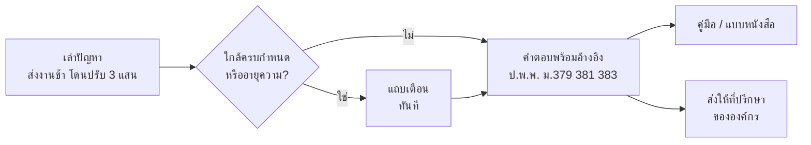

# BRD — นิติมิตร (Legal Consult TH)

เอกสารความต้องการทางธุรกิจ · ฉบับ 1.2 · 1 ต.ค. 2569 (ปรับให้ตรงกับระบบที่สร้างจริง)

## 1. บทสรุปผู้บริหาร

นิติมิตรคือผู้ช่วยข้อมูลกฎหมายสำหรับองค์กรและบุคคล โดยเฟสแรกเน้น **องค์กรธุรกิจขนาดเล็กถึงกลางที่ไม่มีฝ่ายกฎหมาย** ช่วยให้เข้าใจสัญญาทางการค้าก่อนเซ็น และรับมือเมื่อคู่สัญญาผิดสัญญาได้ถูกขั้นตอน คำตอบที่มาจากคลังความรู้ของระบบอ้างอิงตัวบทกฎหมายที่คลิกดูต้นฉบับได้ (คำตอบที่มาจากบริการฐานความรู้ของบริษัทในระบบทดสอบไม่มีรายการอ้างอิง)

ปัญหาที่เฟสแรกแก้คือสัญญาที่เสียเปรียบตั้งแต่ต้นหรือไม่รัดกุมพอ ซึ่งมักแสดงผลเป็น 3 รูปแบบ:
1. โดนค่าปรับส่งมอบงานล่าช้าในอัตราสูง
2. ซัพพลายเออร์ส่งสินค้าไม่ได้มาตรฐาน แต่สัญญาไม่มีข้อให้เลิกสัญญา
3. ถูกคู่สัญญาบอกเลิกสัญญากะทันหันกลางงาน

ระบบรวม 4 อย่างไว้ในที่เดียว: **พื้นที่ทำงานขององค์กร**, **ถาม-ตอบ** เรื่องสัญญาด้วยภาษาของผู้ใช้เอง โดยตอบจากคลังความรู้ที่ผู้ตรวจเนื้อหาดูแล, **รับสัญญาขององค์กร** อ่านและแยกเป็นข้อ พร้อมตรวจรายข้อ และ **เครื่องมือลงมือทำ** เช่น คู่มือส่งหนังสือบอกกล่าว และแบบหนังสือเกี่ยวกับสัญญา

เฟสแรกใช้เวลาประมาณ 14 สัปดาห์หลังเริ่มโครงการ และเริ่มใช้งานจริงแบบ **pilot กับองค์กรนำร่อง 3–5 แห่ง** ในวันที่ 12 ม.ค. 2570

**สิ่งที่ขออนุมัติ:** ขอบเขตเฟสแรกตามเอกสารนี้, การจัดหานักกฎหมายผู้ตรวจเนื้อหาอย่างน้อย 1 คน, การคัดเลือกองค์กรนำร่อง และการตัดสินใจในหัวข้อ 12

**สถานะระบบทดสอบ (1 ต.ค. 2569):** เนื้อหาในคลังความรู้ทั้ง 43 ชิ้นยังเป็นฉบับร่างที่ยังไม่ผ่านผู้ตรวจเนื้อหา ระบบทดสอบจึงแสดงป้าย "ฉบับร่าง" ที่หน้าและการ์ดทุกจุด และหน้าความรู้ทั้งหมดต้องล็อกอินก่อนเปิด

ภาพหน้าจอที่คลิกได้: `docs/prototype/index.html` (เปิดในเบราว์เซอร์)

## 2. ปัญหาและโอกาสทางธุรกิจ

องค์กรจำนวนมากเซ็นสัญญาทางการค้าเป็นประจำ แต่ไม่มีคนตรวจสัญญา และไม่รู้สิทธิของตัวเองเมื่อเกิดข้อพิพาท

| ปัญหา | ผลกระทบต่อองค์กร | นิติมิตรแก้อย่างไร |
| --- | --- | --- |
| เซ็นสัญญาที่เสียเปรียบหรือไม่รัดกุม เพราะไม่มีคนตรวจ | เสียเงินค่าปรับ เลิกสัญญาไม่ได้ หรือเรียกค่างานคืนไม่ได้ | บทความและตัวบทเรื่องข้อสัญญาที่ไม่เป็นธรรม และรับสัญญาขององค์กรมาแยกเป็นข้อเพื่ออ่านเทียบ |
| ไม่รู้ว่าเมื่อคู่สัญญาผิดสัญญาต้องทำอะไรก่อนหลัง | ทำผิดขั้นตอนจนเสียสิทธิ เช่น รับมอบงานโดยไม่สงวนสิทธิ หรือปล่อยให้หมดอายุความ | แชทตอบพร้อมอ้างอิงมาตรา คู่มือทีละขั้น และแบบหนังสือ |
| ให้ทนายตรวจทุกสัญญามีต้นทุนสูงและช้า | เรื่องเล็กไม่คุ้มจ้างทนาย เรื่องใหญ่ส่งทนายช้า | ให้ข้อมูลทั่วไปเบื้องต้นจากคลังความรู้ แล้วส่งเรื่องที่ซับซ้อนให้ที่ปรึกษากฎหมายขององค์กรพร้อมบริบท |
| ข้อมูลกฎหมายออนไลน์มีทั้งถูก ผิด และล้าสมัย | ตัดสินใจจากข้อมูลผิด | ทุกข้อความทางกฎหมายต้องอ้างตัวบทที่มีวันที่ของข้อมูลกำกับ |

**โอกาส:** ตัวบทกฎหมายและความรู้ที่ผู้ตรวจเนื้อหาอนุมัติแล้วนำมาสร้างคลังความรู้ที่ค้นหาและอ้างอิงได้ในวงกว้างด้วยต้นทุนต่ำ (ยังต้องเคารพเงื่อนไขการใช้งานของแต่ละแหล่ง และให้ที่ปรึกษากฎหมายยืนยันประเด็นลิขสิทธิ์)

## 3. วัตถุประสงค์และตัวชี้วัดความสำเร็จ

เป้าหมายคือให้องค์กรนำร่องใช้งานจริงอย่างต่อเนื่อง และได้คำตอบที่ถูกต้องตรวจสอบได้ ตัวเลขด้านล่างเป็นเป้าหมาย

| วัตถุประสงค์ | ตัวชี้วัด | เป้าหมาย |
| --- | --- | --- |
| องค์กรนำร่องใช้งานจริง | องค์กรที่มีผู้ใช้ active ทุกสัปดาห์ | ≥ 3 จาก 3–5 องค์กร ภายใน 3 เดือนหลังเริ่ม pilot |
| คำตอบน่าเชื่อถือ | การอ้างอิงตัวบทตรงกับเนื้อหาที่ตอบ | ≥ 95% |
| ไม่แต่งข้อมูลกฎหมาย | สัดส่วนคำตอบที่อ้างมาตราที่ไม่มีอยู่จริงในคลังความรู้ | ≤ 0.5% |
| ผู้ใช้พึงพอใจ | คำตอบที่ได้คะแนนบวก จากที่ผู้ใช้ให้ feedback | ≥ 80% |
| ตอบเร็ว | เวลาจนคำตอบเริ่มแสดง (95% ของคำถาม) | ≤ 3 วินาที |
| ระบบพร้อมใช้ | เวลาที่ระบบใช้งานได้ต่อเดือน | ≥ 99.5% |

## 4. ขอบเขตโครงการ

ระบบให้ "ข้อมูลกฎหมายทั่วไป" ไม่ใช่สำนักงานกฎหมาย และไม่เป็นตัวแทนผู้ใช้ต่อศาล

**ในขอบเขตเฟส 1 (pilot องค์กร)**

- กฎหมายสัญญาทางการค้าของไทย: หนี้และการผิดนัด, สัญญา มัดจำ เบี้ยปรับ การเลิกสัญญา, ซื้อขายและความชำรุดบกพร่อง, จ้างทำของ, อายุความของสิทธิเรียกร้องตามสัญญา, ค่าเสียหายและดอกเบี้ยผิดนัด, ข้อสัญญาที่ไม่เป็นธรรม, ศาลที่อาจยื่นฟ้องได้
- พื้นที่ทำงานขององค์กร (สมาชิก สิทธิ์ การแชร์ภายใน)
- รับสัญญาไฟล์ PDF/DOCX ที่มีข้อความ อ่านและแยกเป็นข้อ และตรวจรายข้อ (ตัวเลือกการตรวจตั้งค่าได้: ผลจำลองสำหรับทดสอบระบบ, API ตรวจสัญญา หรือถามฐานความรู้กฎหมายของบริษัททีละข้อ)
- ภาษาไทยเป็นหลัก และภาษาอังกฤษ; ใช้งานผ่านเว็บบนคอมพิวเตอร์และมือถือ
- ระบบหลังบ้านสำหรับทีมเนื้อหาและผู้ตรวจเนื้อหา

**นอกขอบเขต**

- การว่าความ หรือเป็นตัวแทนผู้ใช้ในศาล
- การร่างคำฟ้องหรือคำให้การแทนผู้ใช้ และการยื่นเอกสารเข้าระบบศาลแทน
- การรับประกันผลคดี หรือรับรองว่าสัญญาไม่มีความเสี่ยง
- กฎหมายต่างประเทศ
- ตลาดจ้างทนายที่มีการชำระเงินผ่านระบบ

## 5. กลุ่มลูกค้าและผู้ใช้

**กลุ่มลูกค้าและทิศทาง**

| กลุ่มลูกค้า | เฟส | สิ่งที่ต้องการ | สิ่งที่นิติมิตรให้ |
| --- | --- | --- | --- |
| SME – ขนาดกลาง ที่ไม่มีหรือมีฝ่ายกฎหมายเล็ก | 1 | เข้าใจสัญญาก่อนเซ็น รับมือการผิดสัญญา ส่งหนังสือที่ถูกต้อง | พื้นที่ทำงานองค์กร รับสัญญา/อ่าน/แยกข้อ แชท คู่มือ แบบหนังสือ |
| บุคคลทั่วไป | 1 (จำกัด) | เข้าใจสิทธิ ลงมือทำเรื่องของตัวเอง | ใช้ฟรีตามโควตา |

**ผู้ใช้และสิทธิ์**

| กลุ่ม | ใคร | ทำอะไรได้ |
| --- | --- | --- |
| เจ้าของ/ผู้ดูแลองค์กร | ผู้บริหารหรือผู้รับผิดชอบระบบขององค์กร | เชิญสมาชิก (ฟอร์มเชิญแสดงเมื่อมีอีเมลจริง) กำหนดสิทธิ์ ตั้งค่าการเก็บข้อมูล ดูการใช้งาน |
| สมาชิกองค์กร | พนักงานที่ทำงานกับสัญญา | ถามคำถาม อัปโหลดสัญญา แชร์เรื่องภายในองค์กร |
| ที่ปรึกษากฎหมายขององค์กร | นิติกรหรือทนายขององค์กร (ถ้ามี) | รับเรื่องที่ทีมส่งต่อและตอบกลับ |
| ผู้ทดลองใช้ / สมาชิกทั่วไป | บุคคลทั่วไป | ถามได้ตามโควตา (10 / 100 ข้อต่อวัน) |
| ทีมเนื้อหา | ผู้เขียนบทความและคู่มือ | เขียนและแก้เนื้อหา นำเข้าตัวบท (เผยแพร่เองไม่ได้) |
| ผู้ตรวจเนื้อหา | ต้องเป็นนักกฎหมายที่มีคุณสมบัติก่อนเปิดใช้งาน | อนุมัติเนื้อหา ตรวจคำตอบที่ถูกรายงาน |
| ผู้ดูแลระบบ | ทีมปฏิบัติการ | จัดการผู้ใช้ โควตา log การตรวจสอบ ประกาศระบบ และสวิตช์ฉุกเฉิน |

**Persona**

| Persona | สถานการณ์ | สิ่งที่ต้องการ |
| --- | --- | --- |
| คุณวิทย์, 42, เจ้าของบริษัทรับเหมาตกแต่งภายใน (SME) | เจอทั้ง 3 รูปแบบของการผิดสัญญา | รู้ว่าต้องจ่ายค่าปรับเต็มไหม ทำอย่างไรกับซัพพลายเออร์ เรียกค่างานที่ทำไปแล้ว |
| คุณพร, 38, ผู้จัดการฝ่ายจัดซื้อ บริษัทผลิตขนาดกลาง | สัญญาซื้อวัตถุดิบหลายราย | รู้สิทธิเมื่อของชำรุด อ่านบทความและคู่มือเรื่องซื้อขายและความชำรุดบกพร่อง |
| คุณเอ, 35, นิติกรคนเดียวของบริษัท | ต้องตรวจทุกสัญญาของบริษัท | รับเรื่องจากทีมพร้อมบริบท |
| บุคคลทั่วไป (กลุ่มรอง) | ถูกเลิกจ้าง ซื้อของออนไลน์ ทำพินัยกรรม ฯลฯ | สถานการณ์เหล่านี้ส่วนใหญ่อยู่นอกขอบเขตเนื้อหาปัจจุบัน ระบบจะแจ้งว่ายังไม่ครอบคลุม |

## 6. ความต้องการทางธุรกิจ

เฟสแรกต้องมีความสามารถหลักที่ระบุ "ต้องมี · เฟส 1" ด้านล่าง ข้อกำหนดละเอียดพร้อมเกณฑ์ตรวจรับอยู่ใน SRS (`docs/02-srs.md`) ตามรหัสในคอลัมน์สุดท้าย

| รหัส | ความต้องการ | ความสำคัญ | เฟส | อ้างอิง SRS |
| --- | --- | --- | --- | --- |
| R-01 | ใช้งานได้ทันทีโดยไม่ต้องสมัคร และย้ายประวัติเข้าบัญชีได้เมื่อสมัครภายหลัง | ต้องมี | 1 | FR-AUTH |
| R-02 | สมัครสมาชิก ให้ความยินยอม PDPA แยกตามวัตถุประสงค์ ขอดาวน์โหลดหรือลบข้อมูลของตัวเองได้ | ต้องมี | 1 | FR-AUTH |
| R-03 | ถามด้วยภาษาของตัวเอง ได้คำตอบทันทีตามโครง: สรุป · สิทธิ · ขั้นตอน · เอกสาร · ระยะเวลา · เมื่อไรควรหาทนาย | ต้องมี | 1 | FR-CHAT, FR-AI |
| R-04 | คำตอบจากคลังความรู้มีแหล่งอ้างอิงที่คลิกดูตัวบทได้ ทุกคำตอบมีวันที่ของข้อมูลและข้อความแจ้งว่าเป็นข้อมูลทั่วไป (คำตอบที่มาจากบริการฐานความรู้ของบริษัทไม่มีรายการอ้างอิง) | ต้องมี | 1 | FR-AI |
| R-05 | เสนอคำถามต่อและขั้นตอนถัดไป (คู่มือ แบบหนังสือ) ใต้คำตอบ | ต้องมี | 1 | FR-AI |
| R-06 | ตรวจจับเรื่องเร่งด่วน เช่น ใกล้หมดอายุความ ใกล้ครบกำหนดตามสัญญา หรือกรณีอันตราย แล้วแสดงกรอบเตือนทันที | ต้องมี | 1 | FR-AI |
| R-07 | จัดการประวัติแชท (โฟลเดอร์ ปักหมุด เปลี่ยนชื่อ ลบ ค้นหา) และแชร์แชทแบบอ่านอย่างเดียว | ต้องมี | 1 | FR-CHAT |
| R-08 | ผู้ใช้ให้คะแนนคำตอบพร้อมเหตุผล และคำตอบที่ถูกติส่งเข้าคิวให้ผู้ตรวจเนื้อหา | ต้องมี | 1 | FR-CHAT, FR-ADM |
| R-10 | คลังความรู้: เฟส 1 เฉพาะกฎหมายสัญญา (ตัวบท บทความ อภิธานศัพท์ ค้นด้วยเลขมาตราได้) | ต้องมี | 1 | FR-KB |
| R-12 | คู่มือทีละขั้นด้านสัญญา 5 เรื่อง (บอกกล่าวแล้วเลิกสัญญา, สงวนสิทธิเมื่อรับมอบงาน, รับมือค่าปรับ, แจ้งความชำรุดบกพร่อง, เรียกร้องเมื่อถูกเลิกสัญญา) | ต้องมี | 1 | FR-GUIDE |
| R-13 | แบบหนังสือแบบกรอกทีละคำถาม ดาวน์โหลดเป็น DOCX/PDF | ต้องมี | 1 | FR-TPL |
| R-17 | ระบบหลังบ้าน: เขียน ตรวจ อนุมัติเนื้อหา นำเข้าตัวบท คิว feedback และจัดการผู้ใช้ | ต้องมี | 1 | FR-ADM |
| R-20 | พื้นที่ทำงานองค์กร: สร้างองค์กร เชิญสมาชิก (ฟอร์มเชิญแสดงเมื่อมีอีเมลจริง) กำหนดสิทธิ์ แชร์ภายในองค์กร โควตาและ audit log รายองค์กร | ต้องมี | 1 | FR-ORG |
| R-21 | รับสัญญา: อัปโหลด PDF/DOCX สแกนไวรัส เข้ารหัส อ่านข้อความและแยกเป็นข้อ ลบหรือให้ระบบลบตามระยะเก็บขององค์กร | ต้องมี | 1 | FR-CR |
| R-23 | ตรวจสัญญารายข้อ พร้อมข้อความกำกับว่าเป็นข้อมูลทั่วไป — ตัวเลือกผลจำลอง/API ตรวจสัญญาให้ระดับความเสี่ยงต่อข้อและสรุปสาระสำคัญ (คู่สัญญา ระยะเวลา การชำระเงิน การเลิกสัญญา ค่าปรับ กฎหมายที่ใช้บังคับ) ส่วนตัวเลือกถามฐานความรู้กฎหมายของบริษัท (ที่ใช้อยู่บนระบบทดสอบ) ให้การ์ดต่อข้อที่มี "ความเสี่ยง:" และ "วิธีแก้ไข:" เป็นข้อความเบื้องต้น ไม่มีระดับความเสี่ยงและไม่มีแหล่งอ้างอิง | ต้องมี | 1 | FR-CR |
| R-22 | แบบหนังสือเกี่ยวกับสัญญา 5 แบบ (บอกกล่าวให้แก้ไข, บอกเลิกสัญญา, สงวนสิทธิ, โต้แย้งการหักค่าปรับ, แจ้งความชำรุดบกพร่อง) | ต้องมี | 1 | FR-TPL |

## 7. ตัวอย่างการใช้งานหลัก

ทุกเส้นทางจบด้วย "สิ่งที่ทำต่อได้จริง" เส้นทางหลักคือองค์กรที่ถูกคู่สัญญาหักค่าปรับ

แผนภาพนี้คือเส้นทางหลัก (J1) ส่วนเส้นทางอื่นสรุปไว้ในตาราง

| เส้นทาง | เริ่มจาก | ผลลัพธ์ที่ผู้ใช้ได้ |
| --- | --- | --- |
| J7 เก็บสัญญาและดูข้อสัญญา | อัปโหลดสัญญา | ข้อสัญญาแยกตามเลข "ข้อ" พร้อมหน้าและชื่อคู่สัญญาที่ตรวจพบ |
| J3 บอกกล่าวแล้วเลิกสัญญา | ซัพพลายเออร์ส่งของไม่ได้มาตรฐาน | ตรวจเงื่อนไข เตรียมหลักฐาน ส่งหนังสือบอกกล่าว แล้วบอกเลิกสัญญาถ้าไม่แก้ไข |
| J5 ตรวจเนื้อหา (ทีมภายใน) | ทีมเนื้อหาส่งร่าง | ระบบตรวจเบื้องต้น ผู้ตรวจเนื้อหาอนุมัติ แล้วระบบใช้เนื้อหาใหม่ตอบได้ทันที |
| J6 ปรับปรุงคำตอบ | ผู้ใช้กดไม่พอใจคำตอบ | ผู้ตรวจเนื้อหาคัดแยกสาเหตุ และระบุคำตอบที่ถูกต้อง |

## 8. ข้อกำหนดด้านกฎหมาย จริยธรรม ความปลอดภัย และ PDPA

ข้อกำหนดชุดนี้เป็นเงื่อนไขบังคับก่อนเปิดใช้งาน ไม่สามารถลดทอนเพื่อเร่งกำหนดการ

**ขอบเขตวิชาชีพกฎหมาย**

- ระบบให้ข้อมูลกฎหมายทั่วไป ไม่ใช่คำปรึกษาเฉพาะคดี เพื่อไม่ขัดต่อ พ.ร.บ.ทนายความ พ.ศ. 2528 (มาตราที่เกี่ยวข้องให้ที่ปรึกษากฎหมายยืนยัน)
- ไม่ร่างคำฟ้องแทนผู้ใช้
- ไม่ฟันธงผลคดี และแนะนำให้ส่งเรื่องให้ที่ปรึกษากฎหมายหรือทนายเมื่อเรื่องมีความเสี่ยงสูง
- แสดงข้อความแจ้งเตือน 3 จุด: ตอนสมัคร (ข้อกำหนดการใช้งาน), ท้ายหน้าจอทุกหน้า, และทุกคำตอบ

**ความถูกต้องของเนื้อหา**

- ระบบห้ามแต่งเลขมาตราหรือตัวเลขทางกฎหมาย คำตอบดึงจากคลังความรู้เท่านั้น และมาตราที่อ้างมาจากตัวบทที่มีอยู่จริงในคลัง
- ทุกข้อความทางกฎหมายต้องอ้างแหล่งในคลังความรู้ ข้อความที่ไม่มีแหล่งรองรับต้องไม่แสดง
- เนื้อหาต้องผ่านผู้ตรวจเนื้อหาก่อนเผยแพร่ และทบทวนทุก 6–12 เดือน
- ข้อความในระบบห้ามอ้างว่าผ่านการตรวจหรือรับรองใดที่ยังไม่เกิดขึ้นจริง
- ตัวบทกฎหมายเก็บทุกฉบับตามวันที่มีผลบังคับ ไม่ลบฉบับเก่า

**ข้อมูลขององค์กรและข้อมูลส่วนบุคคล (PDPA)**

- แยกข้อมูลรายองค์กรอย่างเด็ดขาด องค์กรหนึ่งเห็นข้อมูลของอีกองค์กรไม่ได้
- สัญญาที่องค์กรอัปโหลด: องค์กรเป็นผู้ควบคุมข้อมูล ผู้ให้บริการเป็นผู้ประมวลผล ต้องมีสัญญาประมวลผลข้อมูล (DPA)
- ไม่นำสัญญาหรือข้อมูลของลูกค้าไปใช้นอกวัตถุประสงค์ของบริการ; เก็บไฟล์แบบเข้ารหัส; องค์กรตั้งระยะเวลาเก็บและสั่งลบได้
- ปิดบังเลขบัตรประชาชน เบอร์โทร เลขบัญชี อีเมล ก่อนค้นหาและก่อนบันทึก log; ข้อความที่ผู้ใช้พิมพ์ไม่ถูกส่งออกนอกระบบ ยกเว้นเมื่อเปิดใช้ API ฐานความรู้ของบริษัท (ปิดโดยปริยาย และไม่ใช้กับแชทในพื้นที่องค์กรเว้นแต่ตั้งค่าเปิดไว้) และเมื่อเลือกตัวเลือกตรวจสัญญาแบบถามฐานความรู้ของบริษัท (ส่งเฉพาะข้อความรายข้อที่ปิดบังข้อมูลส่วนบุคคลแล้ว) ซึ่งต้องแจ้งในประกาศความเป็นส่วนตัว
- ผู้ใช้ขอดู แก้ ดาวน์โหลด หรือลบข้อมูลได้ ระบบดำเนินการภายใน 30 วัน
- มีแผนแจ้งเหตุข้อมูลรั่วไหลต่อสำนักงานคณะกรรมการคุ้มครองข้อมูลส่วนบุคคลภายใน 72 ชั่วโมง

**ความปลอดภัยของระบบ**

- บัญชีทีมงานต้องยืนยันตัวตน 2 ขั้นตอน และมีบันทึกการเข้าถึงข้อมูล
- ทดสอบการแยกข้อมูลรายองค์กรอัตโนมัติทุกครั้งที่แก้ระบบ
- ทดสอบเจาะระบบ (penetration test) และทดสอบรับโหลดก่อนเริ่ม pilot

## 9. แผนดำเนินงานและทีมงาน

เริ่มโครงการ 5 ต.ค. 2569 ทำงานเป็นรอบละ 2 สัปดาห์ เริ่ม pilot กับองค์กรนำร่อง (เฟส 1) ประมาณ 14 สัปดาห์

| วันที่ | หมุดหมาย | สิ่งที่ได้ |
| --- | --- | --- |
| 16 ต.ค. 2569 | M0 วางฐานระบบ | เข้าสู่ระบบ หน้าแชทว่าง และโครงองค์กรบนเซิร์ฟเวอร์ทดสอบ |
| 13 พ.ย. 2569 | M1 ทดสอบภายใน (Alpha) | แชทเรื่องสัญญาตอบพร้อมอ้างอิงตัวบท ความแม่นยำการอ้างอิง ≥ 90% |
| 25 ธ.ค. 2569 | M2 ปิดรับฟีเจอร์เฟส 1 | ครบความสามารถ "ต้องมี · เฟส 1" ผ่าน pen test และทดสอบรับโหลด |
| 8 ม.ค. 2570 | ประชุม Go/No-Go | ตัดสินใจเริ่ม pilot จากผลทดสอบกับผู้ใช้จริงและเกณฑ์คุณภาพ |
| 12 ม.ค. 2570 | M3 เริ่ม pilot องค์กร | องค์กรนำร่อง 3–5 แห่ง พร้อมเนื้อหากฎหมายสัญญา |

**ทีมงานที่ต้องใช้ (ประมาณ 8.5 คน)**

| บทบาท | จำนวน | หน้าที่หลัก |
| --- | --- | --- |
| Product Owner | 1 | กำหนดลำดับงาน ตรวจรับผลงาน |
| นักกฎหมายผู้ตรวจเนื้อหา | 0.5 → 1 | ตรวจเนื้อหาและคำตอบที่ถูกรายงาน (เต็มเวลาตั้งแต่เดือนที่ 2) |
| นักพัฒนาเว็บ | 2 | หน้าจอ พื้นที่ทำงานองค์กร และระบบหลังบ้าน |
| นักพัฒนา AI service | 1 | ระบบค้นคืนตัวบท คำตอบจากคลังความรู้ การอ่านสัญญา และชุดทดสอบคุณภาพ |
| QA | 1 | ทดสอบระบบและทดสอบกับผู้ใช้ |
| DevOps | 0.5 | เซิร์ฟเวอร์ การสำรองข้อมูล การเฝ้าระวัง |
| ผู้เขียนเนื้อหา | 1 | บทความ คู่มือ แบบหนังสือ และนำเข้าตัวบท |
| Customer Success | 1 | คัดเลือกและดูแลองค์กรนำร่อง เก็บ feedback |

## 10. สมมติฐาน ข้อจำกัด และสิ่งที่ต้องพึ่งพา

แผนงานข้างต้นเดินได้เมื่อได้สิ่งที่ต้องพึ่งพาครบตามกำหนด โดยเฉพาะนักกฎหมายผู้ตรวจเนื้อหาและองค์กรนำร่อง

**สมมติฐาน**

- pilot ไม่มีค่าใช้จ่ายสำหรับองค์กรนำร่อง; แพ็กเกจรายองค์กรกำหนดก่อนจบ pilot
- ผู้ใช้ส่วนใหญ่ใช้ภาษาไทย และสัญญาส่วนใหญ่เป็นไฟล์ที่มีข้อความ (ไม่ใช่ภาพสแกน)
- ตัวบทกฎหมายจากแหล่งทางการนำมาใช้ได้ตามเงื่อนไขของแต่ละแหล่ง

**ข้อจำกัด**

- ระบบให้ได้เฉพาะข้อมูลทั่วไป ตามขอบเขตในหัวข้อ 8
- เฟส 1 ตอบได้เฉพาะกฎหมายสัญญา เรื่องที่ไม่มีเนื้อหารองรับ ระบบจะตอบว่ายังไม่พบข้อมูลในคลังความรู้ และไม่เดาคำตอบ
- ไฟล์สัญญาที่เป็นภาพสแกนยังอ่านไม่ได้
- ฐานข้อมูลและไฟล์สัญญาเก็บในประเทศไทย

**สิ่งที่ต้องพึ่งพา**

| สิ่งที่ต้องได้ | ต้องได้ภายใน |
| --- | --- |
| นักกฎหมายผู้ตรวจเนื้อหาอย่างน้อย 1 คน | รอบทำงานแรก (ต.ค. 2569) |
| องค์กรนำร่อง 3–5 แห่งที่ตกลงร่วม pilot | ปลาย พ.ย. 2569 |
| ที่ปรึกษากฎหมายตรวจข้อกำหนดการใช้งาน ประกาศความเป็นส่วนตัว และร่าง DPA | ปลาย พ.ย. 2569 |
| เซิร์ฟเวอร์ production แยก (พร้อมโดเมน HTTPS) และเซิร์ฟเวอร์ส่งอีเมล (SMTP) จริง | รอบทำงานแรก |
| ตัวบทกฎหมายสัญญาฉบับปัจจุบันจากแหล่งทางการ (ตรวจเทียบการแก้ไขล่าสุด) | กลาง ต.ค. 2569 |

## 11. ความเสี่ยงและแนวทางลดความเสี่ยง

ความเสี่ยงสูงสุดคือระบบตอบผิดหรือเนื้อหาล้าสมัยแล้วองค์กรเชื่อ จึงมีการควบคุมหลายชั้นและเกณฑ์คุณภาพก่อนเริ่ม pilot

| ความเสี่ยง | ผลกระทบ | แนวทางลดความเสี่ยง |
| --- | --- | --- |
| ตอบผิดหรืออ้างมาตราผิด | ผู้ใช้เสียหาย ความน่าเชื่อถือลดลง | ตอบจากเนื้อหาที่ตรวจแล้วเท่านั้น มาตราที่อ้างมาจากตัวบทในคลัง มีชุดทดสอบที่ต้องผ่านทุกครั้งที่แก้ระบบ และผู้ตรวจเนื้อหาตรวจคำตอบที่ถูกติ |
| ข้อมูลรั่วข้ามองค์กร | สูญเสียลูกค้า ผิด PDPA และสัญญา | แยกข้อมูลรายองค์กรทุกคำสั่งค้นข้อมูล ทดสอบอัตโนมัติ เข้ารหัสไฟล์ บันทึกการเข้าถึง |
| กฎหมายเปลี่ยน ข้อมูลล้าสมัย | คำตอบไม่ถูกต้องตามกฎหมายปัจจุบัน | เก็บตัวบททุกฉบับตามวันที่มีผล แสดงวันที่ของข้อมูลทุกคำตอบ และรอบทบทวนเนื้อหา |
| ถูกมองว่าประกอบวิชาชีพทนายความโดยไม่มีใบอนุญาต | ความเสี่ยงทางกฎหมายของผู้ให้บริการ | จำกัดขอบเขตเป็นข้อมูลทั่วไป ไม่ร่างคำฟ้อง และให้ที่ปรึกษากฎหมายตรวจข้อกำหนดการใช้งาน |
| หาองค์กรนำร่องหรือนักกฎหมายผู้ตรวจไม่ได้ตามกำหนด | pilot เลื่อน | สรรหาตั้งแต่รอบทำงานแรก และเริ่ม pilot กับองค์กรที่พร้อมก่อน |

## 12. เรื่องที่ต้องตัดสินใจและการอนุมัติ

ขอให้ผู้บริหารตัดสินใจเรื่องเหล่านี้ก่อน 9 ต.ค. 2569 ถ้าไม่มีความเห็นแย้ง ทีมจะใช้ข้อเสนอในตาราง

| เรื่อง | ข้อเสนอของทีม |
| --- | --- |
| D1 ชื่อผลิตภัณฑ์และแบรนด์ | ใช้ "นิติมิตร" ชั่วคราว และสีหลักน้ำเงินแบบเดียวกับ AI-EDW |
| D2 ให้บุคคลทั่วไปใช้งานโดยไม่สมัครได้หรือไม่ | ให้ได้ 10 คำถามต่อวัน |
| D4 ที่ตั้งเซิร์ฟเวอร์ | เซิร์ฟเวอร์ของบริษัท ฐานข้อมูลอยู่ในประเทศไทย |
| D5 นักกฎหมายผู้ตรวจเนื้อหาและที่ปรึกษากฎหมายโครงการ | อย่างน้อย 1 คนก่อนเริ่มงาน (เงื่อนไขบังคับ) |
| D6 โมเดลธุรกิจ | องค์กรก่อน: pilot ไม่มีค่าใช้จ่าย; บุคคลทั่วไปใช้ฟรีตามโควตา |
| D7 ราคาและแพ็กเกจองค์กร | ยังไม่กำหนด — สรุปก่อนจบ pilot |
| D8 แบบ DPA สำหรับองค์กร | ให้ที่ปรึกษากฎหมายร่างก่อนเริ่ม pilot |
| D9 องค์กรนำร่องต้องมีที่ปรึกษากฎหมายภายในหรือไม่ | ไม่บังคับ; ถ้าไม่มี แนะนำให้ปรึกษาทนายความ |

**การอนุมัติเอกสาร**

- [ ] ผู้บริหารโครงการ (Sponsor) — อนุมัติขอบเขตและงบประมาณ
- [ ] Product Owner — ยืนยันความต้องการและลำดับความสำคัญในหัวข้อ 6
- [ ] ที่ปรึกษากฎหมาย — ยืนยันขอบเขตวิชาชีพ ข้อกำหนด PDPA และ DPA ในหัวข้อ 8
- [ ] หัวหน้าทีมพัฒนา — ยืนยันแผนงานและทีมในหัวข้อ 9
